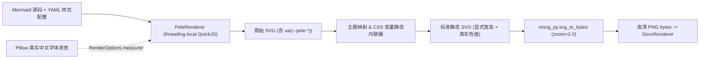

# Mermaid 转换模块替换开发计划（`obsidianmd/pele` 内置引擎方案）

- **日期**：2026-11-06
- **状态**：待确认（确认后进入编码实施）
- **目标模块**：`md2docx/mermaid_converter.py` 及关联配置、GUI 选项、Nuitka 打包管线

---

## 一、背景与改造目标

### 1. 现状痛点
当前项目通过 [`MermaidConverter`](../md2docx/mermaid_converter.py) 调用外部 npm 包 `@mermaid-js/mermaid-cli`（`mmdc`）将 Mermaid 代码块转换为 PNG 图片插入 Word：
1. **外部环境强依赖**：无法打入 Nuitka 独立应用包，要求用户本机额外安装 Node.js 与 Puppeteer/Chromium（约 300MB+），在 macOS Finder 启动环境下还需维护复杂的 NVM/Volta 路径探测（[`external_tools.py`](../md2docx/external_tools.py)）。
2. **冷启动耗时长**：每张未命中缓存的流程图均需拉起一次独立 Node + Headless Chromium 子进程（单图约 1.5s～3.0s，90 张图的业务文档首次转换需 2～4 分钟）。

### 2. 改造目标
采用 **`obsidianmd/pele` + `quickjs-ng` + `resvg-py`** 构建**进程内、零外部依赖的高清 PNG 渲染管线**：
- **彻底去除外部依赖**：打包后的 macOS `Md2docx.app` 与 Windows `.exe` 开箱即用，用户电脑无需安装 Node.js、`mmdc` 或 Chromium。
- **百倍性能提升**：单图冷渲染耗时从秒级降至毫秒级（90 张中文流程图全量冷渲染目标 `< 2s`）。
- **100% 交付兼容**：继续输出高清 PNG 字节流（放弃 Word 原生纯 SVG 直插方案，规避 Word SVG 引擎不支持 `var()`/`dominant-baseline`/`<marker>` 导致的黑块、文字偏上、丢箭头及旧版 WPS/兼容模式白屏风险）。
- **平滑双引擎并存**：新增 `mermaid.engine: pele | mmdc`（默认 `pele`），完整保留原有 `mmdc` 分支作为可选兼容后端。

---

## 二、影响面评估（GitNexus 静态分析与源码核验）

基于 GitNexus 图谱检索与源码逐行核验，`MermaidConverter` 封装边界非常清晰，**上游影响风险为 LOW（改动高度收敛）**：

| 层级 | 涉及文件 / 符号 | 是否需要修改 | 说明 |
| :--- | :--- | :---: | :--- |
| **核心转换层** | `md2docx/pele_renderer.py`（新增） | **新增** | 封装 `pele` JS 执行、中文字宽测量、CSS 变量展开与 `resvg-py` 转 PNG |
| **核心转换层** | `md2docx/mermaid_converter.py` (`MermaidConverter`) | **修改** | 新增 `engine` 分发逻辑（`pele` / `mmdc`）、可用性检查与缓存键隔离 |
| **渲染调用方** | `md2docx/renderer.py` (`DocxRenderer.__init__`) | **微调** | 初始化 `MermaidConverter` 时透传 `engine=mermaid_style.get("engine", "pele")` |
| **排版与插图** | `md2docx/renderer.py` (`block_code`, `_calculate_mermaid_layout`, `_add_block_image`) | **零改动** | 继续消费 `mermaid_to_image(code) -> bytes` 返回的 PNG，宽高比与分页逻辑完全不变 |
| **错误统计层** | `md2docx/converter.py` (`Converter.mermaid_report`), `MermaidReport` | **零改动** | 保持异常链提取与 CLI 退出码 `2` / GUI `Warning` 汇总机制不变 |
| **默认配置层** | `md2docx/styles.py`, `md2docx/templates/default.yaml` | **微调** | `mermaid` 配置块补充 `engine: pele` |
| **桌面界面层** | `md2docx/gui.py` | **微调** | Mermaid 设置页新增“渲染引擎 (`engine`)”只读下拉框与提示文案 |
| **构建打包层** | `pyproject.toml`, `scripts/build_nuitka.py`, `docs/NUITKA_BUILD.md` | **修改** | 引入依赖、打包 `pele.global.js` 静态资源并在 `verify_macos_app` 中增加构建产物校验 |

---

## 三、核心技术方案设计

### 1. 渲染数据流架构

### 2. 五个关键工程细节设计

1. **静态资源内嵌与版本锁定**
   - 下载并锁定 npm 官方发布的 `pele@1.x` 零依赖浏览器全局包 `dist/pele.global.js` 及其 MIT `LICENSE`，存放于 `md2docx/vendor/pele/`。
   - 运行时通过 `pkgutil.get_data("md2docx", "vendor/pele/pele.global.js")` 读取（与现有 `StyleManager._load_packaged_template` 完全一致），天然兼容源码运行、Nuitka `standalone/app` 与 `onefile` 模式。

2. **线程安全的嵌入式 JS 上下文（`quickjs-ng`）**
   - 桌面端 GUI 在后台 `threading.Thread` 中执行转换（`gui.py:_do_conversion`），而 QuickJS 的 `Context` 绑定创建线程、不可跨线程调用。
   - 采用 `threading.local()` 为每个工作线程懒加载并缓存独立的 QuickJS `Context`：`pele.global.js` 在单线程生命周期内仅初始化解析一次，同篇文档连续转换 90 张图直接复用该上下文，消除重复加载开销。

3. **中文字体定位与 `TextMeasurer` 精准对齐**
   - **字体定位（进程级缓存）**：按平台探测可用中文字体文件路径：
     - macOS：优先 `/System/Library/Fonts/PingFang.ttc`、`/Library/Fonts/Microsoft/Microsoft YaHei.ttf`、`/System/Library/Fonts/STHeiti Medium.ttc`；
     - Windows：优先 `C:\Windows\Fonts\msyh.ttc`（微软雅黑）、`C:\Windows\Fonts\simhei.ttf`（黑体）、`C:\Windows\Fonts\simsun.ttc`；
     - 兜底：若未命中固定路径，使用项目已有依赖 `matplotlib.font_manager` 查找或回退 `resvg_py` 系统字体扫描。
   - **字宽对齐**：利用 `Pillow` 的 `ImageFont.truetype(font_path, size)` 实现测量回调并通过 `ctx.add_callable` 注入 `pele` 的 `RenderOptions.measurer`（若字体加载失败则回退校准过全角 CJK 宽度的字符估算表），同时将同一 `font_files=[font_path]` 传给 `resvg_py.svg_to_bytes(..., skip_system_fonts=True)`：
     - 既保证 **节点框计算宽度 == 光栅化实际绘制中文字宽**（不溢出、不贴边）；
     - 又省去 `resvg` 每次调用重复扫描上百个系统字体的 I/O 开销。

4. **现有 YAML 主题与 `theme_variables` 无缝映射 + CSS 变量展开**
   - `resvg` 不解析 CSS `var(--...)`。在 Python 层建立内置主题调色板（`default` / `base` / `dark` / `forest` / `neutral`），并将现有 YAML 的 9 个 `theme_variables` 覆盖映射到 `--pele-*` 变量表：

   | 现有 `mermaid` 配置项 | 映射目标（`--pele-*` 及 SVG 处理） |
   | :--- | :--- |
   | `background_color` (`white` / `#RRGGBB` / `transparent`) | `--pele-bg`；非 `transparent` 时确保根 `<svg>` 底层绘制同色背景 `<rect width="100%" height="100%">`，避免透明底在深色预览器中反色 |
   | `theme_variables.primaryColor` | `--pele-surface`（主节点填充色） |
   | `theme_variables.primaryTextColor` | `--pele-fg`（主文字颜色） |
   | `theme_variables.primaryBorderColor` | `--pele-border`（主节点边框色） |
   | `theme_variables.lineColor` | `--pele-line`、`--pele-accent`（连线与箭头颜色） |
   | `theme_variables.secondaryColor` / `tertiaryColor` | `--pele-surface-alt` 及序列辅助色 |
   | `theme_variables.clusterBkg` | `--pele-surface-alt` 及 `.pele-cluster` 背景色 |
   | `theme_variables.clusterBorder` | `.pele-cluster` 边框色 |
   | `theme_variables.edgeLabelBackground` | 连线标签底色 |

   - 正则扫描生成的 SVG，将所有 `var(--pele-name[, fallback])` 静态替换为最终色值，并将 `width="100%"` 修正为 `pele.render()` 返回的精确像素 `width` / `height`，确保 `resvg` 按原始比例精准光栅化。

5. **高清倍率与缓存隔离**
   - **默认渲染倍率**：`pele` 引擎下若 `scale` 未配置（`None`），默认使用 `zoom = 2.0` 输出 2 倍高清 PNG。因 `_calculate_mermaid_layout` 仅依据宽高比 `aspect_ratio = height_px / width_px` 计算 Word 版面尺寸，提高 `zoom` **不会改变文档排版大小与分页结果**，只会提升文字与线条锐度。
   - **缓存键升级**：`_get_cache_key` 纳入 `self.engine`（及 `pele` 渲染器版本常量），与 `mmdc` 历史缓存互不污染。

---

## 四、分阶段开发任务拆解

### 阶段 1：依赖引入与 `pele` 资源准备
- **涉及文件**：
  - 修改：`pyproject.toml`、`uv.lock`
  - 新增：`md2docx/vendor/pele/pele.global.js`、`md2docx/vendor/pele/LICENSE`
- **执行步骤**：
  - [ ] 使用 `uv add` 引入 `resvg-py` 与 `quickjs-ng`（参照 `markitdown` 使用 `python_full_version >= '3.10'` 环境标记，同时兼容 `mypy` Python 3.8 类型检查配置）。
  - [ ] 拉取官方发布的稳定版 `pele.global.js` 与 `LICENSE` 放入 `md2docx/vendor/pele/`，记录精确版本号与 SHA-256。
  - [ ] 使用 `uv run python` 验证 `quickjs` 加载 `pele.global.js` 输出 SVG、`resvg_py.svg_to_bytes` 输出有效 PNG 的最小闭环。

### 阶段 2：实现 `PeleRenderer` 核心模块与单元测试
- **涉及文件**：
  - 新增：`md2docx/pele_renderer.py`
  - 新增：`tests/test_pele_renderer.py`
- **执行步骤**：
  - [ ] 先编写单元测试 `tests/test_pele_renderer.py`，覆盖：
    1. 基础 `flowchart` / `graph` / `sequenceDiagram` 渲染出合法 PNG 且 `Pillow` 可读取尺寸；
    2. 中文长标签（含标点与 ` ` 换行）渲染无报错、尺寸合理；
    3. `theme_variables`（如自定义 `primaryColor`、`lineColor`）与 `background_color`（`white` vs `transparent`）正确反映在展开后的 SVG 与最终 PNG 像素中，且展开后 SVG 不残留任何 `var(--pele-` 字符串；
    4. `scale` 倍率参数验证（`scale=2.0` 生成像素尺寸严格为 `scale=1.0` 的 2 倍，宽高比一致）；
    5. 多线程并发调用 `PeleRenderer.render_to_png()` 验证 `threading.local()` 无跨线程崩溃；
    6. 非法 Mermaid 语法（如 `A -- > B`）抛出带可读错误摘要的 `ValueError`。
  - [ ] 实现 `md2docx/pele_renderer.py` 并运行 `uv run pytest tests/test_pele_renderer.py -v` 全部通过。

### 阶段 3：集成 `MermaidConverter`、样式配置与 GUI 控件
- **涉及文件**：
  - 修改：`md2docx/mermaid_converter.py`
  - 修改：`md2docx/renderer.py`
  - 修改：`md2docx/styles.py`、`md2docx/templates/default.yaml`
  - 修改：`md2docx/gui.py`
  - 修改：`tests/test_mermaid_converter.py`、`tests/test_mermaid_runtime.py`、`tests/test_gui.py`
- **执行步骤**：
  - [ ] `MermaidConverter.__init__` 增加 `engine: str = "pele"`：
    - `engine == "pele"` 时，`is_available()` 检查内置 `PeleRenderer` 依赖是否就绪，`_render_diagram()` 调用 `PeleRenderer`；
    - `engine == "mmdc"` 时，100% 保持现有 CLI 参数拼装、`mermaid-config.json` 生成及 `resolve_external_command` 逻辑。
  - [ ] 在 `styles.py` (`DEFAULT_CONFIG["mermaid"]`) 与 `templates/default.yaml` 中加入 `engine: pele`。
  - [ ] 在 `renderer.py` 初始化 `MermaidConverter` 时传入 `engine=mermaid_style.get("engine", "pele")`。
  - [ ] 在 `gui.py` 中为 `("mermaid", "engine")` 注册只读下拉框映射（`内置极速引擎 (Pele)` / `外部 Mermaid CLI (mmdc)`）、中文标签与鼠标悬停说明。
  - [ ] 更新并扩充 `tests/test_mermaid_converter.py`、`tests/test_mermaid_runtime.py`（验证模拟 Finder 精简 `PATH=/usr/bin:/bin` 且无 `node`/`mmdc` 时，默认 `pele` 引擎仍能成功将 Mermaid 渲染进 `.docx`；同时保留 `engine="mmdc"` 的原有测试）。

### 阶段 4：90 张真实中文业务图全量回归测试
- **涉及文件**：
  - 新增临时核验脚本：`tests/pele_verification_20261106/verify_corpus.py`
- **执行步骤**：
  - [ ] 使用项目真实业务样本 `tests/mermaid_diagnosis_20260915/source-corrected.md`（90 张中文图）与原始含错样本运行全量转换对比：
    - 核验修正版成功率为 **90/90**，记录总耗时；
    - 核验原始含错样本能准确拦截语法错误并写入 `MermaidReport`（保留源码代码块、不静默吞错、不崩溃）；
    - 抽样导出多张典型流程图 PNG（含多分支、长中文文本、`style` 自定义节点、` ` 换行），人工/视觉核验文字居中、框线边距、箭头完整性与配色效果。

### 阶段 5：Nuitka 打包适配、构建验证与文档更新
- **涉及文件**：
  - 修改：`scripts/build_nuitka.py`
  - 修改：`docs/NUITKA_BUILD.md`、`docs/GUI_GUIDE.md`、`docs/STYLES_CONFIG.md`
- **执行步骤**：
  - [ ] 在 `scripts/build_nuitka.py` 的 `build_nuitka_command` 中显式补充 `--include-package=resvg_py` 与 `--include-package=quickjs`（确保 C/Rust 原生扩展模块在 standalone/app/onefile 模式下均被可靠收集），并在 `verify_macos_app` 中增加 `pele.global.js` 静态资源存在性断言。
  - [ ] 运行全量单元测试与静态检查：`uv run pytest`、`uv run mypy md2docx`。
  - [ ] 执行 macOS 应用打包验证：`uv run --group build python scripts/build_nuitka.py --entry gui --mode app`，并在隔离 `PATH` 下测试打包产物转换含 Mermaid 的文档。
  - [ ] 更新 `/docs` 下相关技术文档，提交前运行 GitNexus `detect_changes()` 核对变更范围。

---

## 五、待你确认的 3 个细节决策

在正式开始写代码前，请确认以下 3 个默认策略是否符合你的预期（如无异议将按“推荐值”执行）：

1. **旧 YAML 配置文件的升级行为**
   - 历史保存的自定义 `.yaml` 文件中没有 `engine` 字段，但带有旧模板遗留的 `command: mmdc`。
   - **推荐策略**：只要未显式指定 `engine: mmdc`，一律默认启用新引擎 `pele`（让老配置文件无需手动修改即可自动享受到免依赖与提速）；仅当配置了 `engine: mmdc` 时才调用外部 `mmdc`。
2. **`pele` 渲染失败时的策略**
   - **推荐策略**：当 `engine: pele` 遇到非法 Mermaid 语法时，**直接记录失败并保留源码块（与原行为一致），不自动回退调用 `mmdc`**（原因：避免错误图触发慢速外部进程或因环境无 `mmdc` 产生混淆报错；若用户个别特殊图确需官方引擎，可在配置中切回 `engine: mmdc`）。
3. **默认高清缩放倍率（`scale` 未设置时）**
   - **推荐策略**：默认采用 **`2.0` 倍率** 光栅化（Word 内排版尺寸不变，放大 200% 及导出 PDF 依然清晰锐利，且 90 张图的 `.docx` 体积可控在约 4～6MB；若你更偏好极致印刷清晰度，也可设为 `2.5` 或 `3.0`）。
