# 麻城市社会救助服务项目

## 1. 商务部分：类似业绩、项目人员配置与企业管理水平

### 1.2 项目人员配置：乡镇现场服务人员社会救助事务性服务经验

#### 1.2.1 29名基层社会救助经办服务人员配置计划

一、配置原则

（一）足额配置与整建制投入

菲尔德咨询针对本项目现场服务需求，按采购要求一次性配置29名基层社会救助经办服务人员，作为项目一线服务实施力量统一纳入项目组织管理。29名人员全部纳入项目启动阶段统筹调配范围，确保项目承接后可按要求及时到岗、及时接续、及时开展现场服务工作，避免因人员分批补充、边运行边组建影响基层社会救助经办服务连续性。

（二）面向基层业务场景设置配置逻辑

29名基层社会救助经办服务人员的配置，紧扣社会救助经办服务的基层运行特点进行安排，重点适配乡镇、街道、场、区一线窗口服务、入户协助、材料流转、信息登记、对象联络、台账维护、档案整理及日常协办等事务性工作场景。人员配置以“稳定驻点、统一管理、机动补位”为基本方式，既满足常态化服务需要，也兼顾阶段性业务高峰、政策集中调整期和重点时段服务保障需要。

（三）专班管理与动态补位并行

29名基层社会救助经办服务人员纳入项目现场服务专班统一管理，实行项目负责人统筹、业务负责人协调、现场服务人员执行的运行模式。配置计划中同步设置机动调配安排，对请假、培训、临时增量任务和短时空岗情形，实行内部调剂和快速补位，确保一线服务不断档、岗位职责不悬空、日常经办不迟滞。

配置结构表

| 配置类别 | 配置人数 | 配置说明 |
| --- | ---: | --- |
| 常态驻点服务人员 | 24人 | 作为项目一线固定服务力量，承担基层现场经办服务的日常任务 |
| 机动补位服务人员 | 3人 | 用于短期支援、阶段性增量任务承接及临时空岗补位 |
| 统筹协调服务人员 | 2人 | 参与现场服务协调、任务衔接、材料流转督办与日常管理配合 |
| 合计 | 29人 | 满足项目基层社会救助经办服务整体配置需求 |

二、配置内容

（一）项目启动阶段配置安排

菲尔德咨询在接到中标通知后，即按29人配置计划启动人员到岗准备、资料核验、岗位衔接和任务分发工作。项目启动阶段的核心目标，是在最短时间内完成服务力量集结，形成可直接投入基层经办场景的稳定队伍。为保证配置计划可落地，拟采取“名单锁定、到岗核验、统一培训、分批进场、集中复盘”的实施方式推进人员配置。

（二）服务运行阶段配置安排

进入正式运行后，29名基层社会救助经办服务人员按照项目统一安排投入现场服务工作，并根据业务量变化进行动态平衡。对于新申请集中受理期、年度复核协助期、救助政策调整期、重点群体排查期等工作量波动较大的时段，优先从机动补位人员中安排增援，必要时由统筹协调服务人员下沉协助，以保证整体服务效率和事项承接能力。

（三）连续服务阶段配置安排

为保障项目服务连续稳定，29名基层社会救助经办服务人员实行替补储备与岗位接续相结合的配置方式。对因病假、事假、离职、培训等原因导致的短期或中期岗位变动，菲尔德咨询将在既定人员计划内及时调整，确保现场服务力量不低于采购需求，避免因个别人员变化影响整体服务交付。

三、配置实施机制

（一）人员配置实施步骤

菲尔德咨询对29名基层社会救助经办服务人员的配置执行清单化推进，确保每一名人员均具备明确的到岗节点、管理关系和任务承接安排。实施中重点把握人员落实、岗位承接、服务衔接三个关键环节，形成从配置到投入的一体化闭环。


（二）配置管理要求

1. 配置实名管理

29名基层社会救助经办服务人员实行实名制管理，逐人建立人员配置台账，明确到岗时间、管理归属、岗位状态和替补安排，做到人员可核、状态可查、变动可追溯。

2. 配置时效管理

对项目启动、人员进场、临时补位等事项设置明确时限要求。常态岗位按计划配置到位，临时缺岗情形及时启动补位程序，缩短岗位空窗期，保障基层经办服务正常运行。

3. 配置稳定管理

在满足项目需求前提下，优先保持29名基层社会救助经办服务人员的相对稳定，减少频繁轮换带来的业务衔接损耗，保障基层服务对象接触人员稳定、经办流程熟悉、日常协同顺畅。

四、配置保障措施

（一）人员来源保障

菲尔德咨询已围绕本项目服务需求建立可投入的基层社会救助经办服务人员组织基础，可按29人配置计划形成完整现场服务队伍，并预留补充调整空间，以应对服务周期内可能出现的岗位替换需求。

（二）到岗组织保障

为确保29名基层社会救助经办服务人员按期投入使用，菲尔德咨询将同步落实报到组织、材料校验、任务交接、考勤纳管等配套安排，实现人员到岗与服务上线同步推进。

（三）运行补位保障

对阶段性业务高峰、临时增量任务、短期空岗等情形，菲尔德咨询依托既定配置计划实施内部机动调配，确保29人配置体系始终具备连续服务和快速响应能力。

配置计划落实要点表

| 落实事项 | 计划要求 | 执行要点 |
| --- | --- | --- |
| 人员数量落实 | 足额配置29人 | 不低于采购需求，整体投入现场服务体系 |
| 配置方式落实 | 固定驻点与机动补位结合 | 兼顾常态服务与高峰支援 |
| 到岗组织落实 | 按项目启动节奏组织进场 | 实现到岗、培训、承接同步衔接 |
| 动态调整落实 | 建立内部调配机制 | 对临时缺岗和增量任务快速补位 |
| 连续服务落实 | 保持队伍运行稳定 | 减少岗位空档，保障服务不断档 |

五、响应结论

（一）数量响应明确

菲尔德咨询承诺按采购需求配置29名基层社会救助经办服务人员，形成完整、稳定、可执行的基层现场服务力量。

（二）计划安排明确

29名基层社会救助经办服务人员配置计划已明确常态驻点、机动补位和统筹协调的组成方式，可满足项目实施期内现场服务组织需要。

（三）实施机制明确

围绕29名人员配置，已建立到岗组织、实名管理、动态调配和连续补位机制，能够支撑项目现场服务平稳启动、稳定运行和持续交付。

#### 1.2.2 乡镇、街道、场、区现场服务岗位分布

（一）现场服务岗位分布原则

菲尔德咨询围绕麻城市社会救助服务事项办理链条、基层窗口承接强度和区域服务半径，对乡镇、街道、场、区现场服务岗位实施分布式配置，形成“中心城区重点覆盖、乡镇片区均衡布点、业务高频区域适度加强”的岗位布局方式。岗位分布仅对应现场服务承接需要设置，重点保障社会救助申请受理、材料初核、政策咨询引导、信息采集协助、入户核查衔接、档案流转对接等现场环节在属地稳定开展。

岗位分布遵循三项要求。一是与属地服务对象规模相匹配，对人口集中、业务量较大的街道和重点乡镇配置相对稳定的现场岗位力量，避免出现窗口承接不足、办件积压和群众等候时间过长等情况。二是与基层经办链条相衔接，岗位设置向镇级便民服务场所、街道服务窗口和区级协同点延伸，确保受理端、审核协同端和归档衔接端之间责任清晰、传递顺畅。三是与项目管理要求相适应，在全市统一服务标准下保留区域调度空间，便于根据低保、特困、临时救助等事项的阶段性工作量变化进行动态补位。

（二）现场服务岗位覆盖范围

根据麻城市基层社会救助服务场景，菲尔德咨询拟将现场服务岗位覆盖至乡镇、街道、场、区等基层服务单元，形成以属地驻点为主、片区协同为辅的岗位分布结构。岗位分布侧重“有窗口即有承接、有需求即有响应、有协同即有对接”，确保群众在属地能够完成咨询、申请、材料提交和办理跟踪等基础服务事项。

表：乡镇、街道、场、区现场服务岗位分布结构

| 覆盖类别 | 岗位分布方式 | 主要服务场景 | 配置侧重点 |
|---|---|---|---|
| 街道 | 重点驻点 | 城区窗口受理、政策咨询、申请材料接收、信息变更协助 | 强化高频咨询与高并发受理 |
| 乡镇 | 均衡驻点 | 低保、特困、临时救助等事项申请受理及初核协助 | 保障属地稳定承接与办理连续性 |
| 场 | 定点覆盖 | 农场、管理区等相对集中区域群众服务办理 | 兼顾集中服务与机动补位 |
| 区 | 协同布点 | 区域统筹、复杂事项衔接、材料流转配合 | 强化跨点联动和业务衔接 |

在街道岗位分布方面，重点考虑中心城区事项咨询量大、群众到场频次高、业务集中度高的特点，岗位布局以窗口承接效率和现场解释能力为核心。街道现场岗位主要承担群众接待、政策口径解释、申请材料收取、缺件一次性告知、办理进度答疑等服务任务，确保城区服务点形成较强的即时响应能力。

在乡镇岗位分布方面，重点考虑服务半径、群众往返成本和基层受理连续性。乡镇现场岗位按照属地常态化服务要求设置，确保群众能够在就近服务点完成申请发起和基础资料提交。对于地理范围较大、自然村分布较分散、阶段性申请量波动明显的乡镇，岗位分布保留机动协同接口，便于集中受理时段和专项摸排期间快速支撑。

在场、区岗位分布方面，重点考虑区域管理特点和事项衔接需求。该类区域岗位既承担现场咨询、材料接收等基础服务，也承担与上级审核、档案流转、数据补正等协同任务，保证非标准区域管理单元内社会救助事务性服务不断档、不脱节。

（三）现场服务岗位层级安排

菲尔德咨询在岗位分布中，将现场服务岗位划分为驻点服务岗位和协同补位岗位两类，形成固定服务与弹性调配相结合的布点模式。

表：现场服务岗位层级安排与功能定位

| 岗位类型 | 分布区域 | 在岗方式 | 功能定位 |
|---|---|---|---|
| 驻点服务岗位 | 街道、乡镇、场、区属地服务点 | 常态驻点 | 群众接待、申请受理协助、材料初核、政策咨询 |
| 协同补位岗位 | 重点街道、重点乡镇及片区协同点 | 动态支援 | 高峰分流、集中受理支撑、复杂事项衔接、短期缺岗补位 |

驻点服务岗位是现场服务的基础单元，承担属地服务点日常事务性服务承接责任。该类岗位在空间上直接嵌入基层服务窗口，便于形成固定联系机制，确保群众咨询有人员接待、申请有专人指引、材料有专口流转。

协同补位岗位主要用于解决区域间业务不均衡、阶段性受理高峰和专项工作任务叠加等情况。当个别乡镇、街道短期内出现申请量增长、政策集中宣传后咨询量放大、入户核查前材料预审集中等情形时，协同补位岗位可按片区进行短时调配，保持整体服务负荷平衡，避免单点服务能力不足影响项目运行质量。

（四）现场服务岗位分布逻辑

现场服务岗位分布不采取平均分散方式，而是依据基层服务规律进行差异化布设，确保岗位数量、服务强度和协同方式与实际办理需求相一致。

一是按业务热度分布。街道和人口较集中乡镇承担较多现场咨询和申请受理任务，应在岗位安排上体现承接强度，保证窗口持续有人、咨询及时有人答、材料提交有衔接。二是按地域便利度分布。对服务半径较大、群众往返成本较高的乡镇，岗位分布更加注重就近受理，减少群众重复跑动。三是按事项协同性分布。对涉及多环节流转、需与审核审批端密切衔接的区域，岗位分布强化对接职能，确保材料传递、信息补正和办理反馈更加顺畅。四是按运行弹性分布。预留片区协同能力，使项目在政策调整、阶段性摸排、救助对象集中申报等情形下能够快速增援。

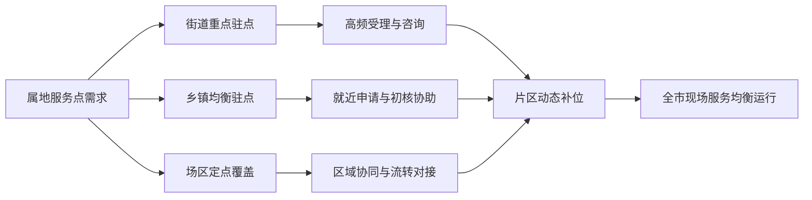

（五）岗位分布与服务连续性保障

为保证乡镇、街道、场、区现场服务岗位分布落地后能够稳定运行，菲尔德咨询在布点安排上同步建立连续服务保障机制。对于固定驻点岗位，实行属地责任清晰、岗位对应明确的管理方式，确保基层窗口在工作时段内持续具备受理和咨询能力。对于跨区域协同事项，明确材料交接、问题反馈和办理回传路径，减少因岗位分布分散导致的信息断点。

对重点区域和高频时段，岗位分布与现场工作计划联动实施。群众申请相对集中时，优先保障街道和重点乡镇窗口承接；专项摸排、政策调整、集中年审等工作期间，及时启动片区补位安排，确保服务不中断、办理不积压、窗口不空转。对于场、区等相对特殊管理单元，岗位分布强调定点服务与区域协同并重，确保群众能够在固定服务点获得稳定服务，同时能够及时衔接后续办理环节。

（六）岗位分布的评审对应性

乡镇、街道、场、区现场服务岗位分布体现了菲尔德咨询对基层社会救助事务性服务组织方式的针对性理解，能够直接支撑项目实施中的属地驻点、就近服务、区域协同和高峰调度等实际需求。该分布方式既覆盖基层服务单元，又保留动态调配空间，符合社会救助服务事项“窗口前移、属地承接、办理连续、协同顺畅”的运行要求。

通过上述岗位分布，基层现场服务可形成“区域有覆盖、窗口有承接、忙时有支援、协同有路径”的运行格局，为后续现场受理、咨询解释、材料流转及日常事务性服务开展提供明确的岗位承载基础。

### 1.3 项目人员配置：管理人员、协调人员证书与五年以上从业经验

#### 1.3.1 项目管理人员与协调人员组织架构

一、组织架构设置原则

（一）围绕项目履约链条设置管理与协调层级

菲尔德咨询结合麻城市社会救助服务项目覆盖对象多元、服务事项衔接频繁、部门协同要求高、过程管理标准严的特点，按照“统一管理、分级协调、职责清晰、响应及时”的原则设置项目管理人员与协调人员组织架构。组织架构重点服务于项目实施统筹、资源调配、服务协同、质量监督、风险预警和成果报送等核心履约活动，确保采购需求能够形成稳定的执行闭环。

项目管理层承担总体统筹、进度控制、质量把关、外部沟通和风险处置职责；协调层承担服务调度、信息衔接、台账流转、现场对接和问题上报职责；一线执行力量按照既定任务接受统一调度。该设置能够实现管理决策有主体、协调联动有接口、任务落地有承接、异常事项有上报路径，满足社会救助服务项目在日常运行中的组织要求。

（二）围绕评审关注点突出管理与协调岗位的独立配置

本项目组织架构中，管理岗位与协调岗位分层设置、分工明确，不以临时兼任替代固定职责，不以单点人员覆盖全部流程。管理人员负责项目整体运行控制，协调人员负责跨事项、跨对象、跨节点的对接与传导，避免因职责交叉导致指令不清、任务延误或资料断档。通过形成“项目负责人—专项管理—综合协调—执行对接”的结构，体现菲尔德咨询对项目组织能力、履约稳定性和现场管理能力的系统安排。

二、项目管理与协调组织架构

（一）组织架构总体设置

菲尔德咨询拟为本项目建立“一个项目总负责、一个综合管理中枢、多个协调接口协同运行”的组织架构。组织架构兼顾项目启动、日常运行、阶段复盘和异常处置四类场景，确保管理与协调体系既能满足日常服务推进，也能适应突发性、集中性任务安排。

项目管理与协调组织架构如下：

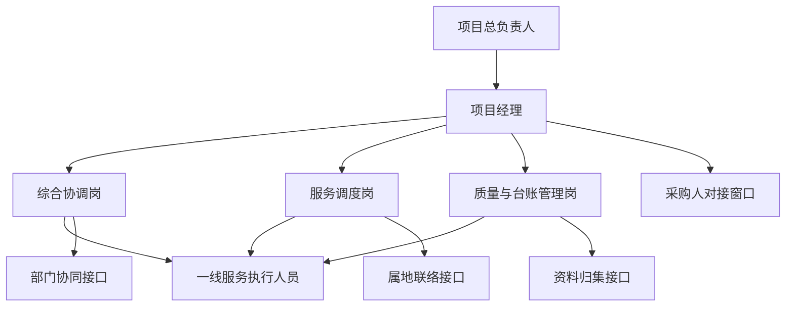

该架构设置中，项目总负责人承担决策支持与资源保障职能；项目经理作为项目实施核心管理岗位，负责日常管理统筹；综合协调岗负责内外部事项衔接；服务调度岗负责人员、任务、时点和场景匹配；质量与台账管理岗负责过程留痕、节点检查和资料归集。各岗位之间形成稳定配合关系，既能够提高指令传递效率，也能够保证项目过程可核验、可追溯。

（二）组织层级设置说明

为提高项目执行效率并降低沟通损耗，菲尔德咨询在本项目中采用三级组织层级运行。

第一，决策保障层。由项目总负责人构成，主要负责重大事项审定、关键资源配置、重要问题协调和风险升级处置，为项目平稳实施提供组织支持。

第二，项目管理层。由项目经理及相关管理岗位构成，主要负责年度或阶段性工作安排、月度计划分解、关键节点控制、服务质量监督、采购人沟通反馈和内部考核管理，是项目履约的管理中枢。

第三，协调执行层。由综合协调岗、服务调度岗及与一线服务衔接的对接人员构成，主要承担任务传达、对象联络、进度跟踪、信息汇总、问题上报和资料衔接等具体协调工作，确保管理要求转换为可操作任务并及时落地。

项目管理与协调岗位设置概况如下表：

| 岗位层级 | 岗位名称 | 组织定位 | 主要管理关系 | 核心作用 |
| --- | --- | --- | --- | --- |
| 决策保障层 | 项目总负责人 | 项目最高统筹 | 对项目经理实施指导与资源支持 | 保障重大事项决策与履约资源投入 |
| 项目管理层 | 项目经理 | 日常管理核心 | 向项目总负责人汇报，统筹协调岗位 | 负责项目计划、执行、督导、反馈 |
| 项目管理层 | 质量与台账管理岗 | 管理支撑岗位 | 受项目经理直接管理 | 负责过程检查、资料归集、台账控制 |
| 协调执行层 | 综合协调岗 | 内外协同接口 | 受项目经理直接管理 | 负责采购人、属地及相关接口衔接 |
| 协调执行层 | 服务调度岗 | 任务配置接口 | 受项目经理直接管理 | 负责人员调度、服务排期、节点跟进 |
| 协调执行层 | 一线服务对接人员 | 执行承接末端 | 接受协调岗位任务传导 | 负责按照安排开展具体服务工作 |

三、管理岗位与协调岗位的结构分工

（一）项目总负责人设置

项目总负责人位于项目组织架构顶层，不直接替代日常执行岗位，而是承担宏观统筹和履约保障职责。其管理重点包括项目实施方向把控、关键难点协调、跨资源支持、重大偏差纠正和重要事项决策。该岗位的设置有助于在项目出现集中任务、服务对象变化、进度压力增大或外部协同复杂时，形成快速决策与资源补位机制，保障项目不因局部问题影响整体履约。

（二）项目经理设置

项目经理是本项目管理体系中的核心岗位，承担项目运行的日常统筹职能。项目经理对内负责将采购需求、服务计划、质量要求和资料规范转化为具体任务安排，对外负责与采购人保持稳定沟通，形成工作确认、进度反馈和问题闭环。项目经理在组织架构中的核心价值在于把分散事项集中管理，把多岗位协同转化为统一执行秩序，从而保障项目实施的一致性和稳定性。

（三）综合协调岗设置

综合协调岗作为项目内外部事项的主要连接点，重点承担需求传达、会议衔接、信息回收、事项提醒、问题流转和跨岗位联动职责。社会救助服务项目通常涉及对象识别、政策衔接、入户安排、记录整理和反馈报送等多个节点，综合协调岗能够有效降低因信息分散造成的传递偏差，确保管理要求及时落地、执行信息及时回流。

（四）服务调度岗设置

服务调度岗主要负责将项目任务与执行力量进行匹配，包括日常任务分派、时点排期、现场安排、人员替补和临时调整。该岗位在组织架构中的价值在于提高任务安排的可执行性，避免出现人员空转、安排冲突、节点失控或现场脱节等问题。通过设置独立调度接口，能够使项目经理从重复性事务中抽离，更聚焦整体控制与关键事项处理。

（五）质量与台账管理岗设置

质量与台账管理岗负责过程性留痕管理和资料归集管理，保障项目实施中形成的工作记录、服务痕迹、内部流转信息和对外报送材料保持连续、完整和可查。该岗位与综合协调岗、服务调度岗相互配合，一方面对过程执行情况进行节点校验，另一方面为项目经理提供基础数据支撑，使项目管理决策建立在真实、完整、及时的信息基础上。

四、组织架构运行关系

（一）纵向指挥关系清晰

本项目组织架构实行单线指挥、分层落实。项目总负责人对项目经理实施统筹指导，项目经理对各管理与协调岗位发出任务指令，各协调岗位再向承接执行环节进行任务分配和反馈收集。该结构能够避免多头管理，提高任务口径一致性，减少交叉指令带来的执行偏差。

（二）横向协同关系顺畅

在纵向管理基础上，菲尔德咨询同步建立岗位间横向协同机制。综合协调岗负责接口整合，服务调度岗负责现场组织，质量与台账管理岗负责过程核验，三者之间按照“事项同步、进度互通、问题共享、资料联动”方式运行。对于需要跨岗位处理的事项，由项目经理进行统一裁量，避免职责边界模糊影响时效。

项目内部协同关系如下：


（三）外部沟通接口统一

为保证对接口径一致、沟通链条清晰，菲尔德咨询在组织架构中设置统一对接路径。涉及采购人工作沟通、计划确认、节点反馈、问题报送等事项，原则上由项目经理统筹把关、综合协调岗承接落实；涉及执行安排、现场衔接、时点调整等事项，由服务调度岗按授权进行联络；涉及过程记录和资料补充等事项，由质量与台账管理岗对接归集。统一接口设置有利于形成清晰的沟通责任边界，提升项目对外响应的规范性。

五、组织架构的履约支撑作用

（一）支撑项目启动与平稳转入

在项目启动阶段，组织架构能够快速完成角色定位、任务分解、接口建立和基础流程衔接，使管理要求尽快转化为执行秩序。项目经理负责启动部署，综合协调岗完成沟通链路建立，服务调度岗完成力量排布，质量与台账管理岗同步建立记录框架，确保项目从启动起即具备有序运行条件。

（二）支撑日常服务连续运行

在日常实施阶段，管理岗位与协调岗位分工协同，能够覆盖计划安排、任务下发、过程跟踪、信息反馈和资料归集等主要环节。即使出现人员调整、任务波动或临时性安排，也可通过既有组织架构快速完成替补与重排，保障项目运行不断档、不失控。

（三）支撑重点事项快速联动

对集中性、时限性较强的工作事项，组织架构能够形成快速响应链条。项目经理统一研判，综合协调岗迅速传递信息，服务调度岗即时调配资源，质量与台账管理岗同步留痕校验，实现管理要求、执行动作和记录成果同步推进。

重点事项响应链条如下：

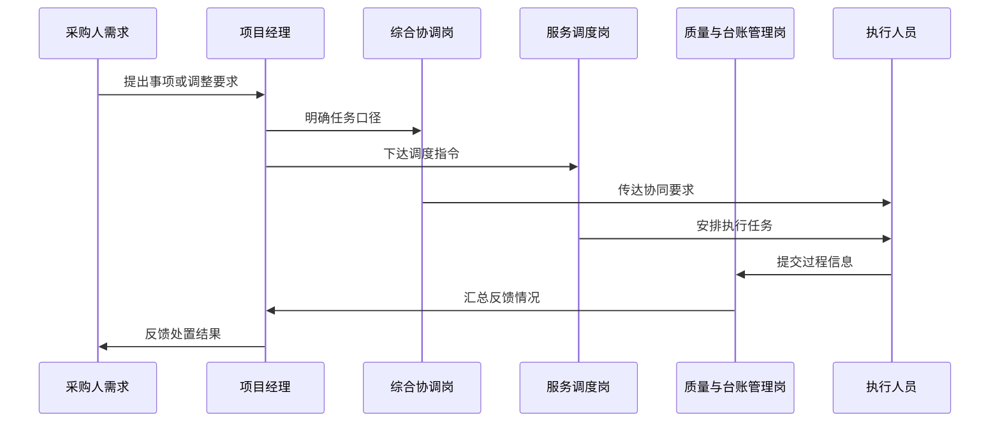

六、组织架构配置的审查适配性

（一）对应评审关注的组织完整性

菲尔德咨询所设置的项目管理人员与协调人员组织架构，具备明确岗位层级、稳定管理关系和实际运行逻辑，能够直观体现项目组织体系的完整性，符合评审对人员配置结构化、职责承接清晰化的关注重点。

（二）对应项目实施的可执行性

该组织架构不是概念性展示，而是直接围绕项目履约环节设置岗位接口和管理链条。每一类岗位均服务于具体管理任务和协调任务，能够在项目实施中直接投入使用，具备较强的可执行性与可落地性。

（三）对应过程管理的可核查性

通过设置项目经理、综合协调岗、服务调度岗和质量与台账管理岗，项目组织架构同时覆盖指令发出、任务安排、过程反馈和资料沉淀四个方面，为后续实施过程中的管理痕迹、沟通记录和履约核查提供清晰的组织基础。

#### 1.3.4 管理协调岗位职责、协同机制与履约支撑

一、管理协调岗位职责设置

（一）项目负责人职责

项目负责人对麻城市社会救助服务项目履约结果、服务质量、进度控制、风险处置和对外协调承担统筹责任。具体履职内容包括：一是依据采购需求、服务清单和考核要求，组织编制项目实施安排、阶段任务分解和资源配置计划，确保各项服务任务落实到岗、落实到时点、落实到责任人；二是统一协调项目执行中的人员调度、任务衔接、信息报送和重点事项督办，保证入户协助、对象核查、资料整理、信息汇总、业务支持等工作形成闭环；三是负责与采购人保持常态化沟通，就阶段进展、难点事项、突发问题和整改要求及时对接，确保执行口径一致、处理边界清晰；四是组织开展项目质量检查和内部复核，对服务记录真实性、台账完整性、反馈及时性和问题整改成效进行把关；五是牵头组织风险识别与应急处置，对服务对象投诉、任务积压、突发舆情、信息遗漏、人员临时缺岗等事项实施快速响应；六是对项目考核结果负责，针对考核发现问题组织原因分析、责任落实和整改复盘。

（二）项目协调人员职责

项目协调人员承担执行层面的组织联络、任务分发、过程跟踪和资料归集职责，是连接项目负责人、服务执行人员和采购人指定接口的重要纽带。具体履职内容包括：一是根据实施安排分解日常任务，明确办理时限、工作标准和交付要求，形成可执行的任务清单；二是负责日常联络，及时收集服务需求、工作变更和业务反馈，做到接收有登记、转办有依据、反馈有时限；三是跟踪各项服务任务完成进度，对节点滞后、资料缺漏、对象联系不畅等情形及时预警并协助处置；四是负责服务过程资料、工作记录、问题清单、整改记录和报送材料的归集与整理，保证材料留痕完整、结构清晰、便于抽查；五是协助落实会议组织、现场对接、数据汇总和阶段性成果报送，保障项目运行顺畅；六是对跨岗位协作事项进行衔接，减少重复沟通和断点传递，提高执行效率。

（三）岗位职责边界与配合要求

菲尔德咨询对管理岗位与协调岗位实行“统筹决策与执行联动相分离、责任落实与过程反馈相闭合”的岗位设置方式。项目负责人侧重目标统筹、质量把控、对外协调和风险处置；项目协调人员侧重任务承接、过程跟踪、资料归集和内部联动。两类岗位之间建立固定的任务确认、进度反馈、问题上报和整改回传机制，避免职责交叉不清、事项悬空和责任模糊。对涉及多环节、多时限、需采购人确认的事项，由项目负责人确定处理口径，项目协调人员负责分发执行和回收结果，形成职责清晰、链条完整的管理闭环。

管理协调岗位职责分工表

| 岗位 | 主要职责 | 关键输出 | 管控重点 |
|---|---|---|---|
| 项目负责人 | 统筹实施、对外协调、质量把关、风险处置、考核应对 | 实施安排、调度指令、问题处置意见、整改方案、阶段汇报 | 目标一致性、执行偏差纠正、重大事项响应、履约结果达成 |
| 项目协调人员 | 任务分解、日常联络、进度跟踪、资料归集、反馈报送 | 任务清单、进度台账、问题清单、资料汇编、反馈记录 | 任务时效、记录完整、衔接顺畅、信息传递准确 |

二、协同机制设计

（一）纵向指挥协同机制

菲尔德咨询建立“统一接收、分级处理、限时反馈、结果复核”的纵向协同机制。采购人提出的工作要求、补充任务、核查需求和整改意见，由项目负责人统一接收并判断事项类型、紧急程度和完成时限；项目协调人员据此形成任务单，分派至对应执行环节并跟踪反馈；涉及重点疑难事项、时间敏感事项或需调整资源配置的，由项目负责人直接督办；完成结果由项目协调人员汇总后提交项目负责人复核，再按要求报送采购人。该机制能够保证口径统一、传导顺畅、责任明确，避免多头接收、重复交办和信息失真。

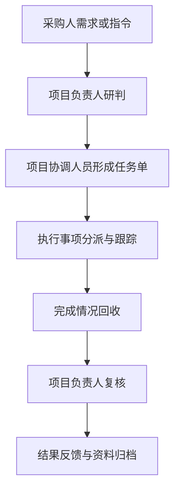

（二）横向联动协同机制

针对社会救助服务项目中常见的对象信息核实、入户服务安排、资料补正、情况说明、阶段汇总等事项，菲尔德咨询实行横向联动协同。项目协调人员负责建立事项台账，明确每项任务的来源、要求、责任环节、配合环节和完成节点；需要多岗位配合的事项，实行“一项一表、一事一记、一日一跟踪”的联动方式，确保每个环节知道做什么、何时完成、由谁确认。对存在前后依赖关系的事项，实行“前一环节完成即触发后一环节”的衔接模式，减少等待时间和沟通空转。对外部反馈频繁、变更较多的事项，项目协调人员同步维护变更记录，确保后续执行不偏离最新要求。

（三）例会与沟通机制

为保障项目运行稳定，菲尔德咨询设置固定沟通机制和临时会商机制并行运行。固定沟通方面，按周进行工作汇总和任务盘点，重点核对本周完成事项、未完成事项、下周计划和需协调问题；按月进行阶段评估，集中梳理服务质量、资料完整性、时效表现和整改情况。临时会商方面，对紧急任务、重点个案、集中整改、投诉事项和突发情形实行即时会商，由项目负责人组织明确处理路径、责任分工和反馈时限。沟通机制强调“问题不过夜、事项不过期、反馈不缺项”，确保项目执行始终处于可控状态。

（四）问题上报与闭环整改机制

对执行过程中发现的进度滞后、资料缺失、对象无法联系、情况不一致、服务争议等问题，菲尔德咨询建立分级上报和闭环整改机制。一般问题由项目协调人员登记后立即推动处理，并在规定时限内核销；跨环节问题由项目负责人组织协调解决；涉及履约风险的问题，纳入重点督办清单，实行专人跟踪、限时整改、结果复核。整改完成后，对问题原因、处置过程和预防措施同步留痕，防止同类问题重复发生。

协同运行关键机制表

| 机制名称 | 运行方式 | 适用事项 | 输出成果 |
|---|---|---|---|
| 统一接收与分派 | 项目负责人接收，协调人员分派 | 工作指令、任务变更、临时需求 | 任务单、时限要求、责任分工 |
| 进度跟踪与预警 | 日常台账跟踪，节点提醒 | 常规服务任务、阶段工作 | 进度台账、预警记录、催办记录 |
| 例会与会商 | 周汇总、月评估、临时会商 | 阶段复盘、难点处理、整改部署 | 会议纪要、问题清单、整改事项 |
| 问题闭环整改 | 登记、处置、复核、归档 | 质量问题、时效问题、投诉事项 | 整改记录、复核意见、归档材料 |

三、履约支撑措施

（一）任务台账支撑

菲尔德咨询以台账化方式支撑履约执行。围绕采购需求对应事项建立任务总台账、进度跟踪台账、问题整改台账和报送材料台账，做到每项工作有来源、有责任、有时限、有状态、有结果。台账实行动态更新，项目协调人员每日核对变动信息，项目负责人定期抽查关键事项，确保项目执行情况可追踪、可核验、可回溯。通过台账管理，可有效支撑服务调度、过程检查、考核应对和成果汇总。

（二）时效控制支撑

围绕社会救助服务项目任务时间要求，菲尔德咨询实行节点化时效控制。对常规事项明确标准完成时限，对紧急事项设置优先级和快速响应路径，对需多方联动事项预留衔接时间，防止因单环节延误影响整体进度。项目协调人员负责日常提示和到期催办，项目负责人对连续滞后事项实施重点督办。对存在客观障碍导致时限受影响的事项，及时形成情况说明并同步调整处置方案，确保进度管理真实、审慎、有依据。

（三）质量复核支撑

菲尔德咨询将质量复核嵌入履约全过程。对服务记录、联系记录、工作台账、情况说明和报送材料实行“形成即检查、提交前复核、归档前校验”的控制方式，重点核查内容一致性、逻辑完整性、时间对应性和文字准确性。对容易出现偏差的环节，采取抽查与重点复核结合方式，防止遗漏、错填、漏签、时间倒置和资料不匹配等问题。质量复核不增加无效流程，而是直接服务于履约交付和考核准备，保证提交成果经得起查验。

（四）应急替补支撑

针对管理协调岗位可能出现的临时请假、突发缺岗、任务集中叠加等情况，菲尔德咨询建立应急替补和临时接续安排。项目负责人对关键事项处理口径和台账状态进行集中掌握，确保必要时可快速接管重点任务；项目协调人员对日常联络、任务分派和资料位置实行清单化管理，保证交接时能够迅速延续。出现临时变化时，按照“事项不停、信息不断、责任不空”的原则进行衔接，防止因个别岗位波动影响整体履约。

（五）资料留痕与审查支撑

为满足采购人检查、阶段考核和履约验收需要，菲尔德咨询对管理协调过程中的通知、分派、反馈、会商、整改和报送等关键动作实行全过程留痕。留痕内容以满足审查需要为原则，不做无效堆积，重点保留能够证明任务来源、办理过程、完成结果和整改情况的材料。资料按事项分类、按时间排序、按阶段归档，便于随时调阅和集中核查。


四、履约保障成效预期

（一）保障指令传递准确

通过统一接收与统一分派机制，采购人要求能够在同一口径下传达到执行环节，减少理解偏差、重复解释和遗漏执行，提升管理协调效率。

（二）保障过程可查可控

通过台账管理、节点跟踪、会议纪要、整改记录和资料归档，项目运行过程形成完整证据链，能够满足日常管理、阶段检查和履约验收需要。

（三）保障问题响应及时

通过分级上报、限时处置和重点督办，项目中的进度、质量和协同问题能够尽早发现、尽快处置，降低问题累积对整体履约结果的影响。

（四）保障服务交付稳定

通过职责清晰的岗位设置、顺畅的协同机制和持续的履约支撑，菲尔德咨询能够在项目实施期间保持管理有序、沟通高效、反馈及时，为采购需求落地提供稳定保障。

### 1.4 企业管理水平：面向社会救助全链条履约的组织治理与制度保障

#### 1.4.1 团队整体实力：总部统筹、驻场执行与乡镇服务网络协同

一、团队组织架构与协同定位

（一）总部统筹、驻场执行、乡镇延伸的三级协同架构

菲尔德咨询针对麻城市社会救助服务项目，建立“总部专业支撑层—项目驻场执行层—乡镇街道服务协同层”三级组织架构。该架构围绕社会救助对象发现、信息核验、入户服务、过程反馈和结果输出等履约环节配置资源，确保管理指令传导顺畅、现场响应及时、基层联动有效。

总部专业支撑层承担项目统筹、资源调配、专业方法供给和复杂事项研判职能，重点解决跨区域经验转化、重点难点事项支持、阶段性任务资源补位等问题。项目驻场执行层设在麻城市，作为日常履约主执行单元，负责承接采购人工作要求、组织现场实施、统筹人员排班、汇总服务数据和反馈项目进展。乡镇街道服务协同层依托属地服务触点和联络机制开展协同配合，保障入户安排、对象联络、信息核实和服务落地的便利性与连续性。

该组织方式既保留总部的专业统筹能力，又形成常驻本地的执行能力，同时兼顾乡镇街道层面的在地协同能力，适应麻城市社会救助服务对象分布广、服务事项细、响应时效要求高的履约特点。

表：三级协同组织定位与主要职责

| 协同层级 | 组织定位 | 主要职责 | 输出成果 |
|---|---|---|---|
| 总部专业支撑层 | 统一统筹与专业支撑 | 资源调度、方法指导、重点事项会商、进度督导、质量支持 | 统筹方案、任务指令、专业意见、督导建议 |
| 项目驻场执行层 | 日常履约主执行单元 | 任务分派、现场组织、过程跟踪、数据汇总、对接反馈 | 日计划、周安排、服务记录、阶段汇总 |
| 乡镇街道服务协同层 | 属地协同与服务延伸 | 协助联系对象、配合入户安排、提供属地信息、协同处置现场问题 | 联系清单、协同记录、反馈信息、服务落点 |

（二）组织设置紧贴社会救助服务场景

本项目服务链条涉及困难群众接触频繁、事项类型多样、基层协同要求高。菲尔德咨询的团队整体设置不采用单一后台管理模式，而是围绕“统筹、执行、触达”三个场景配置力量。

一是统筹场景强调总部对项目节奏、资源和标准的把控，保障项目在任务量波动、重点工作集中或临时任务增加时，能够快速补充支持力量，不因单点压力影响整体履约。二是执行场景强调驻场团队对采购人需求的即时承接和转换，确保部署到人、任务到岗、反馈到日。三是触达场景强调乡镇街道协同网络的就近服务能力，提升对象联系成功率、入户安排效率和情况反馈及时性。

二、总部统筹能力

（一）专业资源统筹能力

菲尔德咨询总部具备成熟的社会民生类项目组织经验，可根据项目推进阶段提供针对性支持。对常规任务，总部负责统一方法、模板和任务要求，减少项目现场重复摸索成本；对重点任务、集中核查、疑难个案等事项，总部可快速组织补充人员或专业力量参与研判与指导，增强项目处理复杂问题的稳定性。

总部统筹不替代驻场执行，而是形成“平时标准化支持、重点节点强化支援、异常情况快速介入”的工作格局。通过前置安排项目联络接口、审核接口和支撑接口，项目执行中出现任务叠加、时间压缩、对象分散等情况时，能够实现快速调度。

（二）跨项目经验转化能力

社会救助服务项目普遍具有政策执行严谨、服务对象特殊、基层协同复杂等特点。菲尔德咨询能够将既有同类项目中的有效做法转化为适配麻城市实际的执行安排，重点体现在三方面：第一，将成熟的任务拆解方式转化为驻场团队可直接执行的清单；第二，将高频现场问题形成统一处置口径，减少重复沟通；第三，将多地项目积累的协同经验转化为乡镇街道联动的方法支撑，提升基层配合效率。

三、驻场执行能力

（一）驻场团队具备现场组织与快速响应能力

驻场团队是项目履约的核心力量，承担日常任务承接、人员调度、进度推进和现场问题反馈职责。菲尔德咨询在本项目中设置稳定驻场执行单元，确保采购人提出的服务要求能够在本地即时接收、即时分解、即时组织。

驻场执行强调“任务不过夜、信息不断档、现场有回应”。对日常服务任务，驻场团队按日跟踪、按周汇总，保证工作链条清晰；对临时性、突发性、集中性任务，驻场团队可依托总部支持快速调整执行安排，形成短时增援能力；对跨乡镇协同事项，驻场团队负责统一排程与路线统筹，提高人力投入效率和现场完成率。

（二）驻场执行形成一体化运转链条

驻场执行不是简单的人员派驻，而是围绕项目实际形成“接收—研判—分派—实施—反馈”的闭环运转链条。采购人需求、乡镇协同事项和服务对象信息由驻场团队统一归口处理，避免多头接收、责任分散和信息遗漏。


该闭环运行方式有利于提升现场执行的稳定性和响应一致性，确保各项任务从布置到反馈均有明确责任主体和跟踪节点。

四、乡镇服务网络协同能力

（一）属地协同网络覆盖项目实施需要

麻城市社会救助服务项目具有明显的基层延伸特征，部分工作必须依托乡镇街道协同开展。菲尔德咨询在团队组织上注重构建与乡镇街道相衔接的服务网络，通过明确联络接口、协同任务边界和信息传递路径，提升服务到村到户的可达性。

乡镇服务网络协同的重点不在行政替代，而在执行衔接。对需要属地配合的对象联络、时间协调、现场引导、情况补充等事项，由驻场团队提前形成协同清单并对接相应接口，做到任务发起有依据、配合事项有边界、反馈内容有记录。

（二）网络协同支撑分散场景下的履约效率

面对服务对象地域分散、出行组织复杂、现场情况差异大的特点，乡镇服务网络协同能够有效降低执行成本并提升服务触达效率。其作用主要体现在四个方面：一是提升对象联系成功率，减少重复上门；二是提升入户组织的时间匹配度，减少空跑和等待；三是强化属地情况辅助判断，提升现场核实准确性；四是形成服务反馈回路，便于驻场团队及时掌握进展。

表：乡镇服务网络协同的核心场景与支撑作用

| 协同场景 | 驻场团队职责 | 乡镇街道协同内容 | 协同价值 |
|---|---|---|---|
| 对象联络 | 梳理名单、明确任务、发起协同 | 协助联系服务对象或相关人员 | 提高联系效率 |
| 入户安排 | 统筹时间、路线和人员 | 协调属地时间与到户条件 | 提高执行成功率 |
| 现场核实 | 组织实施并记录情况 | 提供属地补充信息 | 提高核实准确性 |
| 问题反馈 | 汇总问题并分类处置 | 协助核对与补充说明 | 提高反馈完整性 |

五、整体协同优势

（一）统一指挥与分层实施并行

菲尔德咨询的团队整体实力体现在统一指挥下的分层实施能力。总部负责方向、资源和专业支持，驻场团队负责具体组织和过程控制，乡镇服务网络负责属地协同和触达落地。三者职责清晰、接口明确，能够避免“总部强、现场弱”或“现场忙、统筹散”的常见问题。

（二）稳定执行与灵活调度兼具

本项目执行过程中，既需要常态化、连续性的服务保障，也需要应对阶段性集中任务。菲尔德咨询依托总部与驻场联动机制，在保持驻场执行稳定的同时，具备按需调度、快速支援的能力，能够适配采购人不同阶段的工作节奏。

（三）本地落地与专业支撑结合

驻场执行保证本地响应速度，乡镇协同保证基层触达效率，总部统筹保证专业支持深度。三类能力相互补充，使项目团队不仅能够“到现场”，更能够“到节点、到对象、到问题”。

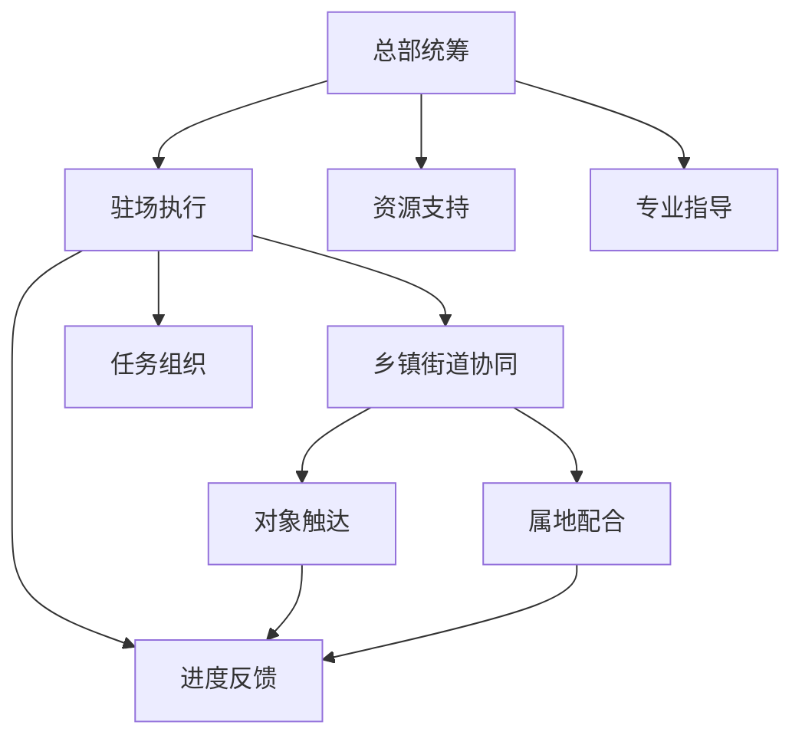

六、履约支撑结论

（一）组织体系能够支撑社会救助全链条任务实施

菲尔德咨询已形成适配本项目特点的团队整体组织能力，在总部统筹、驻场执行和乡镇服务网络协同方面具备完整支撑基础。该体系能够满足项目实施过程中对组织响应、现场执行、属地协同和任务衔接的实际要求。

（二）团队整体实力能够保障任务承接与服务落地

依托三级协同架构，菲尔德咨询能够实现任务承接及时、现场组织有序、基层联动顺畅、服务触达有效，为麻城市社会救助服务项目平稳实施、持续推进和高质量交付提供组织保障。

#### 1.4.2 项目治理制度：采购人、乡镇街道与项目团队三级联动机制

一、三级联动治理架构

（一）治理目标

围绕麻城市社会救助服务项目的受理协同、任务流转、过程督办、结果反馈和风险处置需要，菲尔德咨询建立“采购人统筹指导、乡镇街道协同落实、项目团队执行闭环”的三级联动治理机制。该机制重点解决社会救助服务中多方参与、事项分散、时效要求高、对象情况复杂、过程留痕要求严等管理问题，确保各类服务事项有人统筹、有人承接、有人督办、有人反馈，形成职责清晰、链路完整、响应及时、过程可查的治理体系。

该机制仅聚焦项目履约组织治理，不替代采购人行政管理职责，不替代乡镇街道救助审核主体职责，不混同项目团队具体岗位培训、驻场管理、档案管理和监督考核等专项制度。通过治理层级划分和协同规则明确，保障项目运行中的沟通路径统一、指令来源清晰、事项处置有据、跨层协同顺畅。

（二）三级职责定位

采购人作为项目治理一级统筹主体，主要承担服务方向把控、重点任务部署、跨部门事项协调、关键问题裁决和整体进度督导职责。乡镇街道作为项目治理二级协同主体，主要承担属地需求对接、服务对象信息核验协助、村社区联络组织、事项落地支持和基层问题上报职责。项目团队作为项目治理三级执行主体，主要承担任务接收、计划编排、入户实施、信息回传、问题预警和台账闭环职责。

为避免职责交叉和管理断点，菲尔德咨询将三级主体的管理边界划分为“统筹决策层、属地协同层、现场执行层”。统筹决策层负责方向、规则和重点事项；属地协同层负责衔接、确认和协调；现场执行层负责实施、记录和反馈。凡涉及政策口径、重大争议、敏感事项和跨区域协同的，由采购人牵头统筹；凡涉及村社区联络、对象约访、现场秩序和基础信息补充的，由乡镇街道组织协同；凡涉及入户核查、服务实施、工单填报和异常线索发现的，由项目团队具体执行。

表：三级联动治理职责分工表

| 治理层级 | 主体 | 主要职责 | 输出成果 | 时效要求 |
|---|---|---|---|---|
| 一级统筹 | 采购人 | 明确阶段任务、审定重点安排、协调重大事项、处理升级问题 | 工作指令、协调意见、处置结论 | 按周调度、按需会商 |
| 二级协同 | 乡镇街道 | 对接村社区、协助约访、核实属地信息、反馈基层情况 | 协同清单、联系反馈、属地说明 | 接到需求后及时响应 |
| 三级执行 | 项目团队 | 接单排期、现场服务、过程记录、问题上报、结果回传 | 服务台账、现场记录、问题清单、办结反馈 | 按任务时限完成 |

二、联动运行规则

（一）统一入口与统一指令规则

项目运行过程中，菲尔德咨询坚持“统一受领、分级流转、口径一致”原则。采购人提出的阶段性任务、专项安排和重点关注事项，由项目负责人统一受领并形成任务分解清单；乡镇街道提出的属地协同事项、对象联系事项和基层补充需求，纳入项目协同台账统一编号管理；项目团队成员不得直接接受未经确认的口头临时指令，不得绕开项目负责人自行调整服务范围、服务顺序和反馈口径。

对于同类事项，统一使用标准任务单、协同联系单、问题上报单和办结反馈单进行流转，确保每一项任务均具备来源、内容、责任人、完成时限和反馈方式。对于跨乡镇、跨事项或需多主体共同参与的问题，由项目负责人归并后报采购人或相关乡镇街道确认，避免重复派工和多头沟通。

（二）分层会商与日常调度规则

菲尔德咨询建立“日清、周调、专项议”的联动调度节奏。日常执行层面，由项目负责人汇总当日任务完成情况、未完成原因和次日安排，形成内部运行日报。周度协同层面，根据采购人工作安排和乡镇街道服务需求，组织周度调度，重点梳理任务进展、共性堵点、待协调事项和下周计划。专项事项层面，涉及集中入户、高风险个案、舆情敏感情况、对象集中诉求或临时新增批量任务时，及时启动专项会商。

分层会商坚持问题导向，不以形式代替治理。采购人重点掌握整体进度、难点事项和资源协调需求；乡镇街道重点反馈属地情况、对象配合程度和基层协同条件；项目团队重点反馈现场执行状态、异常发现和办结情况。会商形成的意见必须落实到具体责任主体、完成时限和反馈节点，确保会而有议、议而有决、决而有行。

（三）任务分派与协同落地规则

任务分派遵循“属地优先、时效优先、轻重缓急分类处置”原则。常规服务事项由项目团队按计划排期执行，乡镇街道提供必要协助；时限性较强的核查、复核、回访等事项，优先安排；涉及老弱病残、特殊困难家庭、单人服务对象等现场不确定性较高事项，提前与乡镇街道沟通进入方案；对重复反映、情绪激烈、信息矛盾较多事项，纳入重点事项管理。

协同落地过程中，乡镇街道主要承担属地联系、村社区协调和必要见证支持，项目团队负责现场实施和过程记录。对需采购人协调的情形，如跨部门数据补充、政策口径确认、重点对象处理方向明确等，项目团队不得自行判断替代，应按升级路径及时报告，确保项目执行与管理要求一致。

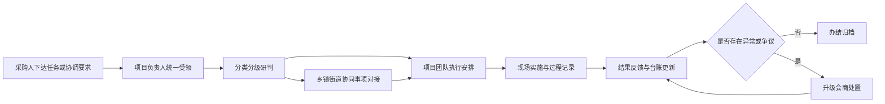

三、重点事项联动机制

（一）跨层级问题升级机制

为防止基层事项久拖不决或风险扩大，菲尔德咨询设置分级升级处置路径。一般性现场问题由项目负责人协调解决；涉及乡镇街道支持事项的，由项目负责人提交属地协同请求；涉及政策争议、服务边界不清、群众集中投诉苗头、敏感对象服务安排和可能影响项目整体履约的问题，报采购人统筹研判。

升级处理坚持“事实先核、口径后定、处理留痕”原则。项目团队发现问题后，先形成事实记录，包括时间、地点、对象情况、问题表现、已采取措施和建议方向；乡镇街道补充属地情况和既往处置背景；采购人依据项目要求或相关管理口径作出统筹意见。整个过程形成可追溯记录，避免因信息片段化导致判断偏差。

（二）突发事项快速响应机制

对于临时新增集中任务、对象突发困难情况、现场冲突苗头、媒体关注、群体性诉求风险等事项，三级主体启动快速响应。项目团队第一时间固定现场信息并报告，乡镇街道同步做好属地联络和秩序协助，采购人视情启动临时调度或专项会商。快速响应不改变原有职责边界，但压缩传递链条，确保信息不过夜、处置不断档。

快速响应机制强调两项要求：一是重要信息不层层截留，发现即报；二是临时处置不突破授权边界，现场人员原则上只做安抚、记录、解释和引导，不擅自作出政策承诺、资金承诺或超范围服务承诺。经会商明确后的处置意见，由项目负责人统一转达执行，保证对外口径一致。

（三）重点对象与复杂事项协同机制

对特殊困难家庭、情况反复变化对象、沟通难度较高对象以及存在多次上门、反复核实需求的复杂事项，实施“一事一策”联动管理。项目团队提前梳理对象基础情况、预判现场难点和所需协同支持；乡镇街道协调村社区或熟悉对象情况人员参与联络；采购人对确需重点关注的事项给予统筹指引。

“一事一策”不等同于另起一套程序，而是在既有治理制度下，对任务准备、现场分工、信息回传和后续跟踪作针对性安排。对复杂事项的过程记录要求更细，重点保留任务来源、协调过程、关键节点、对象反馈和处理结果，以便后续复核、解释和复盘使用。

四、信息传递与闭环管理机制

（一）联动信息流转要求

三级联动的有效性取决于信息传递的完整、及时和准确。菲尔德咨询对外统一由项目负责人或经授权人员进行沟通反馈，对内按照“接收登记、分类流转、节点反馈、结果确认”的要求运行。凡采购人安排、乡镇街道反馈、项目团队发现的事项，均纳入项目协同台账，做到来源可查、进度可见、结果可核。

信息流转重点控制三类风险：一是口头事项遗失风险，凡需执行的事项均补录台账；二是重复沟通风险，同一事项原则上由固定接口人持续跟进；三是反馈失真风险，现场情况由执行人员原始记录，项目负责人审核后对外报送。通过统一口径和统一台账，减少多头反馈造成的理解偏差。

（二）闭环办结要求

所有联动事项均执行闭环办结。闭环的基本要素包括任务受领、责任明确、实施记录、问题说明、结果反馈和办结确认。对一般事项，办结以完成服务并反馈结果为标志；对需持续跟踪事项，办结应同时附后续观察或再次联络安排；对因客观原因暂不能完成事项，应明确暂缓原因、已采取措施和下一节点，不以“未联系上”“待协调”简单挂账。

菲尔德咨询将闭环质量作为项目治理的重要控制点。对无来源记录、无过程记录、无结果反馈、无责任主体的事项，视为未闭环事项进行补正。通过闭环管理，确保三级联动不是单次传递，而是从指令形成到问题解决的全过程可核验。

表：联动事项闭环管理要素表

| 环节 | 管理要求 | 责任主体 | 留痕方式 |
|---|---|---|---|
| 受领登记 | 明确任务来源、内容、时限、协同需求 | 项目负责人 | 任务台账、任务单 |
| 分类流转 | 判定常规事项、重点事项、升级事项 | 项目负责人 | 流转记录、分派记录 |
| 协同实施 | 属地联系、现场执行、问题发现 | 乡镇街道、项目团队 | 联系记录、现场记录 |
| 反馈确认 | 提交结果、说明问题、确认办结状态 | 项目负责人 | 反馈单、办结单 |
| 异常升级 | 对争议、卡点、风险事项报送会商 | 项目负责人、采购人 | 问题单、会商纪要 |

五、责任追踪与治理保障

（一）责任到人机制

三级联动不是泛化协作，而是责任到岗、责任到人。菲尔德咨询在项目启动后即建立对应关系清单，明确采购人对接窗口、各乡镇街道联络窗口、项目负责人和执行责任人，形成固定沟通链路。每项联动任务均明确主办人、协办人和反馈人，避免出现“都在管、都不负责”的情况。

对跨主体事项，实行主办负责制。主办人负责进度跟踪、节点提醒、结果汇总和对外反馈；协办人负责按分工完成具体支持事项。主办责任不因事项转办而转移，确保一项任务从受领到办结始终有人牵头。

（二）时效控制机制

结合社会救助服务事项的时效特征，菲尔德咨询对联动事项实行时限分类管理。一般协同事项按约定节点反馈，紧急事项即时响应、优先处置，复杂事项分阶段反馈进展。对接近时限节点未完成事项，项目负责人主动预警并提出协调建议，防止因等待属地反馈或内部衔接不畅影响整体履约。

时效控制不以简单压缩流程为目标，而是通过前置判断和节点提示提升协同效率。对于需要乡镇街道参与的事项，尽量在现场安排前完成联系确认；对于需要采购人统筹的事项，形成清晰问题清单后一次性提报，减少反复沟通。

（三）复盘优化机制

三级联动运行过程中，菲尔德咨询对高频协同问题、重复卡点和典型案例进行周期性梳理，形成治理复盘清单。复盘重点不放在个别人员责任评价，而放在流程是否顺畅、界面是否清晰、升级是否及时、反馈是否充分。对发现的共性问题，及时优化联动口径、完善任务模板、调整流转规则，提高后续协同效率。

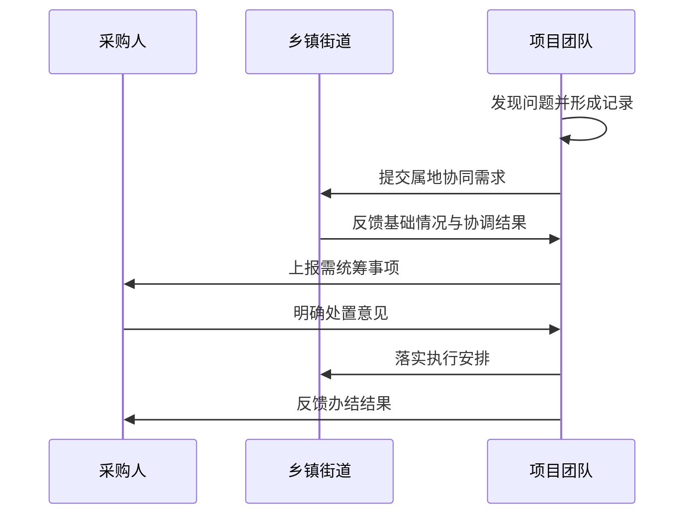

六、机制实施成效预期

（一）治理效能提升

通过采购人、乡镇街道与项目团队三级联动，项目任务由“单点推进”转为“链条推进”，有利于提高任务承接的准确性、现场实施的协同性和结果反馈的完整性。对麻城市社会救助服务项目而言，该机制能够更好适配事项分布广、对象情况差异大、基层协同需求强的特点，提升整体组织效率。

（二）履约风险降低

通过统一受领、统一流转、分级升级、闭环办结，能够有效降低职责不清、指令混乱、反馈失真、事项搁置等履约风险。特别是在重点对象、复杂事项和临时任务场景下，三级联动机制有助于将问题控制在早期、处置在属地、升级在节点，避免局部问题演变为整体履约问题。

（三）审查可追溯性增强

该机制形成的任务单、协同记录、会商纪要、办结反馈和台账资料，可为采购人日常掌握项目运行情况、阶段性检查和结果核验提供直接支撑。各环节均有责任主体、处理动作和结果记录，能够满足项目管理中对“逐项对应、过程留痕、结果可核”的审查要求。

#### 1.4.3 人员常驻管理制度：履约期全员常驻麻城与便捷服务保障

一、常驻管理目标

菲尔德咨询针对麻城市社会救助服务项目建立履约期全员常驻管理制度，核心要求为项目负责人、专职管理人员、驻场服务人员及承担日常服务任务的相关工作人员，在合同履约期内以麻城市为固定服务地开展工作，确保采购人联络及时、乡镇街道对接顺畅、服务对象响应便捷、突发事项处置到位。

常驻管理制度的设定围绕三个直接目标展开。一是保证服务组织重心前移，避免“名义驻场、实际流动”造成的响应迟缓、事项转办层级过多和服务落空。二是保证服务供给连续稳定，满足社会救助事项中咨询接待、对象走访、上门服务、材料补充、现场核验等高频线下场景需要。三是保证采购人和基层经办单位在工作时间内、紧急情形下和重点节点均能够快速找到人、联系到人、调配到人，形成“固定地点、固定人员、固定联络、固定响应”的履约状态。

二、常驻范围与适用对象

菲尔德咨询将常驻管理覆盖至参与本项目日常履约的全体人员，实行“全员纳入、分类管理、统一考勤、动态留痕”的管理方式。纳入常驻范围的人员包括但不限于项目负责人、现场管理人员、业务受理与服务人员、入户及上门服务执行人员、档案资料辅助人员及承担项目日常联络、调度、值守职责的其他项目成员。

对人员常驻的适用要求具体明确如下。

| 常驻对象类别 | 常驻要求 | 管理重点 | 证明方式 |
|---|---|---|---|
| 项目负责人 | 履约期内以麻城市为主要工作地，保持日常在岗和随时可联络 | 重大事项到场、现场协调、临时调度 | 驻地登记、考勤记录、联络记录 |
| 现场管理人员 | 工作日固定驻守项目服务点，按需开展外出协调 | 到岗管理、值班衔接、事项转办 | 排班表、签到记录、外出登记 |
| 一线服务人员 | 履约期内在麻城市范围内常态化驻点服务或就近待命 | 快速响应、服务覆盖、现场处置 | 日报、定位佐证、工单记录 |
| 机动补位人员 | 原则上同步纳入麻城市常驻安排或驻麻备勤 | 峰值支援、紧急替补、突发增援 | 备勤表、调度单、到岗记录 |

常驻管理不等同于简单要求人员“人在本地”，而是要求人员在履约期间具备稳定驻地、明确去向、可核验在岗状态和可追溯服务轨迹。对因公务外出、临时协调、现场服务等不在驻点办公场所的情形，均应履行外出登记和返回销号，防止出现人员状态不明、责任不清的情况。

三、驻地设置与便捷服务保障要求

菲尔德咨询将按照“固定服务点为主、流动服务触点为辅”的方式落实常驻条件。项目服务团队在麻城市设置明确驻地，作为日常办公、人员报到、资料接收、群众接待、工作调度和应急集结的固定场所，确保采购人、乡镇街道及服务对象能够清晰识别联系地点、联系人员和服务时间。

驻地运行重点满足以下要求。

1. 固定可达。

驻地地址、办公时间、联系电话、值班联系人保持公开和稳定，不随意调整；确需变更的，提前报备并完成信息更新，避免服务对象“找不到门、打不通电话、问不到人”。

2. 日常可用。

驻地具备基本办公条件、接待条件和资料临时存放条件，能够支持日常来访接待、事项咨询、工作联络和人员集结。驻地工作时间内保证有人值守，不出现长时间无人接待的情况。

3. 服务便捷。

对需要入户、上门、现场核实的事项，驻地承担快速派单和回收记录功能；对不便到场的困难群众，提供电话预约、时间约定、就近上门等便捷方式，减少群众往返成本。

4. 临时可扩展。

在集中核查、重点宣传、专项服务和突发任务期间，可依托麻城市范围内的临时服务触点开展前置集结和短时接待，但不替代固定驻地，不改变全员常驻要求。

四、常驻期间在岗管理机制

菲尔德咨询实行“每日签到、班次明确、外出报备、去向可查”的在岗管理制度，确保全员常驻要求落到可执行、可检查、可抽查的层面。

一是建立日常考勤机制。项目团队实行工作日正常考勤和重点时期强化考勤相结合的方式，记录人员到岗、离岗、外出、返岗情况。对承担值守职责的人员，单独建立值班记录，确保交接不断档。

二是建立外出报备机制。因入户服务、现场核实、陪同走访、资料送达等原因离开驻地的，须在出发前完成外出登记，注明事由、目的地、同行人员、预计返回时间和联络方式；返岗后完成销号。对临时延时或变更路线的，及时补充更新。

三是建立联络畅通机制。项目全员在工作时间保持电话畅通，值班人员在非工作时间承担紧急事项联络职责；涉及服务对象预约、基层经办联系和采购人通知的，做到有人接听、有人记录、有人跟进。

四是建立缺岗预警机制。对迟到、脱岗、无故离岗、电话失联、未按要求报备外出等情况，现场管理人员即时核实；对可能影响服务衔接的，立即启动替补安排，确保事项不断、人岗不断链。

常驻在岗管理流程如下。

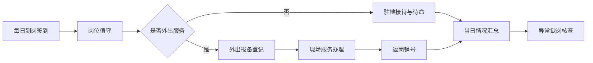

五、快速响应与便捷服务落实方式

常驻管理的落脚点不是人员静态驻留，而是形成便捷服务能力。菲尔德咨询围绕社会救助项目的现场性、时效性和群众性特点，将常驻制度与响应机制一体落实。

1. 工作时间即时响应。

采购人、乡镇街道及服务对象在工作时间内提出咨询、预约、材料补充、入户协同、现场核实等需求时，驻地人员即时受理、登记、分派，原则上当日给予联络反馈，能现场答复的现场答复，需上门处理的尽快安排人员到场。

2. 紧急事项优先响应。

对重点困难对象突发状况、紧急上门需求、舆情敏感事项、重大节假日和极端天气期间的临时任务，依托常驻和备勤人员就地调度，缩短组织链条，避免跨地调人导致的延误。

3. 群众办事少跑动。

对行动不便、老弱病残等服务对象，依托驻麻团队提供电话预约、上门联络、材料一次性告知、补充资料就近收取等便利措施，提高服务可及性和友好度。

4. 基层协同少等待。

对乡镇街道需要现场配合的事项，常驻团队根据通知及时到场，减少基层重复催办、多头协调和等待异地人员赶赴现场的时间损耗。

便捷服务保障要求如下。

| 服务场景 | 常驻支撑方式 | 保障要求 | 管理结果 |
|---|---|---|---|
| 群众来访咨询 | 驻地固定值守接待 | 有人接待、当场登记、明确去向 | 避免空岗和反复跑动 |
| 电话预约上门 | 驻地统一受理派工 | 约定时间、明确人员、按时到达 | 提升履约便利性 |
| 乡镇街道临时协同 | 常驻人员就近响应 | 快速对接、尽快到场 | 缩短等待时间 |
| 紧急情况处置 | 值班与备勤联动 | 先联络、快调度、留记录 | 提高应急到位率 |

六、值守安排与节假日保障

菲尔德咨询针对社会救助服务事项“平时连续、节点集中、特殊时段不能断线”的特点，实行工作日驻地值守与重点时段值班保障相结合的方式。

工作日内，驻地保持连续值守，确保采购人通知、群众来访、事项流转和服务派发不断档。法定节假日、重大活动期间、集中排查节点及采购人明确要求的专项时段，根据实际任务安排值班人员和备勤人员，做到联络不断、响应可达。对节前、节中、节后出现的慰问服务、困难对象关怀、临时核实及异常情况转办，均纳入值班记录和处置记录。

值守与备勤实行名单化管理，明确每日值班人员、联系电话、替补顺序和异常升级路径。任何值守空档均视为管理异常，须立即补位并记录原因。通过固定排班和临时增补相结合，确保常驻要求不因请假、轮休、短时外出而被削弱。

七、住宿通勤与后勤保障安排

为保证“全员常驻麻城”要求具备现实执行条件，菲尔德咨询将从住宿、通勤和基础保障三个方面配套落实。

一是住宿保障。对非麻城市本地工作人员，统一纳入驻地周边居住安排或就近租住管理，确保工作日能够准时到岗，遇紧急事项能够短时间内返回驻地或直接前往服务现场。

二是通勤保障。项目团队根据驻地位置和服务半径合理安排通勤方式，保证日常派工、乡镇协调、入户服务的出行连续性；在天气异常、道路受阻或任务集中时，优先保障一线服务人员出行需求。

三是后勤保障。对常驻人员所需的办公联络、基础用品、应急补给和现场出勤支持实行统一保障，避免因后勤准备不足影响服务时效和在岗稳定性。

上述保障措施仅服务于常驻制度执行，不替代项目其他管理制度中的人员培训、岗位管理、费用管理和稳定性控制要求。

八、请假离岗与替岗约束

菲尔德咨询对常驻人员实行严格的请假离岗管理，原则上不因个人原因影响驻地服务连续性。人员请假、临时离岗、外出学习、返乡处理私事等，均须事前履行审批和替岗安排；未经批准不得擅自离岗，不得出现先离岗后补报情形。

请假管理坚持三个约束。一是提前申请。能够预见的请假事项须提前提出，由管理人员结合排班和任务量统筹安排。二是先补位后离岗。请假获批前应明确替岗人员、交接事项和联络衔接方式。三是离岗可追溯。审批记录、交接记录、返岗记录完整留存，便于采购人检查和内部复核。

对短时离岗但不影响当日任务的，实行简化报备；对跨日离岗、集中时段请假或关键岗位请假，从严控制。对未履行程序造成服务延误、群众空跑或联络中断的，按内部管理要求予以纠正处理。

九、监督检查与记录留痕

菲尔德咨询将常驻制度执行情况纳入项目日常检查范围，重点核查“人员是否在麻城、是否在岗、是否可联络、是否能响应、是否有记录”。

监督检查采取日常抽查与节点检查结合的方式。日常抽查主要查看签到情况、值班情况、外出登记和电话联络畅通情况；节点检查主要围绕专项任务、高频服务阶段、节假日和采购人临时要求开展。对发现的缺岗、漏报、响应慢、记录不全等问题，立即整改并形成闭环。

常驻管理闭环如下。

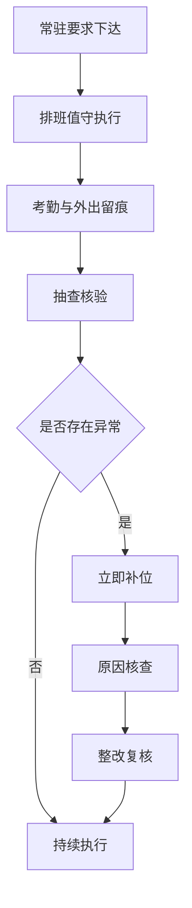

常驻记录至少包括人员名册、驻地联系人信息、日常排班表、签到记录、值班记录、外出登记、返岗销号、请假审批和抽查整改记录。上述资料可按采购人要求提供核验，做到有据可查、有迹可循。

十、制度承诺

菲尔德咨询承诺在本项目履约期内严格执行全员常驻麻城管理要求，不以远程替代驻场，不以临时派驻替代固定常驻，不以口头承诺替代记录管理。对采购人安排的日常联络、现场协同、群众服务和紧急响应事项，均依托麻城市常驻团队落实，确保服务不断档、联络不脱节、到场不延误、过程可核验。通过常驻管理制度的严格执行，为项目便捷服务、快速响应和稳定履约提供直接保障。

#### 1.4.4 岗位能力管理制度：申请受理、信访接待、政策解释与档案归档标准

一、制度目标与适用范围

（一）制度目标

菲尔德咨询围绕麻城市社会救助服务项目中申请受理、信访接待、政策解释与档案归档四类高频岗位任务，建立统一的岗位能力管理制度。制度设置的核心目的，是将岗位要求具体到职责、流程、标准、时限和留痕要求，确保一线人员在面对困难群众咨询、救助申请、来访诉求、政策疑问及资料归集等事项时，做到受理口径一致、解释依据一致、记录格式一致、流转节点清晰、归档结果可查，减少因理解偏差、口头承诺、资料缺失、记录不全引发的服务争议和履约风险。

（二）适用范围

本制度适用于承担以下工作的岗位人员：一是申请受理岗位；二是信访接待岗位；三是政策解释岗位；四是档案归档岗位。适用对象包括驻点服务人员、窗口辅助人员、资料整理人员及承担接待、解释、记录职责的相关支持岗位。制度覆盖事项范围包括社会救助申请资料接收、形式审查辅助、来信来访接待、电话咨询记录、政策条款解释、常见问题答复、服务资料整理、纸质及电子材料归档等，不延伸至入户核查、上门服务、培训管理、信息安全专项管理和监督考核等同级章节事项。

二、岗位设置原则与能力要求

（一）岗位设置原则

菲尔德咨询按照“事项对应岗位、岗位对应职责、职责对应标准”的原则配置岗位能力要求。申请受理侧重资料识别、清单核对、记录规范和转办准确；信访接待侧重情绪安抚、诉求识别、分类登记和节点反馈；政策解释侧重政策掌握、边界把握、表达准确和禁限承诺控制；档案归档侧重材料完整、目录清晰、编号统一和可追溯管理。各岗位之间职责可以衔接，但不得混同，不得以经验判断替代制度要求，不得以口头说明代替书面记录。

（二）岗位能力基准

| 岗位类别 | 核心能力要求 | 关键工作标准 | 主要留痕材料 |
|---|---|---|---|
| 申请受理岗位 | 熟悉救助事项基础条件、材料清单、受理口径与转办要求 | 接收准确、核对完整、一次性告知清楚、登记信息真实 | 申请登记表、材料清单、补正记录、转办记录 |
| 信访接待岗位 | 具备接待礼仪、诉求识别、风险判断、记录归纳能力 | 来访有登记、诉求有分类、事项有去向、反馈有记录 | 接待台账、来访记录、处理流转单、回访记录 |
| 政策解释岗位 | 熟悉政策依据、适用条件、边界限制和常见问答 | 解释准确、口径统一、不越权承诺、不主观推断 | 政策咨询记录、问题答复单、重点事项说明记录 |
| 档案归档岗位 | 熟悉归档目录、材料规则、编号规则和调阅要求 | 一事一档、资料齐全、顺序统一、查找便捷 | 档案目录、归档清单、签收记录、调阅登记 |

（三）岗位任职控制要求

申请受理、信访接待、政策解释与档案归档岗位均实行上岗前能力核验。未达到岗位能力基准的人员，不得单独承担对应岗位工作。对涉及政策解释和来访接待的岗位，要求能够准确复述常见救助事项的申请条件、办理路径、材料要求和不予受理、补正、转办等基础处理规则；对档案归档岗位，要求能够独立完成材料分类、目录编制、缺件提示和归档校核。

三、申请受理岗位能力管理制度

（一）受理事项标准化要求

申请受理岗位实行“清单接收、对照核验、如实登记、一次告知、分类流转”工作标准。岗位人员仅对提交材料进行接收和形式核对辅助，不对审批结果作倾向性判断，不作超越职责范围的承诺。对于符合接收条件的材料，应当当场登记；对于材料不齐全或内容明显缺失的，应当一次性说明需补充内容，并形成补正记录；对于不属于本项目服务协助范围的事项，应当清晰说明办理渠道并做好引导记录。

（二）受理操作规范

1. 资料接收规范

接收申请资料时，应逐项核对申请人身份信息、联系方式、申请事项类别、提交材料名称及份数。对原件和复印件的核验情况应作标注，对代办情形应记录代办人与申请人关系、联系方式及提交依据。对口述事项需要辅助登记的，应当由申请人或代办人确认后留痕。

2. 一次性告知规范

对申请事项所需资料、后续流转方向、补正要求和咨询渠道，应当一次性告知。告知内容应以现行政策和采购人确认口径为准，不得出现模糊表达，不得使用“基本可以”“大概率通过”等带有结果暗示的表述。

3. 异常情形处置规范

对于材料存在涂改、关键字段缺失、信息前后不一致、申请人表达不清、代办关系存疑等情形，受理岗位应当先记录、后请示、再流转，不得自行作出实质性判断。对情绪激动或争议明显的事项，应及时转入信访接待登记程序，避免事项遗漏和口径失控。

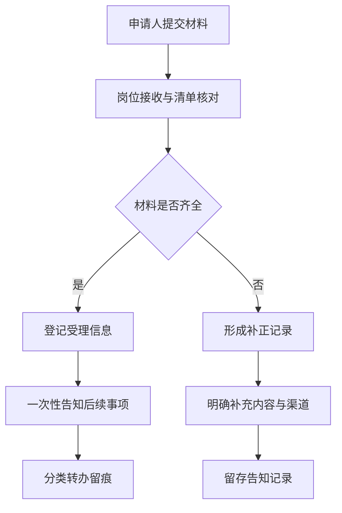

四、信访接待岗位能力管理制度

（一）接待原则

信访接待岗位坚持“先接待、再辨识、后分类、全记录”的工作要求。岗位人员在接待过程中应保持称谓规范、态度平稳、记录客观，不与来访群众发生争辩，不作价值判断，不以个人理解替代制度口径。凡有来访、来电、转办反映事项，均应登记，不得口头处理后不留痕。

（二）接待分类与记录要求

信访接待岗位应将反映事项区分为政策咨询类、办理进度询问类、材料补正类、意见建议类、投诉反映类和情绪疏导类，并对应不同记录方式。涉及事项时间、对象、主要诉求、已采取措施、需转交部门、约定反馈方式等要素，必须完整记录。对于重复反映事项，应在原记录基础上续记，不得分散留存导致事项链条断裂。

（三）重点风险控制要求

1. 对投诉反映类事项，应当避免随意承诺办理结果，仅确认已登记、已转办、将反馈的程序性内容。

2. 对情绪激动、言语冲突、反复来访等事项，应当同步记录现场情况、安抚措施和转交情况，必要时按既定联络机制报告对应负责人。

3. 对涉及隐私、家庭困难、健康状况、收入支出等敏感内容的反映，应当在保证接待完整的同时控制无关人员知悉范围，避免在公开环境中扩散具体信息。

五、政策解释岗位能力管理制度

（一）解释口径管理要求

政策解释岗位实行统一政策口径管理。岗位人员开展解释时，应依据有效政策文本、采购人明确的执行标准及经确认的答复口径进行说明。解释内容应聚焦申请条件、所需材料、办理环节、常见退回原因、咨询路径等基础事项，不得超越职责对审批结论、待遇金额、办理时长作绝对化承诺。

（二）解释方式与表达规范

政策解释应坚持“通俗表达、依据明确、边界清楚、记录可查”。面对老年人、低文化程度群众或情绪波动对象，应将政策表述转化为可理解的办理指引，例如说明“需要准备哪些材料、材料交到哪里、缺失材料如何补充、后续向谁咨询”，避免照搬条文造成理解障碍。对不属于现行政策支持范围或条件暂不满足的情形，应说明原因及可行路径，不得使用刺激性、否定性语言。

（三）常见事项答复控制

| 咨询场景 | 标准答复重点 | 禁止性表述 | 必留记录 |
|---|---|---|---|
| 是否符合申请条件 | 说明基本条件、认定依据、需核实事项 | 一定能办、肯定通过 | 咨询记录 |
| 材料是否齐全 | 按清单说明已交与缺失材料 | 材料差不多、先交再说 | 材料说明记录 |
| 多久能出结果 | 说明办理流程和查询方式 | 几天内一定办好 | 咨询记录或告知单 |
| 被退回怎么办 | 说明补正内容和重新提交路径 | 退回就是办不了 | 补正说明记录 |
| 家属代办是否可以 | 说明代办要求和证明材料 | 谁来都可以代办 | 代办说明记录 |

（四）疑难问题升级机制

对政策交叉、历史遗留、群众理解偏差较大或答复争议明显的问题，政策解释岗位不得自行扩展解释，应当形成问题摘要，列明咨询事项、现有材料、已答复内容和需确认问题，提交上级确认后再向群众反馈。对同类高频问题，应及时纳入口径更新清单，防止不同岗位答复不一致。

六、档案归档标准与岗位能力要求

（一）归档基本规则

档案归档岗位按照“一事项一记录、一对象一归集、一环节一留痕”的标准开展资料整理。归档内容应覆盖申请接收记录、材料清单、补正记录、咨询说明、信访接待记录、转办流转记录及相关签收凭证。凡形成办理事实、解释事实、接待事实的材料，均应纳入归档范围，不得因事项未办结而遗漏前端资料。

（二）归档顺序与目录要求

纸质档案和电子目录应保持对应一致。归档顺序一般按照事项登记、材料接收、补正说明、咨询记录、接待记录、转办记录、反馈记录进行整理。每份档案应有目录页、页码标识和归档责任人标记，便于后续查验、复核和调取。对补充提交材料的，应保留时间顺序，不得覆盖原始记录。

（三）归档质量控制要求

档案归档岗位在归档前应进行完整性校核，重点核查四项内容：一是是否缺少关键登记信息；二是是否缺少申请人或经办人员确认痕迹；三是记录时间前后是否矛盾；四是咨询、接待、转办之间是否能形成闭环。发现缺漏的，应退回相关岗位补充完善后归档，不得带病入档。


七、岗位能力运行保障机制

（一）岗位说明书与标准件管理

菲尔德咨询对四类岗位分别建立岗位说明书，明确职责边界、操作步骤、禁限行为、记录模板和常见问题答复要求，并配套使用申请登记表、补正记录单、接待登记表、咨询记录单、归档清单等标准件。岗位人员必须按统一模板办理，减少自由发挥导致的偏差。

（二）双重校核要求

对申请受理中的补正说明、信访接待中的投诉反映、政策解释中的疑难事项、档案归档中的关键材料完整性，实行岗位自查与指定复核相结合的双重校核。自查重点核对事实记录是否完整，复核重点核对口径是否准确、留痕是否充分、归档是否可查。

（三）问题纠偏要求

日常运行中发现以下问题的，应立即纠偏：一是受理记录缺少关键字段；二是来访事项未登记；三是政策解释存在超范围承诺；四是档案目录与材料不一致；五是同一事项不同人员答复口径不统一。对已发生问题的材料，应补充说明、修正记录、保留痕迹，确保后续查验能够还原过程。

八、制度执行效果承诺

（一）统一受理标准

菲尔德咨询通过岗位能力制度实施后，确保申请受理工作做到事项清、材料清、记录清、去向清，减少因资料交接不清、补正说明不明带来的重复往返。

（二）统一接待口径

确保信访接待全过程有登记、有分类、有去向、有反馈依据，避免出现接而不记、记而不转、转而无痕的管理断点。

（三）统一解释依据

确保政策解释以现行依据和确认口径为准，做到答复准确、边界清楚、表达审慎，避免因越权承诺或解释不当引发争议。

（四）统一归档规则

确保形成材料应归尽归、顺序统一、目录清晰、调取便捷，为后续核查、审阅和履约验收提供完整、可审查的依据。

#### 1.4.5 上岗培训制度：社会救助政策、系统操作与信息处理能力提升

一、培训目标与适用范围

（一）培训目标

菲尔德咨询围绕麻城市社会救助服务项目岗位实际，建立“先培训、后上岗，先考核、后履职”的上岗培训制度，确保拟投入人员在正式承担社会救助服务工作前，具备与岗位相匹配的政策理解能力、系统操作能力、信息处理能力和规范执行能力。培训目标具体包括：

1. 准确掌握社会救助相关政策口径，能够依据采购需求及基层业务场景，正确理解低保、特困、临时救助、低保边缘家庭、支出型困难家庭等重点事项的基础政策要求、受理要点和常见情形。

2. 熟练掌握项目涉及的信息系统、业务平台及常用办公工具操作方法，能够独立完成信息录入、资料上传、检索比对、状态跟踪、台账登记和数据导出等基础操作。

3. 建立规范的信息处理意识，能够按照统一规则开展资料接收、信息核验、分类整理、数据校对、过程留痕和结果反馈，减少漏项、错项、重项和信息失真。

4. 形成岗位履职前的基础判断能力，能够识别政策适用边界、资料完整性风险、系统填报异常和信息处理中的敏感事项，并按规定路径请示、登记和转办。

（二）适用范围

本制度适用于菲尔德咨询投入本项目的全部新上岗人员，包括驻点服务人员、业务辅助人员、信息录入人员、资料整理人员及其他承担社会救助相关辅助性事务的岗位人员。对岗位调整、返岗复岗、替补进场人员，均按本制度执行上岗前培训与考核，不因人员来源、工龄或既往项目经历而免训免考。

（三）培训原则

1. 坚持岗位导向。培训内容与麻城市社会救助服务任务直接对应，围绕“能看懂政策、会操作系统、能处理信息”设置课程，不泛化、不空转。

2. 坚持逐项过关。政策学习、系统实操、信息处理三类内容分别培训、分别考核，任一环节未达标不得独立上岗。

3. 坚持统一口径。培训课件、案例、操作说明、表单模板、答疑结论实行统一管理，避免人员理解不一、执行不一。

4. 坚持留痕可查。培训通知、签到、课件、试题、成绩、补训记录、上岗审批等资料全程留存，便于采购人检查和项目内部复核。

二、培训内容体系

（一）社会救助政策培训模块

政策培训聚焦岗位履职中高频、易错、需统一口径的事项，按照“政策框架—业务情形—办理要点—常见偏差”四层结构组织，重点包括：

1. 社会救助政策基础。围绕社会救助总体制度、对象范围、基本程序、资料要求、动态管理等内容，帮助上岗人员建立政策认知框架，明确各类救助事项之间的边界关系。

2. 重点业务政策。围绕最低生活保障、特困人员救助供养、临时救助、低收入人口识别及相关救助帮扶事项，讲清申请受理环节需掌握的基本标准、常见资料情形和辅助服务边界。

3. 政策口径统一。针对基层咨询中容易出现分歧的事项，形成标准化问答口径，例如家庭成员认定、收入来源理解、财产情况说明、申请资料补正、特殊困难情形说明等，确保上岗人员对外答复一致、对内处理一致。

4. 案例化学习。选取典型案例开展情景讲解，将抽象政策条文转化为可识别、可判断、可应用的业务场景，重点训练人员对常见问题的识别能力和基础处理能力。

（二）系统操作培训模块

系统操作培训以“看得懂界面、找得到功能、填得准内容、留得下痕迹”为要求，围绕项目常用业务系统和辅助工具开展实操训练，重点包括：

1. 账号与权限认知。培训系统登录规则、账号使用规范、密码管理要求、权限范围认知和异常登录处置要求，避免借用账号、混用权限和违规操作。

2. 基础业务操作。培训信息录入、资料上传、查询检索、状态查看、字段修改、台账更新、结果导出等操作步骤，确保人员能够按要求完成日常辅助工作。

3. 关键字段填报。对姓名、身份证号、家庭成员、联系方式、地址信息、业务类别、附件材料等关键字段，进行逐项示范和错误提示，降低录入差错率。

4. 异常情形处理。对系统卡顿、上传失败、字段锁定、信息不匹配、重复记录、材料格式不符等常见问题，明确排查方法、记录要求和上报路径，防止人员自行变通处理。

（三）信息处理能力提升模块

信息处理培训不替代档案管理和信息安全制度内容，重点解决上岗初期“收什么、怎么看、怎么录、怎么核、怎么改”的基础能力问题，主要包括：

1. 资料识别与分类。培训常见申请资料、证明材料、补充说明、核验结果材料的识别方法，明确纸质资料与电子资料的分类规则和使用顺序。

2. 信息核对与校验。培训人员对身份信息、家庭关系、地址信息、联系电话、材料日期、签字页完整性等内容进行逐项核对，做到录入前先校、录入中复核、录入后抽查。

3. 信息整理与转化。针对纸质资料转电子信息、口头表述转书面记录、分散材料转结构化字段等工作，统一填写口径和整理规范，减少理解偏差。

4. 常见差错防控。围绕漏录、误录、重复录入、错传附件、字段错位、材料命名不规范、日期逻辑错误等问题进行专项提示，形成标准纠错清单。

培训模块与训练重点表

| 培训模块 | 主要内容 | 达成标准 | 考核方式 |
|---|---|---|---|
| 社会救助政策 | 政策框架、对象范围、办理要点、统一答复口径 | 能识别常见业务类型并准确说明基础要求 | 闭卷测试、案例问答 |
| 系统操作 | 登录规范、录入上传、查询导出、异常处理 | 能按流程独立完成规定操作 | 上机实操、现场演示 |
| 信息处理 | 资料识别、字段校验、信息整理、差错纠正 | 能规范完成信息接收、录入和复核 | 样表填写、抽样核验 |

三、培训组织与实施方式

（一）培训组织安排

菲尔德咨询实行项目上岗培训分层实施机制，由项目管理人员统筹培训计划，业务骨干承担政策与流程授课，系统熟练人员承担操作实训，形成“统一组织、分类授课、集中考核、结果审批”的实施方式。上岗培训一般安排在人员正式履职前完成；遇新增替补人员时，实行即到即训、合格后补位。

（二）培训实施步骤

1. 岗位识别。根据拟上岗岗位类别确定培训范围和必修内容，避免同训同考造成重点失焦。

2. 资料发放。向参训人员发放培训计划、课程提纲、制度要点、操作指引、样表样例和注意事项，保证学前准备充分。

3. 集中授课。围绕政策、系统和信息处理三类课程开展集中讲解，重点内容同步形成讲义，便于后续复训和抽查。

4. 实操训练。安排模拟账号、模拟表单、样本资料开展现场操作，让参训人员在模拟情景中完成录入、上传、检索、修改和核对。

5. 答疑纠偏。对集中授课和实操中发现的理解偏差进行统一答复，对共性易错点形成书面提示，防止问题带入上岗阶段。

6. 考核评定。采取理论测试与实操测试相结合方式进行综合评定，并形成成绩记录和上岗建议。

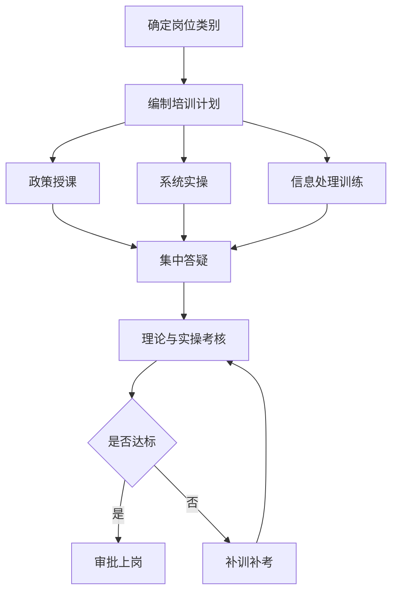

（三）培训方式配置

1. 课堂讲授。用于统一政策口径、说明规则要求和讲解易错事项，适合新进人员快速建立基础认知。

2. 情景案例训练。用于模拟基层常见咨询、资料不全、信息不一致等情况，提升人员对实际问题的理解与判断。

3. 上机操作训练。用于熟悉系统界面、字段逻辑和处理步骤，强调独立完成能力。

4. 样表演练。用于训练纸质资料向系统信息的转换能力，提升录入准确性和整理效率。

5. 一对一纠偏。对测试中薄弱环节明显的人员开展针对性辅导，确保短板问题在上岗前消化。

四、考核准入与补训机制

（一）考核要求

菲尔德咨询将上岗培训考核作为人员准入的刚性条件。考核分为理论考核和实操考核两部分，理论考核重点检验政策理解和规则掌握情况，实操考核重点检验系统使用和信息处理能力。考核内容与实际岗位直接对应，不设置与岗位无关的形式性题目。

（二）准入标准

1. 理论考核达到规定合格标准，能够对常见社会救助政策问题作出准确、统一的基础判断。

2. 实操考核达到规定合格标准，能够在限定时间内完成规定的信息录入、资料上传、字段校验和查询导出操作。

3. 对关键错误实行一票纠正，包括身份信息录入错误、业务类别误选、资料张冠李戴、附件错传、未经核对直接提交等情形；出现关键错误的，须补训后重新考核。

（三）补训补考机制

对首次考核未达标人员，菲尔德咨询安排针对性补训，重点围绕失分集中项和错误高发项进行强化训练。补训后组织补考，补考仍不合格的，不安排其承担独立岗位任务。确需参与项目辅助工作的，仅在合格人员指导下从事不涉及独立判断和系统关键操作的辅助性事务。

考核结果运用表

| 结果类别 | 判定情形 | 处理措施 | 资料留存 |
|---|---|---|---|
| 合格 | 理论、实操均达到要求 | 审批上岗，纳入岗位排班 | 成绩单、上岗确认 |
| 限期补训 | 单项未达标或存在明显薄弱项 | 定向补训后补考 | 补训记录、补考成绩 |
| 暂缓上岗 | 关键错误较多或补考仍未达标 | 不独立上岗，继续培训 | 问题清单、处理意见 |

五、培训质量控制与动态优化

（一）培训过程控制

菲尔德咨询对上岗培训实行全过程质量控制，确保培训不是“走流程”，而是形成可检验的能力提升结果。

1. 统一课件和案例。所有培训材料经项目内部审核后使用，避免授课内容口径不一。

2. 统一签到与记录。每次培训均登记时间、地点、内容、参训人员和授课人员，形成完整培训台账。

3. 统一题库与评分。理论题目、实操任务和评分标准相互对应，保证考核公平和可复核。

4. 统一问题汇总。对培训中反复出现的错误和疑问，形成专题问题清单，作为下一轮培训修订依据。

（二）动态更新机制

针对社会救助政策调整、系统功能更新、表单规则变化和实际工作中暴露出的高频问题，菲尔德咨询建立上岗培训动态更新机制：

1. 政策有调整时，及时修订培训讲义和答疑口径，并在新增人员培训中同步执行。

2. 系统有更新时，及时补充操作截图、变更说明和注意事项，防止新旧流程混用。

3. 发现信息处理差错集中出现时，及时增加专项训练，如身份证信息核验、地址标准化录入、材料命名规范等。

4. 对采购人、基层业务协同中反馈的共性问题，及时转化为培训内容，增强培训与实际场景的贴合度。


（三）培训成效要求

通过本制度实施，菲尔德咨询确保项目上岗人员在正式履职前达到以下基础要求：一是能够准确理解并传达岗位所需的基础社会救助政策口径；二是能够规范完成系统基础操作，不因不熟悉流程影响服务进度；三是能够按统一规则开展资料识别、信息录入和内容校验，提升信息处理准确性和一致性；四是能够识别超出本人权限和能力范围的问题，并按规定流程报告处理，避免因误判、误录、误传影响项目履约质量。

六、资料归集与审查要点

（一）培训资料归集

菲尔德咨询将上岗培训形成的过程资料纳入项目管理资料体系，至少包括培训计划、课程安排、授课讲义、签到记录、现场照片、理论试卷、实操评分表、成绩汇总、补训记录和上岗审批记录。资料形成时间、内容和人员信息保持一致，确保可追溯、可核验。

（二）审查要点

1. 是否做到新进人员先培训后上岗。

2. 是否覆盖社会救助政策、系统操作和信息处理三项必训内容。

3. 是否存在培训有记录但考核无结果、考核有结果但上岗无审批的脱节情况。

4. 是否对未达标人员执行补训补考和暂缓上岗要求。

5. 是否根据政策变化和系统更新及时修订培训内容。

（三）制度执行承诺

菲尔德咨询在本项目实施过程中，将严格执行上岗培训制度，对所有拟投入人员实行培训准入管理，以制度化、标准化、留痕化方式提升社会救助政策理解、系统操作和信息处理能力，为项目稳定履约提供基础保障。

#### 1.4.6 服务技能培训制度：入户沟通、困难群众服务与单人失智对象照护规范

一、制度目标与适用范围

（一）制度目标

菲尔德咨询围绕麻城市社会救助服务项目中入户服务、困难群众接触服务及特殊对象照护场景，建立服务技能培训制度，重点解决三类问题：一是工作人员在入户沟通中政策表达不清、问询方式不当、信息采集不完整的问题；二是面对低保对象、特困人员、临时遇困家庭、重病重残对象等困难群众时，服务语言、情绪安抚、需求识别和风险判断不精准的问题；三是面对单人居住失智对象时，存在沟通失序、行为刺激、照护失当和安全处置不规范的问题。

该制度以“能沟通、会识别、懂边界、知处置”为培训导向，将服务技能培训与具体服务场景绑定，形成可操作、可检验、可复训的培训标准，确保一线人员在开展上门服务、入户访谈、政策解释、困难帮扶接触和特殊对象照护时，行为有规范、过程有记录、异常有处置。

（二）适用范围

本制度适用于参与麻城市社会救助服务项目的一线服务人员、驻点服务人员、入户服务人员、辅助支持人员及承担现场指导职责的管理人员。适用场景限定为：入户沟通技能培训、困难群众服务技能培训、单人失智对象照护规范培训，不延伸至项目治理、常驻管理、档案管理、财务管理等同级制度内容。

（三）培训原则

1. 场景化原则

培训内容围绕真实服务情境设置，包括首次入户、复访沟通、情绪激动对象接触、拒访对象沟通、行动不便对象服务、独居失智对象看护接触等，避免脱离项目实际的泛化培训。

2. 分层分类原则

根据岗位接触深度设置基础培训、专项培训和强化培训。直接入户人员重点掌握沟通、观察、记录和风险识别；辅助人员重点掌握基本礼仪、协助规范和异常报告；现场指导人员重点掌握带教、纠偏和情形研判。

3. 行为规范原则

培训不以概念讲授为主，重点固化服务动作、提问顺序、表达边界、观察要点和禁忌行为，确保培训结果可直接转化为服务行为。

4. 风险前置原则

对高龄、失能、精神状态异常、认知退化、长期独居等高风险服务对象，培训中提前嵌入安全观察、陪护接触、异常报告和紧急协同要求，降低服务过程风险。

二、培训内容架构与课程设置

（一）培训内容总体架构

菲尔德咨询将服务技能培训划分为三大模块、九项核心能力，形成与项目场景相对应的培训体系。

| 培训模块 | 核心能力 | 训练重点 | 适用场景 |
|---|---|---|---|
| 入户沟通模块 | 礼貌接触、身份说明、提问引导 | 开场规范、关系建立、降低抵触 | 首次入户、复访、资料核实 |
| 入户沟通模块 | 倾听反馈、信息确认、沟通收束 | 复述确认、避免误解、结束告知 | 服务记录、政策说明、后续约定 |
| 困难群众服务模块 | 情绪识别、同理表达、需求辨别 | 稳定情绪、尊重对象、识别真实困难 | 低保、特困、临时遇困对象服务 |
| 困难群众服务模块 | 敏感情形应对、服务边界把握 | 面对抱怨、指责、哭诉时规范应答 | 信任建立、矛盾缓和 |
| 困难群众服务模块 | 服务转介提示、异常信号报告 | 风险线索发现、紧急情况提示 | 重大困难、疑似风险家庭 |
| 单人失智照护模块 | 认知障碍基础识别 | 定向力、记忆、表达、情绪变化观察 | 独居失智对象接触 |
| 单人失智照护模块 | 安抚陪伴与照护动作规范 | 语速控制、单次指令、环境安全 | 上门照料、陪护互动 |
| 单人失智照护模块 | 刺激因素规避与突发行为应对 | 不争辩、不强迫、不惊扰 | 情绪波动、拒绝接触、走失风险 |
| 单人失智照护模块 | 异常情况升级报告 | 身体异常、意识异常、环境异常上报 | 风险发现、紧急协同 |

（二）入户沟通培训重点

1. 标准开场训练

服务人员须熟练掌握入户前三项动作：表明身份、说明来意、征得同意。培训要求统一开场表达，做到语义清晰、态度平和、无命令式语气、无先入为主判断，避免因表达方式引发对象抵触。

2. 提问方式训练

培训采用“由浅入深、先生活后事项、先开放后确认”的提问方法。对家庭情况、生活困难、日常照料、近期变化等信息，通过中性表述进行引导，不使用带有暗示性、否定性或评价性的问法，避免造成对象防御、羞辱感或误解。

3. 倾听与回应训练

对困难群众的讲述，要求服务人员做到不抢话、不打断、不争辩。对关键内容须进行复述确认，对情绪化表达应先安抚再引导，对超出当场解释范围的问题应如实说明，不作承诺性表态。

4. 沟通收束训练

培训明确入户结束前需完成三项动作：一是确认已了解事项；二是说明后续服务或反馈方式；三是礼貌结束并提醒联系方式。防止服务对象对办理结果、服务内容或后续安排形成错误理解。

（三）困难群众服务培训重点

1. 尊重性接触训练

面对困难群众，服务人员须避免使用带有标签化、施舍式、质疑式语言。培训中明确禁止出现刺激对象尊严、公开评价家庭状况、追问隐私细节等不当行为，确保服务接触建立在尊重和平等基础上。

2. 情绪安抚训练

对哭诉、焦虑、愤怒、沉默等情绪反应，培训要求服务人员采取“先稳定情绪、再确认事实、后引导表达”的处理方式。对明显情绪激动对象，不直接进入事项问询，以简短安抚语句、适度停顿和非对抗姿态降低紧张感。

3. 需求识别训练

困难群众表达的内容往往存在“诉求口头化、困难复合化、风险隐性化”的特点。培训要求服务人员在沟通中识别生活照料困难、就医困难、心理困扰、照护缺位、突发事件影响等服务信号，做到听得出、问得到、记得准。

4. 边界把握训练

服务人员可以开展政策解释、情绪安抚、基础陪伴和需求收集，但不得超权限承诺救助结果，不得替代医疗诊疗，不得介入家庭冲突裁决，不得私下接受财物委托。培训中对“可做、协助做、不得做”逐项明确，降低履约风险。

（四）单人失智对象照护培训重点

1. 基础识别训练

培训围绕单人居住失智对象常见表现设置识别要点，包括时间地点混淆、重复提问、记忆减退、表达混乱、情绪波动、人物辨识困难和环境定向障碍等。要求服务人员对认知异常保持敏感，但不随意作医学判断。

2. 沟通方式训练

对失智对象，服务人员须使用短句、慢语速、单一指令和明确称呼进行沟通。培训明确不与对象争辩事实，不纠正其记忆错误，不连续提出多个问题，不突然靠近或高声催促，以减少刺激和不安。

3. 陪伴照护训练

对可开展的基础照护动作，培训重点为陪伴交谈、提醒饮水、协助简单生活动作、观察用药摆放及居家安全线索。对需要专业护理或医疗处置的情形，仅作发现与报告，不实施超出能力边界的操作。

4. 异常处置训练

培训将单人失智对象异常情形归纳为四类：身体不适、意识异常、环境危险、走失倾向。遇到此类情况，服务人员应立即停止一般性服务，优先保证人员与现场安全，并依规定启动报告和协同流程。

三、培训组织方式与实施要求

（一）培训组织方式

菲尔德咨询采取“岗前必训、场景专训、案例复训、问题补训”相结合的实施方式。岗前必训解决基础规范问题；场景专训聚焦入户沟通、困难群众接触和失智照护；案例复训针对典型服务案例开展拆解；问题补训对现场发现的不规范行为进行定向纠偏。

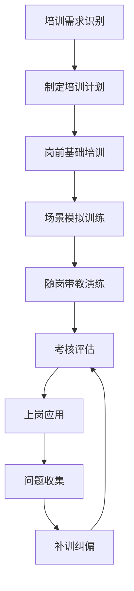

（二）培训实施要求

1. 教学形式要求

培训采用制度讲解、情景演练、角色模拟、案例问答和现场口述考核相结合的方式开展。其中，入户沟通和失智对象照护培训必须设置面对面模拟演练，防止只学概念、不具备实操能力。

2. 培训材料要求

培训材料包括服务话术指引、场景应对卡片、禁忌行为清单、异常情形识别提示和服务记录示例。培训资料以项目服务场景为基础编制，便于一线人员携带学习和复盘使用。

3. 培训频次要求

对直接服务人员，岗前培训合格后方可参与相应服务；项目执行期间，根据服务情形和问题反馈组织专项强化培训。出现对象投诉、沟通失当、照护动作不规范或异常情况处置不当时，应及时补训并复核掌握情况。

（三）场景模拟与带教机制

1. 入户模拟演练

围绕“首次接触不信任对象”“情绪激动对象沟通”“反复诉求对象解释”“独居老人沟通缓慢”等场景开展演练，重点纠正语速过快、追问过急、记录与沟通脱节等问题。

2. 失智照护模拟演练

围绕“对象重复提问”“对象拒绝配合”“对象误认身份”“对象出现外出倾向”等场景进行演练，重点训练语气控制、肢体距离、指令简化和现场安全观察。

3. 带教纠偏安排

对新参与服务人员，由熟悉现场服务要求的人员进行示范、旁听、复盘和纠偏。带教重点不在业务事项本身，而在服务动作是否规范、沟通是否得体、风险识别是否及时。

四、培训标准、行为规范与考核控制

（一）重点行为规范清单

| 服务场景 | 应执行动作 | 禁止行为 | 判定要点 |
|---|---|---|---|
| 入户沟通 | 先说明身份和来意，再开展交流 | 未经说明直接问询、擅自拍照录音 | 对象是否知情并愿意配合 |
| 困难群众接触 | 先倾听再回应，避免评价 | 指责、争辩、催促、标签化称呼 | 是否体现尊重与安抚 |
| 情绪波动对象 | 降低语速，控制问题数量 | 连续追问、提高音量、强行继续 | 情绪是否被进一步激化 |
| 单人失智对象 | 使用短句和单一指令，关注安全 | 争辩记忆、突然接触、单独离场不观察 | 对象是否稳定、现场是否安全 |
| 异常情形发现 | 立即记录并报告，必要时寻求协同 | 隐瞒问题、自行处置超权限事项 | 是否及时启动上报 |

（二）考核机制

1. 考核内容

考核分为知识掌握、情景应对、行为规范和异常处置四项。知识掌握重点看服务边界和禁忌；情景应对重点看沟通与安抚能力；行为规范重点看动作是否符合要求；异常处置重点看风险判断和报告意识。

2. 考核方式

采用书面测试、现场模拟、口头问答和带教观察记录相结合方式。对入户沟通和失智照护两类内容，以模拟考核结果作为是否具备独立服务条件的重要依据。

3. 结果运用

考核不合格人员不得独立承担对应服务；对考核临界人员安排补训复测；对多次出现沟通投诉、对象不适反映或照护行为偏差的人员，暂停相关服务并重新训练。

五、风险控制与闭环改进

（一）服务风险识别

本制度重点防控三类风险：一是因表达失当引发群众误解、抵触或投诉；二是因对困难群众情绪与真实需求识别不足导致服务偏差；三是因失智对象照护不规范导致安全隐患、走失风险或异常情况延误。

（二）异常升级闭环

出现以下情形时，应按规定立即升级处理：对象持续情绪失控、疑似意识障碍、明显身体不适、居住环境存在严重安全隐患、存在走失倾向或无法完成基本沟通。服务人员仅承担发现、稳定和报告职责，不超越培训能力边界进行处置。


（三）复盘改进机制

菲尔德咨询将服务过程中的典型沟通案例、群众反馈问题、失智对象接触中的风险情形纳入培训复盘。对重复出现的问题，修订培训话术、补充场景案例、调整模拟内容；对表现较好的服务做法，固化为操作示例，形成可复制的服务技能标准。

（四）制度落实承诺

菲尔德咨询将以专项培训制度保障服务人员在入户沟通、困难群众服务和单人失智对象照护中的实际操作能力，确保培训内容与服务场景一致、与行为规范一致、与风险防控要求一致，为麻城市社会救助服务项目提供稳定、规范、审慎的现场服务支撑。

#### 1.4.7 入户核查管理制度：家计调查、邻里访问、信息核实与问题线索排查规范

一、制度目标与适用范围

（一）制度目标

菲尔德咨询围绕麻城市社会救助服务项目入户核查场景，建立覆盖家计调查、邻里访问、信息核实和问题线索排查的标准化制度，确保入户核查结论真实、依据充分、过程可追溯、结果可复核。制度执行目标如下：

1. 核查内容完整。对申请对象及相关家庭成员的家庭人口、收入来源、财产状况、实际生活状态、居住情况、照护情况和困难成因进行逐项核实，避免漏项、缺项和笼统判断。
2. 核查过程规范。统一访谈提纲、调查顺序、记录要求、证据采集口径和异常上报方式，避免因调查人员个人经验差异导致标准不一。
3. 核查结论审慎。对涉及救助资格判断的重要事实，坚持“现场所见、对象陈述、邻里印证、资料核验”相互校验，避免单一信息来源直接下结论。
4. 线索发现及时。对隐瞒收入、财产异常、共同生活人员不实、实际居住地不符、疑似重复享受、疑似失联、疑似监护缺失等问题，形成快速识别、分类登记和移交流程。
5. 风险控制到位。对拒访、情绪激动、精神状态异常、行动不便、无人陪护、重大疾病、突发困难等特殊情形，明确安全边界和处理要求，确保核查合法合规、文明审慎。

（二）适用范围

本制度适用于菲尔德咨询承担的麻城市社会救助服务项目中与入户核查有关的各类业务场景，包括但不限于低保、低保边缘家庭、特困供养、临时救助及其他需开展家庭经济状况和实际困难核实的事项。适用对象包括申请对象、共同生活家庭成员、实际照料人、近邻知情人以及其他与核查事实相关的知情主体。

二、核查原则与基本要求

（一）核查原则

1. 逐户核查原则。

对纳入入户调查范围的对象实行一户一核，不以电话询问、单方说明替代应当开展的现场核查。

2. 客观审慎原则。

对家庭收入、财产和生活困难状况坚持事实导向，不凭印象判断，不以外观、居住条件单项信息替代综合认定。

3. 交叉印证原则。

对关键事实至少通过两类以上信息进行印证。能现场查看的现场查看，能由知情人印证的进行印证，能通过资料核验的同步核验。

4. 适度必要原则。

核查内容严格围绕救助审核所需事实展开，不超范围打探与救助无关的个人隐私，不诱导式提问，不扩大采集信息边界。

5. 留痕可审原则。

核查前有任务依据，核查中有记录载体，核查后有结论说明、证据归集和问题流转，确保全过程可核验。

（二）基本要求

1. 入户前明确核查任务、对象信息、拟核重点和疑点事项。
2. 入户中按统一要素开展问、看、查、记，形成文字记录。
3. 对涉及争议、异常和无法当场判断事项，不现场作倾向性承诺。
4. 对老年人、残疾人、重病患者、精神障碍对象等特殊群体，注意沟通方式，必要时通过监护人、照料人补充说明。
5. 对核查发现的重大急难情形，做到先登记、快报告、快移交。

三、入户核查主要内容与标准

（一）家计调查内容

家计调查重点围绕“家庭构成是否真实、收入来源是否明确、财产状况是否清楚、生活困难是否客观”四个方面开展。

| 核查类别 | 重点内容 | 主要核查方式 | 形成记录 |
|---|---|---|---|
| 家庭人口 | 户籍成员、共同生活成员、长期外出人员、实际照料关系 | 询问对象、查看证件或户内情况、邻里印证 | 家庭成员情况记录 |
| 收入情况 | 务工收入、经营收入、赡抚养费、转移性收入、偶发收入 | 访谈说明、票据或凭证、知情人佐证 | 收入来源说明 |
| 财产情况 | 住房、车辆、经营性资产、大额耐用品、存疑财产线索 | 现场观察、对象说明、周边印证 | 财产核查记录 |
| 生活状况 | 饮食起居、医疗支出、照护负担、就学负担、突发支出 | 入户查看、对象陈述、邻里了解 | 困难情况描述 |
| 特殊情形 | 失能失智、精神障碍、长期卧床、无人照护、监护缺位 | 现场观察、照料人说明、周边核实 | 特殊情况登记 |

（二）邻里访问内容

邻里访问重点用于核实对象日常居住、家庭负担、就业状态、照料情况和社会评价，不以邻里意见替代事实判断，但作为交叉印证的重要来源。访问时优先选择对对象情况较熟悉、与对象日常接触较多、相对中立的知情人。访问内容主要包括：

1. 对象及家庭成员是否长期在本地共同生活。
2. 家庭是否存在长期外出务工、经商、借住、分户不分居等情况。
3. 家庭经济状况与申请陈述是否大体一致。
4. 是否存在明显经营活动、车辆长期使用、较高消费等异常现象。
5. 是否存在老人失养、残疾人失护、儿童监护不足、突发重大困难等需关注问题。

（三）信息核实内容

信息核实主要针对申请资料与现场情况的一致性开展，不作形式化核对，重点核实以下内容：

1. 申请人陈述与现场实际是否一致。
2. 户内人员数量、实际居住安排与申报信息是否一致。
3. 家庭主要收入来源、劳动能力情况与困难原因是否一致。
4. 住房现状、生活设施、生活物资与其困难程度是否存在明显背离。
5. 邻里反映、前期记录、任务交办疑点与本次调查结论是否一致。

四、标准化核查流程

（一）核查前准备

核查人员在入户前完成任务清单确认、对象基础信息了解和重点问题预判。对首次申请、动态复核、异议复查和疑点复查对象分别确定核查侧重点。对需重点关注的事项，在调查记录中预置核验项，避免现场遗漏。

（二）入户实施步骤

入户核查执行“表明身份—说明事项—开展调查—现场核实—归纳确认—形成记录”的操作顺序。调查中同步开展观察记录，不以单纯问答代替核查。

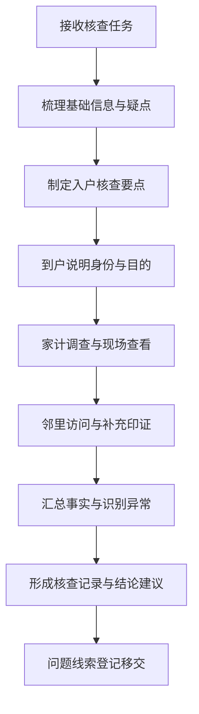

（三）核查后处理

核查结束后，当日整理调查记录和证据材料，对结论明确的形成核查意见，对存疑事项列明疑点、已核情况和建议复核方向；对发现的异常或风险线索，按分类要求登记并移交，不自行搁置。

五、调查方法与记录规范

（一）家计调查方法

1. 问询核实。

围绕家庭成员构成、收入来源、刚性支出、照护负担、困难持续时间等进行逐项询问，提问口径保持中性，避免诱导。对金额、频次、来源、去向等关键点追问到可理解、可记录、可复核。

2. 现场查看。

对居住环境、基本家具家电、生活物资、照护条件、病患状态和无障碍情况进行适度查看。现场查看重在验证家庭基本生活状态，不对与救助无关区域作扩大式检查。

3. 资料比对。

对申请材料、承诺说明和现场陈述进行一致性比对。对明显不一致情形，记录具体矛盾点，不作模糊表述。

（二）邻里访问方法

1. 邻里访问一般不少于两名知情人，确因居住分散、人员缺失等客观原因无法满足的，记录原因并通过其他方式补充印证。
2. 访问提问以事实为主，不询问评价性、攻击性内容，不引导知情人作主观推断。
3. 对邻里提供的信息，区分“亲见事实”“长期了解”“听闻信息”三类，不将听闻信息直接作为核查结论依据。

（三）记录规范

| 记录事项 | 规范要求 | 风险控制要点 |
|---|---|---|
| 时间地点 | 记录入户日期、起止时段、具体地点 | 防止事后无法对应具体任务 |
| 在场人员 | 记录受访对象、家庭成员、照料人、邻里知情人 | 防止信息来源不明 |
| 调查内容 | 围绕人口、收入、财产、困难、照护逐项记录 | 防止遗漏关键认定事实 |
| 现场所见 | 记录直接观察情况，避免主观评价词 | 防止记录带倾向性 |
| 异常事项 | 单列疑点、矛盾点、无法核实点 | 防止结论笼统失真 |
| 结论建议 | 写明基本判断、依据来源和后续建议 | 防止只有结论没有支撑 |

六、问题线索排查与分类处置

（一）重点排查线索

入户核查中，对以下线索实行重点登记：

1. 家庭成员申报不全，共同生活关系存疑。
2. 务工、经营、租赁等收入未如实陈述。
3. 实际居住情况与申报地不一致，长期空挂、长期离户。
4. 家庭财产状况明显异常，与困难陈述不匹配。
5. 对象存在失联、拒绝配合、无法接触或代答严重情形。
6. 老弱病残对象存在照护缺位、监护不足、居住安全隐患。
7. 邻里反映集中且与对象陈述明显相反的事项。
8. 发现疑似骗取救助、重复享受或其他需进一步复核的问题。

（二）分类处置要求

1. 一般疑点。

对信息不完整、表述不清或需补充证明的事项，列入补充核实清单，明确补证方向和复核建议。

2. 重要疑点。

对家庭人口、收入、财产、实际居住等直接影响资格判断的事项，单独标记并提交重点复核，不作简单通过建议。

3. 风险线索。

对涉及急难情况、监护风险、人身安全隐患等事项，形成情况摘要，及时移交采购人指定对接人员或相关基层经办单位。

```mermaid
flowchart LR
A[发现异常情况] --> B{判断性质}
B -->|信息不全| C[补充核实]
B -->|影响资格认定| D[重点复核登记]
B -->|急难或安全风险| E[即时报告移交]
C --> F[更新调查记录]
D --> F
E --> F
F --> G[形成可追溯闭环]
```

七、特殊情形核查要求

（一）对象无法完整表达情形

对高龄、失智、精神障碍、重病卧床等对象，允许由监护人、近亲属或实际照料人辅助说明，但必须结合现场所见和周边印证形成判断，避免单方代答替代核查。

（二）拒访或不配合情形

对拒绝入户、拒绝说明、拒绝签认或情绪明显激动的，不与对象发生争执，记录当时情形、在场人员和已采取的沟通措施，必要时建议另行安排复核。

（三）长期外出或人户分离情形

对长期在外务工、就医、陪读等情形，重点核实其是否属于共同生活成员、家庭经济联系是否持续以及收入对家庭生活的实际影响，不以暂时不在家简单作排除或认定。

（四）单人户与特殊困难家庭情形

对独居老人、事实无人抚养儿童、重病重残家庭、突发变故家庭，核查中增加生活自理、照料支持、就医用药、居住安全等内容，确保困难描述具体、证据充分。

八、质量控制与责任要求

（一）双重校验要求

入户核查记录实行“调查事实校验+结论依据校验”双重检查。前者检查记录是否完整、时间地点是否明确、信息来源是否清楚；后者检查结论是否与证据一致、是否存在以偏概全、是否遗漏重要疑点。

（二）禁止性要求

1. 禁止未入户先下结论。
2. 禁止照抄套用历史记录。
3. 禁止仅凭对象口述形成关键认定。
4. 禁止以邻里主观评价代替事实核查。
5. 禁止对无法确认事项作确定性表述。
6. 禁止对调查对象作承诺性表态或倾向性暗示。

（三）责任落实要求

调查人员对记录真实性、完整性和原始性负责；复核人员对逻辑一致性、证据充分性和疑点识别负责。对因核查粗疏、记录失真、疑点漏报导致后续审核判断失准的，按项目内部质量要求进行责任追溯和整改。

九、制度执行效果

（一）提升核查真实性

通过家计调查、邻里访问、信息核实和线索排查四类动作联动，能够有效减少仅凭申报材料判断带来的信息偏差，提高家庭困难识别的准确度。

（二）提升审核支撑力

入户核查记录形成事实链、印证链和疑点链，为采购人及基层经办单位开展审核研判、动态管理和复查复核提供直接支撑。

（三）提升风险发现能力

对隐瞒收入、居住不实、照护缺位和急难风险等问题建立前端识别机制，有利于实现“早发现、早登记、早移交”，增强社会救助服务的规范性和针对性。

#### 1.4.8 上门服务管理制度：精神慰藉、生活照料、工单记录与异常情况报告规范

一、制度目标与适用范围

（一）制度目标

菲尔德咨询围绕麻城市社会救助服务项目入户服务场景，建立覆盖上门前准备、上门实施、服务记录、异常报告、回访核验的上门服务管理制度，重点规范精神慰藉、生活照料、工单记录与异常情况处置四类核心事项，确保服务对象可识别、服务事项可执行、服务过程可追溯、异常情况可报告、服务结果可核验。

本制度服务于社会救助对象上门关怀与协助事项，不替代行政审批、资金发放、专业医疗护理和公安处置职能。制度设计坚持“按单服务、到户实施、全程留痕、及时报告、边界清晰”的原则，既满足困难群众日常照料与情绪关怀需求，也为采购人掌握服务过程、核验服务质量、识别风险线索提供可审查依据。

（二）适用范围

本制度适用于菲尔德咨询在麻城市社会救助服务项目履约期间开展的入户型服务，包括但不限于以下场景：对特困、低保、低保边缘、支出型困难家庭等对象开展精神慰藉、陪伴交流、生活协助、基础环境整理提醒、代办协助提示、困难情况观察、服务工单填报及异常情况上报。

本制度重点管控四类行为边界：一是不得擅自承诺政策待遇、补助金额和办理结果；二是不得代替服务对象作出具有法律后果的意思表示；三是不得超范围收集与服务无关的个人信息；四是不得隐瞒服务中发现的风险事项和异常线索。

二、上门服务内容与执行标准

（一）精神慰藉服务规范

精神慰藉以缓解孤独感、提升沟通意愿、增强基本信任为目标，重点面向独居、空巢、高龄、重病恢复期、情绪低落及沟通意愿弱的困难群众。服务人员应采用尊重、平和、非刺激性沟通方式，围绕生活近况、身体状态、家庭联系、现实困难等内容开展交流，不进行价值评判，不追问与服务无关的隐私事项。

精神慰藉服务应落实“五有”要求：有称呼确认，入户后准确核对对象身份并使用适宜称呼；有情绪观察，关注表情、反应、语言变化与居家状态；有耐心倾听，允许服务对象完整表达困难与诉求；有适度回应，对现实困难给予程序性解释和安抚性反馈；有结果记录，对情绪状态、主要诉求、后续需跟进事项形成工单留痕。

对存在明显悲观厌世、激烈冲突、长期失联家属矛盾、突发重大变故等情形的对象，服务人员不得仅作口头安慰后结束服务，应依规转入异常情况报告流程。

（二）生活照料服务规范

生活照料以协助性、非替代性、低风险为原则，主要围绕服务对象居家日常中可现场完成且风险可控的事项开展。可执行内容包括：协助整理常用生活区域、提示分类摆放常用物品、协助简单清洁、陪同核对常用生活物资、提醒按时饮食和休息、协助联系家属或村居相关人员、提示就医复诊或政策咨询渠道等。

生活照料不得超越服务边界，不得实施专业护理、注射用药、现金保管、银行卡密码代管、贵重物品代存、单独搬运重物、危险电器维修、高危登高作业等高风险事项。对对象提出超范围需求的，服务人员应做好解释，并记录需求内容及转介建议。

对居家环境明显杂乱、存在异味、床铺潮湿、食物腐败、取暖用电不规范等情况，服务人员应在协助整理、提醒整改的同时，将影响安全和基本生活的问题纳入工单记录；达到隐患标准的，应启动异常报告，不得以一般照料事项替代处理。

上门服务事项执行要点表

| 服务类别 | 主要内容 | 执行要求 | 禁止事项 |
|---|---|---|---|
| 精神慰藉 | 陪伴交流、情绪疏导、困难倾听 | 语气平和、尊重意愿、如实记录诉求 | 承诺救助结果、刺激性言语、强行追问隐私 |
| 生活照料 | 简单整理、日常提醒、协助联系 | 现场可控、对象知情、不过度替代 | 医疗护理、代管财物、危险作业 |
| 工单记录 | 服务时间、事项、结果、异常 | 当次完成、真实完整、可复核 | 补填造假、笼统描述、漏记异常 |
| 异常报告 | 安全隐患、突发疾病、失联失能等 | 分级上报、及时联动、留痕闭环 | 瞒报迟报、仅口头反馈、不形成记录 |

三、上门服务实施流程与现场规范

（一）上门前核对要求

服务人员在出发前应核对服务任务、对象基本信息、约定事项、既往服务记录及注意事项，明确本次服务重点。对连续服务对象，应重点查看上次遗留问题是否已处理；对首次服务对象，应准备身份说明、服务事项说明及记录工具，避免入户后反复询问影响沟通。

如服务对象为高龄、行动不便、情绪敏感或沟通障碍人员，上门前应预判接触方式，必要时同步预留家属、村居联系人信息用于沟通核实。上门前发现地址不清、对象状态不明、服务事项缺失的，不直接出发，应先行核准。

（二）入户实施规范

到达现场后，服务人员应先表明身份和来意，经对象或监护照护人员知晓后开展服务。入户期间应先观察再实施，重点识别对象状态、居家环境、生活物资、沟通反应及现场是否存在不安全因素。精神慰藉与生活照料应结合对象实际开展，不机械照搬统一话术，不以简单签到替代服务过程。

服务过程中应坚持“三同步”：一是服务同步观察，边服务边识别困难变化；二是沟通同步确认，对对象表述的关键事项及时复述确认；三是完成同步记录，当次核心事项及时形成笔记，避免离户后凭记忆补录。

（三）离户确认与后续处理

服务结束前，服务人员应简要确认本次完成事项、对象当前状态、是否存在需协调事项，并对不能现场解决的问题说明后续反馈路径。离户后应在规定时限内完成工单录入，涉及异常情况的，同步启动报告流程，不得待集中汇总时统一补报。

```mermaid
flowchart TD
A[任务接收] --> B[上门前核对]
B --> C[入户身份确认]
C --> D[精神慰藉与生活照料]
D --> E[现场观察与事项记录]
E --> F[离户确认]
F --> G[工单录入]
G --> H{是否存在异常}
H -- 否 --> I[归档待回访]
H -- 是 --> J[分级报告与跟进]
```

四、工单记录管理规范

（一）记录要求

工单是上门服务真实性、完整性和可核验性的核心载体。菲尔德咨询实行“一次上门、一单记录、当次形成、要素完整”管理要求。工单内容应至少覆盖服务对象、服务时间、到离户时段、服务地点、服务事项、对象状态、现场发现、处置结果、需跟进问题、记录人员等关键要素。

文字记录应客观、准确、可复核，避免使用“已处理”“情况正常”“完成服务”等空泛表述。对精神慰藉类服务，应记录主要沟通内容、情绪状态变化、提出诉求及回应情况；对生活照料类服务，应记录协助事项、对象配合情况、现场改善情况及未完成原因；对异常情况，应记录发现时间、表现特征、已采取动作和报告去向。

（二）记录时限与校核要求

上门服务工单原则上应于当日完成录入；存在紧急异常的，应先报告后补全记录，但最迟不超过规定内部时限。项目现场负责人应对工单开展抽查，重点核查服务事项与对象类别是否匹配、记录内容是否具体、异常事项是否同步上报、同一对象连续记录是否前后衔接。

对记录不完整、用语笼统、逻辑矛盾、时间异常、事项失真的工单，应退回补正并保留痕迹。对重复出现记录质量问题的人员，纳入专项纠偏，不以形式合格替代真实可审查。

工单记录关键字段表

| 字段类别 | 记录要点 | 审查关注点 |
|---|---|---|
| 基础信息 | 对象姓名、地址、服务日期、服务人员 | 身份对应准确、时间地点清楚 |
| 服务实施 | 精神慰藉内容、生活照料事项、停留时长 | 是否与任务相符、是否具体可辨 |
| 现场观察 | 身体状态、情绪变化、居住环境、生活物资 | 是否体现真实入户、是否有判断依据 |
| 结果处置 | 已完成事项、未完成原因、后续建议 | 是否形成闭环、是否可跟进 |
| 异常情况 | 风险描述、报告时间、接收对象、处置动作 | 是否及时报告、是否留痕完整 |

五、异常情况报告规范

（一）异常情形识别标准

上门服务中的异常情况，是指超出一般精神慰藉和生活照料范围，可能影响服务对象生命安全、基本生活、家庭稳定、政策执行或项目履约质量的事项。重点包括以下类型：一是身体异常，如疑似突发疾病、明显外伤、长期卧床无人照护、持续精神异常；二是居家安全异常，如燃气电路隐患、严重卫生恶化、食品腐败、冬季取暖风险；三是生活保障异常，如断粮、断药、无人照料、失联失访；四是家庭关系异常，如家暴迹象、激烈冲突、监护照料缺失；五是服务阻断异常，如对象拒绝接触、身份信息明显不符、长期无法入户。

（二）分级报告要求

一般异常，应在当次服务结束后立即向项目现场负责人报告，并在工单中完整记录，纳入后续跟进；紧急异常，应优先采取必要联络和求助动作，同时第一时间逐级报告，不得等待工单完成后再行反馈。涉及生命安全、突发疾病、疑似意外伤害等情形，应立即联系紧急救助渠道，并同步通知相关联络人。

异常报告应做到“四清楚”：对象清楚、问题清楚、现场状态清楚、已采取措施清楚。不得仅以“情况特殊”“对象状态不好”等模糊表述代替报告事实。

（三）报告闭环要求

异常事项报告后，应形成“发现—报告—接收—处置—反馈—销项”闭环。项目现场负责人负责跟踪接收状态和处置进度，对需持续关注的对象设置后续回访提醒；对已完成处置的，补充记录结果；对短期无法解决的，记录原因和下一步协同方向，避免异常事项在工单中悬空。

```mermaid
flowchart LR
A[异常发现] --> B[现场初步判断]
B --> C{紧急程度}
C -- 一般 --> D[报告现场负责人]
C -- 紧急 --> E[立即联络救助并同步报告]
D --> F[工单留痕]
E --> F
F --> G[跟踪处置]
G --> H[结果反馈]
H --> I[闭环销项]
```

六、服务质量控制要求

（一）服务语言与行为规范

服务人员入户开展精神慰藉和生活照料时，应保持态度稳妥、表达清楚、举止得当，不训诫、不争辩、不制造心理压力。对服务对象反复表达同类困难的，应耐心倾听并做好记录，不以简单打断或笼统答复应付。对认知下降、语言迟缓、情绪波动对象，应放慢交流节奏，缩短单次提问长度，提高沟通可接受度。

（二）特殊情形处理要求

对独居高龄、行动受限、疑似失智、重病恢复期对象，应适当增加观察和确认力度，重点关注饮食、起居、服药提醒、居家安全、与外界联系等基本状况。对拒绝照料但存在明显风险的对象，应尊重其表达，同时保留客观记录并报告，不因对象拒绝即视同服务终止。对非服务对象在场干扰、代答或阻碍记录的，应坚持向本人核实核心事项，必要时注明信息来源和受限情况。

（三）责任追溯要求

凡上门服务未按要求记录、异常未报告、报告后未跟进、工单信息失真造成核验困难的，均纳入责任追溯范围。通过工单抽查、服务回访、时间比对、问题复核等方式，对制度执行情况进行验证，确保精神慰藉有过程、生活照料有内容、工单记录有依据、异常报告有闭环。

七、制度执行成果预期

（一）服务过程更加规范

通过统一上门服务内容边界、现场动作标准和记录规则，可有效避免“只到户、不服务”“有服务、无记录”“有问题、未报告”等履约风险，提升上门服务的一致性和可核验性。

（二）风险识别更加及时

通过将情绪异常、生活失序、环境隐患、照料缺失等纳入标准化观察与报告要求，能够更早发现困难群众现实风险，增强项目对突发事项和潜在问题的前端识别能力。

（三）评审与验收依据更加充分

通过工单、异常报告和处置闭环的规范留痕，菲尔德咨询可为采购人提供清晰、连续、可抽查的履约证据，支撑项目过程监管、服务验收和续签评估。

#### 1.4.9 培训宣传管理制度：业务培训、政策宣传、舆论引导与宣传费用管控

一、制度目标与适用范围

（一）制度目标

菲尔德咨询围绕麻城市社会救助服务项目培训宣传工作，建立“业务培训有计划、政策宣传有口径、舆论引导有机制、经费使用有控制”的专项管理制度。制度目标聚焦四个方面：一是保障项目服务人员准确理解社会救助政策边界、服务要求和群众沟通规范，减少因理解偏差导致的解释不一致、宣传失真和舆情风险；二是保障面向群众、基层协办人员及相关协同对象的政策传播内容真实、易懂、可核验，提升社会救助政策知晓率和服务获得感；三是保障项目执行过程中对群众咨询、社会关注和异常舆情信息做到早发现、快研判、稳处置，防止个案问题演变为面上风险；四是保障宣传相关费用预算清晰、审批规范、支出可溯、票据完整，避免超范围宣传、无依据支出和不合规报销。

（二）适用范围

本制度适用于与本项目直接相关的培训组织、政策宣传、信息发布、现场宣讲、咨询解答、舆情监测、宣传资料制作及宣传费用管理活动。适用对象包括项目管理人员、驻场服务人员、宣传执行人员及经批准参与本项目宣传培训活动的相关支持人员。凡涉及对外口径、宣传材料形成、公众活动组织和宣传费用支出事项，均纳入本制度统一管理。

二、业务培训管理制度

（一）培训分类与实施原则

菲尔德咨询将本项目培训划分为岗前培训、专题培训、更新培训和警示培训四类，并实行“按需设置、分层实施、记录留痕、效果验证”原则。

1. 岗前培训。

面向拟投入本项目的服务人员，重点覆盖社会救助政策框架、群众咨询高频问题、宣传行为边界、保密要求、舆情敏感事项识别、宣传资料使用规范等内容。未完成岗前培训并通过考核的人员，不安排独立承担政策宣讲、咨询答复和宣传资料发放任务。

2. 专题培训。

围绕低保、特困、临时救助、救助申请受理配套服务、对象沟通、重点群体政策解释、敏感场景应答等主题开展。对政策调整期、群众申请高峰期、集中排查期和重点宣传节点，增加专题培训频次，确保宣传内容与最新政策口径一致。

3. 更新培训。

对新出台、修订或明确解释的救助政策和执行口径，实行“政策变化即更新、更新后即传达、传达后即抽测”机制。更新培训重点解决旧口径未清理、新口径未同步、同题不同答等问题。

4. 警示培训。

针对群众投诉、宣传误导、表达失当、资料发放错误、敏感舆情苗头等事件开展案例复盘培训，明确错误类型、责任环节、整改要求和预防措施，形成“问题暴露一次、规则强化一次、执行提升一次”的纠偏机制。

（二）培训内容设置

培训内容紧扣宣传与解释场景，不延伸至同级章节已覆盖的专业服务管理事项。重点包括：一是社会救助政策宣传口径，明确哪些内容可以宣传、哪些内容需谨慎表述、哪些内容必须引用正式依据；二是政策解释方法，统一对资格条件、申请流程、审核审批衔接、动态管理、常见误解等事项的表达方式；三是群众沟通技巧，规范面对老年人、困难群众、情绪激动来访人员时的语言尺度、倾听方式和答复边界；四是宣传活动组织规范，包括现场秩序、资料发放、群众提问收集、口头承诺限制和问题转办要求；五是舆情敏感点识别，重点识别“政策理解偏差、个案放大传播、费用质疑、服务误解、承诺争议”等风险点；六是宣传合规要求，明确不得擅自发布未经审核的信息，不得使用夸大性表述，不得作出超出政策权限的承诺。

培训项目与管理要求一览表

| 培训类别 | 主要对象 | 核心内容 | 组织频次 | 输出成果 |
|---|---|---|---|---|
| 岗前培训 | 新投入项目人员 | 政策口径、宣传边界、咨询答复规范、保密要求 | 上岗前 | 培训签到、课件、测试记录 |
| 专题培训 | 宣传及服务相关人员 | 专项政策宣讲、常见问题答复、典型场景应对 | 按月或按需 | 培训纪要、问答清单 |
| 更新培训 | 全体相关人员 | 政策变化、口径调整、资料更新说明 | 政策调整后及时开展 | 更新通知、版本替换记录 |
| 警示培训 | 相关责任人员及全体人员 | 投诉案例、误宣案例、舆情事件复盘 | 事件发生后 | 复盘报告、整改清单 |

（三）培训实施流程

培训由项目负责人统筹安排，宣传培训专员具体组织，实行年度计划与临时任务相结合的实施机制。年初形成培训计划，明确主题、对象、频次、授课方式和成果要求；月度根据项目节点、政策变化和群众咨询热点进行动态调整；单次培训结束后完成签到、资料归档、效果测试和问题汇总，重要问题纳入后续答疑清单。

```mermaid
flowchart LR
A[培训需求收集] --> B[确定主题与对象]
B --> C[编制培训方案]
C --> D[组织实施]
D --> E[测试与答疑]
E --> F[形成记录归档]
F --> G[问题纳入口径更新]
```

（四）培训考核与应用

培训不以“学过”为完成标准，而以“能讲清、讲一致、讲得准”为评价要求。菲尔德咨询对培训结果实行知识测试、情景问答、现场抽问和宣传活动复核相结合的考核方式。对考核不合格人员，安排补训和再测；连续两次未达到要求的，不安排其承担独立对外宣传和现场解释工作。对在宣传活动中出现口径偏差、解释失当、擅自承诺等情形的，按培训纠偏程序处理，并将结果作为岗位履职评价的重要依据。

三、政策宣传管理制度

（一）宣传原则

政策宣传坚持真实性、准确性、通俗性和适度性。真实性要求宣传内容来源于现行有效政策文件、正式答复口径和采购人确认要求；准确性要求具体表述与政策条件、办理范围和适用对象保持一致，不自行扩张解释；通俗性要求面向困难群众和基层群众的表达简明易懂，避免机械照搬政策原文；适度性要求不作诱导性承诺，不以宣传替代审批，不以个案推定普遍结果。

（二）宣传内容管理

宣传内容实行统一策划、统一审核、统一版本、统一留存。对外宣传内容主要包括政策概况、申请条件说明、办理流程提示、救助类别识别、群众常见问题解答、咨询渠道指引和风险提示。涉及群众最关心的资格条件、材料准备、动态调整、临时救助适用场景等事项，采用“简明问答+事项提示”的方式呈现。涉及个案判断、审批结果、金额测算、特殊政策适用等事项，不在公开宣传中作确定性承诺，统一引导至正式受理和审核程序。

（三）宣传方式管理

菲尔德咨询根据项目特点采取集中宣讲、入点宣传、资料发放、咨询答疑和定向提醒等方式开展政策传播。集中宣讲适用于政策集中普及；入点宣传适用于群众来访集中场所；资料发放适用于高频事项普及；咨询答疑适用于个性化问题回应；定向提醒适用于易遗漏、易误解的重点事项提示。不同宣传方式均应对应明确的宣传主题、使用材料、责任人员和活动记录，避免临时拼凑、口径失控和资料失管。

（四）宣传资料管理

宣传资料包括折页、问答单页、提示卡、横幅文案、现场宣讲提纲、咨询答复清单等。所有资料均应建立版本号、形成日期、审核记录和发放去向登记。因政策调整导致资料失效的，应同步启动作废回收和新版替换。未经审核的草稿、网络摘录内容、来源不明表述不得直接用于对外宣传。

四、舆论引导与风险应对制度

（一）舆情监测范围

舆情监测重点关注四类信息：一是群众对社会救助政策的集中疑问和普遍误解；二是对服务态度、解释口径、宣传资料、活动组织的投诉和负面反馈；三是与社会救助资格、公平性、资金使用相关的敏感讨论；四是可能引发误读扩散的个案信息、短视频内容、群聊传播和现场录音录像片段。

（二）舆情处置原则

菲尔德咨询对舆情信息实行“发现即登记、敏感即上报、事实先核、口径统一、分类回应”原则。一般性误解信息，以政策解释和事实澄清为主；涉及投诉苗头信息，以核实经过、解释依据、提出纠正措施为主；涉及明显失实传播信息，以证据核对、口径报批、稳妥回应为主；涉及重大敏感事项的，不擅自对外表态，按项目要求及时上报并配合处理。

（三）舆情分级与响应要求

舆情按照影响范围、传播速度、内容敏感度和处置难度进行分级管理。低风险信息由项目现场及时解释并登记；中风险信息由项目负责人组织核实、统一口径后回应；高风险信息立即上报采购人相关管理要求对应责任链条，并暂停无授权信息输出。所有舆情处置均应保留发现时间、信息来源、核实过程、回应依据、处理结果和后续观察记录。

宣传与舆情管控要点表

| 管控事项 | 主要风险 | 管控措施 | 留痕要求 |
|---|---|---|---|
| 宣传口径 | 误解政策、夸大承诺 | 统一问答清单、重要表述审核 | 口径版本、审核记录 |
| 宣传资料 | 内容过期、来源不明 | 编号管理、更新回收 | 发放登记、作废记录 |
| 现场宣讲 | 即兴答复偏差 | 使用提纲、疑难问题转登记 | 活动记录、问题台账 |
| 咨询答疑 | 个案承诺争议 | 明确答复边界、书面提示 | 咨询记录、转办记录 |
| 舆情信息 | 扩散失控、回应失当 | 分级上报、统一回应 | 舆情登记、处置闭环 |
| 费用支出 | 超范围、无依据报销 | 预算控制、审批核验 | 申请单、票据、结算凭证 |

（四）舆论引导方式

舆论引导重在前端预防和过程释疑，不以简单“删压”替代沟通。菲尔德咨询通过统一问答口径、设置高频问题提示、加强重点时段现场解释、在宣传活动中同步开展风险提醒等方式，减少因信息不对称引发的误读。对群众普遍关注的共性问题，及时形成简明解释材料；对个案引发的泛化讨论，坚持就政策依据说明事实边界，避免个人信息泄露和不当延伸评论。

```mermaid
flowchart TD
A[舆情信息发现] --> B{风险判断}
B -->|一般| C[现场解释并登记]
B -->|较高| D[核实事实并统一口径]
B -->|重大敏感| E[立即上报并暂停对外表述]
C --> F[跟踪反馈]
D --> F
E --> F
F --> G[复盘优化宣传口径]
```

五、宣传费用管控制度

（一）费用管理原则

宣传费用坚持预算约束、事前审批、用途匹配、据实报销和专项留痕原则。菲尔德咨询对本项目宣传费用实行专门事项管理，不将与项目无关支出列入宣传费用，不以培训、宣传名义列支非必要开支，不以活动便利替代合规手续。

（二）费用适用范围

宣传费用主要用于经批准的政策宣传资料制作、必要的宣传物料印制、现场宣讲必需的基础保障支出及经确认的宣传活动相关合理开支。超出项目任务范围、与政策宣传无直接关联、无法形成有效凭证或无法说明用途必要性的支出，不予列支。

（三）费用审批与报销要求

宣传活动发生费用前，应提出用途说明、预算测算、数量依据和实施安排，经审批后执行。费用发生后，应提交申请单、活动记录、物料清单、结算依据和合法票据。对批量印制、重复采购、临时追加和单价异常事项，实行重点核验。对已作废或未实际发放的宣传资料，不得重复结算或虚列支出。

（四）费用复核与节约控制

菲尔德咨询建立宣传费用月度复核机制，对宣传资料印制量、活动开展次数、物料使用情况和结算金额进行交叉核对，防止“资料多印少用、活动少报多支、单据齐全但实物不符”等问题。宣传方式优先选择内容简明、覆盖有效、成本适度的形式，避免形式化宣传和重复性开支。在保证群众知晓效果的前提下，压减非必要装饰性、展示性支出，提高宣传费用使用效率。

六、记录归档与制度执行要求

（一）记录归档要求

培训宣传相关工作实行全流程留痕管理。培训方面保存计划、签到、课件、测试、纪要和补训记录；宣传方面保存方案、审核稿、定稿、发放登记、活动记录和问题汇总；舆情方面保存发现记录、研判意见、处置过程和复盘材料；费用方面保存申请、审批、合同或制作清单、票据和结算记录。所有资料做到内容对应、时间可查、责任可追。

（二）制度执行要求

菲尔德咨询将本制度作为项目培训宣传工作的执行依据。凡涉及政策解释、宣传发布、公众答疑、舆情回应和宣传费用报销事项，均按本制度办理。对未按制度执行造成宣传口径偏差、群众误解扩大、舆情处置失当或费用管理不规范的，立即启动纠偏措施，必要时暂停相关人员宣传权限，直至完成整改、复核通过后恢复执行。通过制度化培训、统一化宣传、审慎化引导和精细化费用控制，保障本项目政策传播有据、群众沟通有序、风险防控有效、经费使用合规。

#### 1.4.10 档案与信息安全制度：一户一档整理、资料归集与个人信息保护

一、档案与信息安全制度目标

（一）制度定位

菲尔德咨询围绕麻城市社会救助服务项目中入户核查、申请受理协助、资料整理归集、动态跟踪记录、结果反馈留痕等业务场景，建立覆盖纸质档案、电子资料、影像材料和个人信息处理全过程的档案与信息安全制度。制度重点解决四类问题：一是服务对象资料来源多、类型杂、更新频；二是乡镇街道、村社区、项目服务端之间资料交接容易出现遗漏、错漏和版本不一致；三是涉及身份证明、家庭经济状况、联系方式、病残情况等敏感信息，保密要求高；四是项目履约过程中资料既要可查、可核、可追溯，又要严格控制知悉范围和使用边界。

（二）管理目标

1. 实现“一户一档、分类建档、动态更新、统一编号、双重留痕”。
2. 实现资料“来源清楚、内容完整、时间可溯、责任到人、调取可控”。
3. 实现个人信息“最小必要采集、限定用途使用、授权访问、全过程防泄漏”。
4. 实现档案管理与项目验收、质量核查、问题复盘相互支撑，做到有据可查、有档可审。

二、“一户一档”建档标准

（一）建档对象范围

菲尔德咨询对项目服务覆盖范围内形成服务关系、发生入户调查、材料收集、事项协办、上门服务记录、动态核实记录的对象，统一建立“一户一档”。建档对象包括但不限于最低生活保障对象、特困供养对象、临时救助对象、低保边缘家庭、支出型困难家庭、核查复核对象及采购人要求纳入档案管理的其他救助服务对象。

（二）建档原则

1. 一户一档原则。

以家庭为基本建档单元；涉及单人单户、分散供养、事实独居等情形的，按照实际服务对象独立建档，避免混档并档。

2. 一事一痕原则。

凡形成受理记录、核查记录、回访记录、资料补正记录、异常情况说明、结果送达记录等，均纳入该户档案链条留存，不以口头说明替代书面留痕。

3. 一次采集、多次调用原则。

对已依法合规取得且在有效期内的基础资料，不重复要求服务对象提交；确需补充更新的，仅补齐变化部分，减少群众反复提供材料。

4. 动态更新原则。

对家庭人口、收入状况、健康状况、居住情况、联系方式、救助类别变化等信息，按业务发生节点及时更新，保留历史版本和更新说明。

（三）档案构成内容

菲尔德咨询按照“基础信息+业务资料+过程记录+结果资料”的结构建立户档，主要内容如下：

| 档案类别 | 主要内容 | 归集要求 |
|---|---|---|
| 基础身份资料 | 身份证明、户籍信息、联系方式、家庭成员关系信息 | 复印件或影像件清晰可辨，注明来源与采集日期 |
| 救助业务资料 | 申请表、授权书、承诺书、申报材料、补正材料 | 按事项发生顺序编排，缺项需附情况说明 |
| 核查过程资料 | 入户记录、家计调查记录、邻里访问摘要、现场照片、定位或时间留痕 | 记录时间、地点、经办人员、对象确认信息齐全 |
| 服务实施资料 | 上门服务记录、问题发现记录、转介协办记录、回访记录 | 每次服务独立记录并归入同户档案 |
| 结果资料 | 审核意见反馈、结果告知、签收记录、异议说明、整改补充记录 | 体现闭环结果，不得仅留中间过程 |
| 动态更新资料 | 信息变更说明、重新核查记录、阶段汇总表 | 新旧资料关联存放，保留版本轨迹 |

（四）编号与标识规则

菲尔德咨询对档案实行统一编号管理。编号至少包含乡镇街道标识、村社区标识、对象类别标识、年度标识、顺序号五项基本字段。纸质档案与电子档案使用同一主编号，分册、补录、变更材料在主编号下设子编号管理，避免出现纸电编号不一致、后续资料无法归并的问题。档案封面、目录、卷内材料右上角、电子文件名均按统一规则标识。

三、资料归集与整理制度

（一）归集范围与时点

菲尔德咨询对项目实施中形成和接收的资料实行清单化归集。归集时点分为三类：一是受理建档时即时归集基础资料；二是入户核查、服务实施、问题处置后当日或次日归集过程资料；三是事项办结后归集结果资料和补充说明。对跨阶段形成的资料，按业务节点及时归档，不待集中处理时一次性补录。

（二）整理标准

1. 完整性标准。

每户档案应具备目录页、材料顺序页和主体材料；存在缺页、缺签名、缺日期、缺说明情形的，不得直接归档完结。

2. 一致性标准。

申请表、入户记录、影像材料、台账信息、电子系统录入信息之间，户主姓名、身份证号、家庭人数、地址、联系电话等关键字段应保持一致；不一致的，须附核实说明。

3. 规范性标准。

纸质材料应字迹清晰、页码连续、签字完整；电子材料应格式统一、命名规范、扫描端正、内容可识别。

4. 可审查标准。

卷内材料顺序应符合业务逻辑，做到“看得见来源、看得清过程、看得到结果”。

（三）归档步骤

```mermaid
flowchart TD
A[资料形成] --> B[当日登记]
B --> C[完整性核对]
C --> D[纸质整理]
C --> E[电子扫描]
D --> F[统一编号入卷]
E --> G[电子命名入库]
F --> H[纸电对应校验]
G --> H
H --> I[缺项补正]
I --> J[归档封存]
```

（四）重点控制要求

1. 对身份证、户口簿、残疾证、病历摘要、银行卡信息等高敏感资料，复印和扫描仅保留业务必要页，不扩大收集范围。
2. 对现场照片、入户视频、语音说明等影像资料，应控制拍摄内容，不拍摄与救助核查无关的私人空间、无关人员和无关物品。
3. 对服务对象自行提交的补充材料，应登记接收时间、接收人、材料名称和份数，防止散失。
4. 对作废表单、错印资料、重复扫描件，应按作废件管理，不得随意丢弃或混入正式档案。

四、档案保管与调阅制度

（一）纸质档案保管

菲尔德咨询对纸质档案实行专柜、分类、分区、加锁保管。档案存放区域与办公公共区域物理隔离，非授权人员不得进入。档案盒、档案柜外部仅显示编号和类别，不直接展示服务对象姓名、身份证号等个人信息。对未归档临时资料设立待整理专区，防止正式档案与临时材料混放。

（二）电子档案保管

电子档案统一存储于项目指定工作环境或经批准的信息存储环境，实行分级文件夹权限控制、账号访问控制和操作留痕控制。电子资料不得存放于个人私人网盘、未经批准的即时通信群文件、个人移动设备公开相册等高风险载体。涉及导出、复制、传输的，应履行登记审批和接收确认。

（三）调阅管理

菲尔德咨询实行“因岗调阅、因事调阅、登记调阅、限时归还”的档案调阅制度。调阅前应明确用途、范围、时限和责任人；调阅中不得擅自拍照、转发、复制无关内容；调阅后应核对归还材料完整性。对采购人核查、审计检查、绩效评价所需资料，按照要求提供查阅支持，同时做好调阅记录和交接留痕。

档案调阅控制要点表

| 调阅情形 | 审批要求 | 使用边界 | 留痕要求 |
|---|---|---|---|
| 日常业务核对 | 岗位负责人同意 | 仅限本人经办事项相关资料 | 记录时间、用途、调阅人 |
| 项目质量检查 | 项目授权人员审批 | 仅限检查范围内样本资料 | 记录抽查范围和归还情况 |
| 采购人检查 | 按对接要求办理 | 不超出检查事项提供资料 | 形成交接清单 |
| 外部审计评价 | 经项目负责人批准 | 按法定或合同要求提供 | 留存调取依据和反馈记录 |

五、个人信息保护制度

（一）采集控制

菲尔德咨询对个人信息实行最小必要采集原则。围绕社会救助核查、服务记录、结果反馈所必需的信息进行收集，不以方便管理为由扩大采集范围。对个人敏感信息，应明确采集用途、使用场景和保管要求；无法证明与当前业务直接相关的信息，不纳入常规采集范围。

（二）使用控制

1. 严格限定用途。

已收集信息仅用于本项目救助服务实施、资料核验、过程留痕、结果反馈和合同约定的管理需要，不用于无关宣传、无关培训展示、个人留存或其他项目调用。

2. 严格限定知悉范围。

按照岗位职责授权访问，不实行全员共享资料库。不同岗位仅接触履职所需信息，避免无差别浏览全部对象资料。

3. 严格脱敏展示。

在工作汇报、案例分析、培训示例、统计报送等场景中，涉及姓名、身份证号、手机号、详细住址、病情等信息的，应作隐名或遮蔽处理；能够用编号替代的，统一使用编号。

（三）传输控制

涉及电子资料传输时，菲尔德咨询采取指定渠道、指定对象、指定文件、指定时限管理，不通过无关群组扩散发送，不在公共终端下载留存。发送前核对对象身份和资料范围，发送后确认接收并及时清理临时缓存。纸质材料外带应履行登记手续，做到去向明确、数量明确、责任明确。

（四）销毁控制

对超出保存期限、失效作废、重复留存、错误打印或依法应当销毁的资料，菲尔德咨询实行分类销毁。纸质资料采用碎纸或专门销毁方式处理，电子资料采用彻底删除并清除可恢复痕迹的方式处理。销毁过程至少形成销毁清单和经办记录，防止简单丢弃造成信息泄露。

六、风险防控与异常处置机制

（一）主要风险识别

菲尔德咨询针对档案与信息安全重点识别六类风险：一是户档材料缺失、错装、混装；二是纸电资料不一致；三是个人信息在复印、拍照、转发、培训展示等环节泄露；四是因交接不清造成材料遗失；五是因非授权访问造成信息扩散；六是因归档不及时导致项目检查时资料不完整。

（二）预防措施

1. 采用资料清单核对制，每户建档均对应归档清单，缺项即时标注。
2. 采用纸电双校验制，扫描后与原件逐项核对关键字段和页数。
3. 采用敏感资料单独标识制，对高敏感信息提高访问限制。
4. 采用调阅登记制和外带审批制，减少资料流转失控。
5. 采用定期抽查制，对编号、目录、页码、签名、脱敏情况进行检查。

（三）异常处置

一旦发现档案缺失、错档、破损、非授权查阅、疑似泄露等异常，菲尔德咨询立即启动处置：第一时间封存相关资料和访问权限；同步核查影响范围、资料类型、接触人员和传播路径；对可补正的资料及时补齐，对疑似泄露事项形成专项记录并按规定报告；完成处置后形成原因分析、责任界定和防再发措施。

```mermaid
flowchart LR
A[发现异常] --> B[立即控制]
B --> C[登记报告]
C --> D[范围核查]
D --> E[补正或止损]
E --> F[责任追溯]
F --> G[整改复核]
G --> H[闭环归档]
```

七、档案质量检查与留痕要求

（一）检查内容

菲尔德咨询将档案质量检查聚焦于五项内容：资料是否齐全、字段是否一致、签字日期是否完整、影像资料是否清晰合规、个人信息处理是否符合最小必要和脱敏要求。对检查中发现的缺项、错项、漏项，逐户建立问题记录，不以口头通知代替整改依据。

（二）留痕要求

每次档案整理、补正、调阅、复制、移交、销毁均形成可核查记录。记录至少包括时间、事项、资料名称、数量、经办人、复核人和处理结果。对于补录材料，应注明补录原因、原缺失情况和补录日期，防止后续核查时无法判断形成先后。

（三）移交要求

项目实施过程中因阶段性汇总、采购人查验或合同要求发生资料移交的，菲尔德咨询按照“清单交接、双方确认、去向可追”的原则办理。移交清单应明确档案编号、材料名称、份数、载体形式、是否含敏感信息及交接时间，确保移交后责任边界清晰。

八、制度执行承诺

（一）制度落地方式

菲尔德咨询将在项目实施中配套形成户档目录模板、资料接收登记表、调阅登记表、资料移交清单、销毁清单、异常事件记录单等执行载体，使档案管理和信息保护要求落实到每一份资料、每一次流转、每一个处理动作。

（二）履约保障效果

通过建立上述档案与信息安全制度，菲尔德咨询可确保麻城市社会救助服务项目相关资料实现统一归集、规范建档、动态可查、过程留痕和安全可控，既满足项目履约管理、检查验收和资料审查需要，也切实保护困难群众个人信息安全，降低资料失真、遗漏、泄露和争议风险。

#### 1.4.11 财务管理制度：分项费用预算、服务工单据实结算与费用支出审核

一、财务管理目标与适用原则

（一）管理目标

菲尔德咨询针对麻城市社会救助服务项目建立“预算有依据、结算有工单、支出有审核、凭证可追溯、资金可核验”的财务管理制度，确保项目资金使用与采购需求、服务内容、实际工单和验收结果保持一致，满足采购人对服务类项目经费规范、过程留痕和审查可视的管理要求。

（二）适用范围

本制度适用于本项目履约过程中发生的各类服务性支出、保障性支出和管理性支出，重点覆盖以下事项：
1. 分项费用预算编制与执行控制；
2. 服务工单据实结算与费用归集；
3. 日常费用申请、审核、支付和报销；
4. 票据、附件、台账和原始凭证管理；
5. 预算调整、异常支出和超预算控制；
6. 财务资料对账、抽查与审计配合。

（三）管理原则

1. 合同对应原则。
所有费用均以合同约定、采购需求、服务任务和履约边界为依据，不列支与项目无关的费用，不将其他项目费用并入本项目。

2. 分项管控原则。
按照服务事项、服务区域、服务频次、服务工单和费用类别分别建账、分别归集、分别核验，避免混项结算、笼统计费。

3. 据实结算原则。
实际发生、实际服务、实际留痕、实际审核后方可结算。未形成工单记录、未完成必要签认、未达到支付条件的，不纳入结算。

4. 审核前置原则。
费用发生前有预算依据，费用发生中有标准约束，费用报销时有材料核验，付款前有复审把关，形成全流程控制链。

5. 票账一致原则。
工单记录、审批单据、发票凭证、付款记录、会计账册和项目台账相互对应，确保金额一致、时间一致、事项一致。

二、分项费用预算管理

（一）预算编制依据

菲尔德咨询按照本项目服务内容、履约周期、人员配置安排、基层服务开展方式及采购人确认的实施要求编制项目预算。预算编制主要依据包括：
1. 招标文件及合同约定的服务范围和结算规则；
2. 项目实施计划、服务数量预估和区域覆盖安排；
3. 历史同类项目经验形成的成本测算参数；
4. 项目执行中必须发生的合规支出项目及控制标准；
5. 服务工单闭环所需的基础记录、审签和归档要求。

（二）预算分类方式

为保证后续结算清晰、审核便利，项目预算采用“一级费用类别+二级费用事项+三级核销依据”方式编制。一级费用重点包括人员费用、服务实施费用、辅助物资费用、宣传培训费用、差旅交通费用、资料印制费用及经批准的其他必要费用。每项费用均设置对应的核销口径和证明材料要求。

费用类别与核销依据对照表

| 费用类别 | 主要内容 | 预算控制方式 | 结算依据 |
|---|---|---|---|
| 人员费用 | 项目服务人员劳务、补贴等 | 按岗位及周期控制 | 考勤、任务记录、审批资料 |
| 服务实施费用 | 入户服务、调查核实等发生的直接费用 | 按服务类型和工单数量控制 | 工单、服务记录、签认资料 |
| 交通差旅费用 | 县域内外因项目需要产生的交通支出 | 按路线、频次、标准控制 | 出行审批、票据、工单关联 |
| 宣传培训费用 | 项目相关培训、政策宣传资料等 | 按计划和场次控制 | 方案、签到、照片、票据 |
| 资料印制费用 | 表单、档案袋、宣传页等 | 按批次和领用控制 | 印制清单、入库领用记录 |
| 其他必要支出 | 经批准且与项目直接相关支出 | 单项审批控制 | 专项审批单、凭证附件 |

（三）预算控制机制

1. 年度统筹、月度细化。
结合项目周期建立总预算控制表，并按月分解至各费用项，保证月度执行有参照、阶段考核有基础。

2. 预算锁定、动态预警。
财务人员建立预算执行台账，按“已批准、已发生、已报销、待支付、余额”五个口径进行跟踪。任一费用项达到预算警戒值时，及时提示项目负责人采取控制措施。

3. 超预算从严审批。
原则上不得发生无预算支出。确因采购人新增任务、服务频次调整、政策变化或特殊情况导致预算需调整的，必须形成书面说明，明确调整原因、金额影响、对应服务事项和资金平衡方式，经项目负责人、财务负责人审核后执行。

4. 专款专用、单独核算。
本项目单独设立费用台账和凭证归集口径，不与菲尔德咨询其他项目混同核算，确保资金流向清晰、成本结构明晰、审查口径统一。

三、服务工单据实结算管理

（一）结算基本要求

服务工单是本项目费用结算的重要基础资料。凡与服务实施直接相关的费用，均应建立“任务来源明确、服务过程可查、结果信息完整、费用关系可对应”的工单管理逻辑。无工单、工单要素不全、工单与实际服务不符、工单与附件无法印证的，不作为结算依据。

（二）工单结算要素

每笔纳入结算的服务工单原则上应包含以下核心要素：
1. 服务对象或服务事项标识信息；
2. 工单编号、下达时间、完成时间；
3. 服务地点、服务内容、服务次数；
4. 执行人员信息；
5. 相关过程记录或结果记录；
6. 必要的签认、复核或佐证材料；
7. 对应费用类别、结算口径和金额说明。

（三）工单与费用对应规则

1. 一单一事一归集。
每张工单对应具体服务事项，原则上不得将多个性质不同的服务内容合并为一笔笼统费用。

2. 先服务后结算。
工单必须反映已完成的实际服务，不得预填、补造、倒签或将计划任务直接作为结算依据。

3. 同步留痕、月度汇总。
服务完成后及时登记工单，按月形成工单汇总表，与费用报销单、支付申请单及财务台账对应归档。

4. 抽查核验、异常剔除。
对存在时间异常、地点异常、数量异常、内容雷同、签认缺失等情况的工单，暂停结算，待核实后按结果处理。

服务工单据实结算流程

```mermaid
flowchart LR
A[服务任务形成] --> B[执行服务并记录工单]
B --> C[提交佐证资料]
C --> D[项目复核工单要素]
D --> E{是否完整合规}
E -- 是 --> F[财务匹配费用类别]
F --> G[纳入月度结算台账]
G --> H[审核通过后支付]
E -- 否 --> I[退回补正或剔除]
I --> D
```

（四）月度结算管理办法

菲尔德咨询实行月度归集、分项核验、集中审核的结算方式。月度结算重点把握以下要求：
1. 每月固定时点汇总当期有效工单及相关附件；
2. 项目端先完成业务真实性和完整性复核；
3. 财务端再核验金额口径、预算余额、票据规范和审批链条；
4. 对已审定金额形成当月结算清单，作为付款和记账依据；
5. 对跨月补件事项单独备注，防止重复结算或遗漏结算。

（五）异常工单处置

出现以下情形时，相关费用不直接进入结算：
1. 工单信息缺项，无法识别服务事项或时间地点的；
2. 签认资料不完整，无法证明服务实际发生的；
3. 工单数量与任务安排明显失衡的；
4. 同一事项重复填报、重复归集的；
5. 工单关联金额明显偏离预算标准且无合理说明的。

对于异常工单，建立“登记—核实—处理—留痕”处置台账。经核实属补正可修复的，限期补正；经核实属不符合结算条件的，予以剔除并说明原因。

四、费用支出审核制度

（一）支出审核层级

项目费用支出实行“申请人提交、项目负责人初审、财务人员复审、授权负责人审批、合规支付”的分级审核机制。不同金额、不同性质和不同类别的支出，按照内部授权规则执行，不得越权审批，不得先付款后补审。

（二）支出审核重点

1. 审事项。
核实费用是否属于本项目必要支出，是否与合同履约内容直接相关。

2. 审依据。
核实是否具备预算依据、工单依据、活动依据或专项审批依据。

3. 审标准。
核实单价、数量、频次、范围是否符合项目预算和内部控制标准。

4. 审附件。
核实申请单、工单、清单、签认记录、发票、付款凭证等是否齐全、真实、可相互印证。

5. 审重复。
核实是否存在同一事项重复报销、拆分报销、跨期报销或不同口径重复结算。

（三）支出审核资料要求

不同类型费用实行分类审核。原则上应提交以下材料：
1. 费用申请或报销审批单；
2. 对应工单或事项说明材料；
3. 相关清单、统计表或结算明细；
4. 合法有效票据；
5. 验收、签收、签到、照片等辅助证明材料；
6. 付款信息及收款主体信息；
7. 其他根据费用性质需要补充的资料。

（四）重点费用审核控制

1. 直接服务类费用。
重点核实工单真实性、服务次数、服务对象对应关系及结算金额计算依据。

2. 交通差旅类费用。
重点核实出行事由、路线、时间、票据与工单关联性，防止与日常通勤、非项目活动混同列支。

3. 宣传印制类费用。
重点核实批量、单价、实际用途、领用流向和活动对应关系，防止超量印制、用途不明或重复采购。

4. 零星采购类费用。
重点核实必要性、审批合规性、采购明细和实物交付记录，确保小额支出同样有据可查。

费用审核控制要点表

| 审核环节 | 审核责任 | 审核重点 | 审核结果 |
|---|---|---|---|
| 申请提交 | 经办人员 | 事项说明、金额测算、附件完整 | 受理或补件 |
| 项目初审 | 项目负责人 | 与服务任务对应、工单真实性、是否超预算 | 通过、退回、暂缓 |
| 财务复审 | 财务人员 | 票据合规、金额准确、分类正确、台账可入账 | 通过、补正、剔除 |
| 审批确认 | 授权负责人 | 支出必要性、审批权限、付款条件 | 批准或不批准 |
| 支付归档 | 财务人员 | 付款信息、凭证装订、账务处理、资料归档 | 支付并归档 |

五、票据、台账与对账管理

（一）票据管理

菲尔德咨询严格执行合法票据报销要求。所有报销票据应真实、有效、内容完整，与费用事项、金额、时间及收款主体一致。对抬头错误、内容模糊、明显涂改、与实际事项不符的票据，一律退回，不作为报销凭证。

（二）台账管理

项目财务设置不少于以下台账：
1. 项目预算执行台账；
2. 工单结算汇总台账；
3. 费用报销登记台账；
4. 发票与付款对应台账；
5. 异常事项处理台账。

各类台账按月更新、按项对应、按笔可查，做到从预算到支付全链条可追溯。

（三）对账管理

项目实行月度对账制度。财务人员按月将工单结算数据、报销数据、付款数据和账务数据进行核对，重点检查以下差异：
1. 工单金额与报销金额不一致；
2. 已报销未付款或已付款未入账；
3. 同一工单多次结算；
4. 超预算支出未履行审批；
5. 台账与原始凭证编号不一致。

发现差异后，及时形成对账说明并整改销项，不将问题滚动带入下一结算周期。

六、风险控制与监督留痕

（一）主要风险控制

围绕本项目财务管理，重点防控以下风险：
1. 预算编制粗放导致执行失控；
2. 工单与费用脱节导致结算依据不足；
3. 原始凭证不完整导致报销审核失真；
4. 超预算、重复报销、拆分报销导致资金使用不规范；
5. 支付后资料补录导致责任边界不清。

针对上述风险，菲尔德咨询通过预算分解、工单联动、审核分级、台账校验和异常预警进行全过程控制。

（二）监督抽查机制

财务负责人定期对项目费用进行抽查，抽查重点包括工单真实性、附件完整性、票据规范性、金额准确性和预算执行偏差。对抽查发现的问题，按照“问题登记、责任确认、补正整改、复核关闭”的方式处理，并保留书面记录。

财务支出审核闭环

```mermaid
flowchart TD
A[费用发生需求] --> B[预算匹配核验]
B --> C[提交申请及附件]
C --> D[项目初审]
D --> E[财务复审]
E --> F{符合支付条件}
F -- 是 --> G[审批支付]
G --> H[记账归档]
H --> I[月度对账抽查]
F -- 否 --> J[退回补正]
J --> C
I --> K[发现问题整改销项]
```

（三）资料留存要求

所有与项目费用相关的预算表、审批单、工单、票据、付款凭证、结算清单、对账记录和异常处理资料，均按时间顺序和事项类别归档保存，保证采购人查验、项目复核、结算核对和审计抽查时能够快速调取、逐笔说明、逐项印证。

七、制度执行承诺

（一）严格执行分项预算控制

菲尔德咨询将对项目各项费用实行事前测算、事中监控、事后核验，确保每一类支出均有预算依据、控制标准和执行台账。

（二）严格执行工单据实结算

凡属服务实施形成的费用，均坚持以有效工单和佐证资料为基础进行归集和结算，不虚列、不重列、不提前结算。

（三）严格执行费用审核把关

所有费用支出均履行规定的审核和审批程序，做到事项明确、依据充分、票据合规、金额准确、支付审慎。

（四）确保资金使用规范透明

通过预算、工单、审核、票据、台账、对账六个环节联动管理，确保本项目费用支出可证明、可审查、可追溯，为项目规范履约和采购人监督管理提供稳定、完整、可核验的财务支撑。

#### 1.4.12 人员稳定制度：岗位替补、交接培训与服务人员调整不超过15%控制

一、制度目标与控制原则

（一）稳定履约目标

菲尔德咨询针对麻城市社会救助服务项目建立人员稳定制度，核心控制目标为：在合同履约周期内保持服务队伍持续、岗位职责不断档、服务对象衔接不脱节、项目资料交接不遗漏，并将服务人员调整比例控制在采购人可审查、可核验、可追溯的范围内。围绕社会救助服务连续性要求，人员稳定制度重点解决三类问题：一是关键岗位临时空缺导致工作中断；二是人员更替造成服务对象信息断层；三是频繁调整影响基层协同与群众信任。

（二）适用范围

本制度适用于承担麻城市社会救助服务项目的驻场管理人员、乡镇街道服务人员、入户核查人员、上门服务人员、资料处理及辅助岗位人员。凡涉及离职、病假、产假、长期请假、岗位轮换、阶段性补位、内部调配等影响正常履约的情形，均纳入统一稳定管理。

（三）控制原则

1. 岗位不断档原则

任何岗位出现人员异动时，必须先落实替补、后实施调整；未完成替补安排和交接确认的，不得形成岗位空档。

2. 原岗熟悉优先原则

优先从已参与同类社会救助项目、熟悉救助服务流程和群众工作要求的人员中安排替补，减少重新磨合成本。

3. 交接完整原则

人员调整不得仅完成名单替换，必须同步完成对象台账、在办事项、风险事项、资料清单、联系方式和时间节点交接，确保后续人员接得住、跟得上、办得成。

4. 比例受控原则

履约期内服务人员调整实行总量控制，累计调整比例原则上不超过项目服务人员总数的15%。确因不可抗力、人员健康、政策变化或采购人要求发生调整的，单独说明原因并履行报备程序。

二、人员稳定管理架构与责任分工

（一）稳定管理责任设置

菲尔德咨询实行“项目负责人统筹、岗位主管把关、综合管理台账留痕”的稳定管理方式。项目负责人对人员稳定结果负责，审核调整必要性、替补到位情况和比例控制情况；岗位主管负责提出岗位连续性评估意见，确认在办事项、风险事项和交接清单；综合管理人员负责登记人员异动、更新调整台账、统计累计比例、保留签字材料。

（二）重点岗位稳定要求

对与社会救助对象直接接触、影响服务连续性和工作质效的岗位，实行更严稳定要求。包括申请受理衔接岗位、入户核查岗位、上门服务岗位、台账维护岗位等。上述岗位如需调整，应优先采取短期替补、带岗过渡、并行交接等方式，避免直接替换后立即独立作业。

人员稳定控制要点表

| 控制事项 | 管理要求 | 审查材料 | 控制结果 |
|---|---|---|---|
| 岗位空缺控制 | 先替补、后调整，不得出现无人承接 | 替补审批记录、到岗确认 | 岗位不断档 |
| 人员交接控制 | 必须书面交接并经主管确认 | 交接清单、签收记录 | 事项不断线 |
| 调整比例控制 | 履约期累计调整原则上不超过15% | 调整台账、比例统计表 | 队伍总体稳定 |
| 服务对象衔接控制 | 原服务对象、在办工单、重点对象逐项移交 | 对象名册、工单清单 | 服务连续 |
| 紧急替补控制 | 临时缺岗24小时内安排替补人员接续 | 应急调配记录 | 应急不断档 |

三、岗位替补机制

（一）替补人员储备要求

菲尔德咨询建立项目岗位替补名册，按“关键岗位必备、一般岗位覆盖、同岗同责对应”的要求储备替补人员。替补名册不作形式备案管理，而是明确到具体岗位、到岗条件、可接替时限和现有熟悉程度。替补人员应满足以下条件：一是具备相应岗位基础能力；二是已接受项目通用要求学习；三是可在规定时限内到岗；四是能够承接原岗位资料和服务对象。

（二）替补触发情形

出现以下情形时，立即启动岗位替补程序：第一，人员离职或提出离岗申请；第二，连续请假影响既定服务安排；第三，因身体原因无法继续履职；第四，因突发事件短期不能到岗；第五，经采购人或项目内部核实，原岗位人员已不适宜继续承担服务任务。

（三）替补启动时限

1. 计划内调整

对可预见调整事项，原则上提前启动替补准备，完成替补确认、资料预移交和过渡安排后再实施岗位变动。

2. 紧急性调整

对突发离岗、临时缺岗等情况，原则上在24小时内落实临时替补，保障对外联络、工单承接和重点对象服务不受影响；在3个工作日内完成正式替补衔接和交接资料补齐。

（四）替补到岗控制要求

替补人员到岗后，不得仅以“人员已补齐”作为完成条件，还应同步完成三项核验：一是岗位职责核验，确认可承担具体工作事项；二是服务对象核验，确认已接收并掌握原服务对象与在办事项；三是资料核验，确认纸质资料、电子资料、联络信息和待办节点完整移交。

```mermaid
flowchart TD
A[出现离岗或缺岗情形] --> B[项目负责人判定是否启动替补]
B --> C[从替补名册匹配人员]
C --> D[确认到岗时间与承接岗位]
D --> E[开展交接准备]
E --> F[替补到岗]
F --> G[完成职责核验与资料核验]
G --> H[更新人员调整台账]
```

四、交接培训与过渡安排

（一）交接启动要求

凡涉及服务人员调整，必须同步启动交接培训。交接培训以“岗位交接+对象交接+资料交接+风险交接”为基本内容，不以简单口头说明替代正式交接，不以单一签字材料替代实际培训过程。

（二）交接内容清单

交接培训至少覆盖以下事项：一是原岗位职责边界、正在办理事项、未完成事项；二是服务对象基本情况、重点关注对象、特殊需求对象和需持续跟进事项；三是已形成的工作台账、服务记录、工单流转情况、资料存放位置；四是易出错环节、历史投诉事项、需重点说明的沟通注意事项；五是近期工作节点、时限要求和衔接联系人。

交接培训控制表

| 交接项目 | 主要内容 | 交接方式 | 验收要求 |
|---|---|---|---|
| 岗位职责交接 | 职责范围、工作边界、办理流程 | 面对面讲解+清单移交 | 接替人员复述确认 |
| 服务对象交接 | 对象名册、重点对象、待办事项 | 逐项说明+名册核对 | 重点对象逐一确认 |
| 资料台账交接 | 纸质档案、电子资料、工单记录 | 清单核验+签字交接 | 账实一致 |
| 风险事项交接 | 异常个案、投诉线索、时间节点 | 专项说明 | 风险清单单列 |
| 过渡跟带交接 | 短期并行、答疑辅导、现场纠偏 | 带岗过渡 | 主管确认可独立上岗 |

（三）交接培训组织方式

1. 常规交接

对计划内人员调整，安排不少于一个完整工作周期的交接过渡。原岗位人员负责逐项讲解工作事项，接替人员同步跟岗学习并接收交接清单，经岗位主管确认后转入独立履职。

2. 紧急交接

对临时缺岗无法完成完整周期交接的，由岗位主管先组织重点事项交底，优先完成服务对象名册、紧急工单、时限任务和风险事项移交，再在替补人员到岗后补充完整交接培训资料。

3. 重点对象专项交接

对高频联系对象、特殊困难对象、存在持续跟进事项的服务对象，实行名单单列、情况单讲、记录单交，不以一般性批量移交替代重点对象专项交接。

（四）交接结果确认

交接完成后，由原岗位人员、接替人员、岗位主管三方确认；原岗位人员无法现场交接的，由岗位主管组织资料核验和补充说明。未完成交接确认的，不认定为调整完成；已调整但交接不完整的，纳入整改事项限时补齐。

五、服务人员调整比例控制机制

（一）控制口径

服务人员调整比例按照项目实际投入服务人员总数为基础进行累计统计。统计口径以实际退出原服务岗位并由其他人员正式接替为准；同一人员短期请假期间由临时替补协助且未退出原岗位的，不重复计入调整比例。因采购人书面要求新增岗位、压减岗位或重构服务组织导致的结构性变化，单独列示，不直接作为稳定性失控认定。

（二）控制阈值

菲尔德咨询承诺在履约期内将服务人员调整比例原则上控制在15%以内。达到预警线时立即启动原因分析和稳定措施，避免无序变动。具体控制分级如下：一是累计达到8%，启动内部预警，暂停非必要调整；二是累计达到12%，启动专项审查，由项目负责人逐项说明调整原因及后续稳定安排；三是接近15%时，实行从严审批和采购人专项报备，未经充分论证不再实施一般性替换。

（三）调整审批要求

任何人员调整均须履行必要性审查，重点核查四项内容：一是是否存在不调整即可解决的替代办法；二是是否已有合格替补人员；三是是否已制定交接培训安排；四是是否会触发比例风险。未经审批或先调后报的，不纳入合规调整范围。

```mermaid
flowchart LR
A[提出人员调整需求] --> B[核查调整必要性]
B --> C[核查替补是否具备条件]
C --> D[测算累计调整比例]
D --> E{是否触及预警}
E -- 否 --> F[组织交接培训并实施调整]
E -- 是 --> G[启动专项审查与报备]
G --> F
F --> H[更新统计台账与持续跟踪]
```

六、异常情形处置与纠偏措施

（一）短期缺岗处置

对临时请假、突发事务等短期缺岗情形，优先采用内部顶岗、临时替补、任务再分配方式处理，确保岗位职责不悬空、服务对象不断联。短期替补结束后，及时恢复原岗位安排并完善缺岗期间记录。

（二）非正常离岗处置

对未按规定提前申请、交接不充分即离岗的情形，立即采取应急接管措施，由岗位主管先行归集资料、接续工作、补录事项，并对造成的资料缺失和服务影响进行清点，防止形成管理盲点。

（三）连续调整纠偏

同一岗位在短期内发生重复调整、同一片区连续出现多名人员变动时，项目负责人组织专项复核，查明是否存在管理、强度安排、沟通匹配等方面原因，并及时采取岗位稳定措施，防止局部波动扩散为整体失稳。

七、台账管理与可审查支撑

（一）调整台账

菲尔德咨询建立人员调整专项台账，至少记录人员姓名、岗位、到岗时间、调整时间、调整原因、替补人员、交接完成情况、是否计入比例、审批情况等信息，做到一人一记录、一调一留痕。

（二）过程材料留存

围绕岗位替补、交接培训和比例控制，保留可供采购人审查的书面材料，包括但不限于调整申请、审批记录、替补确认、交接清单、培训签到或记录、到岗确认、比例统计表、异常情况说明等，确保人员稳定管理有据可查。

（三）定期复核机制

按月复核项目人员稳定情况，核对实际在岗、替补状态、累计调整比例和未完交接事项；发现超预警趋势、交接不完整、重点岗位波动等情况，立即形成纠偏安排并限时处理。

八、履约承诺

（一）稳定履约承诺

菲尔德咨询承诺在麻城市社会救助服务项目实施过程中，严格执行岗位替补、交接培训和调整比例控制制度，确保项目服务队伍总体稳定，确保岗位不空缺、服务不中断、事项不漏交、资料不失管。

（二）比例控制承诺

菲尔德咨询承诺将服务人员调整比例原则上控制在15%以内；确因客观原因发生个别调整的，均以不影响项目正常履约为前提，落实替补到位、交接完整、记录可查和过程报备。

（三）连续服务承诺

菲尔德咨询承诺任何人员异动均不降低服务连续性要求，不因内部人员变化影响社会救助对象基本服务衔接，不因岗位替换影响采购人对项目进度、质量和资料完整性的审查。

#### 1.4.13 监督考核制度：服务过程检查、第三方验收评估与年度续签支撑

（一）监督考核目标与适用范围

菲尔德咨询围绕麻城市社会救助服务项目履约要求，建立覆盖服务实施、过程检查、结果评估、问题整改、验收支撑、续签评价的监督考核制度。监督考核的目标是对服务执行情况形成可记录、可核验、可追溯、可运用的管理闭环，为采购人掌握项目实际成效、开展阶段验收、年度评价及续签决策提供客观依据。

本制度适用于本项目全部社会救助服务事项的监督检查与考核评价，重点覆盖服务任务完成情况、服务规范执行情况、资料留痕完整性、问题整改及时性、群众反馈情况以及与年度续签相关的关键履约指标。监督考核仅聚焦项目执行过程和结果评价，不替代岗位培训、人员管理、财务审核、档案归档等其他专项制度职责。

（二）监督考核原则

1. 逐项对应原则

依据采购需求、合同约定、服务清单、质量标准和阶段工作安排设置检查要点，做到每项服务有标准、每次检查有依据、每个问题有记录、每项整改有结果。

2. 过程与结果并重原则

既检查服务数量、覆盖率、完成率等结果性指标，也检查入户记录、问题上报、服务回访、过程台账、异常处置等过程性指标，防止只看结果不看质量。

3. 日常检查与专项抽查结合原则

将常态化巡检、节点性检查、重点事项抽查、投诉问题复核有机结合，对高频服务、高风险环节和群众关注事项加大抽查频次，提高发现问题的及时性和准确性。

4. 内部监督与外部评估衔接原则

内部监督形成自查纠偏基础，第三方验收评估形成独立核验支撑，二者在指标口径、资料目录、样本抽取、问题分类上保持衔接，确保年度考核证据一致、评价逻辑一致。

5. 整改闭环原则

对发现的问题实行“登记—分析—交办—复核—销号”闭环管理，整改结果纳入月度、季度和年度考核，作为项目履约评价和续签支撑的重要依据。

（三）监督考核组织与职责分工

1. 项目监督考核组织

菲尔德咨询设立项目监督考核工作机制，由项目负责人牵头，质量监督人员、资料核验人员、数据统计人员共同参与，形成“检查实施、问题复核、结果汇总、整改跟踪、验收支撑”五项职责分工。该机制重点承担项目内部监督与迎检准备职责，确保对采购人和第三方评估形成稳定、规范、可审查的支撑材料。

2. 各角色职责边界

（1）项目负责人负责审定年度、季度、月度监督考核计划，确定重点检查任务，审核问题清单和整改结论，向采购人报送阶段履约分析资料。

（2）质量监督人员负责现场抽查、服务过程核验、问题发现与分类、整改复核，形成检查记录和复核意见。

（3）资料核验人员负责服务台账、工单资料、回访记录、佐证影像、验收清单等资料的完整性、规范性和一致性核查。

（4）数据统计人员负责服务量、完成率、问题率、整改率、满意情况等指标统计分析，形成月报、季报和年度履约汇总数据。

（5）一线服务人员按要求接受检查、配合核验、落实整改，不得迟报、漏报、虚报服务信息。

（四）监督考核内容与指标体系

菲尔德咨询按照“服务任务落实、服务质量控制、群众反馈管理、资料证据完整、问题整改成效、年度续签支撑”六个维度建立监督考核指标体系，确保评价内容与采购需求直接对应。

| 考核维度 | 核查重点 | 主要证据材料 | 运用场景 |
|---|---|---|---|
| 服务任务落实 | 服务对象覆盖、服务事项完成、计划执行进度 | 服务计划、工单台账、签到签收记录、服务记录单 | 月度检查、阶段验收 |
| 服务质量控制 | 服务流程规范、现场执行符合性、异常处置及时性 | 现场抽查表、影像资料、问题登记表、处置记录 | 日常巡检、专项抽查 |
| 群众反馈管理 | 服务对象满意情况、投诉处理、回访结论 | 回访记录、投诉台账、处理闭环记录 | 季度评价、年度汇总 |
| 资料证据完整 | 一事一记录、一单一留痕、数据口径一致 | 台账目录、资料清单、统计汇总表、签字确认材料 | 资料核验、第三方评估 |
| 问题整改成效 | 整改时限、复核通过、同类问题复发率 | 整改通知、整改报告、复核记录、销号台账 | 复盘考核、结果追责 |
| 年度续签支撑 | 履约稳定性、验收通过情况、综合评分趋势 | 月报季报、验收材料、年度分析报告、典型案例 | 年度评价、续签建议 |

在具体考核口径上，重点检查以下事项：一是合同约定服务任务是否按期完成；二是服务记录是否真实、完整、可追溯；三是服务对象反馈是否真实反映服务效果；四是发现问题是否在规定时限内整改并复核；五是阶段验收资料是否具备独立核验条件；六是年度评价资料是否能够支撑采购人作出续签判断。

（五）服务过程检查机制

1. 检查频次与方式

菲尔德咨询实行“日常核验、月度检查、季度评估、专项抽查”相结合的过程检查机制。

（1）日常核验。针对服务记录、工单闭环、异常上报、回访落实等内容开展随时核验，重点发现资料缺失、记录不一致、服务滞后等即时问题。

（2）月度检查。每月形成统一检查计划，对当月服务完成情况、记录质量、问题整改情况进行系统检查，形成月度检查报告和问题清单。

（3）季度评估。每季度对服务质量趋势、群众反馈、问题复发、资料规范化水平进行综合分析，形成阶段性评价结论。

（4）专项抽查。围绕投诉事项、重点对象服务、阶段验收前准备、采购人关注事项组织专项抽查，提高监督针对性。

2. 检查方法

过程检查采用资料查验、电话回访、现场复核、样本抽查、交叉核验五种方式综合实施。对同一事项坚持“记录看得见、对象可联系、过程可说明、结果可印证”的核查标准，避免单一凭台账判断履约情况。

```mermaid
flowchart TD
A[制定检查计划] --> B[收集服务台账与记录]
B --> C[实施资料核验与抽查]
C --> D[形成问题清单]
D --> E[下发整改要求]
E --> F[复核整改结果]
F --> G[形成检查报告]
G --> H[纳入阶段验收与年度评价]
```

3. 重点检查环节

服务过程检查重点关注四类事项。

第一，时效性事项。包括阶段任务是否按约完成、问题是否按时反馈、整改是否超期。

第二，真实性事项。包括服务记录是否与服务对象情况一致、是否存在信息漏记错记、是否存在服务留痕与实际不符情形。

第三，规范性事项。包括过程记录是否完整、签字确认是否齐全、异常事项是否有处置依据、统计口径是否统一。

第四，有效性事项。包括服务措施是否落实、群众反馈是否改善、问题重复发生情况是否下降。

（六）问题发现、分级处置与整改复核

1. 问题分类标准

菲尔德咨询将监督检查发现的问题分为一般问题、较重问题、重点问题三类，按问题性质、影响范围、整改时限和是否影响验收进行管理。

（1）一般问题，指资料瑕疵、记录格式不规范、个别台账信息缺项等不影响服务实质完成的问题，要求限期补正。

（2）较重问题，指服务记录不完整、回访结论不清晰、问题上报迟缓、抽查一致性不足等可能影响质量评价的问题，要求明确责任人和整改时限。

（3）重点问题，指可能影响采购人验收、群众评价或年度续签判断的事项，包括重复投诉、关键服务缺失、证据链不足、整改不到位等，实行重点督办和复核销号。

2. 整改闭环要求

发现问题后，菲尔德咨询在规定时限内形成问题清单，逐项载明问题表现、涉及事项、责任环节、整改要求、完成时限和复核方式。整改完成后，由质量监督人员实施复核，复核不通过的不予销号，并继续跟踪至整改到位。

| 问题等级 | 处置要求 | 整改时限 | 复核方式 | 结果运用 |
|---|---|---|---|---|
| 一般问题 | 补正资料、完善记录 | 2个工作日内 | 资料复核 | 纳入月度通报 |
| 较重问题 | 书面整改、责任确认 | 3至5个工作日内 | 资料加电话或现场复核 | 纳入季度评价 |
| 重点问题 | 重点督办、专题复盘 | 立即处置并限期完成 | 现场复核并形成结论 | 影响验收判断与年度评价 |

3. 结果反馈机制

监督考核结果以问题清单、整改通知、复核意见、月度简报、季度分析、验收资料包等形式反馈和固化。对具有普遍性的共性问题，形成专项提示；对可能影响阶段验收的关键问题，提前预警并集中整改；对整改反复不到位的问题，纳入重点跟踪范围。

（七）第三方验收评估支撑机制

1. 验收评估衔接思路

菲尔德咨询按照“内部先核、资料成册、口径一致、现场可查”的要求，为采购人组织的第三方验收评估提供全过程支撑。支撑重点不是替代评估，而是确保项目履约成果能够被独立、清晰、完整地审查。

2. 验收前准备内容

（1）建立验收资料目录。围绕合同要求、服务清单、工作台账、回访记录、问题整改、统计汇总、满意情况等形成标准化目录。

（2）开展预验收核查。对资料完整性、服务对象样本可联系性、服务记录与汇总数据一致性进行核验，提前补齐缺项、纠正错项。

（3）形成说明材料。对服务阶段安排、完成情况、问题整改情况、重点成效和遗留事项形成简明说明，便于评估机构快速掌握履约全貌。

（4）落实现场配合。根据评估需求准备样本台账、原始记录、服务佐证和问题整改依据，确保现场核验顺畅有序。

3. 第三方评估配合要求

在第三方验收评估过程中，菲尔德咨询坚持三项配合要求：一是提供材料真实完整，不临时拼凑、不事后补造；二是解释口径统一，数据来源清楚，统计边界明确；三是对评估发现问题及时确认、及时补证、及时整改，避免问题积压至年度评价阶段。

```mermaid
flowchart LR
A[内部月度检查] --> B[阶段资料归集]
B --> C[预验收核查]
C --> D[第三方验收评估]
D --> E[反馈问题清单]
E --> F[整改复核销号]
F --> G[年度履约评价]
G --> H[续签支撑建议]
```

（八）年度续签支撑机制

1. 续签支撑评价重点

菲尔德咨询将年度续签支撑建立在持续、稳定、可验证的履约证据基础上，重点围绕以下内容形成综合判断：一是年度任务完成的连续性和稳定性；二是服务质量问题是否得到有效控制；三是第三方验收结果是否总体良好；四是投诉和负面问题是否处于可控范围；五是整改闭环是否及时、有效、可复核。

2. 续签支撑资料构成

年度续签支撑资料原则上包括：年度监督考核计划及执行记录、月度检查报告、季度分析报告、专项抽查记录、问题整改台账、第三方验收评估反馈及整改结果、履约统计汇总、群众反馈分析、年度综合评价报告。上述资料相互印证，形成完整证据链，用于支撑采购人年度考核和续签决策。

3. 年度综合评价输出

年度综合评价采取“数据汇总+问题分析+整改成效+验收结论+续签建议”的结构输出，重点说明以下事项：一是项目年度履约总体情况；二是重要监督指标完成情况；三是主要问题及整改结果；四是第三方验收反馈及处置情况；五是对下一年度持续履约风险的预判与控制建议。对符合要求的事项形成续签支撑意见；对需持续改进的事项同步列明改进方向和保障条件。

（九）监督考核结果运用

监督考核结果直接用于四个方面。

1. 用于服务质量控制

将检查发现的问题转化为具体改进事项，推动服务过程纠偏，减少资料缺陷、记录偏差和执行脱节问题。

2. 用于阶段验收支撑

通过平时检查形成的规范台账、整改记录和汇总分析，为采购人开展阶段性核查和第三方验收提供现成证据基础。

3. 用于年度履约评价

将月度、季度、专项检查结果进行累计分析，形成年度履约表现画像，避免年度评价仅凭单次检查结果作出判断。

4. 用于续签决策支撑

以连续监督记录、问题控制情况、验收反馈及整改成效作为续签支撑依据，提高续签评价的客观性、完整性和可审查性。

（十）制度执行承诺

菲尔德咨询在本项目实施过程中，严格按照监督考核制度开展服务过程检查、第三方验收评估支撑和年度续签支撑工作，做到检查有计划、过程有记录、问题有整改、结果有复核、验收有依据、续签有支撑。对采购人提出的监督要求、整改意见和验收配合事项，确保及时响应、按时落实、形成闭环，以可核验的履约成果支撑项目稳定实施。

#### 1.4.14 持续改进制度：问题整改闭环、服务复盘与基层经办质效提升

一、持续改进制度目标与适用范围

（一）制度目标

菲尔德咨询围绕麻城市社会救助服务项目履约全过程，建立“发现问题—分析原因—制定措施—整改落实—复核验证—复盘提升—标准固化”的持续改进制度，将整改闭环与服务复盘嵌入日常服务、阶段评估和年度履约管理之中，确保项目实施中出现的服务偏差、资料缺失、流程堵点、群众反馈问题和基层协同问题能够被及时识别、及时处置、及时校正，并转化为可复制、可检查、可追踪的改进成果。

该制度重点解决四类问题：一是服务执行中出现的程序性偏差和工作遗漏；二是入户核查、上门服务、资料流转、系统填报等环节中的质量波动；三是群众诉求、投诉建议和基层经办反馈中反映出的共性难点；四是项目运行一段时期后存在的效率瓶颈、重复劳动和协同不畅问题。通过制度化复盘和分级整改，持续提升项目履约质量、问题响应效率和基层经办支撑成效。

（二）适用范围

持续改进制度适用于本项目实施期内与社会救助服务相关的全过程事项，包括但不限于服务工单执行结果、入户调查记录质量、异常事项处置情况、群众满意情况、项目资料归集质量、阶段性工作推进偏差、基层经办部门提出的业务协同问题以及采购人关注的整改事项。凡属于质量偏差、过程失控、结果不达预期、群众反映集中、复发风险较高的事项，均纳入本制度统一管理。

二、问题来源识别与改进事项分级管理

（一）问题识别渠道

菲尔德咨询设置统一的问题识别台账，实行多源汇集、分类登记、动态更新。问题来源主要包括：

1. 日常服务发现。项目人员在服务执行、资料审核、事项回访、工单核对中发现的差错、遗漏、超期、信息不一致等问题。

2. 管理检查发现。项目负责人、质控人员在周检查、月抽查、专项核验、节点复核中发现的履约偏差和质量缺陷。

3. 采购人及基层反馈。采购人、乡镇街道、社区村组在业务衔接、资料使用、群众服务、事项流转中反馈的堵点问题和改进建议。

4. 群众反馈。受助对象及其家属通过电话、现场、回访、意见收集表等方式提出的投诉、意见和建议。

5. 数据异常提示。工作记录、服务进度、回访结果、满意度变化、重复问题频次等形成的异常信号。

（二）问题分级原则

为提高整改针对性和响应效率，菲尔德咨询对问题实行分级处置。

| 问题类别 | 主要表现 | 处置时限 | 管控要求 |
|---|---|---|---|
| 一般改进事项 | 个别记录不规范、材料缺项、表述不完整、非关键流程偏差 | 1个工作日内明确措施，3个工作日内完成整改 | 由责任人立改立清，项目负责人复核 |
| 重点整改事项 | 多次出现同类问题、影响群众体验、影响基层经办效率、造成返工 | 当日登记，5个工作日内完成整改闭环 | 制定专项措施，纳入周例会复盘 |
| 重大风险事项 | 涉及政策执行偏差、群众投诉集中、资料失真、整改反复未果 | 当日报告，立即采取控制措施，按采购人要求限时办结 | 启动专项核查，形成书面分析和复核结论 |

（三）问题受理标准

纳入整改闭环的问题应当具备明确的问题描述、发生时间、涉及事项、责任环节、影响范围和初步处置意见。对于表述模糊、责任不清、依据不足的问题，先行补充核实后再转入整改流程，避免出现“只提问题、不明边界、不便核查”的情况。

三、问题整改闭环机制

（一）闭环整改流程

菲尔德咨询坚持“有记录、有责任、有时限、有验证、有销号”的闭环整改要求，确保每一项整改事项均可追溯、可复查、可审验。

```mermaid
flowchart LR
A[问题发现] --> B[登记分类]
B --> C[责任分派]
C --> D[原因分析]
D --> E[制定措施]
E --> F[整改落实]
F --> G[复核验证]
G --> H[销号归档]
H --> I[复盘转化]
```

（二）闭环控制要点

1. 问题登记。

所有问题统一纳入整改台账，载明问题来源、发生环节、问题描述、责任人员、整改时限、复核结果和销号时间，防止口头交办、无据可查。

2. 责任分派。

坚持“谁发生、谁整改；谁主管、谁督办；谁复核、谁把关”的原则。一般问题由直接责任人整改，重点问题由项目负责人牵头，重大风险事项报采购人知悉并同步采取控制措施。

3. 原因分析。

围绕问题性质开展针对性分析，区分是理解偏差、执行不到位、衔接不顺畅、资料标准不统一，还是群众沟通方法不当、流程设置不合理等原因，避免只纠正表象、不触及根源。

4. 措施制定。

整改措施必须对应具体问题，不得笼统表述为“加强管理”或“提高重视”。措施应当明确整改动作、完成标准、责任人和完成时限，必要时同步设置预防措施，降低复发率。

5. 复核验证。

整改完成后，由项目负责人或指定复核人员对整改结果进行验证。验证重点包括问题是否真实解决、相关资料是否补齐、流程是否恢复规范、是否存在连带问题、是否具备持续执行条件。复核不通过的，不予销号，直接退回重新整改。

6. 销号归档。

整改完成并复核通过后方可销号。销号资料应当至少包括问题记录、整改措施、相关证据、复核意见和改进结论，形成完整链条，便于后续抽查和评估。

（三）高频问题预警机制

对一个阶段内反复出现、跨人员重复出现、对基层经办造成明显返工的问题，菲尔德咨询启动高频问题预警。对同类问题达到预警阈值的，实行“一次汇总、集中分析、统一纠偏、跟踪验证”，由单点整改升级为制度改进，避免问题反复在不同环节重复出现。

四、服务复盘机制与成果转化

（一）复盘组织方式

菲尔德咨询建立“日清、周议、月盘、专项复核”四层复盘机制，复盘对象聚焦服务质量、问题成因、协同效率和群众感受，不与常规监督考核内容重复。

1. 日清复盘。

针对当日服务中的异常情况、工单退回、群众临时诉求和流程卡点进行快速梳理，形成当日提醒和即时修正。

2. 周议复盘。

围绕一周内高频问题、重复返工、整改进度、基层协同反馈进行集中讨论，明确下周改进重点和操作口径。

3. 月盘分析。

对月度问题分布、整改完成率、重复问题占比、群众反馈热点和基层经办协同难点进行综合分析，形成月度改进清单。

4. 专项复核。

对群众反映较集中、采购人重点关注、易影响项目质量评价的事项开展专题复盘，形成专项优化方案。

（二）复盘重点内容

服务复盘不泛化、不空转，重点围绕以下内容开展：

1. 问题是否具有共性。识别单点失误还是系统性短板，确定整改层级。

2. 措施是否真正有效。比较整改前后变化，防止“已整改但未改善”。

3. 标准是否需要修订。对不适应实际工作的要求，及时优化操作说明和检查口径。

4. 协同是否存在堵点。重点识别资料交接、信息反馈、事项确认中的低效环节。

5. 基层经办是否减负增效。判断改进措施是否减少重复沟通、重复核验和无效返工。

（三）复盘成果应用

复盘结论不得停留在会议记录层面，而应转化为三类成果：一是形成问题清单、原因清单、措施清单、成效清单，支撑后续验证；二是转化为统一操作提示、风险提醒、典型案例说明，指导项目人员执行；三是对重复问题形成标准化纠偏办法，纳入日常工作指引，推动同类事项一次改正、长期见效。

五、基层经办质效提升机制

（一）提升导向

持续改进制度的落脚点，不仅在于纠正项目团队内部问题，更在于通过流程优化、信息清晰、响应及时和成果可用，切实提升基层经办的工作质效。菲尔德咨询将基层经办质效提升作为整改成效的重要检验标准，以是否减少基层重复核对、是否提升事项流转顺畅度、是否提高服务材料可用性作为核心衡量方向。

（二）提升路径

| 提升方向 | 主要问题表现 | 改进措施 | 预期成效 |
|---|---|---|---|
| 减少重复返工 | 资料缺项、记录口径不一致、补充次数多 | 建立常见问题清单和一次性告知要点 | 降低反复补正频次 |
| 提高流转效率 | 问题反馈慢、责任界面不清、事项积压 | 设置整改时限和责任到人机制 | 缩短问题处置周期 |
| 提升资料可用性 | 记录不完整、证据支撑不足、归集分散 | 统一整改模板和结果留痕要求 | 提高经办审核便利度 |
| 优化协同体验 | 同类问题反复沟通、信息传递失真 | 周期性复盘共性问题并统一口径 | 降低沟通成本 |

（三）基层反馈反向改进机制

菲尔德咨询建立基层经办反馈直连机制，对乡镇街道和相关经办人员提出的流程不顺、资料使用不便、沟通成本高等问题，实行“接收即登记、分类即研判、研判即整改、整改后回访确认”的处理方式。凡基层提出且经核实合理的改进建议，及时吸收到项目执行细则中，形成“基层提出、项目改进、结果回看”的反向优化闭环。

六、整改复盘协同运行机制

（一）协同运行要求

整改与复盘不是两个孤立动作。菲尔德咨询将二者联动实施：对已经发生的问题，通过闭环整改解决当前偏差；对已经完成的整改，通过复盘评估其成效和复发风险；对经验证有效的做法，固化为后续执行标准；对成效不足的措施，重新进入整改流程，形成持续循环。

```mermaid
flowchart TD
A[整改完成] --> B[复盘评估]
B --> C{措施有效?}
C -- 是 --> D[标准固化]
D --> E[日常执行]
C -- 否 --> F[重新分析原因]
F --> G[调整措施]
G --> A
E --> H[持续监测]
H --> B
```

（二）协同运行结果要求

1. 每项重点整改事项均应有复盘记录，说明是否达到预期。

2. 每月形成阶段改进结果汇总，反映问题数量、闭环情况、重复问题变化和优化事项落实情况。

3. 对经验证有效的改进做法及时固化，避免经验停留在个别人员层面。

4. 对长期未改善或反复出现的问题，升级纳入专项整治，直至问题根源得到消除。

七、制度执行保障与成果审查方式

（一）执行保障

菲尔德咨询通过台账管理、时限管理、责任管理和结果管理保障制度落地。所有整改事项统一进账、统一编号、统一跟踪；所有重点事项统一复核、统一留痕、统一归档；所有复盘结论均形成书面记录并落实到后续动作，确保制度执行不流于形式。

（二）成果审查方式

持续改进制度的执行效果，可通过以下资料进行审查和验证：问题整改台账、整改通知记录、责任分派记录、整改证据、复核意见、销号记录、月度复盘纪要、专项分析材料、改进清单及其落实结果。上述材料能够清晰体现问题来源、处理过程、完成时限、结果验证和成果转化情况，满足采购人对履约管理可证明、可审查、可追踪的要求。

（三）预期实施成效

通过持续改进制度实施，菲尔德咨询可在本项目中实现三方面效果：一是问题发现更及时、整改更闭环，减少服务偏差累积；二是复盘分析更聚焦、改进更具体，推动项目运行质量持续稳定；三是基层经办使用项目成果更便利、协同成本更低，为麻城市社会救助服务工作形成可持续、可优化、可验证的履约支撑。

## 2. 技术与服务部分：整体服务方案、入户核查服务方案与服务性服务方案

### 2.1 整体服务方案：项目目标理解、前瞻性研究方案与采购需求融合

#### 2.1.1 基层社会救助经办服务能力提升目标理解

一、目标理解与定位

（一）基层社会救助经办服务能力提升的核心内涵

基层社会救助经办服务能力，不仅体现为街道、乡镇及村、社区工作人员对政策条款的掌握程度，更体现为救助对象识别、申请受理、入户调查、材料审核、动态管理、政策解释、档案归集和风险处置等全流程工作的规范化、协同性和可持续性。对于麻城市社会救助服务项目而言，该能力提升目标的实质，是通过系统化支撑，推动基层经办从“能办理”向“会办理、办得准、办得稳、留得痕、经得查”转变。

菲尔德咨询理解，本项目中的“能力提升”不是单一培训行为，也不是短期补位式服务，而是围绕采购人社会救助管理要求，对基层经办体系中的薄弱环节进行补强，对既有工作流程进行优化，对执行标准进行统一，对实际操作能力进行固化，最终形成可复制、可延续、可考核的基层经办支撑机制。

（二）基层能力提升的目标指向

结合社会救助工作特点，基层经办服务能力提升目标主要指向四个层面。

第一，提升政策理解与执行一致性。解决基层经办中因政策掌握不深、口径理解不一、适用边界把握不准而导致的受理标准不统一、审核意见不一致、群众咨询答复不规范等问题。

第二，提升实务操作规范性。聚焦申请登记、材料收集、入户核验、信息填报、程序流转、结果留痕等关键环节，推动经办过程符合制度要求、符合审查要求、符合痕迹管理要求。

第三，提升基层承接与协同能力。强化乡镇、街道与村、社区在社会救助事项中的分工衔接、信息反馈和工作配合，减少因职责边界模糊、移交机制不清造成的反复补件、办理迟滞和群众多头跑动。

第四，提升风险识别与问题处置能力。围绕经办中常见的程序风险、材料风险、舆情风险和廉政风险，增强基层人员对异常情形、疑难个案和敏感事项的识别、报告与规范处置能力。

表：基层社会救助经办服务能力提升目标解读

| 目标维度 | 目标内容 | 直接体现 | 评审关注点 |
|---|---|---|---|
| 政策执行能力 | 准确理解并统一执行救助政策口径 | 受理审核标准一致 | 是否体现对基层政策落地难点的把握 |
| 业务操作能力 | 规范完成经办全流程操作 | 材料齐全、程序完整、记录规范 | 是否具备可操作的能力提升路径 |
| 协同联动能力 | 强化多层级工作衔接与任务协作 | 信息传递顺畅、职责边界清晰 | 是否有利于提升基层整体运行效率 |
| 风险防控能力 | 提高问题识别、纠偏和留痕管理水平 | 经办过程可复核、可审查 | 是否符合政府采购项目合规履约要求 |

二、对麻城市基层经办现状需求的判断

（一）基层经办能力提升需求具有现实紧迫性

社会救助工作覆盖面广、政策性强、动态调整频繁，基层一线既承担群众咨询解释任务，又承担申请受理、调查核实、资料整理等大量事务性工作。随着救助对象类别细化、核查要求提高和过程留痕要求强化，传统依赖经验推动的经办方式已难以满足当前工作要求。基层能力短板若不及时补齐，容易在受理初审、政策适用、程序规范和痕迹管理等方面形成风险积累。

菲尔德咨询认为，采购人设置该项目任务，目的之一就是通过专业服务支持，帮助基层经办体系补足“知识更新慢、实操标准不统一、业务承接压力大、成果固化不足”的现实短板，从而提高整体救助管理水平。

（二）基层经办能力短板主要集中在关键环节

结合同类项目经验，基层社会救助经办常见薄弱点主要体现在以下方面。

一是政策条文能知晓，但与具体情形对应不够准确，导致个案判断存在口径偏差。

二是程序要求总体了解，但材料审核、表单填写、入户记录、审核留痕等细节执行不够严格。

三是工作推进依赖个别熟练人员，替补性、延续性和团队化支撑不足，人员调整后业务稳定性容易下降。

四是经办成果分散在不同表单、不同人员和不同节点中，难以形成完整、统一、可追溯的资料体系。

上述问题决定了本项目中的能力提升目标，必须体现“贴近基层岗位、贴近真实场景、贴近实际流程”的特点，而不能停留在概念宣贯层面。

三、基层社会救助经办服务能力提升的建设方向

（一）以岗位胜任为导向提升经办能力

基层经办能力建设应围绕实际岗位任务展开，不以理论覆盖代替实务提升。菲尔德咨询对该目标的理解，是把基层工作人员在日常经办中必须具备的能力拆解为若干可训练、可观察、可评价的具体能力单元，重点包括政策理解能力、事项受理能力、调查核验能力、规范填报能力、群众沟通能力和问题处置能力。

不同层级人员的能力提升重点应有所区分。乡镇、街道层面更强调政策把握、程序审核和综合协调；村、社区层面更强调政策传递、基础摸排、信息收集和协助核实。只有按职责定位提升能力，才能避免培训与经办实际脱节。

（二）以流程规范为抓手提升执行质量

基层能力提升的落脚点应是实际办理质量的提高，而提高质量的关键在于流程标准化。菲尔德咨询认为，采购人关注的不是单次讲解效果，而是基层人员能否在后续工作中稳定输出规范成果。因此，能力提升目标应体现在经办流程的统一化、操作步骤的清晰化和资料要求的明确化。

对基层而言，最需要的不是抽象原则，而是清楚知道“什么情形如何处理、什么材料必须具备、什么环节必须留痕、什么问题需要上报”。围绕这一目标，应形成面向基层的简明操作依据，使经办人员在实际工作中有章可循、有据可依。

（三）以持续支持强化能力固化

基层能力建设不能止于集中培训时点。社会救助工作具有持续性、动态性和人员流动性，能力提升如缺少后续巩固，容易出现“培训后会、实操中弱、过一段时间又回到原状”的情况。因此，对该目标的理解必须包含持续支持和应用转化要求，即把一次性能力输入转化为阶段性能力巩固，再转化为常态化经办习惯。

```mermaid
flowchart LR
A[政策要求梳理] --> B[岗位能力拆解]
B --> C[基层场景适配]
C --> D[经办流程规范]
D --> E[实务应用转化]
E --> F[能力固化提升]
```

四、基层经办服务能力提升的目标成果表现

（一）经办人员层面的成果表现

基层能力提升是否有效，最终应落实到经办人员的实际表现上。菲尔德咨询理解，本项目目标达成后，经办人员应在以下方面体现明显改善。

一是能够较为准确地理解社会救助政策边界和适用条件，在面对常见事项时形成统一答复口径。

二是能够按照规范程序完成事项受理、基础核查、资料整理和表单填报，减少因细节缺失造成的返工。

三是能够在入户、沟通、解释等工作中保持政策表达清晰、过程记录完整、群众沟通稳妥。

四是能够识别需进一步审核、复核或请示的特殊情形，避免超权限判断和程序失当。

（二）基层组织层面的成果表现

能力提升不应仅停留在个体熟练度提高，更应体现为基层经办组织运行的整体优化。具体表现包括：基层不同岗位对工作标准形成统一理解，内部移交衔接更顺畅，资料管理更规范，过程记录更完整，工作质量更便于检查与复核。

对采购人而言，这类成果具有更强的管理价值。它意味着基层经办不再依赖个别人员经验，而是形成较稳定的组织能力，为后续社会救助工作连续开展提供基础支撑。

表：基层经办服务能力提升的预期成果表现

| 成果层面 | 提升前常见情形 | 提升后目标表现 |
|---|---|---|
| 政策理解 | 答复口径不一、边界把握偏差 | 政策适用判断更统一 |
| 程序执行 | 材料收集不完整、流程留痕不足 | 经办环节更规范、资料更完备 |
| 协同办理 | 层级间交接不清、反馈不及时 | 工作衔接顺畅、责任界面清晰 |
| 风险控制 | 疑难事项处置依赖经验 | 异常情形识别和报告更及时 |

五、基层社会救助经办服务能力提升的实施原则理解

（一）坚持需求导向

能力提升必须紧扣麻城市基层社会救助经办实际，不照搬外地模式，不泛化培训内容，不脱离岗位职责设置目标。凡与基层办理密切相关、直接影响工作质量和群众体验的能力，应作为提升重点。

（二）坚持问题导向

应把基层经办中真实存在的堵点、弱点和易错点作为能力建设重点，将常见问题转化为规范动作，将高频风险转化为重点提醒，将抽象政策转化为操作要求，确保能力提升与实际问题整改形成对应关系。

（三）坚持结果导向

能力提升成效应能够通过经办过程、资料成果和工作表现体现出来，而不是停留在形式上。菲尔德咨询将围绕“学得懂、用得上、做得出、查得到”理解本项目目标要求，使能力建设成果能够接受采购人日常检查和后续复核。

（四）坚持可持续导向

基层能力提升的价值在于长期有效。项目实施中形成的操作要点、工作指引、规范模板和过程资料，应能够在后续工作中持续使用，减少重复培训成本，提高基层长期经办稳定性。

```mermaid
flowchart TD
A[基层岗位职责] --> B[识别能力短板]
B --> C[确定提升目标]
C --> D[形成统一标准]
D --> E[转化为经办行为]
E --> F[沉淀为组织能力]
```

六、对采购目标实现路径的总体把握

（一）目标实现的关键不在“补人手”，而在“强机制”

基层社会救助经办能力提升不能简单理解为通过项目服务替代基层完成工作，而应理解为通过专业力量帮助基层形成更稳固的工作基础。菲尔德咨询认为，采购目标实现的关键，是把外部服务转化为基层内部可吸收、可复制、可延续的工作机制。只有这样，项目实施才不局限于服务期内的临时支撑，而能够真正提升采购人基层经办体系的承载能力。

（二）目标实现的关键不在“讲政策”，而在“会运用”

社会救助政策培训本身并不等同于能力提升。评审关注的重点更在于，基层人员能否把政策要求转化为日常工作中的规范动作，能否把制度要求落实到具体材料、具体步骤和具体记录中。基于这一理解，本项目的基层能力提升目标，应强调政策与经办场景的紧密衔接，强调实务运用而非泛化宣讲。

（三）目标实现的关键不在“阶段完成”，而在“持续稳定”

基层经办能力提升是一项需要逐步巩固的工作。采购人设置服务周期安排，本质上也是为能力建设留出观察、完善和稳定过程。菲尔德咨询对本章节目标的理解，是在项目实施中推动基层形成更加成熟的经办习惯、更加明确的责任边界和更加规范的过程管理基础，为后续社会救助工作质量提升提供稳定支撑。

#### 2.1.2 困难群众救助需求及时响应与对象精准识别目标

一、目标理解与应答定位

（一）救助需求“及时响应”的目标内涵

困难群众救助需求具有突发性、叠加性、动态性和隐蔽性并存的特点。麻城市社会救助服务项目中的“及时响应”，不是单纯缩短受理时间，而是围绕困难线索发现、需求甄别、风险分级、转介处置、结果反馈构建全过程响应目标，确保群众在急难发生、生活陷入阶段性困境或长期处于脆弱状态时，能够被尽早发现、尽快接入、及时处置。

菲尔德咨询对“及时响应”的目标把握，重点体现在三个层面：一是发现要及时，能够通过主动排查、线索汇集和动态跟踪尽早识别潜在困难对象；二是研判要及时，对群众困难程度、救助紧迫性、家庭承压因素进行快速判断，避免“已接触、未识别”或“已识别、未分类”；三是联动要及时，对符合条件或需进一步核实的对象形成明确转办意见和处置建议，减少信息滞留和重复核查。

（二）救助对象“精准识别”的目标内涵

精准识别的核心不是扩大覆盖面，也不是机械套用单一条件，而是在政策框架内实现“识别对象准、困难原因准、救助建议准、风险等级准”。对于城乡低保、特困供养、临时救助、低保边缘家庭、支出性贫困家庭等潜在救助对象，应结合家庭人口结构、劳动能力、健康状况、刚性支出、突发变故、居住生活状况和实际困难持续性进行综合识别，避免错保、漏保和政策适配偏差。

菲尔德咨询将精准识别目标落实为四项具体要求：一是识别入口清晰，明确哪些线索应纳入排查范围；二是识别标准统一，确保同类问题同口径判断；三是识别过程可追溯，做到入户有记录、判断有依据、建议有支撑；四是识别结果可复核，便于采购人审核、抽查和后续政策衔接。

目标导向与实现要求对应表

| 目标方向 | 具体目标 | 核心判断点 | 可审查成果 |
|---|---|---|---|
| 及时发现 | 困难线索早发现、早介入 | 是否建立主动发现与线索汇集机制 | 线索登记台账、排查记录 |
| 及时响应 | 急难事项快速研判并分类处理 | 是否区分紧急、重点、一般需求 | 分级处置记录、转办建议单 |
| 精准识别 | 准确判定对象类别及困难程度 | 是否形成多维度识别依据 | 入户核查表、家庭情况分析记录 |
| 精准建议 | 救助建议与实际困难相匹配 | 是否做到对象、事由、政策方向对应 | 救助建议清单、问题分类汇总 |
| 动态跟踪 | 重点对象变化及时更新 | 是否对易返贫、易致困、突发困难对象持续关注 | 动态更新台账、回访记录 |

二、及时响应目标的实现要求

（一）建立“主动发现优先、被动受理补充”的响应目标

困难群众救助不能仅依赖群众主动申请。部分对象因政策认知不足、表达能力有限、家庭成员照护压力大或心理顾虑较强，存在“应救未申”“可救不知”“有难未报”等情况。因此，及时响应的目标应体现主动发现导向，将群众等待服务转变为服务靠前识别。

菲尔德咨询在本项目中将及时响应目标聚焦于四类高关注线索：一是因病、因残、因学、因灾、因意外事故导致家庭基本生活明显承压的对象；二是家庭收入变化较快、刚性支出显著上升、短期内生活陷入困难的对象；三是独居、空巢、失能、重病、重残等高脆弱对象；四是存在多重困难叠加、需进一步研判是否纳入相应救助范围的边缘群体。对上述线索做到尽快接触、尽快入户、尽快核实、尽快形成初步判断。

（二）形成分层分类响应目标

不同困难情形对响应速度和核查深度要求不同。若全部采取同一节奏和同一处理路径，容易造成紧急事项响应不够快、复杂事项识别不够深、一般事项资源投入不够均衡。基于这一特点，及时响应目标应体现分级管理。

菲尔德咨询将响应对象划分为紧急关注类、重点核查类、常规核实类。紧急关注类主要指存在基本生活严重受影响、急需临时性支持的对象，目标是实现优先接触和快速建议；重点核查类主要指家庭状况复杂、困难成因多元、政策适配需综合研判的对象，目标是提高核查完整性和判断准确性；常规核实类主要指线索较明确、事实相对清晰的对象，目标是规范完成核实和信息归集。通过差异化响应，实现速度与准确性的平衡。

```mermaid
flowchart TD
A[困难线索发现] --> B[初步接触与信息登记]
B --> C{困难程度判断}
C -->|紧急关注| D[优先入户核实]
C -->|重点核查| E[综合信息比对与入户核查]
C -->|常规核实| F[标准化核实]
D --> G[形成快速建议]
E --> G
F --> G
G --> H[提交采购人审核衔接]
```

三、精准识别目标的主要内容

（一）聚焦“对象识别准”

精准识别首先要解决“识别谁”的问题。对困难群众的识别不能停留在表面收入描述上，而应以家庭整体生活承受能力为基础，关注人口、健康、就业、支出、照料负担、住房和现实生活状态等因素的综合影响。对疑似符合救助条件或存在明显生活困难迹象的家庭，应做到人户情况清、困难来源清、关键支出清、现实状态清。

菲尔德咨询将对象识别的准确性建立在“信息采集完整、实地观察细致、交叉印证充分”的基础上，特别关注以下偏差风险：一是只看单项材料、不看家庭整体困境；二是只看静态收入、不看持续支出压力；三是只看申报表述、不看实际居住生活状态；四是只看当前困难、不看变化趋势。通过多维判断，提高识别结果的可信度和可复核性。

（二）聚焦“困难成因准”

同样表现为生活困难，不同家庭的困难成因可能完全不同。有的属于短期冲击型，有的属于长期脆弱型，有的属于支出挤压型，有的属于照护负担型。若成因判断不准，容易造成后续建议偏差。精准识别目标要求不仅看“困难是否存在”，更要看“困难由何产生、程度如何、是否持续、是否叠加”。

菲尔德咨询将困难成因识别重点放在五个方面：疾病医疗负担、残障与失能影响、就业与收入中断、家庭刚性支出上升、突发事件冲击。对存在多因素叠加的家庭，实行综合记录与重点标注，避免因单一归因影响识别判断。

（三）聚焦“风险等级准”

精准识别不仅服务于是否纳入后续救助研判，也服务于救助优先级排序。部分家庭虽然暂未完全达到某类救助对象条件，但已经处于明显脆弱状态，若不及时关注，可能迅速滑入严重困难。为此，精准识别目标应包括风险等级判断，区分当前已困、临界致困、持续脆弱等不同状态。

菲尔德咨询将通过入户事实、家庭陈述、邻里佐证及已有资料情况，对困难对象进行风险标识，形成重点关注名单、持续观察名单和常规核实名单，为采购人后续开展动态救助衔接提供基础。

精准识别要点对应表

| 识别维度 | 重点核查内容 | 识别目标 | 主要风险防控 |
|---|---|---|---|
| 家庭结构 | 人口构成、抚养赡养负担、实际共同生活情况 | 判断家庭承压基础 | 防止人口情况失真 |
| 收入与就业 | 收入来源稳定性、失业减收情况 | 判断基本生活支撑能力 | 防止只看名义收入 |
| 刚性支出 | 医疗、教育、照护、康复等支出 | 判断支出致困程度 | 防止遗漏持续性支出 |
| 健康状况 | 重病、慢病、残障、失能情况 | 判断长期困难风险 | 防止低估照护成本 |
| 居住与生活状态 | 住房条件、家中物资、现实生活状况 | 验证困难真实性 | 防止纸面材料与实际脱节 |
| 突发变故 | 灾害、事故、主要劳动力变故等 | 判断急难救助紧迫性 | 防止错过临时性困难窗口 |

四、及时响应与精准识别的衔接目标

（一）实现“快发现”与“准判断”同步

响应过快但识别粗糙，可能导致建议失准；识别过细但启动缓慢，则可能错过急难救助时点。本项目目标应体现“速度服从时效要求、判断服从事实依据”。菲尔德咨询将以标准化信息采集和分层判断方式，确保在快速接触对象的同时完成必要事实核实，使响应效率与识别质量同步提升。

（二）实现“有线索必登记、有入户必记录、有判断必依据”

及时响应和精准识别能否经得起审核，关键在于全过程留痕。菲尔德咨询将把目标落到可审查要求上，对每一条困难线索建立基础记录，对每一次接触核查形成事实记载，对每一项识别结论保留判断依据，确保后续抽查、复核、验收时能够说明“线索从何而来、情况如何核实、结论如何形成”。

```mermaid
flowchart LR
A[线索登记] --> B[分类研判]
B --> C[入户核实]
C --> D[事实印证]
D --> E[对象识别]
E --> F[风险标识]
F --> G[处置建议]
G --> H[结果留痕]
```

五、目标落地的评价导向

（一）以漏识别风险降低为导向

本项目对困难群众救助需求响应的关键，不在于形式上完成多少次走访，而在于是否真正发现隐性困难对象、边缘脆弱对象和短期急难对象。菲尔德咨询将把降低漏识别风险作为重要目标导向，重点关注不易主动求助、不易被常规渠道发现、家庭表象与实际困难不完全一致的群体。

（二）以识别结论可复核为导向

精准识别不是经验判断，而应形成可核、可查、可追踪的结论。凡属重点对象、争议对象、情况复杂对象，均应做到事实依据清楚、家庭状况描述完整、风险判断有支撑、建议方向有逻辑。通过提高识别结论的可复核性，增强采购人对服务成果的使用效率和审核把握。

（三）以群众感受和实际救助衔接效率为导向

及时响应与精准识别最终要体现为群众困难被看见、被理解、被分类、被转介。菲尔德咨询将以群众诉求接触是否及时、困难情况掌握是否准确、识别结果与实际状况是否一致作为目标检验重点，推动救助服务从“接单式响应”向“发现式响应、研判式识别”转变，为后续救助审核和政策衔接提供扎实基础。

#### 2.1.3 社会救助事务性服务、服务性服务、培训宣传服务一体化实施思路

一、实施定位

（一）服务集成原则

菲尔德咨询围绕麻城市社会救助服务项目的执行特点，按照“事务支撑不断档、服务落实不断线、培训宣传可转化”的组织思路，将社会救助事务性服务、服务性服务、培训宣传服务作为同一履约体系下的三类协同任务统筹实施，形成前端信息进入、中端服务处置、后端成果固化的联动机制。

社会救助事务性服务承担基础支撑功能，重点解决受理辅助、资料流转、信息整理、过程跟踪、台账形成等执行问题，保障基层救助经办环节运转顺畅。服务性服务承担落地执行功能，重点围绕对象发现、联系对接、入户协同、需求反馈、事项跟进等工作形成实际服务触达。培训宣传服务承担能力转化和认知提升功能，重点服务于政策理解统一、执行口径一致、群众知晓提升和服务成果沉淀。三类服务并行推进、相互支撑，不作割裂安排，不以单项任务替代整体履约。

（二）一体化实施目标

菲尔德咨询在本项目中对一体化实施的目标把握为三项。

1. 形成统一任务入口。

对来自采购人、乡镇街道、村社区及服务对象的工作信息，实行分类登记、统一分办、闭环跟踪，避免事务类、服务类、宣传类任务各自独立运行，减少信息遗漏和重复处理。

2. 形成统一执行标准。

对资料接收、过程记录、问题反馈、服务留痕、成果归档等关键动作设置一致性要求，确保不同服务板块在证据形式、时限要求、责任分工上可比对、可核验。

3. 形成统一成果输出。

将日常事务处理结果、服务开展情况、培训宣传形成的记录资料统一纳入项目成果体系，为后续考核、验收、复盘提供连续支撑。

二、一体化服务架构

（一）三类服务功能分工

| 服务类型 | 功能定位 | 核心任务表现 | 与其他服务的衔接关系 |
|---|---|---|---|
| 事务性服务 | 运行支撑 | 信息登记、材料整理、流转对接、台账更新、进度跟踪 | 为服务性服务提供基础数据和过程底册，为培训宣传提供真实案例与问题来源 |
| 服务性服务 | 一线落实 | 对接联络、需求收集、事项协同、反馈回传、服务留痕 | 以事务性服务提供的信息为基础，将执行情况回流形成台账，并为培训宣传提供应用场景 |
| 培训宣传服务 | 认知转化 | 政策解读支撑、执行口径传递、服务提示、宣传配合、成果固化 | 针对事务性服务和服务性服务中暴露的问题进行针对性传达与辅助改进 |

（二）协同组织逻辑

菲尔德咨询按照“同一计划编排、同一人员协同、同一记录体系、同一成果归集”进行组织，不将三类服务割裂为平行外包事项，而是以任务单为载体进行联动。每一项具体工作均明确来源、责任、时限、产出和反馈方式；凡涉及对象信息、服务记录、沟通结果的内容，均同步进入项目管理台账，确保任务之间可接续、可追踪。

```mermaid
flowchart LR
A[任务来源汇总] --> B[分类研判]
B --> C[事务性支撑办理]
B --> D[服务性落实办理]
B --> E[培训宣传配合办理]
C --> F[过程记录]
D --> F
E --> F
F --> G[问题反馈与调整]
G --> H[成果归集]
```

三、任务衔接机制

（一）任务生成与分类分办

菲尔德咨询对项目任务实行统一接收，按照事项性质分为事务支撑类、服务落实类、培训宣传配合类和综合协同类。对于单一事项，由对应岗位直接办理；对于跨类型事项，由项目负责人进行组合派单，明确先后顺序和协作节点。

例如，某项工作涉及对象信息补充、事项联系对接和政策解释时，不分别设立三套流程，而是由事务岗位先完成资料校验和底册整理，再由服务岗位开展联络与协同，最后将过程中的高频疑问提炼为培训宣传支撑素材，实现一次组织、连续推进。

（二）过程协同与信息回流

事务性服务不是单纯资料处理，而是服务性服务的前置条件；服务性服务不是单纯执行动作，而是事务完善与培训宣传优化的信息来源；培训宣传服务不是单纯集中宣讲，而是对前两类服务中的共性堵点进行归纳转化。三类服务之间实行信息双向回流机制：

1. 事务信息向服务前移。

对已登记事项、待核实内容、需补充材料、需重点关注对象，及时形成服务提醒清单，支持后续联络与协同处理。

2. 服务结果向事务回归。

对联络情况、需求变化、办理进度、未完成原因等形成记录，回填项目台账，避免口头反馈造成信息断层。

3. 共性问题向培训宣传转化。

对在执行过程中反复出现的理解偏差、材料问题、沟通难点，整理为针对性说明口径和提示要点，支撑后续培训宣传配合。

（三）节点控制与闭环要求

每一项工作均设置“接收、分办、执行、反馈、归档”五个基础节点。对跨类别任务，增加“协同确认”节点；对需要连续跟踪的事项，增加“进度更新”节点。所有节点均要求有记录依据，能够体现谁接收、谁办理、办到何种程度、何时反馈、成果归入何处，确保项目执行中每一条线索都可核查。

四、一体化实施方式

（一）以任务单驱动执行

菲尔德咨询将日常服务任务转化为标准化任务单，统一标明任务编号、事项类别、来源渠道、办理要求、协同岗位、完成时限和留痕要求。任务单既是执行凭据，也是复核依据，能够有效避免事务、服务、宣传三条线分散管理带来的责任模糊问题。

| 执行环节 | 主要动作 | 输出成果 | 管控要求 |
|---|---|---|---|
| 任务接收 | 事项登记、信息初审、类别判定 | 任务单、登记记录 | 来源清晰、内容完整 |
| 协同分办 | 明确岗位、时限、前后置关系 | 分办记录、协同说明 | 不漏派、不重派 |
| 落实执行 | 资料处理、联络协同、服务配合 | 办理记录、过程留痕 | 动作真实、记录同步 |
| 反馈复核 | 结果反馈、问题复盘、差错修正 | 反馈单、复核意见 | 有依据、可追溯 |
| 资料归集 | 台账更新、成果整理、分类存放 | 项目台账、归档清单 | 统一格式、便于抽查 |

（二）以场景化方式组织协同

针对本项目的实施特征，菲尔德咨询将工作场景划分为日常支撑场景、集中任务场景、联动配合场景三类。

1. 日常支撑场景。

对应常态化事务处理和服务响应，重点保证信息进入顺畅、事项处理连续、反馈口径统一。

2. 集中任务场景。

对应阶段性工作安排或集中推进事项，采取临时强化调度方式，将资料准备、人员联系、过程支撑和宣传配合同时纳入同一推进清单。

3. 联动配合场景。

对应需要采购人、基层经办力量及项目团队共同完成的事项，重点做好任务拆解、时间衔接和信息同步，防止出现一端完成、另一端未接续的问题。

（三）以记录体系保证可审查

三类服务一体化实施的关键不在于形式合并，而在于全过程能够留下统一、真实、连续的证据。菲尔德咨询将围绕任务单、过程记录、沟通记录、问题清单、反馈结果、成果归集清单建立统一记录体系。凡属项目实施中形成的资料，均按照事项类别和时间顺序进行管理，做到同一事项资料能够前后对应、同类问题能够横向比对、阶段成果能够快速调取。

五、协作运行机制

（一）内部协同机制

菲尔德咨询在项目执行中实行“项目负责人统筹、业务骨干协调、岗位人员落实”的运行方式。项目负责人负责统筹任务负载和平衡资源投入；业务骨干负责对跨类别事项进行协同判断和衔接安排；具体岗位人员按任务单完成对应动作，并按要求反馈结果。通过纵向负责与横向协同相结合，保证日常工作不积压、临时任务能切换、综合事项能联动。

（二）外部衔接机制

对接采购人及相关协同单位时，菲尔德咨询坚持单一出口、分类反馈、同步留痕。涉及事务性事项的，以清单方式反馈处理状态；涉及服务性事项的，以过程情况和结果情况分别反馈；涉及培训宣传配合事项的，以需求梳理和支撑成果方式反馈。对需要多方同步掌握的信息，形成统一口径，避免因表达不一致影响执行效果。

```mermaid
sequenceDiagram
participant P as 采购人
participant M as 项目负责人
participant T as 事务岗位
participant S as 服务岗位
participant X as 培训宣传配合岗位
P->>M: 下达任务或反馈需求
M->>T: 分派基础支撑事项
M->>S: 分派落实协同事项
M->>X: 分派配合转化事项
T-->>M: 返回资料与台账信息
S-->>M: 返回办理与反馈信息
X-->>M: 返回提示与配合成果
M-->>P: 汇总反馈与成果提交
```

六、实施成效保障

（一）避免职责割裂

菲尔德咨询通过统一派单、统一记录、统一反馈，解决事务类工作与服务类工作“两张皮”的问题，防止出现资料有人收、服务无人跟，或服务已开展、事务未留痕的情况。

（二）避免信息断点

围绕同一事项建立连续信息链条，将受理信息、执行情况、问题反馈和成果资料串联管理，减少重复沟通和反复补充，提升项目运行效率。

（三）避免成果分散

将事务处理结果、服务记录材料、培训宣传配合成果纳入同一归集框架，保证阶段检查、过程抽查和结果验收时能够快速定位依据、完整展示过程、清晰反映成效。

（四）提升整体履约稳定性

一体化实施并不增加管理层级，而是通过任务协同减少内部损耗。对采购人而言，能够看到任务来源明确、执行链路清楚、反馈时点稳定、资料沉淀完整的实施状态；对项目执行而言，能够在同一组织体系内完成支撑、落实和转化，提高整体服务连续性与协同性。

#### 2.1.4 社会救助培训宣传服务目标定位与整体实施路径

一、目标定位

（一）培训宣传服务的功能定位

社会救助培训宣传服务在本项目中承担政策传导、能力补位、执行协同和群众触达四项基础功能，目标不是单纯完成培训场次和宣传次数，而是围绕麻城市社会救助工作实际，形成“政策能理解、人员会执行、群众可知晓、问题可反馈”的支撑路径。菲尔德咨询将该项服务定位为连接制度要求与基层落实的重要中间环节，重点解决基层理解不一、口径不一、宣传不深、反馈不畅等实际问题。

从项目履约角度看，培训宣传服务应服务于社会救助工作的规范化、可及性和协同性。一方面，通过面向不同对象开展分层分类培训，促进政策口径统一、经办要求统一、操作标准统一；另一方面，通过多渠道、分众化宣传，提高群众对救助政策、申请路径、受理条件和权利义务的认知水平，减少信息不对称带来的漏保、错报、误解和重复咨询。

（二）培训宣传服务的目标导向

结合麻城市社会救助服务场景，菲尔德咨询将本项服务目标细化为五个导向。

1. 政策传达准确化

围绕现行社会救助制度及配套要求，确保培训宣传内容与主管部门口径一致、与项目任务一致、与基层执行场景一致，避免出现概念模糊、条款误读和表达偏差。

2. 服务对象覆盖化

培训对象覆盖相关工作人员和参与服务人员，宣传对象覆盖重点群体、潜在救助对象及社会公众，兼顾城镇社区与乡镇村组，提升政策触达广度。

3. 实施方式场景化

培训和宣传不采用单一模板，而是根据麻城市不同区域、不同群体、不同问题类型进行场景设计，提高内容可接受度和实际转化效果。

4. 问题发现前置化

将培训宣传过程作为发现政策疑点、执行堵点和群众认知盲点的重要入口，在服务过程中同步收集高频问题，为后续服务优化提供依据。

5. 服务成果可检验化

每项活动均形成可记录、可追溯、可核验的过程资料和结果资料，做到目标明确、过程留痕、成效可查。

培训宣传服务目标定位表

| 目标维度 | 目标内容 | 主要实现方式 | 成效表现 |
|---|---|---|---|
| 政策理解 | 统一政策口径与执行认识 | 分类培训、案例讲解、答疑释义 | 重点内容理解一致 |
| 经办支撑 | 提升基层落实配合度 | 场景化讲解、问题归纳、口径提示 | 沟通效率提高 |
| 群众知晓 | 提高政策可达性和认知度 | 线下宣介、通俗化表达、重点提示 | 咨询更聚焦、认知更清晰 |
| 风险防范 | 减少误读误传与执行偏差 | 审核宣传口径、统一资料内容 | 宣传内容规范可控 |
| 成果闭环 | 形成过程与结果留痕 | 台账、签到、照片、记录、汇总 | 服务过程可核验 |

二、整体实施原则

（一）坚持政策一致原则

所有培训宣传内容均以采购人确认的政策依据、工作要求和实施口径为准，未经确认不自行扩大解释，不对尚无明确规定事项作延伸承诺。对涉及对象认定、申请条件、审核流程、动态管理等敏感内容，坚持统一来源、统一审校、统一表达。

（二）坚持对象分类原则

根据培训对象和宣传对象差异，区分内容深度、表达方式和组织形式。对工作人员侧重政策理解和执行要求，对群众侧重申请路径、基本条件、所需材料和咨询渠道，对特殊群体侧重通俗解读和面对面说明，确保信息传递有效。

（三）坚持问题导向原则

围绕基层在社会救助工作中常见的政策疑问、宣传难点和群众关注点组织内容，不泛化、不空转，突出“讲得清、听得懂、用得上”。对高频问题、反复问题和易误解问题进行集中梳理，提升培训宣传针对性。

（四）坚持过程闭环原则

从需求收集、内容策划、材料形成、组织实施、现场反馈到效果复盘，形成完整工作链条。每次培训宣传活动后均及时整理问题清单、反馈意见和改进建议，为后续活动优化提供依据。

三、整体实施路径

（一）实施路径总体安排

菲尔德咨询将培训宣传服务实施路径划分为“前期研判—内容策划—分类实施—反馈校正—成果沉淀”五个环节，确保各环节前后衔接、责任清晰、输出明确。

```mermaid
flowchart LR
A[前期研判] --> B[内容策划]
B --> C[分类实施]
C --> D[反馈校正]
D --> E[成果沉淀]
E --> B
```

（二）前期研判

前期研判重点不是展开具体培训业务或宣传形式，而是明确本项目培训宣传服务的边界、对象和重点。菲尔德咨询将在项目启动后，围绕麻城市社会救助工作的政策执行特点、基层关注问题、群众认知薄弱点进行梳理，形成培训宣传重点清单。

研判内容主要包括：一是需要重点统一口径的政策事项；二是基层实施中容易出现理解偏差的事项；三是群众普遍关注但认知不足的事项；四是不同区域在培训宣传安排上的差异化需求。通过该环节，确保后续服务不脱离实际、不偏离重点。

（三）内容策划

在完成需求研判后，菲尔德咨询将建立培训宣传内容策划机制，重点解决“讲什么、怎么讲、谁来讲、形成什么资料”四个问题。内容策划以准确、简明、适配为原则，将政策语言转化为适合不同对象理解和使用的表达形式。

内容策划环节形成的成果主要包括：培训宣传主题清单、对象分类提纲、重点问题释义、统一口径提示、活动实施安排建议、资料留存模板。该环节强调前置审核，确保进入实施环节前，内容已具备可用性和规范性。

（四）分类实施

分类实施是培训宣传服务落地的核心环节。菲尔德咨询将根据对象类别、应用场景和信息接受能力，组织差异化实施，避免“同一材料面向所有对象、同一表达适用于所有场景”的粗放方式。

1. 对内部协同对象

重点围绕政策理解一致、工作口径一致、沟通表达一致开展服务，提升信息传递效率，减少多头解释和口径偏差。

2. 对基层服务触点对象

重点围绕群众接触频繁事项进行说明，确保前端接待、解释、引导环节能够清楚传达基础政策信息和办理提示。

3. 对群众宣传对象

重点围绕“能否申请、向谁申请、如何申请、需要注意什么”等核心问题进行通俗化表达，压缩专业术语使用，提升知晓和理解程度。

整体实施路径分解表

| 实施环节 | 主要任务 | 关键控制点 | 输出成果 |
|---|---|---|---|
| 前期研判 | 收集重点问题与对象需求 | 范围清晰、口径统一 | 培训宣传重点清单 |
| 内容策划 | 编制分类内容与表达框架 | 内容准确、对象适配 | 主题提纲、资料模板 |
| 分类实施 | 按对象与场景组织活动 | 节奏可控、记录完整 | 实施记录、现场反馈 |
| 反馈校正 | 汇总问题并调整内容 | 问题归类、响应及时 | 问题清单、修订建议 |
| 成果沉淀 | 归集资料与经验做法 | 留痕完整、便于复用 | 成果台账、阶段总结 |

（五）反馈校正

培训宣传服务不是单向输出，而应形成双向反馈。菲尔德咨询将在每轮活动后及时收集现场问题、共性疑问、理解偏差点和组织实施中的不顺畅环节，对内容表达和组织方式进行校正。

反馈校正重点围绕三类事项开展：一是政策表述是否足够清楚；二是对象接受度是否达到预期；三是是否出现新的高频问题。对需要进一步明确的事项，及时形成问题归集，提交采购人确认后更新后续使用口径。

（六）成果沉淀

成果沉淀侧重将培训宣传过程转化为可复用、可核验的项目成果。菲尔德咨询将对各类活动形成规范台账，归集计划安排、内容资料、过程记录、问题反馈和优化建议，为后续持续实施提供基础支撑。

四、实施组织逻辑

（一）按“目标—内容—对象—场景”进行组织

菲尔德咨询在实施中不以活动形式为主线，而以目标实现为主线组织工作。每项培训宣传任务均先明确具体目标，再匹配内容，再锁定对象，再选择适合场景，避免出现活动做了但目标不清、内容散乱的问题。

（二）按“统一口径—分层表达—现场反馈”进行控制

为保证培训宣传服务质量，实施中将把控三个关键点。第一，所有内容口径先统一；第二，根据对象差异进行分层表达；第三，现场收集反馈并及时修正。通过该逻辑，确保既规范又有效。

```mermaid
flowchart TD
A[统一口径] --> B[分层表达]
B --> C[现场实施]
C --> D[问题收集]
D --> E[内容修正]
E --> A
```

五、预期实施成效

（一）形成清晰的培训宣传工作主线

通过目标定位和路径安排，麻城市社会救助培训宣传服务将形成较为清晰的组织逻辑，做到任务有主线、实施有步骤、活动有依据、结果有记录。

（二）提升政策传递的准确性和稳定性

通过统一策划、统一审校和分类实施，降低基层传播过程中的信息衰减和口径偏差，增强政策传递稳定性。

（三）增强群众对社会救助事项的基础认知

通过围绕核心问题开展宣传，推动群众对申请条件、办理路径和基本要求形成更直接理解，提升政策触达效果。

（四）为后续持续实施提供可复用基础

通过阶段性沉淀问题清单、内容模板和活动资料，形成可持续使用的培训宣传基础成果，支撑项目周期内培训宣传服务稳定推进。

六、履约控制要点

（一）控制内容边界

培训宣传服务仅围绕项目确定事项开展，不超出政策边界作解释，不对未明确事项作引导性表述，确保履约稳妥。

（二）控制实施节奏

根据项目推进安排和实际需求有序组织活动，做到前后呼应、轻重分明，避免集中堆量和临时应付。

（三）控制留痕质量

每次活动均形成完整记录，确保培训宣传服务从策划到实施再到反馈具有可查证依据，满足项目管理和验收核验需要。

（四）控制问题响应

对活动中发现的共性问题及时归集、及时研判、及时修正，保证培训宣传服务能够动态优化并持续贴合麻城市社会救助工作实际。

#### 2.1.5 社会救助业务培训、信息平台技术培训与经办能力提升方案

一、培训目标与实施原则

（一）培训目标

围绕麻城市社会救助服务项目实施要求，菲尔德咨询将社会救助业务培训、信息平台技术培训与经办能力提升作为支撑项目落地的重要基础工作同步推进，形成“政策理解准确、系统操作熟练、经办流程规范、问题处置及时、资料留痕完整”的能力提升体系。培训目标具体落实为：

1. 提升政策执行一致性。确保参训人员准确掌握城乡低保、特困供养、临时救助及相关救助审核确认、动态管理、入户调查、资料收集、群众解释等核心要求，减少政策理解偏差和口径不一致问题。

2. 提升平台应用熟练度。围绕项目涉及的信息录入、查询、比对、台账整理、预警核验、资料上传、过程留痕等操作事项开展分层培训，确保经办人员能够独立完成常见业务处理和基础数据维护。

3. 提升实际经办能力。将培训内容与日常办理场景对应，强化受理、核查、反馈、流转、归档等关键环节的实操能力，提高办理效率、准确率和规范性。

4. 提升问题发现与纠偏能力。通过案例解析、错项复盘、现场答疑和跟踪辅导，及时发现经办短板，形成培训后可检查、可整改、可提升的闭环机制。

（二）实施原则

1. 坚持分层分类。针对镇街民政经办人员、村社区协办人员、项目服务人员等不同岗位职责，设置差异化培训重点，避免“一套内容覆盖全部对象”的低效培训方式。

2. 坚持业务与系统同步。将政策条文、办理流程、材料要求与平台操作界面、字段逻辑、填报规范同步讲解，确保“学政策即能办业务、学系统即能落流程”。

3. 坚持问题导向。围绕社会救助经办中的高频错点、易漏环节、群众咨询集中问题组织培训，突出实操性和纠偏性，不停留在概念层面。

4. 坚持培训留痕。培训方案、签到记录、课件资料、考核结果、问题清单、整改建议均形成书面或电子留存，为过程管理和后续验收提供依据。

二、培训对象与课程体系

（一）培训对象划分

菲尔德咨询根据项目实施链条，将培训对象划分为三类，并分别设置培训深度和训练重点：

| 培训对象 | 主要职责 | 培训重点 | 培训方式 |
|---|---|---|---|
| 镇街经办人员 | 受理审核、资料把关、流程流转、动态管理 | 政策口径、审核要点、平台实操、异常处置 | 集中授课、实操演练、案例研讨 |
| 村社区协办人员 | 宣传引导、线索收集、入户协助、基础信息整理 | 对象识别基础、资料收集、群众沟通、表单规范 | 基础培训、情景模拟、现场答疑 |
| 项目服务人员 | 辅助实施、培训协同、资料整理、质量配合 | 业务协同要求、系统配合操作、台账规范、服务纪律 | 岗前培训、专题培训、复盘提升 |

（二）课程模块设置

1. 社会救助业务培训模块。

围绕社会救助经办链条设置课程，重点覆盖政策适用条件、申请受理规范、家庭经济状况调查要点、入户核查基础要求、材料形式审查要点、动态管理注意事项、常见争议情形处理、群众咨询答复口径等内容。课程设计突出“政策条款—办理动作—材料要求—风险提示”的对应关系，便于参训人员直接用于实际工作。

2. 信息平台技术培训模块。

围绕项目实施中需要使用的信息平台和电子化资料处理场景，重点培训账号使用规范、信息录入标准、字段逻辑理解、数据查询和筛选、问题数据核对、资料上传命名规范、电子台账维护、过程留痕要求、常见系统报错排查及反馈流程等内容，确保系统操作与业务办理保持一致。

3. 经办能力提升模块。

围绕基层经办中的共性难点，设置群众接待沟通、疑难事项解释、时间节点管理、资料完整性检查、错漏项自查、办理进度跟踪、书面记录规范、跨岗位协作配合等能力训练内容，提升一线执行的稳定性与规范性。

三、培训组织方式与实施安排

（一）培训方式设计

菲尔德咨询采取“集中授课+岗位实操+案例复盘+现场辅导”的组合方式实施培训。

1. 集中授课。

用于统一政策口径、讲清制度要求和流程标准，适合项目启动阶段、阶段性政策更新节点和重点工作部署前开展。

2. 岗位实操。

依托真实业务场景进行系统操作演练和资料处理训练，重点解决“听得懂但不会做”的问题，确保参训后能够独立完成基础经办动作。

3. 案例复盘。

选取高频错项、退件事项、解释难点和典型业务情形进行拆解，明确“哪里容易错、为何会出错、怎样避免错”，提高问题识别能力。

4. 现场辅导。

结合镇街和村社区实际经办情况，开展针对性答疑和点对点指导，解决培训后个体差异和落地偏差问题。

（二）实施节奏安排

培训安排与项目推进保持协同，不另起体系、不脱离实施实际。总体分为启动培训、专题强化、跟岗辅导、阶段复训四个阶段。

| 阶段 | 时间安排 | 主要内容 | 预期结果 |
|---|---|---|---|
| 启动培训 | 项目启动初期 | 政策口径统一、角色职责明确、平台基础操作 | 建立统一工作标准 |
| 专题强化 | 重点任务开展前 | 高频业务、易错环节、专项系统操作 | 提升关键环节处理能力 |
| 跟岗辅导 | 项目实施过程中 | 现场答疑、实操纠偏、问题复盘 | 缩小执行偏差 |
| 阶段复训 | 阶段总结后 | 共性问题反馈、错项纠正、能力补强 | 形成持续改进闭环 |

（三）培训实施流程

```mermaid
flowchart LR
A[培训需求收集] --> B[对象分层与课程匹配]
B --> C[课件与案例准备]
C --> D[集中培训实施]
D --> E[实操演练与答疑]
E --> F[考核评估]
F --> G[问题清单整理]
G --> H[跟踪辅导与复训]
```

四、社会救助业务培训实施要点

（一）围绕经办流程组织培训内容

培训内容紧扣基层社会救助经办实际，不泛化、不脱离办理环节。具体按照“受理准备、信息核对、材料审看、调查配合、结果记录、后续跟踪”进行设置，使参训人员能够将知识点直接转化为工作动作。

1. 受理准备环节。

重点培训政策适用范围、基础受理条件、常见咨询事项回应口径、材料清单识别和缺项提示方式，提升首环节规范性。

2. 信息核对环节。

重点培训身份信息、家庭成员情况、基础经济信息、特殊情形说明等核对方法，减少信息前后不一致、表述含糊和记录缺漏问题。

3. 材料审看环节。

重点培训材料完整性、有效性、逻辑一致性判断方法，明确需补充说明、需进一步核实和需退回修改的情形边界。

4. 结果记录环节。

重点培训工作记录规范、办理过程留痕要求、台账更新时点、附件整理方法，确保经办过程可追溯、可复核。

（二）围绕常见问题设置案例课程

将基层经办中常见的材料不齐、信息不一致、情况说明不充分、系统录入错误、群众理解偏差等事项纳入案例教学，通过对照式讲解提高培训针对性。每个案例均明确事实背景、处理依据、标准做法、易错点和风险提示，避免抽象讲授导致培训效果弱化。

五、信息平台技术培训实施要点

（一）培训内容聚焦实际操作

信息平台技术培训以“会登录、会录入、会查询、会修改、会留痕、会反馈”为基本要求，重点解决一线经办中最常出现的操作性问题。

1. 基础操作培训。

包括账号使用要求、密码管理、界面识别、模块进入路径、基础字段含义和数据保存规则，保障系统使用的规范性。

2. 业务录入培训。

包括对象基础信息填写、资料上传命名、备注说明填写、状态更新、信息校验等操作，强调业务事实与系统信息一致。

3. 查询与核对培训。

包括检索条件设置、数据筛选、异常信息定位、重复信息识别、台账核对等操作，提升经办效率和数据准确性。

4. 异常处置培训。

包括常见报错识别、字段冲突处理、资料上传失败排查、需上报技术问题的记录方式和反馈路径，减少因技术问题造成的办理停滞。

（二）培训方法突出上机演练

平台培训不以口头讲解替代操作训练。菲尔德咨询将采用“演示一步、操作一步、检查一步”的方式组织上机培训，对关键字段、易错节点和提交前核验动作进行逐项确认。对操作能力较弱人员，安排二次辅导，确保培训效果不止于“参加过”，而达到“能够独立完成”。

```mermaid
flowchart TD
A[政策要求] --> B[业务办理动作]
B --> C[平台字段录入]
C --> D[资料上传与留痕]
D --> E[数据核验]
E --> F[异常反馈与修正]
```

六、经办能力提升机制

（一）建立“培训+考核+辅导”提升机制

单次培训难以替代持续能力建设。菲尔德咨询将通过培训后测试、实操抽查、问题反馈、再辅导等方式，推动经办能力从“知道要求”转化为“稳定执行”。

1. 培训后测试。

围绕政策理解、流程判断、系统操作和资料规范设置简明测试，检验培训吸收情况。

2. 实操抽查。

在日常办理过程中抽查资料整理、记录填写、系统录入和问题处置情况，识别薄弱环节。

3. 定向辅导。

针对测试和抽查中发现的问题，形成分类问题清单，对共性问题组织复训，对个性问题开展点对点辅导。

（二）建立问题沉淀与更新机制

培训内容不是一次性固定文本。项目实施过程中，菲尔德咨询将持续汇总实际经办中出现的新问题、新错项和新需求，动态补充培训案例、更新操作提示和完善答疑口径，增强培训体系的适配性和持续性。

（三）建立可审查的培训成果留存机制

每次培训均形成完整留痕资料，包括培训通知、课程安排、签到记录、课件资料、现场照片、测试结果、问题清单和辅导记录。对重点培训事项同步形成简要总结，明确参训范围、培训重点、存在问题和后续措施，便于采购人检查培训实施质量和能力提升成效。

七、培训成效控制与质量要求

（一）成效控制重点

1. 看覆盖情况。确保相关经办岗位按需参加培训，避免关键岗位缺训、漏训。

2. 看掌握程度。通过测试、问答、演练和抽查验证参训人员对政策和系统操作的掌握情况。

3. 看转化效果。重点检查培训后在资料规范、流程执行、系统录入和问题反馈方面是否出现明显改善。

4. 看纠偏能力。对培训后仍反复出现的问题，及时分析原因并补充辅导，避免问题长期累积。

（二）质量要求

菲尔德咨询将把培训质量控制在“内容准确、对象匹配、方式有效、过程留痕、结果可验”的标准下实施。对政策类培训，确保依据清晰、口径统一；对平台类培训，确保操作可复现、问题可定位；对能力提升类培训，确保措施可执行、效果可检查。通过分层培训、实操检验和持续辅导，支撑麻城市社会救助服务项目经办能力稳步提升。

#### 2.1.6 政策宣传册制定、下乡入户政策宣讲与群众知晓率提升方案

一、宣传目标与实施原则

（一）宣传目标

围绕麻城市社会救助服务项目实施要求，菲尔德咨询将政策宣传册制定、下乡入户政策宣讲和群众知晓率提升作为政策落地的重要支撑环节，重点解决群众“不了解政策、不会提需求、不清楚流程、找不到渠道、对结果预期不明确”等现实问题。宣传工作聚焦三个层面：一是让重点对象知晓可申请事项、基本条件、办理流程和受理渠道；二是让基层群众理解社会救助政策边界，减少误解、重复咨询和无效申报；三是让基层经办协同对象在宣讲过程中形成统一口径，提升政策传播的准确性和可接受度。

（二）实施原则

1. 坚持政策口径统一。

宣传内容以采购人确认的现行政策、地方执行口径和业务流程为依据，确保宣传册、现场宣讲、入户解读三类内容一致，避免出现表述冲突、条件误读和承诺过界。

2. 坚持对象分类宣传。

区分普通群众、潜在救助对象、已享受救助对象、特殊困难群体及其监护照料人员，分别设置宣传重点，增强宣传内容的针对性、可理解性和使用便利性。

3. 坚持通俗易懂表达。

将政策条文转化为“群众看得懂、干部讲得清、现场用得上”的宣传语言，突出“能不能申请、申请什么、找谁申请、准备什么、多久反馈”五类群众最关心信息。

4. 坚持宣讲与反馈联动。

不将宣传停留在资料发放层面，而是同步收集群众疑问、高频误区和集中诉求，及时形成问题清单，支撑宣传内容迭代优化，促进知晓率和理解率同步提升。

二、政策宣传册制定方案

（一）宣传册内容架构

菲尔德咨询拟按照“总述说明、事项分册、问答提示、渠道指引”四个模块组织宣传册内容，保证宣传册既可集中发放，也可按场景分项使用。

| 宣传模块 | 主要内容 | 编制要点 | 使用场景 |
|---|---|---|---|
| 政策总览 | 社会救助政策体系、救助对象范围、申请基本路径 | 统一概念解释，避免政策混淆 | 集中宣讲、窗口发放 |
| 事项解读 | 低保、特困供养、临时救助、低保边缘家庭、支出性贫困家庭等事项简明说明 | 以申请条件、办理流程、所需材料、常见误区为核心 | 入户讲解、村居宣传 |
| 问答提示 | 高频咨询问题、易误解事项、不能承诺事项 | 用问答式表达，突出边界与规范 | 现场答疑、电话解释 |
| 渠道指引 | 申请受理方式、咨询渠道、反映路径 | 信息准确、便于查找和保存 | 群众自助查询 |

（二）宣传册编制方式

1. 资料收集与政策校核。

收集项目涉及的政策依据、办事流程、受理渠道、咨询方式及地方执行要点，形成宣传底稿。对存在口径差异、表述不清或需进一步明确的内容，提交采购人确认后定稿，确保宣传内容合规可用。

2. 群众语言转化与版式优化。

将业务术语转化为简明表述，控制单页信息密度，突出申请条件、办理步骤、注意事项和咨询方式。对老年人、文化程度较低群体，采用大字号、短句式、关键词加粗等方式提升阅读便利性。

3. 分层审核与定稿印制。

实行“编写—复核—确认—排版—抽检”流程，对政策表述准确性、信息完整性、版面清晰性和印刷实用性进行核查，避免出现漏项、错项和过度承诺。

（三）宣传册表现形式

根据基层宣传使用场景，宣传册可同步形成三类成果：一是便于集中发放的综合版宣传册；二是适合村居公示宣传的单页折页；三是适合入户宣讲随身携带的简明口袋版。三类成果内容口径一致、详略不同，保证宣讲人员使用便利，群众获取便捷。

三、下乡入户政策宣讲实施方案

（一）宣讲对象划分

政策宣讲按照“普遍宣传与重点入户结合”方式组织实施，重点覆盖以下对象：一是有潜在救助需求但对政策不熟悉的群众；二是老年人、残疾人、重病患者家庭等信息获取能力较弱群体；三是已申请或正在申请相关救助事项的家庭；四是对政策理解偏差较大、重复咨询较多的重点村居群众。

（二）宣讲组织方式

1. 村居集中宣讲。

依托村委会、社区服务点等场所开展小范围集中宣讲，适用于政策普及、统一答疑和共性问题说明。现场采用“政策讲解+案例说明+问题答复+资料发放”方式，提高群众对主要救助事项的整体认识。

2. 入户精准宣讲。

针对行动不便、理解困难、需求迫切或政策适配度较高的群体，安排工作人员入户面对面解读。宣讲重点放在家庭能否申请、应准备什么、有哪些注意事项、后续如何联系等关键信息上，避免泛泛讲政策。

3. 重点群体复访宣讲。

对首次宣讲后仍存在理解偏差、材料准备困难、反复咨询较多的家庭，安排二次解释和重点提示，确保政策传播从“听到”转向“听懂”。

（三）宣讲实施流程

```mermaid
flowchart LR
A[制定宣讲计划] --> B[梳理对象清单]
B --> C[准备宣传资料]
C --> D[开展集中宣讲]
D --> E[实施入户解读]
E --> F[收集问题与意见]
F --> G[形成反馈清单]
G --> H[优化后续宣讲内容]
```

（四）宣讲内容控制要点

1. 讲清政策适用范围。

不笼统宣传“都可申请”，而是结合不同救助事项说明适用对象、基本条件和受理原则，帮助群众形成合理预期。

2. 讲清申请路径和材料要求。

围绕“向哪里申请、由谁受理、一般准备什么、缺少材料怎么办、如何获得指导”等内容展开，减少群众来回跑、多头问和重复准备。

3. 讲清政策边界和审核属性。

对于家庭收入核算、财产状况核查、动态管理等事项，坚持如实说明，防止群众将宣传理解为结果承诺。

4. 讲清救助与服务衔接关系。

对群众最关心的申请后续环节、咨询方式和补充说明渠道进行明确提示，提升宣讲后的可操作性。

四、群众知晓率提升机制

（一）知晓率提升路径

菲尔德咨询将知晓率提升划分为“看得见、听得到、问得明、记得住、用得上”五个环节，通过资料触达、口头讲解、现场答疑、重复强化和渠道提示形成宣传闭环，避免单次发放、一次宣讲后群众实际记忆和理解不足。

| 提升环节 | 实施措施 | 预期作用 |
|---|---|---|
| 看得见 | 宣传册、折页、村居宣传点投放 | 提高政策曝光度 |
| 听得到 | 集中宣讲、入户宣讲 | 提高核心政策传达率 |
| 问得明 | 现场答疑、问题记录 | 减少理解偏差 |
| 记得住 | 高频问题反复提示、重点事项简明卡片 | 强化群众记忆 |
| 用得上 | 留存咨询渠道、受理路径说明 | 提升实际使用率 |

（二）知晓率提升重点措施

1. 建立高频问题清单动态更新机制。

将宣讲、入户、咨询过程中群众集中关注的问题进行归纳，如申请条件理解偏差、材料准备疑问、审核结果预期误区等，及时修订宣讲话术和宣传内容，使宣传始终贴近群众真实需求。

2. 建立重点对象重复触达机制。

对老年人、重病家庭、照护负担重家庭等群体，不以单次发放资料替代有效宣讲，通过口头说明、二次提醒、家庭成员共同解释等方式提高实际知晓程度。

3. 建立村居协同扩散机制。

结合村居日常服务接触点，将宣传资料摆放在群众易接触位置，并在群众集中活动时段开展简明提示，提高政策触达频次和覆盖面。

4. 建立误解纠偏机制。

对群众中易出现的片面理解，如“困难就一定能办”“提交材料就一定享受”“宣传了就代表马上审批”等情况，采用案例式、问答式解释方式进行纠偏，减少后续矛盾和投诉风险。

五、宣讲执行保障与质量控制

（一）人员要求与口径管理

参与宣讲的工作人员统一接受政策口径培训和宣讲话术校核，做到政策名称准确、适用条件清楚、流程表达一致、边界解释规范。对不确定事项实行“记录后反馈、核实后答复”机制，不作超出政策依据的现场承诺。

（二）现场管理与群众沟通要求

集中宣讲前明确时间、地点、对象和资料数量；入户宣讲前核对基本信息和宣讲重点；宣讲过程中注意表达方式平实、耐心，尊重群众感受，尤其对老年群体、特殊困难群体坚持慢讲、细讲、反复确认，确保群众真正理解关键信息。

（三）宣传成效检查机制

将宣传册发放、入户宣讲覆盖、问题收集、群众反馈和重点误区纠偏情况纳入日常检查。对群众反映“没听懂、找不到、不会办”的问题，及时倒查宣传内容、宣讲方式和资料适配性，形成整改调整。

```mermaid
flowchart TD
A[宣传准备] --> B[资料发放与现场宣讲]
B --> C[入户解释与答疑]
C --> D[问题记录]
D --> E[口径复核与内容修订]
E --> F[再次宣传与重点提示]
F --> G[知晓率提升与误解减少]
```

六、预期成效

（一）宣传成果预期

通过规范编制宣传册、开展下乡入户宣讲和建立知晓率提升机制，推动社会救助政策传播从“资料发到位”向“群众理解到位”转变，使重点政策事项、申请路径、咨询渠道和注意事项更加清晰可感。

（二）执行效果预期

在项目实施过程中，菲尔德咨询将促使宣传工作实现三个结果：一是群众获取政策信息更加便捷，重点对象对主要救助事项的认知更加明确；二是基层宣讲口径更加统一，共性问题能够在前端得到解释和化解；三是群众对申请条件、办理流程和政策边界的理解更加准确，为后续社会救助服务顺畅实施提供稳定支撑。

#### 2.1.7 新媒体宣传视频制作、政策传播与舆论引导方案

一、传播目标与实施原则

（一）传播目标

围绕麻城市社会救助服务项目政策宣传、群众知晓、舆情稳控和正向引导需要，菲尔德咨询拟构建“短视频传播、政策解读输出、重点事项回应、舆论风险预警”一体化工作方案。传播目标聚焦三个层面：

1. 提升政策可理解性。

将社会救助政策中的申办条件、办理流程、常见情形、救助边界、监督渠道转化为群众易懂、易记、易传播的视频内容和图文化表达，降低政策理解门槛，减少“听不懂、不会办、反复问”情况。

2. 提升传播触达效率。

结合移动端传播习惯，依托短视频、微视频、音画结合讲解等形式，提高政策信息在基层群众、困难群众家庭、基层经办人员及社会公众中的到达率和观看完成率，增强宣传实效。

3. 提升舆论引导与回应能力。

针对社会救助领域易引发关注的资格认定、动态管理、停保退保、临时救助、特殊个案等事项，建立规范回应和风险提示机制，做到重点政策有统一口径、敏感问题有预案支撑、传播过程可监测可纠偏。

（二）实施原则

1. 坚持政策准确。

所有视频文案、解说口径、字幕内容、案例表述均以采购人确认的政策依据、业务规则和公开发布口径为准，不作超政策承诺，不作扩大解释，不以个案替代政策结论。

2. 坚持群众导向。

围绕群众“能否申请、找谁办理、准备什么、多久反馈、哪些情形不能享受、遇到异议怎么办”等高频问题设计内容，提高政策传播的针对性和可操作性。

3. 坚持通俗表达。

对政策性、程序性、边界性内容采用场景化、问答式、案例式、动画化表达，避免生硬照搬条文，确保老年群体、文化程度较低群体也能理解核心信息。

4. 坚持稳妥传播。

对涉及个人隐私、家庭信息、争议事项、负面情绪聚集话题，实行审稿、审看、审发闭环管理，确保传播安全、内容合规、导向正确。

二、新媒体宣传视频制作方案

（一）视频内容体系设计

菲尔德咨询将围绕社会救助传播需求设置“基础政策类、流程指引类、热点回应类、典型倡导类”四类视频内容，形成常态化内容储备。

| 视频类别 | 主要内容 | 表现形式 | 适用场景 |
|---|---|---|---|
| 基础政策类 | 城乡低保、特困供养、临时救助、低保边缘家庭、支出性贫困家庭等基本政策要点 | 解说短视频、字幕讲解、动画演示 | 政策普及、集中宣传 |
| 流程指引类 | 申请渠道、所需材料、审核确认、动态管理、结果告知、救助咨询方式 | 步骤演示、情景讲解、图示视频 | 办事引导、窗口配套宣传 |
| 热点回应类 | 常见误解、资格边界、停发原因、重复咨询问题、社会关注问题 | 问答式、主持讲解、政策答疑 | 舆情回应、专题解释 |
| 典型倡导类 | 政策温度、主动发现、诚信申报、规范申请、社会关爱 | 纪实短片、人物讲述、公益倡议 | 正向引导、氛围营造 |

（二）视频制作流程

菲尔德咨询将建立“选题策划—政策校核—脚本创作—样片确认—成片制作—审发发布—效果复盘”的标准流程，确保内容质量和传播效率统一。

```mermaid
flowchart LR
A[传播需求收集] --> B[选题策划]
B --> C[政策依据校核]
C --> D[脚本与分镜编制]
D --> E[采购人审看确认]
E --> F[拍摄剪辑与包装]
F --> G[成片审核]
G --> H[发布投放]
H --> I[数据监测与优化]
```

1. 选题策划。

根据年度宣传节点、阶段性重点工作、群众咨询高频问题、社会关注焦点形成月度视频选题清单。选题优先覆盖政策理解难点、办理流程堵点和舆论关注热点。

2. 脚本编制。

每条视频形成脚本、字幕稿和核心口径表。脚本内容包括传播目的、目标受众、核心信息、时长控制、画面设计、结尾引导语。涉及政策边界的内容同步标明依据来源，便于审查确认。

3. 拍摄制作。

根据内容类型采用实景拍摄、动画演示、图文合成、配音解说等适配方式。画面风格坚持简洁规范，突出重点信息，不追求形式化包装，不弱化政策准确性。

4. 审核发布。

成片在发布前完成内容审核、政策审核和导向审核，未经确认不对外发布。对政策调整、规则变化、口径更新的视频内容，实行同步修订或下线替换机制。

（三）视频成片控制要求

1. 时长控制明确。

单条短视频原则上控制在1至3分钟，重点政策解读类视频可适度延长，但应确保信息密度和观看完成度。系列化内容采取“单主题、短时长、连续发”的方式，提高吸收效率。

2. 表达方式统一。

标题醒目、字幕完整、口播清晰、重点内容上屏、关键节点有图示。对申请条件、办理节点、注意事项、咨询渠道等内容进行视觉强化，确保群众可直接获取办事要点。

3. 合规要求严格。

不出现未经授权的个人信息、家庭住址、身份信息、困难情形细节；不使用可能引发误解、标签化或歧视性的表述；不对个案作结论性泛化，不以单个案例替代政策普遍适用规则。

三、政策传播组织方式

（一）传播内容组织

政策传播不采用单一公告式输出，而是围绕“群众要知道什么、基层要解释什么、社会要理解什么”进行差异化组织。

1. 面向群众的传播内容。

重点讲清申请对象、基本条件、办理路径、常见误区、咨询方式和监督渠道，提升群众对政策的基本认知和合理预期。

2. 面向社会公众的传播内容。

重点讲清社会救助制度功能、对象识别原则、动态管理必要性、公平公正规则，减少对政策“泛福利化”“一刀切”的误解。

3. 面向传播平台的内容适配。

针对移动端传播特点，将长政策拆解为短单元内容，将复杂概念转化为问答、图示和情境解说，增强可传播性和停留时长。

（二）传播节奏安排

菲尔德咨询将传播节奏划分为常态传播、节点传播和热点传播三种模式。

| 传播模式 | 启动条件 | 内容重点 | 组织要求 |
|---|---|---|---|
| 常态传播 | 日常政策普及阶段 | 基础政策、办理流程、咨询指引 | 按月度计划持续输出 |
| 节点传播 | 集中宣传月、重点工作期、重要政策调整期 | 系列解读、重点提示、统一口径发布 | 强化频次和集中曝光 |
| 热点传播 | 出现高频咨询、争议讨论、误读扩散时 | 事实澄清、规则解释、风险提示 | 快速响应、统一审发 |

（三）传播渠道适配

新媒体视频可根据采购人宣传安排，适配政务新媒体、工作宣传载体、会议培训播放场景及基层宣传终端。不同渠道采取不同版本控制：公开传播版突出普及和引导，内部工作版可增加经办提醒和政策细则提示，避免同一成片生硬通投。

四、舆论引导与风险应对机制

（一）舆情关注点识别

社会救助领域舆论敏感点通常集中于资格认定差异、救助结果变化、个案情绪表达、程序理解偏差和信息不对称。菲尔德咨询将围绕以下重点开展舆论引导：

1. 对政策边界讲清规则。

对“为何有人能享受、有人不能享受”“为何已享受对象会退出”等问题，重点解释认定标准、家庭经济状况变化、动态管理要求和审核程序，减少情绪化误判。

2. 对程序问题讲清流程。

对“到哪里办、谁来核、何时反馈、如何复核”等问题，用视频化方式说明办理环节和责任节点，减少程序不明引发的不满。

3. 对个案关注讲清原则。

对社会关注个案，坚持“尊重事实、保护隐私、统一口径、审慎回应”，只回应可公开、可核实、可解释事项，避免引发二次传播风险。

（二）舆论引导工作机制

```mermaid
flowchart TD
A[舆情线索发现] --> B[初步研判]
B --> C{是否涉敏感事项}
C -- 否 --> D[常规答疑视频或图文回应]
C -- 是 --> E[报采购人会商]
E --> F[统一回应口径]
F --> G[定向发布与评论引导]
G --> H[持续监测与复盘]
D --> H
```

1. 线索收集。

关注群众咨询集中问题、评论区高频问题、基层反馈问题和社会关注苗头，形成舆情线索台账。

2. 分级研判。

按照一般咨询、集中误解、热点争议、敏感事项进行分类。一般咨询纳入常态答疑内容；热点争议启动快速策划；敏感事项坚持先研判、后回应。

3. 统一口径。

涉及政策解释、救助边界、处理进展等内容，均以采购人确认口径对外发布。对不宜公开评论的事项，仅发布原则性说明和办理渠道，不作推测性表态。

4. 回应方式。

优先采用短视频答疑、图示说明、问题清单释义等形式回应群众普遍关切；对误读性较强问题，采用“问题提出—规则说明—情形边界—咨询渠道”结构，增强解释力。

（三）风险防控要求

1. 严控失实传播风险。

对未核实个案、非正式信息、网络截图类材料不直接用于传播制作，防止误导公众。

2. 严控导向偏差风险。

不渲染个别极端案例，不煽动情绪对立，不使用刺激性标题吸引流量，确保社会救助宣传导向稳定。

3. 严控内容失效风险。

对政策更新、标准调整、流程变化内容建立版本管理，已发布视频按需更新，避免旧口径持续传播。

五、质量控制与成果交付

（一）质量控制措施

1. 建立三审机制。

视频文案、字幕、画面和配音实行内容初审、政策复审、成片终审，重点检查政策准确性、语言规范性、信息完整性和画面合规性。

2. 建立清单管理。

对每条视频形成制作台账，记录选题来源、依据文件、审核意见、发布时间、投放渠道和传播反馈，保证过程可查。

3. 建立优化机制。

根据播放完成率、互动问题集中点、基层使用反馈，对视频长度、表达方式、字幕样式和选题方向持续优化。

（二）成果交付形式

菲尔德咨询可按采购人安排提交以下成果：宣传视频成片、视频脚本及字幕稿、选题策划清单、审核确认记录、发布汇总台账、传播效果简报、热点问题回应素材库。交付成果做到内容可审、过程可追、使用可复用。

（三）预期成效

通过实施新媒体宣传视频制作、政策传播与舆论引导方案，可实现社会救助政策信息表达更清晰、群众理解路径更直接、热点问题回应更及时、宣传内容管理更规范，为采购人开展社会救助政策宣传和舆论引导提供稳定、可执行、可复用的支撑。

#### 2.1.8 一户一档资料整理、档案归集与培训宣传成果闭环

一、建设原则与归集范围

（一）一户一档建立原则

菲尔德咨询围绕麻城市社会救助服务项目实施过程中形成的入户、核查、协办、培训、宣传等资料，按照“对象可识别、过程可追溯、结果可核验、责任可倒查、成果可复用”的要求建立一户一档。档案组织坚持四项原则：一是以服务对象为基本单元，确保同一对象在不同服务环节形成的资料能够归并对应；二是以实际业务行为为归集依据，凡涉及申请受理、信息采集、入户走访、资料补正、结果反馈、动态更新的资料，均形成归档链条；三是以审核留痕为控制重点，所有关键节点均保留经办、复核、时间、方式和结论信息；四是以后续查验和验收使用为导向，做到目录清晰、编码统一、查找便捷、纸电一致。

（二）档案归集内容边界

本节聚焦一户一档资料整理、档案归集以及培训宣传成果的闭环管理，不延展至对象认定标准、业务政策解读、平台功能培训、新媒体传播策略等同级章节内容。归集内容主要包括三类：第一，面向救助对象的个案档案；第二，面向培训活动的过程与结果档案；第三，面向宣传活动的实施与反馈档案。通过三类资料的统一整理与相互印证，形成项目实施可审查、可复盘、可验收的成果体系。

（三）一户一档基础构成

一户一档不局限于单一申请材料，而是围绕服务全过程形成完整证据链。档案一般包括基础身份资料、家庭情况采集资料、入户工作记录、影像佐证资料、问题整改或补证记录、服务结果反馈记录、动态变更记录以及与该户相关的其他必要证明材料。对于存在多次服务、阶段性补充、信息更新的对象，采用“主档案+过程子卷”方式归档，避免资料散落和版本混乱。

一户一档资料构成表

| 资料类别 | 主要内容 | 归集要求 | 审查要点 |
| --- | --- | --- | --- |
| 基础识别资料 | 身份信息、联系方式、家庭成员基本情况 | 信息完整、字段统一、与原始材料一致 | 对象身份可核验、家庭构成清晰 |
| 过程记录资料 | 受理记录、走访记录、沟通记录、补证记录 | 时间连续、责任到人、事项可回溯 | 服务过程真实、关键节点留痕 |
| 佐证支撑资料 | 现场照片、签字确认、必要证明复印件 | 图文对应、命名规范、来源明确 | 事实支撑充分、证据链完整 |
| 结果反馈资料 | 办理结果说明、告知记录、回访记录 | 结果明确、反馈方式可查 | 服务结果可验证、群众知情可证明 |
| 动态更新资料 | 信息变更、补充说明、阶段复核记录 | 新旧版本区分、更新依据明确 | 档案状态真实、变更有据可依 |

二、资料整理与档案归集实施方法

（一）统一编码与目录管理

菲尔德咨询对一户一档实行统一编码管理，编码规则与对象身份、行政区域、年度批次、资料类别相对应，确保纸质档案与电子档案一一匹配。每户建立标准目录，目录中明确资料名称、形成时间、形成环节、页码范围、是否原件或复印件、是否完成复核。目录作为档案封面后的第一查阅页，便于采购人抽查、项目复核和第三方验收时快速定位关键材料。

对于培训和宣传形成的成果资料，同步采用活动编码管理方式，确保“活动有计划、实施有记录、结果有汇总、反馈有依据”。培训资料与宣传资料分别建立活动主卷，并按场次、对象、时间和区域形成子卷，避免年度累积后难以查询。

（二）纸质与电子双轨归集

为兼顾现场使用、后续移交和验收审查，档案实行纸质归档与电子归档同步推进。纸质档案侧重签字确认、原始记录、必要证明的实体留存；电子档案侧重扫描备份、分类索引、快速检索和成果汇总。电子归集坚持“扫描清晰、命名统一、目录对应、版本可辨”要求，确保任何一份纸质材料均可在电子系统中对应检索，任何一项电子成果均可回溯到原始形成环节。

（三）整理步骤与质量控制

一户一档资料整理按照“收集、核对、补齐、分类、编目、装卷、复核、归档”八步实施。收集环节重点解决资料散、来源杂的问题；核对环节重点检查信息一致性；补齐环节重点处理缺页、漏签、缺少时间标识等常见问题；分类与编目环节重点保证同类材料归类统一；复核环节重点检查证据链闭合情况；归档环节重点落实台账登记和移交流转。

```mermaid
flowchart LR
A[资料收集] --> B[完整性核对]
B --> C[缺项补正]
C --> D[分类编目]
D --> E[纸电同步装卷]
E --> F[复核抽查]
F --> G[归档登记]
G --> H[调阅与验收使用]
```

（四）常见问题预防机制

针对项目实施中容易出现的档案风险，菲尔德咨询设置前置控制措施。对信息不一致问题，实行原始采集记录与归档材料比对；对影像资料缺失问题，实行现场采集清单确认；对签字不全问题，实行当日核验、当日补正；对时间逻辑不清问题，实行资料形成时间统一标识；对后续更新遗漏问题，实行动态补卷登记。通过“形成即核、归档前复核、定期抽核”三道检查，降低后期集中整改压力。

三、培训成果归集与转化闭环

（一）培训成果归集要求

培训成果归集不止于签到表、课件和照片留存，而应形成覆盖“培训准备、培训实施、培训检验、培训改进”的完整链条。菲尔德咨询对每次培训均建立成果档案，至少包括培训通知、培训方案、课程安排、讲义资料、签到记录、现场照片、答疑记录、测试或评估资料、意见收集资料、问题汇总与改进建议。对于分层分类培训，还应区分参训对象类别、培训主题和具体场次，保证培训效果能够按对象、按内容进行追踪。

（二）培训成果闭环方式

培训档案的核心不在“留痕”，而在“可转化”。菲尔德咨询将培训成果转化为三类闭环资料：第一类为知识掌握类成果，如测试结果、问答高频问题、薄弱环节清单；第二类为能力提升类成果，如培训后规范操作要点、易错事项提示、重点环节操作清单；第三类为持续改进类成果，如培训意见汇总、课程优化建议、后续辅导事项。归集后的培训成果不单独沉淀，而是进入项目资料库，作为后续复训、答疑、检查和验收支撑的重要依据。

（三）培训成果复核重点

培训档案复核重点放在四个方面：一是培训对象与计划是否对应，防止出现培训实施与名册不一致；二是培训内容与项目任务是否对应，防止资料完整但与采购需求脱节；三是培训反馈与改进动作是否对应，防止只收集意见、不形成整改；四是成果资料是否便于验收调阅，防止材料分散、凭证不足。

四、宣传成果归集与反馈闭环

（一）宣传资料归集结构

宣传成果归集围绕“方案依据、实施过程、覆盖情况、效果反馈”建立档案。每次宣传活动形成活动资料包，主要包括宣传计划、宣传内容样稿、发放或宣讲记录、现场图片、群众反馈记录、问题咨询汇总、后续答复或转办记录等。对入户宣传形成的个体资料，按照“一户一档关联归档”的方式处理；对集中宣传形成的共性资料，按活动档案归集并建立关联索引。

（二）宣传成果闭环机制

宣传工作的闭环不以完成发放和宣讲为终点，而以群众知悉、问题反馈、资料修正和经验沉淀为落点。菲尔德咨询对宣传成果实行“内容留痕—覆盖核验—问题收集—反馈处理—资料更新”五步闭环。对群众普遍关心的问题，形成咨询问题清单；对宣传中发现的资料缺口、理解偏差或信息不一致情况，及时反馈至相应台账或个案档案中进行补充修正；对有效做法和高频疑问，转化为后续宣传资料优化依据。

宣传成果闭环表

| 闭环环节 | 归集资料 | 核验方式 | 输出成果 |
| --- | --- | --- | --- |
| 内容留痕 | 宣传方案、样稿、发放清单、照片 | 内容与实际活动对应核验 | 宣传实施记录 |
| 覆盖核验 | 场次统计、区域统计、对象统计 | 台账比对、现场抽查 | 覆盖情况汇总 |
| 问题收集 | 咨询记录、意见记录、典型问题 | 分类梳理、重复项归并 | 高频问题清单 |
| 反馈处理 | 答复记录、转办记录、补充说明 | 办结状态核查 | 问题处理台账 |
| 资料更新 | 宣传材料修订、档案补充、口径更新 | 新旧版本比对 | 宣传成果优化记录 |

（三）宣传与个案档案关联归集

对于在宣传过程中涉及具体家庭咨询、补充资料提醒、政策告知确认等情况，菲尔德咨询同步建立“活动档案—个案档案”关联标识。凡影响后续服务判断、资料完整性或群众知情留痕的内容，均纳入对应家庭档案，避免宣传记录与个案资料两张皮。这样既能反映宣传工作的实际触达情况，也能证明后续服务动作的来源和依据。

五、成果闭环运行与验收支撑

（一）闭环运行机制

一户一档、培训成果、宣传成果三类资料并非平行存放，而是通过统一台账、统一目录、统一复核要求实现闭环联动。个案档案反映对象服务事实，培训档案反映经办能力支撑情况，宣传档案反映政策触达和反馈情况，三者相互印证，形成完整的项目过程证据。凡培训或宣传中发现的共性问题，能够回流至档案整理标准；凡个案资料中发现的重复性缺项，能够反向提示培训和宣传材料优化方向。

```mermaid
flowchart TD
A[一户一档] --> D[问题识别与证据沉淀]
B[培训成果档案] --> D
C[宣传成果档案] --> D
D --> E[补充修正]
E --> F[统一归档]
F --> G[调阅抽查]
G --> H[验收支撑与持续优化]
```

（二）验收导向的整理要求

面向采购人过程检查和年度验收，菲尔德咨询重点做到三点。第一，档案可抽查。任一对象、任一培训场次、任一宣传活动均可依据目录快速定位原始资料和汇总结果。第二，证据可对应。台账数据、现场记录、签字资料、影像资料相互匹配，不出现结论有、依据缺的问题。第三，成果可说明。能够通过档案清晰说明“做了什么、怎么做的、做到什么程度、发现什么问题、如何完成闭环”。

（三）移交与保管要求

项目实施期间形成的档案资料，按照“分类保管、分批归集、定期备份、清单移交”的要求进行管理。阶段性资料完成整理后，形成移交清单、归档台账和电子目录，确保后续接续使用和年度审查不中断。对涉及个人信息和家庭情况的资料，严格控制查阅范围、复制权限和流转记录，做到归档规范与信息安全并重。

六、执行效果与章节响应落点

（一）对一户一档的响应落点

通过统一标准、统一目录、双轨归档和动态补卷机制，确保每一户资料完整、逻辑清晰、证据闭合，满足日常管理、抽查复核和验收审查需要。

（二）对档案归集的响应落点

通过纸质与电子同步归集、活动主卷与子卷对应、个案档案与活动档案关联，确保项目资料不散失、不混乱、可追溯、可调阅。

（三）对培训宣传成果闭环的响应落点

通过培训成果转化、宣传反馈回流、问题整改留痕和资料更新机制，确保培训宣传不止于实施留痕，而是形成可复核、可改进、可持续使用的闭环成果。

#### 2.1.9 城乡低保、特困供养、临时救助、低保边缘家庭与支出性贫困家庭需求解读

一、救助对象需求总体解读

（一）救助需求的政策属性与服务指向

麻城市社会救助服务对象覆盖城乡低保对象、特困供养对象、临时救助对象、低保边缘家庭及支出性贫困家庭等重点群体。不同救助类别在认定条件、保障内容、动态管理要求和服务支撑方式上存在明显差异，但共同指向均为“基本生活保障、急难问题纾解、风险预警处置、对象识别精准、政策落实及时”。菲尔德咨询理解，本项目对应的需求解读应聚焦于对象真实困难、家庭经济状况变化、政策适配边界和基层经办识别难点四个方面，形成可用于研究分析、需求归类和后续服务支撑的统一认知基础。

从评审视角看，采购人关注的不仅是对政策条文的复述，更重视对麻城市救助对象结构性特征的把握能力，即能否识别哪些群体是长期保障型需求，哪些群体是突发急难型需求，哪些群体处于“刚性支出高、收入略超线、返贫致贫风险高”的边缘状态，哪些群体虽已纳入救助体系但仍存在照护、就医、居住、就业支持等衍生性困难。基于此，需求解读必须做到分类清楚、问题具体、识别口径统一、证据来源明确。

（二）救助需求的共性特征

麻城市社会救助对象需求具有以下共性特征：

1. 困难形成原因复合化。

不少家庭困难并非单一收入不足，而是因患病、残疾、失能、失业、教育支出、意外事故、照护负担、住房安全问题等多重因素叠加形成，单一收入核算难以完整反映实际困难程度。

2. 救助诉求呈现阶段性变化。

同一家庭在不同阶段可能由临时困难转为持续困难，也可能由低保边缘状态转入最低生活保障范围。需求判断不能停留在一次性静态结果，而应关注家庭人口、收入、支出和风险事件变化后的连续性影响。

3. 对象识别存在隐蔽性难点。

部分困难家庭存在收入不稳定、灵活就业难核实、家庭财产边界复杂、刚性支出证明不完整、共同生活成员认定争议等问题，容易造成“应保未保”“应救未救”或救助不精准。

4. 基层经办面临核查压力。

镇街、村居在入户走访、材料收集、政策解释、对象区分和动态管理中任务重、标准执行难度高，需要以统一口径支撑需求识别与分类研判。

表：重点救助对象需求解读要点

| 救助类别 | 主要困难表现 | 核心识别重点 | 需求解读关注点 |
|---|---|---|---|
| 城乡低保 | 家庭收入持续低于保障标准，基本生活难以维持 | 共同生活成员、收入来源、财产状况、实际生活水平 | 长期保障需求是否稳定存在，是否存在漏保、错保、政策衔接不足 |
| 特困供养 | 无劳动能力、无生活来源、无法定赡养抚养扶养义务人或其无履行能力 | 身份条件、照料能力、生活自理情况、供养方式适配性 | 供养资格准确性、分散或集中供养适宜性、照护风险 |
| 临时救助 | 因突发事件、意外伤害、重大疾病等导致阶段性基本生活困难 | 困难发生原因、持续时长、影响程度、急难性 | 救助时效、一次性纾困必要性、与其他救助政策衔接 |
| 低保边缘家庭 | 收入略高于低保线但抗风险能力弱 | 收入边缘状态、刚性支出、家庭脆弱性 | 潜在返贫致困风险、专项救助衔接需求、动态跟踪必要性 |
| 支出性贫困家庭 | 刚性支出较大导致实际生活困难 | 医疗、教育、照护等必要支出占比及持续性 | 名义收入与实际生活能力偏差、支出核算合理性、政策适配边界 |

二、城乡低保需求解读

（一）需求表现

城乡低保对象的核心需求在于基本生活稳定保障，其困难通常具有持续性、基础性和刚性特征。此类家庭往往收入来源单一或不稳定，劳动力弱，抵御风险能力不足，易因物价波动、季节性失业、疾病支出增加等因素进一步恶化生活状况。对于麻城市而言，城乡低保需求解读不能仅停留在“低收入”标签上，而应具体分析家庭结构、赡养抚养关系、劳动能力、健康状况和长期生活压力。

（二）识别难点

1. 家庭共同生活成员界定存在复杂情形，直接影响收入核算口径。
2. 灵活就业、零工收入、务农收入等波动性较大，真实性和稳定性判断难度高。
3. 部分家庭名义收入未明显偏低，但存在长期医疗、教育、照料负担，实际生活困难程度被低估。
4. 个别对象家庭情况发生变化后未及时反映，动态调整滞后。

（三）需求研判重点

对城乡低保需求的解读应重点把握三个判断维度：一是是否符合持续性基本生活困难特征；二是困难原因是否具有长期性和现实性；三是家庭实际生活水平是否与申报材料相一致。对已纳入对象，重点关注保障稳定性和动态变化风险；对申请对象，重点关注边界识别准确性，防止因片面核算造成误判。

三、特困供养需求解读

（一）需求表现

特困供养对象需求具有更强的人身照护属性和兜底保障属性。除基本生活保障外，其现实困难往往集中于生活照料、医疗协助、居住安全、精神慰藉和风险监护等方面。部分对象高龄、失能、残疾或患有慢性疾病，单纯以经济救助视角难以完整反映其需求。

（二）需求差异

特困供养对象在实际生活中存在明显个体差异。部分对象适合分散供养，依赖村居和近亲属日常照应；部分对象因身体状况较差或照护能力缺失，更需要稳定的集中照护条件。因此，需求解读中应特别关注“是否有人照料、能否安全生活、供养方式是否适配”三项关键问题。

（三）需求研判重点

1. 资格条件判断应兼顾身份合规与实际生活处境，避免只看形式材料。
2. 对无生活自理能力或部分丧失生活自理能力对象，应重点识别照料缺口和现实风险。
3. 对分散供养对象，应关注住房安全、日常探访、医疗可及性和照护连续性。
4. 对存在监护薄弱、精神障碍、失联亲属等特殊情形的对象，应提高风险识别敏感度。

```mermaid
flowchart TD
A[特困对象基础信息] --> B[身份条件核实]
B --> C[生活来源与劳动能力判断]
C --> D[赡养抚养扶养关系核验]
D --> E[生活自理能力评估]
E --> F[供养方式适配研判]
F --> G[照护风险与保障需求归类]
```

四、临时救助需求解读

（一）需求表现

临时救助对象的困难通常具有突发性、紧迫性和阶段性。其需求重点不在长期保障，而在短期内快速缓解基本生活压力，防止因急难事件导致家庭陷入更深层次贫困。麻城市临时救助需求解读应重视疾病、意外、灾害、事故、突发失业及其他非常规支出冲击下的家庭承压程度。

（二）识别难点

临时救助的难点在于困难发生时间短、证明材料分散、家庭状态变化快，且部分申请事项具有较强情境性。若仅以静态收入为判断依据，容易忽视急难事件对家庭即时生活能力造成的实质冲击。

（三）需求研判重点

1. 困难是否由突发事件直接引发。
2. 事件对家庭基本生活是否已造成明显影响。
3. 困难是否具有现实紧迫性，是否需要立即介入。
4. 是否可通过现有其他救助渠道缓解，临时救助是否具有必要性和适当性。

对临时救助需求的理解，应强调“急难先行、实事求是、证据支撑、分类判断”，既防止救助迟滞，也避免泛化适用。

五、低保边缘家庭与支出性贫困家庭需求解读

（一）低保边缘家庭需求特征

低保边缘家庭通常表现为收入略高于最低生活保障准入线，但整体抗风险能力弱，一旦出现疾病、失业、教育支出增加或照护负担上升，极易转化为深度困难家庭。此类家庭往往最容易被传统“线性认定”方式遗漏，也是精准救助中最需要加强识别的群体之一。

其需求不完全等同于直接纳入低保，更突出政策衔接、风险预警和分类帮扶需要。需求解读中，应着重关注家庭人口负担、收入稳定性、必要支出刚性和潜在返贫风险。

（二）支出性贫困家庭需求特征

支出性贫困家庭的典型特点是“收入看似尚可，实际生活承压明显”。家庭因重大疾病、长期康复、残疾照护、子女教育等刚性支出较高，导致可支配资源明显不足。对此类家庭，需求判断不能只看收入总量，还应结合必要支出占比、持续周期和家庭承受能力进行综合分析。

（三）需求研判重点

1. 判断家庭是否处于脆弱边缘状态，而非仅作是否达到低保线的机械比较。
2. 判断刚性支出是否真实、必要、持续，并已实质影响基本生活。
3. 判断是否需要纳入更高层级救助，或通过专项救助、临时救助等方式予以衔接支持。
4. 判断风险是否具有扩散趋势，如因病致贫、因学致困、照护致困等连锁影响。

表：低保边缘家庭与支出性贫困家庭需求识别关注点

| 识别维度 | 低保边缘家庭 | 支出性贫困家庭 |
|---|---|---|
| 收入状态 | 略高于保障边界，稳定性较弱 | 收入未必偏低，但可支配部分受挤压 |
| 主要风险 | 遭遇突发事件后快速滑入贫困 | 刚性支出长期侵蚀家庭承受能力 |
| 判断重点 | 家庭脆弱性、返贫致困可能 | 支出真实性、必要性、持续性 |
| 救助关注 | 政策衔接、动态跟踪、提前识别 | 收入与支出综合评估、分类救助适配 |

六、各类救助需求之间的边界与衔接理解

（一）边界把握

不同救助类别虽各有法定适用条件，但在现实场景中存在交叉与转化。城乡低保强调持续性基本生活困难，特困供养强调更强兜底与照护属性，临时救助强调突发急难纾困，低保边缘家庭与支出性贫困家庭强调边缘脆弱状态识别。需求解读中必须坚持分类清晰、口径统一，避免将长期困难按临时困难处理，也避免将突发急难问题简单纳入常规保障逻辑。

（二）衔接理解

对同一家庭，应看到困难类型可能并存。例如低保边缘家庭因重大疾病形成高额支出，可表现为支出性贫困特征；普通困难家庭遭遇突发事故，可能产生临时救助需求；部分低保对象因失能失智加重，可能进一步显现照护型需求。需求解读的重点不在替代认定权限，而在于为采购人后续精准研判提供清晰、完整、可核实的问题画像。

```mermaid
flowchart LR
A[基础生活困难] --> B[持续性判断]
B --> C[城乡低保需求]
A --> D[无自理或无供养支撑]
D --> E[特困供养需求]
A --> F[突发事件冲击]
F --> G[临时救助需求]
A --> H[收入边缘且风险高]
H --> I[低保边缘家庭需求]
A --> J[刚性支出过高]
J --> K[支出性贫困家庭需求]
```

七、需求解读形成的实施导向

（一）统一分类口径

围绕城乡低保、特困供养、临时救助、低保边缘家庭和支出性贫困家庭建立统一需求分类口径，确保同类问题识别标准一致、不同类别边界清楚。

（二）突出问题导向

需求解读坚持从家庭实际困难出发，对收入不足、照护缺失、急难冲击、边缘脆弱和刚性支出过高等问题进行针对性归类，不以形式材料替代实际困难判断。

（三）强化证据支撑

所有需求判断均应建立在可核查信息基础上，包括家庭人口情况、收入来源、支出事实、健康状态、照护能力及突发事件影响情况，确保后续分析结论可审查、可追溯。

（四）服务采购决策

通过对重点救助对象需求的系统解读，为麻城市社会救助服务提供对象分层、问题识别和政策适配依据，支撑采购人更加准确把握困难群众的实际诉求与救助重点。

#### 2.1.10 研究方案与采购需求紧密结合的任务分解机制

一、任务分解机制设计原则

（一）以采购需求为牵引构建研究任务单元

菲尔德咨询围绕麻城市社会救助服务项目采购需求，不将研究工作作为独立、空转的专题安排，而是将研究方案嵌入服务交付全过程，形成“需求条款—研究问题—执行任务—成果输出—验收依据”五位一体的任务分解机制。该机制的核心在于把采购文件中的服务范围、成果要求、周期安排、验收口径转化为可执行、可检查、可追溯的任务单元，确保每一项研究动作均有来源依据、实施路径和成果载体。

（二）以问题导向确保研究内容与服务场景一致

研究方案紧密贴合社会救助服务的实际场景，重点围绕政策执行中的堵点、基层经办中的薄弱点、对象识别中的风险点、服务协同中的断点进行任务拆解。各项任务不作泛化扩展，不偏离采购需求，不替代具体业务执行内容，而是服务于采购人对项目组织、调查分析、经验提炼、改进建议和成果支撑的实际需要。

（三）以交付导向控制任务边界与成果深度

菲尔德咨询在任务分解中坚持“研究有对象、过程有记录、节点有成果、结论有依据”的控制原则。对每项研究任务均明确责任岗位、启动条件、输入资料、实施动作、输出成果和复核要求，避免出现研究内容过宽、任务交叉重叠、成果难以审查等问题，确保研究方案与采购需求在执行层面真正对接。

二、研究方案与采购需求的对应拆解逻辑

（一）从采购条款提炼研究问题

菲尔德咨询将采购需求中的服务事项、重点人群、实施范围、成果形式和验收要求逐条梳理，提炼形成研究问题清单。研究问题不以理论叙述为主，而以项目实施中需要被识别、被分析、被验证、被转化的问题为主，确保研究方案直接服务项目落地。

表：研究方案与采购需求对应任务拆解表

| 采购需求关注点 | 研究问题 | 任务分解方向 | 主要输出成果 | 审查要点 |
|---|---|---|---|---|
| 社会救助服务项目实施需紧贴基层实际 | 当前基层救助经办中存在何种共性问题与差异问题 | 资料梳理、对象分类、场景归纳、问题筛选 | 研究问题清单、需求分析记录 | 是否来源清晰、问题真实 |
| 服务实施需形成可操作路径 | 研究结论如何转化为执行安排 | 任务映射、节点拆分、责任落实、成果对应 | 任务分解台账、节点成果表 | 是否可执行、可跟踪 |
| 项目推进需满足阶段性交付 | 不同阶段需形成何类研究支撑成果 | 阶段划分、样本汇总、分析提炼、书面固化 | 阶段性研究简报、专题分析材料 | 是否与进度匹配 |
| 采购人需掌握项目运行情况 | 研究过程如何服务过程管理和决策支持 | 周报汇总、问题上报、动态修正、建议反馈 | 研究动态报告、问题建议清单 | 是否可用于管理决策 |
| 项目验收需有成果证明 | 研究任务如何沉淀为可审查材料 | 过程留痕、成果归档、依据整理、版本控制 | 成果归档目录、支撑材料包 | 是否完整、可追溯 |

（二）从研究问题反推执行任务

针对提炼出的研究问题，菲尔德咨询采用“一个问题对应一组任务”的分解方式，将抽象研究目标转化为具体执行动作。每组任务原则上包含资料收集、信息校核、比较分析、结论形成、成果提交五类动作；涉及跨阶段延续的问题，则设置持续跟踪任务，避免研究成果停留在阶段性描述层面。

（三）从执行任务落实成果载体

研究任务最终均需落到书面成果、过程记录和应用建议三个层面。书面成果用于满足采购人对研究性输出的审查需要；过程记录用于证明研究活动真实开展；应用建议用于将研究结论转化为后续项目执行优化依据。通过成果载体的前置设定，保证任务拆解不是简单分工，而是形成完整闭环。

三、任务分解结构与运行方式

（一）建立“四层拆解”任务结构

菲尔德咨询将本项目研究方案拆解为四个层级，逐层细化至可执行、可督办、可复核。

1. 第一层为需求层。

依据采购需求、服务边界、项目周期和成果要求，明确研究工作必须回应的核心事项，形成总任务清单。

2. 第二层为专题层。

按照实施中需要研究支撑的重点场景划分专题任务，如需求识别、政策执行观察、流程适配分析、成效提炼等，确保专题设置服务采购目标。

3. 第三层为动作层。

将每个专题继续拆分为具体动作，包括收集、比对、访谈记录、分类整理、分析研判、意见归纳、成果起草、内部复核等，使研究任务能够进入日常管理。

4. 第四层为成果层。

对每项动作设定输出成果名称、形成时间、责任人和留痕方式，作为项目管理、质量控制和验收备查的直接依据。

（二）建立任务卡管理机制

为避免研究任务描述笼统、执行落空，菲尔德咨询对各项研究内容实行任务卡管理。每张任务卡至少载明六项内容：任务名称、来源条款、目标说明、实施动作、成果要求、完成标准。对于需要多岗位协同的任务，同步载明主责岗位与配合岗位，防止职责悬空。

表：研究任务卡关键字段设置表

| 字段名称 | 设置要求 | 控制目的 |
|---|---|---|
| 任务名称 | 对应单一研究事项，表述准确 | 便于识别与管理 |
| 来源条款 | 对应采购需求或实施要求 | 证明任务设立依据 |
| 目标说明 | 明确研究要解决的问题 | 防止任务泛化 |
| 实施动作 | 细化到具体操作步骤 | 保证可执行 |
| 输出成果 | 明确书面材料或记录形式 | 保证可检查 |
| 完成标准 | 设定质量与时限要求 | 保证可考核 |
| 主责岗位 | 指定牵头责任人 | 保证责任落实 |
| 复核要求 | 明确审核口径与流程 | 保证成果质量 |

（三）建立动态修正机制

社会救助服务项目具有政策适应性强、基层情况变化快、对象特征复杂的特点。菲尔德咨询在任务分解机制中设置动态修正环节，对研究任务实行“月度回看、节点校准、问题加挂、成果修订”的调整方式。对于采购人临时提出的补充关注事项，在不突破采购需求边界的前提下，及时并入任务台账，形成补充任务卡，确保研究方案始终围绕实际履约需要运行。

```mermaid
flowchart TD
A[采购需求梳理] --> B[提炼研究问题]
B --> C[形成专题任务]
C --> D[拆分执行动作]
D --> E[设定成果载体]
E --> F[过程跟踪与复核]
F --> G[问题修正与任务更新]
G --> C
```

四、任务分解与执行协同的衔接机制

（一）研究任务与实施计划同步编排

菲尔德咨询将研究任务纳入项目整体进度安排，不单独漂浮于实施计划之外。每项研究任务均匹配启动时间、完成节点和成果提交节奏，并与项目例会、阶段总结、资料整理等管理动作同步衔接。这样既保证研究活动不滞后于服务实施，也避免研究成果形成过晚、失去应用价值。

（二）研究任务与岗位职责同步落实

在岗位分工上，研究任务不由单一人员封闭完成，而采取“项目统筹牵引、业务执行提供素材、研究整理负责归纳、质量复核把关成稿”的协同方式。项目负责人负责研究方向把控和任务授权，现场执行人员负责一线信息采集与情况反馈，研究人员负责分析整理与文本输出，质量复核人员负责成果一致性、完整性和依据性审查。

（三）研究任务与质量控制同步闭环

研究方案与采购需求紧密结合，关键不只在于任务拆出来，更在于拆解后能够稳定执行。菲尔德咨询通过“三审控制”确保任务成果质量。第一审查任务设定是否偏离采购需求；第二审查研究过程记录是否完整；第三审查研究成果是否能够支撑采购人审阅、过程管理和项目验收。凡不符合上述要求的成果，不进入正式提交环节。

```mermaid
sequenceDiagram
participant P as 采购需求
participant M as 项目统筹
participant E as 执行岗位
participant R as 研究整理
participant Q as 质量复核
P->>M: 明确服务要求
M->>E: 下达研究任务
E->>R: 提供一线资料与记录
R->>Q: 形成研究成果初稿
Q->>M: 反馈修订意见
M->>R: 确认调整要求
R->>M: 提交定稿成果
```

五、保障研究方案落地的控制措施

（一）实行条款对照控制

每项研究任务建立条款对应关系，做到来源明确、内容对应、成果可查。对于采购需求中表述较为原则的事项，菲尔德咨询通过任务说明进行细化，但不擅自扩大解释范围，不增加与采购需求无关的研究内容。

（二）实行节点留痕控制

研究任务从启动、实施到成果形成，全程保留过程痕迹，包括任务卡、资料接收记录、分析底稿、研判意见、修改版本和提交登记。通过节点留痕，确保采购人能够审查研究工作开展的真实性和完整性。

（三）实行成果应用控制

研究任务的价值不止于形成文字材料，更在于服务项目执行优化。菲尔德咨询对形成的研究结论实行应用转化管理，对具有普遍性的发现形成建议清单，对具有阶段性的情况形成提示清单，对需要持续关注的问题形成跟踪清单，使研究成果能够进入项目日常管理和阶段评估。

（四）实行偏差纠正控制

当研究任务出现数据支撑不足、问题指向不清、结论与实际脱节等情况时，立即启动偏差纠正。纠正方式包括补充资料、重整逻辑、重新校核和再次复核，确保研究成果不因前端信息偏差而影响整体服务质量。

六、任务分解机制的预期成效

（一）实现采购需求向执行任务的精准转化

通过任务分解机制，采购文件中的原则性要求能够转化为明确的执行清单和成果清单，减少理解偏差和履约偏差。

（二）实现研究工作与项目实施的同步推进

研究任务不脱离现场、不滞后交付，能够随项目实施实时积累、实时分析、实时形成支撑材料。

（三）实现成果审查与项目验收的有效支撑

每项研究成果均对应任务来源、实施过程和书面结论，便于采购人审阅、过程核查和后续验收使用。

（四）实现项目管理的持续优化

通过动态修正和成果转化，研究方案不仅满足采购需求中的研究性安排，也能够为项目运行中的问题识别、任务调整和质量提升提供持续支持。

#### 2.1.11 三年服务期、一年一签与第三方验收评估衔接机制

一、三年服务期与一年一签的履约衔接原则

（一）以“三年统筹、年度考核、分年签约、动态优化”为主线

菲尔德咨询针对本项目三年服务期安排，建立“总目标不变、年度重点递进、合同履约闭环、验收结果挂钩续签”的衔接机制。该机制的核心不是将三年任务简单平均分配，而是依据社会救助服务项目的实施规律，将项目执行划分为启动夯基、深化提质、固化提升三个阶段，在保持采购需求连续落实的前提下，实现年度合同管理与第三方验收评估的有效对应。

第一，三年服务总框架保持稳定。围绕采购人确定的服务目标、服务边界、交付要求和考核标准，形成覆盖三年的总体实施框架，确保各年度工作内容前后衔接、责任清晰、成果可追溯，避免因一年一签造成任务断档、资料割裂或标准变化过大。

第二，年度合同内容体现递进。每一年度合同均在上年度履约基础上进行优化确认，重点对年度实施计划、阶段性成果、考核指标、整改要求、人员配置和配合机制进行细化，使一年一签既满足采购管理要求，又不影响三年周期目标的系统实现。

第三，第三方验收评估作为年度衔接节点。年度服务期满前，以第三方验收评估结果作为年度履约结论、问题整改依据和下一年度优化衔接的重要基础，确保“评价有依据、整改有清单、续签有支撑”。

（二）建立分阶段实施逻辑，确保年际之间不断线

菲尔德咨询将三年服务周期划分为三个衔接阶段。

1. 第一年度为机制建立与标准定型阶段。

围绕项目启动、基线梳理、实施标准统一、过程台账建立、验收口径对齐等内容，重点完成年度履约体系搭建，为后续两年持续实施奠定可执行、可核验、可移交的基础。

2. 第二年度为执行深化与质量提升阶段。

在第一年度已形成的工作路径、资料体系和协同机制基础上，重点提升年度执行质量、问题整改效率、服务响应稳定性和成果规范性，推动项目从“能够实施”转向“稳定高质实施”。

3. 第三年度为成果固化与总结提升阶段。

聚焦对前两年形成的工作机制、服务成果、整改成效和规范成果进行系统归集、总结提升和验收支撑，保障三年期满时能够形成完整、可审查、可复核的项目闭环。

二、一年一签条件下的年度合同衔接安排

（一）年度签约前设置承接准备环节

为避免合同年度切换期间出现履约空档，菲尔德咨询将在每一年度结束前设置承接准备环节，对本年度执行情况、待完成事项、遗留问题、第三方初步意见和下一年度重点事项进行集中梳理，形成年度承接清单。该清单作为下一年度合同衔接的重要依据，用于保障服务内容连续、资料标准一致、责任边界明确。

年度承接准备重点包括：一是梳理本年度合同约定事项完成情况；二是梳理正在推进但跨年度延续的事项；三是梳理第三方验收可能关注的薄弱环节；四是提出下一年度需要优化的组织、流程和成果要求；五是明确采购人与菲尔德咨询双方需共同确认的衔接事项。

（二）年度签约中设置“三个对应”

一年一签并非重新起步，而应实现三个对应。

1. 与采购需求对应。

年度合同条款应与招标文件、采购需求及中标响应内容保持一致，不因分年签约而缩减服务内容、降低服务标准或弱化成果要求。

2. 与上年履约结果对应。

对上年度已完成事项、整改事项、未尽事项和持续事项进行清晰区分，确保下一年度合同既承接既有工作基础，又体现针对性调整。

3. 与第三方评估意见对应。

对于第三方提出的整改建议、优化建议和风险提示，纳入下一年度实施安排和过程管控要求中，使年度签约与评估结果形成实质衔接，而非形式衔接。

（三）年度签约后形成“目标—计划—执行—评估—续接”闭环

菲尔德咨询在每一年度签约后，将同步形成年度执行文件包，包括年度实施计划、节点安排、资料清单、质量控制要点、配合事项清单和验收准备要求。通过标准化执行文件包，保证不同年度之间的履约逻辑一致、资料要求一致、考核口径一致，减少跨年度切换产生的偏差。

年度衔接要点表

| 衔接环节 | 主要任务 | 输出成果 | 衔接作用 |
|---|---|---|---|
| 年度中期复盘 | 对照合同检查进度、质量与问题 | 中期复盘记录、问题清单 | 提前发现影响验收和续签的风险 |
| 年度期末梳理 | 汇总完成情况与跨年事项 | 年度承接清单、履约汇总表 | 为年度验收和续签提供依据 |
| 第三方评估 | 对年度履约进行独立审查 | 评估意见、整改建议 | 形成年度履约结论和改进方向 |
| 整改落实 | 对评估问题逐项整改销号 | 整改台账、佐证材料 | 消除续签前主要履约风险 |
| 下一年度签约衔接 | 确认续接内容与优化要求 | 下一年度实施要点 | 保证三年目标连续推进 |

三、第三方验收评估的嵌入式衔接机制

（一）将第三方验收要求前置到过程管理

菲尔德咨询不将第三方验收评估视为年度末单次应对事项，而是将其前置嵌入项目全过程。围绕“验收看什么、评估查什么、佐证凭什么”三个问题，按照年度合同要求同步建设过程资料、成果台账和问题整改记录，使年度执行过程天然具备验收条件。

前置嵌入的关键做法包括：一是依据合同及采购人要求建立验收指标对应台账；二是按事项、节点、成果类别整理佐证材料；三是同步留痕采购人确认、沟通记录及成果提交记录；四是对可能影响评估结论的风险点实施预警提示；五是对发现的问题形成整改闭环并保留证据链。

（二）设置“自查预验—第三方评估—整改复核”三级衔接

为提高验收评估通过率和评估结果的客观性，菲尔德咨询将建立三级衔接机制。

1. 自查预验。

在年度服务期接近结束前，对照合同条款、任务清单、成果清单和考核要求开展内部预验，重点检查任务完成度、资料完整性、成果规范性和问题整改状态，提前补齐短板。

2. 第三方评估。

配合采购人及第三方机构开展年度验收评估，按照既定口径提交资料、说明情况、回应问题，保证评估过程有据可查、边界清楚、结论可复核。

3. 整改复核。

对第三方评估指出的问题形成整改清单，明确责任、时限、措施和佐证要求。整改完成后提交复核材料，确保年度履约结论完整闭合，并为下一年度续签提供可靠依据。

```mermaid
flowchart LR
A[年度合同执行] --> B[过程留痕与台账归集]
B --> C[内部自查预验]
C --> D[第三方验收评估]
D --> E[问题整改与复核]
E --> F[下一年度签约衔接]
```

（三）评估结果与后续履约优化直接挂钩

第三方验收评估结果不只用于证明本年度是否完成任务，更用于指导后续年度履约优化。菲尔德咨询将依据评估结果，对下一年度的实施重点、质量控制要求、资料管理方式、协同频次和风险防控措施进行针对性调整，确保评估成果转化为改进动作，形成持续提升机制。

四、年度验收与续签衔接的责任分工机制

（一）明确采购人、第三方与菲尔德咨询三方接口

为避免年度验收和续签阶段出现责任交叉、信息遗漏或口径不一，菲尔德咨询将围绕“谁提出、谁配合、谁确认、谁留痕”明确三方接口关系。

责任接口表

| 参与方 | 主要职责 | 关键节点 |
|---|---|---|
| 采购人 | 确认年度任务要求、组织验收评估、审定整改结果、决定续签安排 | 年度启动、验收组织、整改确认、续签确认 |
| 第三方机构 | 按委托要求开展独立评估、出具意见、提出整改建议 | 资料审查、现场核验、评估反馈、复核确认 |
| 菲尔德咨询 | 提供履约资料、配合评估、落实整改、提交续接建议 | 过程留痕、自查预验、现场配合、整改销号 |

（二）建立统一资料口径和移交机制

一年一签条件下，若资料标准前后不一致，极易影响年度验收判断和三年整体成果认定。菲尔德咨询将实行统一资料口径管理，确保各年度材料在命名规则、归档逻辑、版本标识、签收记录和成果映射方面保持一致。对跨年度延续事项，设置专门移交清单，避免出现“上年已做、下年无据”“资料分散、责任不明”的问题。

（三）强化关键节点的书面确认

针对年度验收与续签衔接中容易产生争议的事项，菲尔德咨询将通过书面确认方式固化关键节点，包括年度任务确认、阶段成果提交、问题整改反馈、评估意见接收、复核结果确认及下一年度重点衔接事项确认。通过关键节点留痕，提升履约可审查性，降低续签衔接风险。

```mermaid
sequenceDiagram
participant P as 采购人
participant F as 菲尔德咨询
participant T as 第三方机构
F->>P: 提交年度履约汇总及预验材料
P->>T: 启动年度验收评估
T->>F: 提出资料核验与问题反馈
F->>T: 补充说明及整改材料
T->>P: 出具评估意见
P->>F: 确认整改及下一年度衔接要求
F->>P: 提交续接实施要点
```

五、主要风险控制与衔接保障措施

（一）针对“一年一签”可能产生的中断风险，实行提前谋划

对跨年度持续事项，菲尔德咨询将在年度后段提前形成续接事项清单、未结事项清单和待确认事项清单，防止因签约周期切换影响工作连续性。

（二）针对第三方验收可能产生的资料风险，实行全过程归集

所有履约行为均按“实施有记录、提交有签收、问题有整改、整改有复核”的要求留存证据，确保年度评估时能够做到逐项对应、逐项证明。

（三）针对评估意见整改不到位风险，实行销号管理

对第三方指出的问题，不仅明确整改措施，还同步明确完成时限、责任人员、佐证形式和复核标准，未完成事项不得直接转入下一年度常规执行状态。

（四）针对三年成果割裂风险，实行统一总台账管理

菲尔德咨询将建立覆盖三年的总台账，将各年度合同要求、完成情况、评估结论、整改状态和续签衔接事项进行贯通管理，确保三年服务期满时能够完整展示项目实施脉络、年度改进轨迹和整体履约结果。

六、衔接机制的落地效果

（一）保障年度合同管理合规。

一年一签的合同安排能够与采购管理要求保持一致，合同边界清楚，年度责任明确，续签依据充分。

（二）保障三年目标实施连续。

通过总框架统筹、年度承接清单、统一资料口径和跨年度移交机制，避免因合同分年签订造成工作断层。

（三）保障第三方评估顺畅开展。

通过前置台账建设、自查预验、整改复核和书面留痕机制，提高年度验收评估的可核验性和通过效率。

（四）保障续签决策有据可依。

以年度履约结果、第三方评估意见和整改落实情况为核心依据，使下一年度续签建立在可量化、可证明、可审查的基础之上。

#### 2.1.12 常驻麻城、便捷服务与采购人协同履约机制

一、常驻麻城服务安排

（一）常驻机制设置

菲尔德咨询针对麻城市社会救助服务项目建立“本地常驻、快速联动、现场处置、闭环反馈”的履约机制，在服务期内保持驻点力量稳定，确保采购人交办事项能够在本地直接接收、直接协调、直接落地，不依赖异地调度，不形成信息转手和执行断层。

常驻安排坚持三个原则：一是服务前移，将项目管理、日常联络、现场协调等核心职能前移至麻城本地；二是响应就近，围绕采购人及相关业务场景形成便捷到达、便捷沟通、便捷处置的服务支撑；三是责任到岗，对常驻人员岗位职责、在岗要求、请示报告和替补机制进行明确，保证服务不中断、责任不悬空、事项不积压。

为保障常驻服务的连续性与稳定性，菲尔德咨询将配置驻点负责人和驻点执行人员，形成“固定驻点人员为主、项目后台支持为辅”的服务组织方式。固定驻点人员承担日常对接、工作承办、资料流转、会议协同、现场配合等职责；后台支持人员承担制度审核、质量把关、资源补位和应急支援等职责。两类力量分工清晰、衔接顺畅，既保证本地服务的及时性，也保证执行结果的规范性。

常驻服务重点不是简单“有人在场”，而是确保采购人提出的工作要求能够被迅速接收、准确理解、及时分派、按时办结，并形成可追踪、可复核的过程记录。围绕这一要求，菲尔德咨询将建立驻点签到、事项登记、流转跟踪、办结反馈、问题上报、替岗补位等配套制度，确保常驻机制具备可执行性和可审查性。

常驻服务要素表

| 服务要素 | 机制安排 | 执行要求 | 管理目标 |
|---|---|---|---|
| 驻点方式 | 麻城本地常驻服务 | 固定人员驻点开展日常协同 | 保障事项本地化承接 |
| 对接模式 | 驻点负责人统一接口 | 口径统一、责任清晰 | 避免多头沟通 |
| 响应方式 | 现场响应与线上响应结合 | 紧急事项优先处理 | 提高处置时效 |
| 替补安排 | 设置替岗与补位机制 | 请假、外出时无缝衔接 | 保证服务不断档 |
| 过程管理 | 建立台账和流转记录 | 全过程留痕 | 便于检查与复核 |
| 后台支撑 | 项目组远程配合 | 复杂事项协同研判 | 增强履约稳定性 |

（二）常驻人员履约要求

常驻人员执行统一管理要求，保持工作时间内在岗可联络、交办事项可追踪、现场配合可到位。对采购人临时安排、会议通知、现场协助、材料收发、意见反馈等事项，实行专人登记、限时转办、结果回复。对于需要与相关单位、相关经办环节衔接的事项，由驻点负责人进行统一协调，减少沟通层级，提高执行效率。

为降低人员变动对项目履约的影响，菲尔德咨询将提前建立岗位交接清单、常用事项模板、资料目录索引和联系人清册。常驻人员如因客观原因需临时调整，由替补人员按交接清单即时接续，确保采购人工作安排不因人员异动受到影响。所有交接内容均形成书面记录，并由驻点负责人复核。

二、便捷服务保障机制

（一）多通道便捷联系机制

菲尔德咨询围绕采购人实际工作节奏，建立线下驻点、电话联系、即时通讯、邮件流转、会议对接相结合的多通道联系机制。采购人可根据事项紧急程度、保密要求和材料属性选择适配方式，减少沟通等待时间，提升事项处理便利性。

对一般事项，采取“当日登记、当日流转、按时反馈”的方式办理；对紧急事项，采取“即时接收、优先响应、同步报告”的方式办理；对需要现场配合的事项，采取“就近到场、现场确认、过程记录”的方式办理。各类事项均纳入统一台账管理，避免因沟通渠道不同导致遗漏、重复或口径不一致。

（二）便捷到场与现场支撑机制

常驻麻城的核心价值在于缩短服务半径和到场时间。菲尔德咨询将依托本地驻点安排，确保采购人召开协调会、工作会、临时碰头会、阶段复盘会时，能够快速到场并同步落实会后任务；对需要现场核验、资料交接、事项说明、联络协调的工作，驻点人员可就近支撑，减少异地团队往返带来的时间损耗。

便捷服务不仅体现在“快”，还体现在“稳”。现场支撑过程中，驻点人员按照“接受指令—确认事项—形成记录—办理反馈”的规范办理，不口头代替流程，不以经验代替记录，确保每一项现场配合都有明确来源、办理过程和反馈结果，便于采购人掌握进度和检查质量。

（三）便捷服务事项分级管理

为提升常态化协同效率，菲尔德咨询将便捷服务事项划分为日常协同事项、重点推进事项、紧急处置事项三类，分别匹配不同的响应方式和反馈要求，做到轻重有别、急缓有序。

便捷服务分级表

| 事项类别 | 典型情形 | 响应方式 | 反馈要求 |
|---|---|---|---|
| 日常协同事项 | 资料收发、日程协调、一般沟通 | 常驻人员接收办理 | 按约定时限反馈 |
| 重点推进事项 | 跨环节协调、集中任务落实 | 驻点负责人统筹推进 | 阶段性反馈进展 |
| 紧急处置事项 | 临时交办、紧急会议、时限性事项 | 优先受理、即时联动 | 实时报告办理情况 |

三、与采购人的协同履约机制

（一）单一接口与双向确认机制

为确保项目执行中责任边界清晰、信息传递准确，菲尔德咨询建立“单一接口、双向确认”的协同履约方式。菲尔德咨询由驻点负责人作为统一对接窗口，负责接收采购人工作指令、汇总办理需求、组织内部落实、反馈办理结果；采购人交办的事项在接收后进行要点确认，对办理要求、完成时限、成果形式存在疑问的，及时提请明确，避免理解偏差影响执行。

事项办结后，由驻点负责人按约定方式向采购人反馈，必要时同步提交办理记录、材料清单或结果说明，形成“交办有记录、承办有过程、办结有反馈”的双向确认闭环。该机制有利于减少口径分散、多头接收和重复沟通问题，提升协同履约的稳定性。

（二）例行沟通与临时会商机制

菲尔德咨询将根据采购人工作需要，建立例行沟通和临时会商相结合的协同方式。例行沟通用于梳理近期待办事项、跟踪任务进展、提示衔接风险、确认下一步安排；临时会商用于处理时限紧、跨环节、需要快速形成一致意见的事项。两类机制共同作用，既保障日常协同顺畅，也保障突发任务能够快速形成处理路径。

例行沟通形成事项清单和办理要求，临时会商形成明确分工和时限安排。对需多方衔接的事项，驻点负责人负责整理会议纪要、待办事项和责任分配，并持续跟踪至办结，避免“会议已开、事项未落”的情况发生。

```mermaid
flowchart LR
A[采购人交办事项] --> B[驻点负责人接收登记]
B --> C[要点确认与分类]
C --> D[常驻人员办理]
C --> E[后台支撑协同]
D --> F[过程跟踪]
E --> F
F --> G[结果反馈采购人]
G --> H[办结归档留痕]
```

（三）任务协同与内部传导机制

采购人与菲尔德咨询之间的协同能否有效，关键在于采购人要求能否在菲尔德咨询内部被准确传导。为此，菲尔德咨询建立“外部统一接收、内部分工落实、节点检查纠偏”的传导机制。驻点负责人接收事项后，按照任务属性和完成时限分派至相应执行人员，并同步明确交付要求、反馈节点和注意事项；对时限紧或影响面大的事项，启动重点跟踪，必要时由后台支持力量参与复核和补位。

内部传导过程中，所有事项均以台账方式管理，至少包括事项来源、接收时间、办理要求、责任人员、反馈节点、办结情况等内容。通过台账管理，实现采购人交办事项可查、可问、可控，防止遗漏和超期。

四、履约过程中的风险预防与保障措施

（一）沟通失真风险防控

针对口头交办易遗漏、多人对接易分散、临时事项易混淆等风险，菲尔德咨询坚持统一入口登记、关键要求复述确认、办结结果书面反馈。对涉及时间节点、提交形式、配合边界的内容，均以明确记录为准，降低执行偏差。

（二）人员不在岗风险防控

针对驻点人员请假、外出、临时冲突等情况，菲尔德咨询设置替岗人员和交接要求，保证联系方式不中断、工作台账不断档、待办事项不悬空。替岗期间仍由驻点负责人统一把控事项口径和反馈出口，确保采购人感受到的是连续服务，而非临时切换。

（三）事项积压风险防控

针对交办事项多、时间集中、节点重叠等情况，菲尔德咨询实行分类分级办理，对紧急事项优先流转，对重点事项专门跟踪，对一般事项限时办结。对可能出现延迟的事项，提前向采购人说明原因和解决安排，不发生无反馈、无说明的被动状态。

```mermaid
flowchart TD
A[事项受理] --> B{是否紧急}
B -->|是| C[优先响应]
B -->|否| D{是否重点}
D -->|是| E[专项跟踪]
D -->|否| F[常规办理]
C --> G[反馈采购人]
E --> G
F --> G
G --> H[留痕归档]
H --> I[复盘改进]
```

五、协同履约成效目标

（一）服务可达

通过常驻麻城和便捷联系机制，采购人提出的日常协同需求能够在本地直接承接，减少跨区域调度带来的等待时间，保证联络顺畅、到场及时、处置便利。

（二）过程可控

通过统一接口、台账管理、分级响应、书面反馈等措施，采购人与菲尔德咨询之间的协同过程全程留痕，能够清晰反映事项来源、责任归属、办理进度和完成结果，满足履约检查和过程追溯需要。

（三）结果可核

通过标准化登记、规范化反馈和闭环式归档，菲尔德咨询提供的常驻服务、便捷服务和协同履约服务均具备明确记录和核查依据，能够支撑采购人对服务过程和履约情况进行检查、评价和验收。

### 2.2 入户核查服务方案：工作流程、调查内容与实施计划方案

#### 2.2.1 入户核查对象识别：城乡低保、特困供养、临时救助等家庭分类

一、入户核查对象识别原则

（一）以救助事项为主线分类识别

菲尔德咨询对入户核查对象的识别，按照麻城市社会救助业务办理实际，以“申请事项对应核查对象、核查对象对应核查重点”为基本逻辑进行分类。识别环节仅解决“核查谁、按什么类别核查、适用什么核查口径”的问题，不延伸至任务派发、入户流程、调查方法和资料归档等同级事项。

对象识别坚持四项原则：一是依据申请或转办事项识别对象类别，确保分类起点清晰；二是依据家庭结构和共同生活关系识别核查单元，确保核查边界一致；三是依据困难成因和救助类型识别重点关注群体，确保调查方向准确；四是依据政策适用条件识别是否存在交叉救助情形，确保后续审核有明确分类基础。

（二）以家庭为基础确定核查单元

入户核查对象并非仅指申请人个人，而是以家庭为基本核查单元。对于城乡低保、临时救助等以家庭经济状况为重要认定依据的事项，应围绕共同生活家庭成员进行识别；对于特困供养等以个人无劳动能力、无生活来源、无法定赡养抚养扶养义务人或者其法定义务人无履行能力等条件为核心的事项，应同步识别个人属性与家庭支持状况。

家庭核查单元识别时，重点把握三类边界：一是户籍成员与实际共同生活成员不完全一致的情形；二是长期外出务工、就学、就医、服役等成员的归属情形；三是离异、再婚、寄养、分户不分居等关系复杂情形。对上述情况，菲尔德咨询在对象识别阶段即进行标注，为后续核查口径统一提供基础。

（三）以政策适用口径保持分类一致

同一家庭可能同时涉及低保申请、临时救助申请、低收入人口动态监测预警、乡村振兴反馈线索核查等事项。菲尔德咨询在对象识别中实行“主事项分类、关联事项标注”的处理方式，即以本次委托核查的主救助事项确定对象类别，同时对可能涉及的其他救助属性进行关联标识，避免后续出现分类混乱、核查标准错配或信息重复采集。

二、入户核查对象分类框架

（一）按社会救助事项划分的对象类别

菲尔德咨询将本项目入户核查对象识别为以下主要类别，并据此确定后续核查口径和关注重点。

| 对象类别 | 识别依据 | 核查单元 | 识别关注点 |
|---|---|---|---|
| 城乡低保申请及复核家庭 | 提出低保申请、动态复核、资格调整等事项 | 共同生活家庭成员 | 家庭收入、财产、刚性支出与实际生活困难程度 |
| 特困供养对象 | 申请特困供养、存量对象复核、状态变化核查 | 申请人个人为核心，兼顾家庭支持关系 | 劳动能力、生活来源、赡扶抚养关系、照料依赖程度 |
| 临时救助对象 | 因突发性、紧迫性、临时性生活困难提出救助申请的家庭或个人 | 申请人及实际受困难影响单元 | 困难发生时间、原因、损失程度、临时性和急难性 |
| 低收入困难家庭及边缘对象 | 纳入低收入人口监测、边缘家庭识别、支出型困难识别等事项 | 家庭 | 收入略高于救助线但支出负担重、生活脆弱性明显 |
| 其他需入户核验的社会救助关联对象 | 上级交办、部门转办、预警比对、问题线索指向对象 | 依事项确定 | 分类归口、是否属于现有救助体系覆盖对象 |

（二）按家庭构成和风险特征细分的对象类型

在上述主类别基础上，菲尔德咨询对核查对象进一步进行结构化细分，以提升识别准确性。重点包括老年人单人户、重病重残家庭、多子女抚养家庭、失能失智照护家庭、突发事故家庭、刚性支出压力较大家庭、事实无人抚养儿童关联家庭、收入来源不稳定家庭、返贫风险家庭等。

此类细分并不改变其原有救助类别，但能够为后续核查过程中的重点事项聚焦提供依据。例如，同属低保申请家庭，重病支出型困难家庭与无稳定就业家庭在识别后所对应的核查重点并不相同；同属临时救助对象，因火灾、因病、因学、因意外事故致困的家庭，其真实性判断依据也存在明显差异。

三、重点救助对象识别口径

（一）城乡低保家庭识别

城乡低保家庭识别，以共同生活家庭成员为基础，以家庭经济困难程度为主判断方向。对象识别时，重点明确以下事项：一是申请人所属家庭成员范围是否完整；二是家庭是否存在共同生活但未纳入申报的成员；三是是否存在名义分户、实际共同生活情形；四是是否属于收入来源不稳定、灵活就业、季节性务工等需重点核实收入波动的家庭；五是是否属于支出型困难明显、实际生活水平与申报状况需要进一步核验的家庭。

对城乡属性的识别，应以项目委托和主管部门认定口径为准，不因居住地、务工地变化而简单替代户籍属性。识别阶段重点是确认其适用的低保审核类别，避免城乡口径混用。

（二）特困供养对象识别

特困供养对象识别，以个人救助资格为核心，但不能脱离其法定赡养、抚养、扶养关系进行孤立判断。菲尔德咨询在对象识别中重点把握四项内容：一是识别申请人是否属于老年人、残疾人或未成年人等重点群体；二是识别其劳动能力和基本生活自理能力的现实状况；三是识别其是否存在稳定生活来源；四是识别法定义务人是否存在、是否具备履行能力、实际履行情况如何。

对于“有亲属但长期未实际照料”“形式上有赡养人但实际无履行能力”“居住分散、关系疏离、照护缺失”等复杂情形，在对象识别阶段即作出风险标注，防止后续仅凭表面关系作出偏差判断。

（三）临时救助对象识别

临时救助对象识别，核心在于准确判断其困难是否具有突发性、紧迫性和阶段性。菲尔德咨询在识别环节重点区分三类情形：一是因重大疾病、事故、灾害等突发事件导致基本生活暂时陷入严重困难的对象；二是因教育、医疗、照护等刚性支出骤增导致家庭短期内难以维持基本生活的对象；三是虽未达到长期救助条件，但当前确有急难情形需要先行救助的对象。

对于临时救助对象，识别时尤其注意与低保、特困供养等长期救助事项的边界。凡属于长期贫困且困难持续存在的，应在对象识别中进行关联标注，便于主管部门统筹研判是否需要衔接其他救助政策，但不在本环节替代后续事项认定。

（四）低收入困难及其他关联家庭识别

对处于低收入边缘、刚性支出较重、返贫风险较高但未必已正式提出某类救助申请的家庭，菲尔德咨询按照“线索归类、对象识别、属性标注”的方式处理。凡来源于监测预警、信访反映、部门反馈、基层上报等渠道的对象，先识别其属于家庭困难类、个人困难类还是情况待明类，再据其主要困难特征归入低保、特困、临时救助或其他救助关联类别，保证后续核查有明确方向。

四、对象识别的关键判定维度

（一）主体身份维度

对象识别首先明确申请主体或被核查主体是个人还是家庭。涉及家庭救助事项的，应识别户主、申请人、主要抚养人、实际照护人等关键角色；涉及个人救助事项的，应识别其民事行为能力、生活自理能力和受照护状况。身份识别不清，将直接影响核查单元划定和后续结论适用。

（二）共同生活关系维度

共同生活关系是城乡低保、低收入家庭等对象识别的基础。菲尔德咨询在识别中重点关注长期共同居住、经济共同负担、生活相互依赖等实际状态，对“户在人不在”“人在户不在”“账目分离但生活未分离”等情况进行区分标注，确保后续核查基于真实家庭结构开展。

（三）困难成因维度

不同救助对象的认定基础不同，必须在识别阶段明确困难成因。对因病、因残、因学、因灾、因意外、因失业、因照护负担导致困难的家庭分别作出属性标识，有利于判断其属于长期性困难、阶段性困难还是突发性困难，从而匹配正确的对象类别。

（四）政策关联维度

对象识别不仅是单项归类，还应识别是否存在政策交叉适用情形。例如，独居重残老年人可能同时具有特困供养评估必要性和临时救助急难情形；重病家庭可能既涉及低保申请，也涉及医疗支出型困难认定。菲尔德咨询在识别中实行“主类明确、辅类标注”，既避免漏项，也避免重复认定。

```mermaid
flowchart TD
A[接收对象信息] --> B[识别救助事项]
B --> C[判断个人或家庭核查单元]
C --> D[识别共同生活关系]
D --> E[识别困难成因]
E --> F[归入对象类别]
F --> G[标注交叉救助属性]
```

五、复杂情形下的分类处理要求

（一）一户多事项情形

同一家庭同时提出多项救助需求的，按照当前主申请事项确定对象类别。例如，以低保申请为主的家庭，即使同时反映突发医疗困难，识别时仍归入低保家庭，并标注临时救助关联属性；以突发事故救助为主的，即归入临时救助对象，并标注是否需后续衔接长期救助。

（二）人户分离情形

对户籍地与实际居住地不一致、家庭成员长期异地务工或就学的对象，识别时不以单一居住信息直接改变其对象类别，而是保留户籍、居住、共同生活状态三类信息并行标注，确保分类依据完整、后续核查边界清楚。

（三）名义分户与实际未分户情形

对因婚姻变化、宅基地分户、政策性分户形成独立户号，但经济并未独立、实际共同生活未改变的对象，菲尔德咨询在识别中作重点提示，防止将应合并核查的家庭拆分为多个对象，影响救助资格判断的真实准确。

（四）重点敏感对象情形

对老年独居、重病卧床、精神障碍患者家庭、未成年人实际监护缺失家庭等重点敏感对象，识别阶段同步加注“重点关注”标识。该标识仅用于提示后续核查需增强事实辨识，不等同于提前作出救助结论。

六、对象识别成果要求

（一）形成标准化分类结果

菲尔德咨询对每一核查对象形成统一识别结果，至少包含四项信息：救助主类别、核查单元类型、家庭结构特征、困难属性标注。识别结果应能够直接支撑后续入户核查开展，并与主管部门审核口径保持一致。

| 识别要素 | 主要内容 | 结果要求 |
|---|---|---|
| 救助主类别 | 低保、特困供养、临时救助、低收入困难等 | 一户一类主标识清晰 |
| 核查单元 | 个人或家庭，家庭成员范围是否明确 | 核查边界可执行 |
| 结构特征 | 单人户、老弱病残家庭、多子女家庭等 | 重点群体可辨识 |
| 困难属性 | 因病、因残、因学、因灾、因意外等 | 核查方向可聚焦 |
| 关联属性 | 是否涉及交叉救助、动态监测、线索核验 | 后续衔接有依据 |

（二）确保分类结果可审查、可追溯

对象识别结果应能够回答三个问题：核查对象属于哪一类、按什么口径识别、为何如此分类。菲尔德咨询将通过统一识别口径、统一字段设置、统一分类说明，保证同类对象分类标准一致，避免因人员理解差异造成识别偏差。

```mermaid
mindmap
  root((对象识别))
    低保家庭
      共同生活成员
      家庭经济困难
      支出负担明显
    特困供养
      个人属性
      劳动能力
      赡扶抚养关系
    临时救助
      突发性
      紧迫性
      阶段性困难
    关联对象
      低收入边缘
      监测预警
      线索核验
```

七、分类识别的实施效果

（一）提高后续核查针对性

对象识别准确，后续调查重点才能准确。低保家庭重在家庭整体生活状况，特困供养对象重在个人生活来源与照护关系，临时救助对象重在困难发生原因与当前急难程度。分类越清晰，后续核查越能避免泛化、遗漏或错位。

（二）降低认定偏差风险

社会救助对象情况复杂、边界模糊，若前端分类不准，容易导致后续核查证据与认定事项不匹配。菲尔德咨询通过“事项分类+家庭单元识别+困难属性标注”的方式，可有效降低混类核查、漏核关键成员、误判困难性质等风险。

（三）增强部门审核可用性

分类识别结果直接服务于主管部门审核判断。通过对城乡低保、特困供养、临时救助等对象进行清晰区分，并对交叉属性进行显性标注，可为后续审核、研判和政策衔接提供明确基础，提高核查成果的实务可用性。

#### 2.2.2 入户核查任务接收、资料预审、计划编制与人员派工流程

一、任务接收与登记流转机制

（一）接收渠道与统一入口

菲尔德咨询对入户核查任务实行“统一接收、统一登记、统一分流、统一跟踪”管理。任务接收入口与来源保持单一归口，由项目负责人指定专人对接采购人及业务主管单位，避免多头接收、重复派发、口径不一等问题。任务来源主要包括民政部门交办、乡镇（街道）转办、村（社区）提报及专项核查清单下发等，接收时同步核验交办主体、交办时间、完成时限、核查对象数量、区域分布及附随资料完整情况。

任务接收后，第一时间形成任务登记台账，赋予唯一编号，并将每批次任务按“来源单位—交办日期—任务类别—区域—数量—时限要求”进行基础标识。对口头通知、临时加急、批量转办等情形，均要求在规定时间内补齐书面或电子交办依据，确保后续预审、派工、复核和归档均有明确依据。

（二）任务受理要点与时限确认

任务受理阶段重点不在调查事实判断，而在确认任务是否具备启动条件。菲尔德咨询设置受理核验清单，逐项确认以下内容：一是核查对象身份信息是否具备基本识别条件；二是任务类型是否明确，属于新增申请、动态复核、问题线索核查或补充核验中的哪一类；三是交办时限是否清晰，是否存在加急、集中办理、阶段性交付要求；四是任务分布是否集中，是否涉及跨乡镇、偏远村组或交通受限区域；五是所附材料是否能够支撑预审与排程。

对资料缺项但不影响先期排程的任务，先行登记并列入“补充资料待完善”状态；对身份信息缺失、地址模糊、对象重名难辨、任务口径不清等影响启动的事项，形成补正清单，及时反馈交办单位确认后再转入预审。该处理方式既保证任务不滞留，也避免盲目派工造成往返、空跑和核查失败。

（三）任务登记与状态流转控制

任务登记后实行全过程状态管理，基础状态设置为“已接收、待预审、预审中、待编排、已派工、执行中、待回传、已闭环”等节点。每一状态变更均记录经办人、变更时间及处理依据，形成清晰的流转痕迹。对有完成时限的任务，同步标注预警日期和最迟出发日期，便于项目负责人按日跟踪进度。

```mermaid
flowchart LR
A[任务接收] --> B[登记编号]
B --> C[资料预审]
C --> D{资料是否具备启动条件}
D -- 是 --> E[计划编制]
D -- 否 --> F[补正反馈]
F --> C
E --> G[人员派工]
G --> H[执行跟踪]
H --> I[资料回传]
```

二、资料预审规则与启动条件判定

（一）预审目标与边界

资料预审的作用在于判断任务是否具备实施条件、识别执行难点、减少现场无效核查，并为后续计划编制和人员派工提供依据。预审不替代实地调查，不提前作出对象结论，不与后续调查内容交叉重复。其核心是“核基础信息、看材料完备、辨风险难点、定实施路径”。

（二）预审内容与审查重点

预审按照“身份可识别、地址可到达、事项可执行、资料可支撑、时限可落实”的原则开展。重点审查内容如下：

| 预审事项 | 审查要点 | 处理方式 |
|---|---|---|
| 对象识别信息 | 姓名、身份证号、联系方式、家庭住址是否齐全一致 | 缺失项列入补正 |
| 任务属性 | 新增申请、复核、线索核查等类型是否明确 | 不明确的退回确认 |
| 区域信息 | 乡镇、村组、门牌或地理指引是否清楚 | 地址模糊的先核实定位 |
| 附件材料 | 是否附基础申报材料、交办单、名单清册等 | 缺件但可启动的先登记后补齐 |
| 时限要求 | 是否标明完成期限、阶段节点、加急要求 | 加急任务单独标识 |
| 特殊提示 | 是否有行动不便、长期外出、联系方式异常等提示 | 作为排程和派工参考 |

对同一批次中出现的重号、疑似重复交办、对象信息相近但无法区分等情形，预审人员先进行内部比对，再向交办方发起核验。对存在明显逻辑冲突的材料，如地址与辖区不符、姓名与身份证号码对应异常、任务类别与交办说明不一致等，作出预审标记，避免直接进入执行环节。

（三）预审分级与任务标识

为便于后续精准编排，菲尔德咨询将任务按照预审结果分为三类。第一类为“资料完整、可直接启动”，进入计划编制；第二类为“资料基本具备、执行前需补充确认”，在排程时附带提示并安排出发前复核；第三类为“资料不足、暂不具备执行条件”，形成补正反馈并挂账跟踪。对第二类、第三类任务均明确责任人和补正时限，防止任务在预审环节停滞。

三、计划编制方法与排程组织

（一）编制原则

计划编制坚持“时限优先、区域集约、难易搭配、资源匹配、动态调整”。对采购人明确要求的时限任务，优先纳入近期排程；对同一区域任务，尽量集中安排，减少交通往返和重复沟通；对工作量大、点位分散、情况复杂的任务，提前预留机动时间；对批量任务与零星加急任务，分别建立常规计划和插单机制，保证整体推进与重点响应兼顾。

（二）计划编制步骤

1. 批次梳理与任务归并

按乡镇（街道）、村（社区）、任务时限、预审等级进行归并，形成可执行批次。对同一路线、同一区域、同一时间窗口内可联动办理的任务进行合并编排，提升单次出勤效率。

2. 路线测算与日程安排

根据区域分布、道路通达情况、天气因素和出行时间进行路线测算，明确每日计划户数、出发时间、预计返回时间和备用线路。对偏远区域、山地村组、交通不便区域设置更稳妥的日计划负荷，避免因计划过满影响完成质量。

3. 节点分解与责任落实

将批次任务分解到日、组、人的粒度，形成“批次计划表、日程安排表、派工清单”。每项任务明确计划执行日期、责任小组、替补人员及回传时点，确保可执行、可替换、可跟踪。

（三）计划调整机制

计划编制并非一次性固定。菲尔德咨询设置动态调整机制，对新增交办、资料补正后转入、极端天气、交通受阻、对象联系异常等情况进行日调度。调整时坚持两个控制要求：一是不得挤占临近到期任务资源；二是调整后必须同步更新台账、派工单和责任人，避免现场按旧计划执行。对连续出现计划偏差的区域或批次，项目负责人组织复盘，修正日均任务量、路线安排和人员配置。

计划编制与派工衔接要点表

| 编制环节 | 输出成果 | 管控要点 |
|---|---|---|
| 批次梳理 | 批次清单 | 任务不重不漏，时限清晰 |
| 区域归并 | 路线分组表 | 尽量减少跨区域往返 |
| 日程安排 | 日计划表 | 单日负荷与路程相匹配 |
| 责任分解 | 派工清单 | 责任到组到人 |
| 动态调整 | 更新记录 | 留痕完整，口径一致 |

四、人员派工流程与岗位协同

（一）派工原则

人员派工按照“任务匹配人员、区域匹配路线、经验匹配难度、时限匹配力量”的原则进行。派工不以平均分配为唯一标准，而是综合考虑任务紧急程度、区域熟悉度、现场沟通能力、资料处理能力和出勤稳定性。对于批量常规任务，实行小组化派工；对于时限紧、对象分散、需高频反馈的任务，实行重点派工和负责人直管。

（二）岗位分工设置

派工环节至少覆盖项目负责人、调度人员、预审人员、执行小组四类角色。项目负责人负责任务统筹、优先级确认和异常调配；调度人员负责日计划生成、路线安排和派工通知；预审人员负责向执行小组交接任务要点、资料状态和注意事项；执行小组负责按派工清单领取任务并确认出发准备情况。各岗位之间实行清单交接，避免口头转达造成遗漏。

（三）派工实施流程

1. 派工前核对

调度人员依据最新计划，对拟派任务再次核对编号、对象信息、区域、时限和资料状态，确认无误后生成派工单。对仍处于“资料待补正”的任务，不直接派出执行，防止现场落空。

2. 派工交底

派工时向执行人员交付任务清单、基础资料和路线安排，同时标明加急事项、特殊联系提示、可能的空访风险及回传时点要求。交底重点是让执行人员清楚“去哪里、做什么、何时回传、遇到问题找谁”，不在此环节展开实地调查内容。

3. 到岗确认

执行小组接单后进行到岗与出发确认，对人员缺席、车辆安排变化、临时替换等情况即时上报调度人员。未经确认不得擅自调整任务顺序和执行区域，防止任务遗漏。

4. 派工后跟踪

派工完成后，调度人员按计划节点跟踪出发、到点、返程和资料回传状态。对当日无法执行的任务及时回收并重新编排，不留“已派未办、无人追踪”的断点。

```mermaid
sequenceDiagram
participant J as 交办单位
participant F as 项目负责人
participant T as 预审与调度
participant G as 执行小组
J->>F: 交办任务
F->>T: 登记并预审
T->>F: 提交排程建议
F->>T: 确认计划
T->>G: 派工交底
G->>T: 接单确认
T->>F: 反馈执行状态
```

五、异常情形处置与流程闭环要求

（一）异常情形分类处理

围绕任务接收、资料预审、计划编制和人员派工四个环节，菲尔德咨询设置前置异常清单。对任务接收中的重复交办、信息缺失、时限冲突，实行登记备注和补正确认；对预审中的地址不明、身份疑点、资料矛盾，实行预审标识和暂停派工；对计划编制中的区域过散、日程超载、加急插单，实行计划重排和力量补充；对派工中的人员缺岗、交通受阻、设备异常，实行替补派工和任务回收。

（二）闭环控制要求

所有异常均纳入台账管理，做到“发现即登记、处置有责任、调整有依据、结果可追溯”。任务一经接收，不因资料补充、派工调整或执行延后而脱离管理视线。项目负责人每日汇总待补正任务、次日派工任务和临期任务，形成滚动清单，确保每一项任务均能进入明确状态并向下一环节推进。

（三）流程执行标准

为保证任务接收、预审、编制与派工四个环节稳定运行，菲尔德咨询执行三项控制标准：一是登记标准统一，所有任务必须编号入账后流转；二是预审标准统一，资料是否具备启动条件必须有明确判断结果；三是派工标准统一，所有外出任务必须有计划依据、责任人和回传节点。通过上述流程控制，确保入户核查启动环节衔接顺畅、组织有序、责任清晰，为后续调查实施提供稳定的执行基础。

#### 2.2.3 入户调查、邻里访问、信息核实、结果反馈全过程工作流程

一、全过程工作流程设计原则

（一）流程设置要求

菲尔德咨询将入户调查、邻里访问、信息核实、结果反馈组织为“任务确认—现场核查—交叉印证—结果反馈—痕迹留存”的闭环流程，确保每一户核查对象均实现流程完整、证据对应、节点清晰、结论可复核。全过程突出三项控制要求：

1. 以核查任务为牵引。所有现场工作均围绕委托核查事项展开，确保调查范围与核查事项一致，避免无关延伸、遗漏重点或偏离核查目的。

2. 以事实证据为基础。入户所见、对象陈述、邻里访问、现场佐证和相关资料相互印证，形成“口径可核、信息可比、结论可查”的核查链条。

3. 以结果反馈为落点。核查流程不止于现场走访，而是形成明确、可审查的反馈结论，对发现问题、待补充事项和需进一步关注情形进行分类反馈。

（二）流程边界控制

本流程重点解决“怎么查、怎么核、怎么回”的问题，不替代前置任务接收、资料预审、人员派工，也不展开具体调查指标、隐私保护措施、档案归集和抽查复核事项。现场调查阶段仅围绕工作衔接、动作步骤、节点转换和信息闭环进行设计，确保与同级章节分工清晰、逻辑衔接顺畅。

二、全过程工作流程

（一）总体流程安排

菲尔德咨询在接收已下发的核查任务后，按既定安排开展入户核查。现场流程按照“到户核验、入户调查、邻里访问、信息核实、形成初步判断、结果反馈、资料回传”依次推进；如遇无法入户、情况矛盾或信息缺失情形，启动补核路径，直至具备形成有效反馈的条件。

```mermaid
flowchart TD
A[接收已下发核查任务] --> B[核对户信息与到访准备]
B --> C[到达现场核验对象身份与住址]
C --> D[开展入户调查]
D --> E[实施邻里访问]
E --> F[现场信息比对核实]
F --> G[形成初步核查意见]
G --> H[向委托方反馈结果]
H --> I[提交核查记录与痕迹资料]
F --> J[发现疑点或信息不一致]
J --> K[补充走访或二次核实]
K --> G
C --> L[未能有效入户]
L --> K
```

（二）分步骤工作流程

1. 到户核验与现场启动

核查人员到达核查对象居住地后，先核对门牌地址、居住位置和实际到访地点是否与任务信息一致，确认现场对象与任务对象的一致性。对核查对象本人在场的，核验其身份信息并说明核查事项；对本人不在场但共同生活家庭成员在场的，确认与对象关系后开展后续核查；对地址存在偏差、对象搬离或长期不在本地的，及时记录现场情况并转入补核程序。

该步骤的核心是解决“是否找到正确的人、正确的户、正确的居住地”问题，避免后续调查建立在错误对象基础上。现场启动后，同步明确本次核查访问顺序，先看实际居住环境，再问家庭情况，再做邻里印证，防止单纯依赖口头陈述形成片面判断。

2. 入户调查实施

进入入户调查环节后，核查人员围绕任务事项进行逐项了解，采用“观察与询问结合、陈述与现场对应结合”的方式开展。调查时不预设结论，不机械套问，而是按照家庭成员在场情况、居住状态和现场可见信息进行顺序调整。

现场调查中，一方面核实家庭实际共同生活状况，了解家庭主要生活来源、日常生活状态和居住使用情况；另一方面结合住所环境、生活用品配置、家电家具使用状态、就餐和住宿痕迹等进行辅助判断。对受访对象陈述的关键事实，核查人员当场进行复述确认，避免因表达歧义导致记录偏差。

对存在特殊情形的住户，如白天无人、居住分散、临时外出、委托亲属照看住房等情形，现场不作简单认定，而是保留现场见闻，结合后续访问和核实形成判断。

3. 邻里访问实施

完成入户调查后，核查人员根据现场情况开展邻里访问。邻里访问主要选择对该住户居住状况较为熟悉、接触时间相对稳定的周边知情人员进行，不以单一访谈对象作为依据，尽量通过多方印证提高真实性。

邻里访问主要围绕居住稳定性、家庭成员日常出入情况、主要劳动力务工状态、长期患病照护情况、住房实际使用情况等可感知事实展开，不引导受访人作价值判断，不采信情绪化评价，不将道听途说直接作为结论依据。对邻里表述与入户陈述一致的，作为印证信息纳入核查判断；对存在明显矛盾的，及时标记为重点核实事项，进入补充核实步骤。

邻里访问完成后，核查人员对信息来源、接触关系、访问时间和主要内容进行简明记录，确保后续可追溯、可比对。

4. 信息核实与交叉印证

信息核实是现场流程的关键转换节点。菲尔德咨询坚持“对象自述、现场所见、邻里反映”三类信息交叉比对，对一致项直接形成核查支撑，对矛盾项进行逐项拆分核实。

核查人员在现场重点识别以下几类情况：一是对象陈述完整但缺乏现场对应痕迹的情形；二是现场状态与口头陈述明显不符的情形；三是邻里反映与家庭成员说法差异较大的情形；四是住址、成员、居住方式存在变动但未能当场说明清楚的情形。出现上述情况时，不仓促下结论，而是通过补充询问、再次查看、联系关联在场人员等方式核实。

对能够现场澄清的问题，现场完成修正确认；对当场无法完全澄清的问题，形成“已核实部分、待补充部分、存在疑点部分”的分层判断，并在结果反馈中明确说明，不以模糊表述替代事实判断。

全过程关键动作与输出如下表所示：

| 流程环节 | 主要动作 | 核心核查点 | 形成输出 |
|---|---|---|---|
| 到户核验 | 核对地址、确认对象、说明事项 | 人户对应、地址一致、到访有效 | 到户记录、现场情况说明 |
| 入户调查 | 观察居住状态、询问家庭实际情况 | 现场状态与对象陈述是否对应 | 入户调查记录、现场见闻要点 |
| 邻里访问 | 访问周边知情人员、记录共性信息 | 居住稳定性、家庭日常情况 | 邻访记录、印证要点 |
| 信息核实 | 比对入户、邻访、现场所见 | 一致项、矛盾项、待核项 | 初步核查意见、疑点清单 |
| 结果反馈 | 分类反馈核查情况 | 可认定事项与需关注事项 | 结果反馈记录 |

（三）异常情形处理流程

1. 无法有效入户情形

对现场无人、长期外出、地址模糊、临时搬离等情形，核查人员保留到访痕迹并开展周边了解，确认是否为短时不在、实际异地居住或原址已不再居住。对无法完成有效入户的，不以单次到访直接终结，而是纳入补核路径，根据现场线索实施再次联系或二次走访。

2. 信息前后不一致情形

如家庭成员陈述前后变化较大、邻里反映与现场情况不符、同住关系和实际居住状态存在冲突，核查人员将矛盾点单列，逐项回溯信息来源，区分“表述偏差”“时间变化”“事实矛盾”三种情况。能够说明系近期变化导致的，按变化后的实际情况记录；不能合理解释的，作为疑点反馈，不作主观推断。

3. 非正常配合情形

对回避关键问题、由无关人员代答、仅作笼统说明而无法对应现场事实的，核查人员坚持核查口径，围绕任务事项反复确认关键事实。经沟通后仍无法形成有效核实的，记录客观情形并转入补充核查，确保流程不断档、结论不失真。

三、结果反馈流程

（一）现场反馈与后续反馈衔接

核查完成后，菲尔德咨询对已查明事项形成初步判断，对当场可以明确的事实进行现场确认，避免因理解偏差造成后续争议。对仍需补充核实的事项，不作超出证据范围的表述，而是向委托方反馈事实状态、疑点来源和建议处理路径。

结果反馈遵循“事实先行、判断审慎、表述清楚”的要求，反馈内容包括三类：一是现场已核实清楚的事项；二是现场发现但仍需进一步确认的事项；三是未能完成有效核查及其原因。通过分类反馈，使委托方能够直接识别核查完成度和后续处置重点。

（二）反馈内容结构

反馈不作空泛描述，统一围绕任务对象、到访情况、核查经过、主要事实、印证情况、疑点说明、初步意见进行组织，做到每一条结论均有过程支撑、每一项疑点均有来源说明、每一种未完成情形均有原因记录。

```mermaid
flowchart LR
A[现场调查事实] --> B[邻里访问印证]
B --> C[信息交叉核实]
C --> D[形成初步意见]
D --> E[分类反馈已核实事项]
D --> F[分类反馈待补事项]
D --> G[分类反馈疑点事项]
E --> H[委托方掌握核查结果]
F --> H
G --> H
```

（三）反馈时效要求

对已完成的核查户，核查人员在现场工作结束后及时整理并反馈，不积压、不跨批次混报。对存在补核情形的，先反馈已完成核查事实和未完成原因，再在补核后补充完整结果，确保委托方能够实时掌握推进状态，而非等待全部任务完成后一次性汇总。

四、流程执行控制要点

（一）统一动作标准

为保证不同核查人员执行尺度一致，菲尔德咨询对全过程设置统一动作要求，即到户必核对、入户必观察、询问必记录、邻访必印证、矛盾必标识、反馈必分类。通过动作统一，降低因个人经验差异带来的结论偏差。

（二）突出闭环核查

全过程不以“完成走访”作为结束标志，而以“形成可反馈结果”作为流程完成标志。凡未达到结果可反馈条件的，均继续执行补充核实，直至形成明确状态：已核实、待补核、无法核实并说明原因。通过闭环控制，保证每一项任务都有过程、有结论、有去向。

（三）确保过程可追溯

全过程各节点均保留对应记录，包括到户情况、入户经过、邻访信息、核实要点和反馈结果，使核查过程能够回看、能够解释、能够接受检查。对最终形成的核查结论，能够清晰追溯至对应的现场动作和信息来源，确保核查流程经得起复核和审查。

全过程衔接要点如下表所示：

| 衔接节点 | 上一步完成标志 | 下一步启动条件 | 控制重点 |
|---|---|---|---|
| 到户转入户 | 已确认到访对象或现场状态 | 具备有效接触条件 | 防止错户、空转 |
| 入户转邻访 | 已完成家庭现场调查 | 已形成需印证事项 | 防止仅凭单方陈述 |
| 邻访转核实 | 已取得周边知情信息 | 可与现场信息比对 | 防止邻里信息替代事实 |
| 核实转反馈 | 已形成一致项和疑点项 | 具备反馈依据 | 防止结论先行 |
| 补核转反馈 | 已完成追加核实 | 疑点已缩减或原因已明 | 防止久拖不报 |

五、流程实施效果

（一）提升核查真实性

通过入户调查与邻里访问相结合，能够避免仅凭申请材料或单方陈述作出判断，使核查结果更贴近家庭实际生活状况。

（二）提升结果可审查性

通过信息核实与分类反馈相结合，能够将现场事实、印证情况和初步意见对应起来，便于委托方审核、比对和后续使用。

（三）提升任务完成稳定性

通过设置补核路径和异常情形处理节点，能够减少因一次性入户失败、信息矛盾或现场情况复杂导致的中断和漏核，确保核查任务全过程有序推进。

#### 2.2.4 家庭成员、家庭收入、财产情况与实际生活支出调查内容

一、调查内容界定

（一）调查目标

围绕社会救助家庭认定所需核心事实，菲尔德咨询将家庭成员、家庭收入、财产情况、实际生活支出作为入户核查的基础调查事项进行逐项采集、逐项核实、逐项留痕，形成能够支撑审核认定的事实材料。调查内容以申请家庭现实生活状态为基础，以证件资料、陈述信息、现场观察和必要佐证相互印证为原则，确保调查结果具备一致性、可核验性和可审查性。

（二）调查口径

调查坚持“共同生活、实际占有、持续发生、能够证明”的认定口径。凡涉及家庭人口构成、收入来源、财产占有和生活支出事项，均以核查时点的真实状态为准，同时关注一定期间内持续性、经常性、规律性变化情况，避免仅凭单次陈述作出判断。对口头说明与证据材料不一致、材料之间相互矛盾、现场状态与申报情况明显不符的事项，列为重点核查内容。

二、家庭成员调查内容

（一）基础身份信息调查

对申请家庭共同生活成员逐人调查并登记下列信息：姓名、性别、身份证件信息、与申请人关系、婚姻状况、户籍性质、受教育情况、劳动能力状态、健康状况概况、现居住状态、联系方式等。对未成年人、在校生、老年人、残疾人、长期患病人员等特殊成员，同步记录其实际依附关系和生活照料关系。

（二）家庭结构与共同生活关系调查

重点查明家庭成员范围是否完整、关系是否真实、共同生活状态是否持续稳定。具体包括：配偶是否共同生活，成年子女是否独立生活，老人是否由子女实际赡养，未成年人是否由法定监护人抚养，共同生活成员是否存在长期外出但经济仍归集于家庭的情形。对户籍在册但长期不在本户居住、实际共同生活但未在同一户籍内登记的情形，均据实记录其生活联系和经济联系状况。

（三）成员状态真实性调查

对家庭成员就业状态、就学状态、服兵役、服刑、住院、长期务工、失联等情况进行调查。凡影响家庭人口认定、收入归集或支出承担的重要状态，均要求形成清晰事实描述。对申报“无劳动能力”“无收入来源”“长期失业”等情况，需结合年龄、健康、职业经历、现实居住和生活状态综合判断，不作简单接受。

家庭成员调查要点表

| 调查项目 | 主要调查内容 | 重点核查情形 | 主要证明方向 |
|---|---|---|---|
| 身份信息 | 姓名、身份证件、户籍、婚姻、关系 | 户籍信息与实际关系不一致 | 身份证件、户口信息、关系说明 |
| 共同生活成员 | 实际同住人员、长期外出人员、依附生活人员 | 漏报成员、挂户分户、名义分居 | 现场居住状态、邻里印证、生活痕迹 |
| 劳动与就学状态 | 就业、失业、务工、在校、退学 | 申报失业但实际务工，申报在学但长期离校 | 工作情况说明、学籍或现实状态材料 |
| 赡养抚养关联 | 老人赡养、子女抚养、监护关系 | 名义分户但经济未分离 | 日常供养事实、资金往来、居住联系 |

三、家庭收入调查内容

（一）收入调查范围

家庭收入调查覆盖工资性收入、经营性收入、财产性收入、转移性收入及其他可计入家庭收入的经常性收入。凡能够反映家庭实际获得支付能力和生活来源的收入事项，均纳入调查范围。对现金收入、季节性收入、临时收入、非固定收入，也要结合持续性和实际发生情况进行核实。

（二）工资性收入调查

重点调查家庭成员在机关、企事业单位、企业、个体经营单位、务工场所等取得的工资、奖金、补贴、劳务报酬、计件收入等。对零工、灵活就业、临时务工、家政服务、建筑短工、运输装卸、网络接单等不稳定就业收入，要重点了解工作频次、结算方式、平均周期和月均水平，防止漏报、少报。

（三）经营性收入调查

重点调查种植、养殖、加工、零售、餐饮、小作坊、运输服务、摊点经营等形成的净收入情况。对农村家庭，应查明承包地经营、农副产品销售、养殖规模、经营季节、自产自销与对外销售比例等。对个体工商经营家庭，应关注经营场所、库存状态、经营设备、客流痕迹和日常经营连续性。

（四）财产性和转移性收入调查

重点调查存款利息、房屋出租、土地流转、资产收益分红等财产性收入，以及赡养费、抚养费、离退休金、社会保险待遇、工伤待遇、遗属补助、社会捐助、长期固定资助等转移性收入。对由亲属定期提供生活费用、由外出家庭成员固定汇款、由社会组织长期资助等情形，应查明支付主体、支付周期、支付金额和持续时间。

（五）收入真实性核查重点

对申报“无收入”家庭，重点核查其劳动力状况、生活来源、近期消费能力和家庭物资水平是否匹配；对收入明显偏低但生活条件较好的，重点核查隐性务工、经营收入、租赁收益、亲属长期供养等情况；对收入波动较大家庭，重点记录淡旺季差异和核查时点前后收入变化。

```mermaid
flowchart LR
A[家庭成员识别] --> B[逐人询问收入来源]
B --> C[区分工资经营财产转移收入]
C --> D[核对金额周期持续性]
D --> E[比对生活状态与申报水平]
E --> F[形成收入调查结论]
```

四、财产情况调查内容

（一）不动产调查

调查家庭成员名下或实际占有使用的住房、商铺、宅基地附属房屋及其他不动产情况。重点了解房屋数量、用途、使用状态、自住或出租状态、装修水平、是否空置、是否存在明显超出救助家庭常态的居住条件。对名下无房但长期居住于条件较好住房的，应查明居住来源、是否借住、是否由亲属提供无偿居住等情况。

（二）动产与金融类财产调查

调查家庭持有和实际支配的机动车、电动车、大型农机、经营设备、贵重耐用品、存款、理财、证券类资产等情况。对与生产生活密切相关的基础工具和代步工具据实记录，对明显超出基本生活所需、具有较高价值或具备持续变现能力的财产重点登记。对申报困难但拥有较高价值耐用品、经营设备较全、长期稳定持有车辆的，应列为重点核查事项。

（三）生产性和资源性财产调查

对农村家庭，重点调查承包地、林地、山场、水面、养殖设施、农机具等资源性和生产性财产；对城镇家庭，重点调查门面、仓储、经营设备、长期租赁资产等。调查时既关注登记名义，也关注实际控制和实际收益归属，避免仅按书面权属作单一判断。

财产情况调查要点表

| 财产类别 | 调查重点 | 现场关注点 | 风险提示 |
|---|---|---|---|
| 住房及附属房产 | 数量、用途、使用状态、出租情况 | 居住面积、装修、出租痕迹 | 名下无房但实际长期占有住房 |
| 车辆及设备 | 车辆类型、购置用途、使用频率 | 停放状态、经营用途、折旧情况 | 代持、借名登记、隐性经营 |
| 金融类资产 | 存款、理财、收益性资产 | 是否存在稳定收益来源 | 口头否认但生活水平不符 |
| 生产性资产 | 土地、农机、养殖设施、经营器具 | 实际经营规模和收益能力 | 资源占有与申报困难不匹配 |

五、实际生活支出调查内容

（一）基本生活支出调查

调查家庭日常食品、衣着、水电燃气、通讯、交通等基本生活支出水平，重点了解支出来源、月度支出结构和刚性支出占比。对低收入家庭，关注其日常消费是否保持在基本生活水平；对支出明显高于申报收入的，重点核查是否存在未申报收入、外部持续资助或隐性财产变现。

（二）居住与教育支出调查

调查房租、物业、水电、取暖、居住维修等居住相关支出，以及学费、住宿、教材、托育、课外必需支出等教育相关支出。对存在多名在校生、异地就学、长期租房陪读等情形的，需详细记录支出持续性与家庭承受情况，作为判断经济压力的重要事实依据。

（三）医疗与照护支出调查

调查门诊、住院、长期服药、康复器具、护理照护等实际支出情况，重点关注慢性病、重病、残疾、失能失智等导致的持续性、重复性支出。对家庭陈述负担较重的医疗支出，应调查支付频率、年度累计金额、报销后个人负担水平和是否存在外部救助分担。

（四）债务及其他必要支出调查

对因治病、教育、住房安全、基本生产恢复等形成的必要债务支出，据实调查其借款用途、还款压力、利息负担和当前偿还状态。对明显属于高消费、投资失败、非基本生活需要形成的支出，不作为困难程度判断的主要依据，但应客观记录事实背景。

```mermaid
flowchart TD
A[申报支出事项] --> B[分类为生活居住教育医疗债务]
B --> C[核查支出凭据或现实痕迹]
C --> D[判断是否持续发生]
D --> E[比对家庭收入与承受能力]
E --> F[形成支出调查意见]
```

六、调查结果形成要求

（一）逐项对应形成事实记录

对家庭成员、收入、财产和实际生活支出四类内容，均按照“调查事项—事实描述—现场表现—佐证情况—初步判断”方式形成记录，避免仅写结论、不写依据，避免仅记口述、不记核实情况。

（二）突出矛盾点和异常点

凡发现成员构成异常、收入来源不清、财产占有与申报不符、支出水平明显失衡等情形，均在调查记录中单列说明，写明异常表现、涉及对象、具体事实和需进一步关注事项，便于后续审核判断。

（三）保持调查口径一致

同一家庭各项调查内容之间应保持逻辑一致。家庭成员数量、就业状态、收入来源、财产占有和支出水平应能够相互印证；如存在无法完全印证情形，记录中应明确“不一致事项”及其具体表现，确保调查材料经得起复核审查。

#### 2.2.5 特殊困难情况、赡扶抚养关系、健康状况与实际居住情况核查内容

一、核查目标与判定原则

（一）特殊困难情况核查目标

特殊困难情况核查重点在于识别申请对象是否存在一般收入财产信息难以充分反映的现实困难，准确判断其生活脆弱程度、持续受困程度和救助紧迫性。菲尔德咨询在核查中围绕“是否存在客观困难事实、是否对家庭基本生活形成实质影响、是否具有持续性或阶段性、是否有证据支撑”开展调查，形成可供审核审批使用的事实依据。

核查范围主要包括重病重残、失能失智、长期照护负担较重、单亲抚养压力突出、突发事故影响明显、因灾因病因学因残导致基本生活困难、家庭主要劳动力显著减弱或缺失、刚性支出持续过高、家庭成员存在需要特别照料的未成年人或老年人等情形。对于困难事实与常规家庭收支表现不一致的情形，重点核实其困难形成原因、发生时间、持续状态及对家庭基本生活的实际影响。

（二）赡扶抚养关系核查原则

赡养、扶养、抚养关系核查不以口头陈述作为单一依据，重点查明关系是否真实存在、义务主体是否明确、履行能力是否具备、实际履行是否到位、未履行原因是否合理。对家庭申报“无人赡养、无人扶养、无人抚养”或者“虽有法定义务人但无法实际履行”的情形，均需结合人员构成、居住分离情况、就业和健康情况、经济往来与长期照料事实综合判断。

（三）健康状况与实际居住情况核查原则

健康状况核查以影响劳动能力、生活自理能力、照料需求和刚性支出的事实为核心，不替代医学鉴定，不作专业诊断结论。实际居住情况核查以“长期、稳定、真实、可印证”为判断标准，查明申请家庭成员是否共同生活、是否长期离家、是否人户分离、是否存在名义同户但实际分居分灶，或者名义分户但实际共同生活等情形，为家庭人口认定和救助对象识别提供支撑。

二、特殊困难情况核查内容

（一）重点核查事项

特殊困难情况重点核查以下事项：

1. 困难类型及形成原因。

核实困难属于疾病、残疾、事故、失业、教育支出、照护负担、突发事件还是其他因素造成，查明发生时间、持续时长、变化趋势及当前影响程度。

2. 困难对家庭基本生活的影响程度。

核实困难是否已导致家庭收入中断、劳动能力下降、照料负担加重、医疗康复支出增加、未成年人照护受限、老年人照护缺失等结果，判断其是否已实质影响基本生活。

3. 刚性支出负担情况。

围绕长期治疗、康复训练、辅助器具、照护服务、就学支出、必要交通食宿支出等进行核查，关注支出是否具有持续性、必要性和不可替代性。

4. 家庭脆弱性叠加情况。

对“老弱病残幼”多重叠加、单一劳动力支撑多人生活、照护者与被照护者同时存在健康问题、家庭主要收入来源不稳定等情形重点标识。

（二）重点识别情形

对于下列情形，入户核查时实行重点记录和证据补强：

| 核查情形 | 核查要点 | 主要证明方向 |
|---|---|---|
| 重病重残家庭 | 病情持续时间、治疗频次、是否影响劳动和生活自理 | 医疗资料、残疾证、照护事实 |
| 单亲或隔代抚养家庭 | 实际抚养责任承担人、子女教育照护压力 | 户籍关系、实际生活安排、支出情况 |
| 失能失智老人家庭 | 日常照料方式、陪护人员、照护成本 | 健康资料、照护记录、邻里印证 |
| 突发变故家庭 | 事故、死亡、灾害、失业等事件发生时间与影响 | 事件证明、收入变化、生活现状 |
| 多重困难叠加家庭 | 困难是否相互强化并持续影响基本生活 | 多项资料交叉印证 |

（三）核查结论表达要求

对特殊困难情况的记录以事实描述为主，避免笼统表述。对于“家庭困难较大”“生活较为困难”等模糊结论，应拆解为可审查事实，例如“家庭主要劳动力因脑梗后遗症无法从事原有体力劳动，近六个月持续治疗，配偶需长期陪护，家庭稳定收入明显下降”等，使困难事实、影响路径和救助相关性形成完整对应。

三、赡扶抚养关系核查内容

（一）法定义务关系与实际履行情况核查

赡养、扶养、抚养关系核查重点不止于户籍关系和亲属关系，还应查明实际承担责任情况。核查内容包括：法定义务人身份及人数、与申请对象的关系、共同生活情况、经济支持方式、照料方式、履行频率、近阶段履行变化情况，以及未履行或履行不足的现实原因。

对成年子女赡养老年父母、父母抚养未成年子女、夫妻互负扶养义务、兄弟姐妹在特定情形下承担扶养责任等情况，均通过户籍、家庭陈述、邻里印证、实际生活状态综合判断。对于长期在外务工、联系不稳定、虽有亲属关系但多年未共同生活的情形，重点核实是否存在固定汇款、物资供给、定期照料或委托照护安排。

（二）重点核查情形与判定关注点

| 关系类型 | 重点核查内容 | 风险关注点 |
|---|---|---|
| 老年人赡养 | 子女数量、居住分布、经济供养和生活照料情况 | 名义有赡养人但实际无人照料 |
| 未成年人抚养 | 实际抚养人、监护稳定性、教育生活保障情况 | 户籍监护人与实际抚养人不一致 |
| 夫妻扶养 | 一方患病失能后另一方承担情况 | 分居后申报关系失实或责任转移 |
| 特殊家庭扶养 | 重残、失智人员的照护安排 | 义务主体存在但履行能力不足 |

（三）特殊处理要求

对于“存在法定义务人但无法有效履责”的情形，不简单以“有子女”“有亲属”作否定判断，应进一步核查义务人年龄、健康、就业、收入、负担人口、长期异地状态等因素，审慎区分“应履未履”与“客观无力履行”。对于“名义分户规避责任”“口头断绝关系”“由他人临时照顾但无稳定照护安排”等情况，予以重点记录并形成风险提示。

```mermaid
flowchart TD
A[确认法定关系] --> B[核实共同生活状态]
B --> C[核实经济供养情况]
C --> D[核实生活照料情况]
D --> E[判断是否实际履责]
E --> F[记录未履责原因及影响]
```

四、健康状况核查内容

（一）核查重点

健康状况核查围绕“是否影响劳动、是否影响自理、是否增加支出、是否需要照护”四个方面展开。具体包括：

1. 家庭成员患病、伤残、慢性病、精神障碍等基本情况。

2. 病情或伤残对劳动能力、就业稳定性和日常生活的影响程度。

3. 是否需要长期服药、定期复诊、住院治疗、康复训练或辅助器具支持。

4. 是否存在卧床、半失能、全失能、认知障碍、精神状况异常等需要持续照护的情形。

5. 家庭中照护者因长期照护导致无法正常就业或收入明显减少的情况。

（二）核查方法要求

健康状况核查以现场观察、对象陈述和可获得资料相互印证为原则。重点观察家庭成员行动能力、语言表达、精神状态、居家照料痕迹、药品和辅助器具使用情况，以及居住环境是否反映长期照护需求。对重病、重残、长期治疗对象，记录其疾病影响而非医学术语堆砌；对精神、认知类问题，记录异常行为表现、生活依赖程度和家属照护负担，避免作专业诊断表述。

（三）结论形成要求

健康状况核查结论应落脚于救助审查所需事实，包括是否影响劳动、是否增加刚性支出、是否形成照护负担、是否导致家庭生活能力下降。对于“有病但不影响生活”“有残但可稳定就业”“需治疗但支出可控”等情形，也应据实反映，防止将一般健康问题等同于特殊困难。

五、实际居住情况核查内容

（一）核查范围

实际居住情况主要核查共同生活成员是否真实共同居住，申报地址是否为长期稳定住所，家庭成员是否存在长期外出务工、就学、住院、寄住、轮流照料、分居分灶或空挂户等情况。该项核查直接关系家庭成员认定、赡扶抚养事实判断和困难程度判定。

（二）重点核查事项

1. 现住地址与申报地址是否一致。

核实是否长期居住于申报住所，是否存在仅在户籍地保留登记但长期在外生活的情形。

2. 家庭成员是否实际共同生活。

核实同户成员中是否有人长期不在家居住，或非同户成员长期与申请家庭共同生活并实际承担家庭责任。

3. 生活单元是否独立。

核实同一院落、同一房屋内是否分灶分账分住，还是实际共同生活、共享收支。

4. 特殊居住安排是否稳定。

对于就医陪护、异地务工、入学寄宿、轮流赡养、阶段性寄住等情形，核实其持续时间、规律性和对家庭生活安排的实际影响。

（三）现场核查观察点

通过居住空间、床位安排、生活用品、衣物摆放、厨房使用、日常痕迹、邻里陈述等信息，辅助判断实际居住状态。对于“户在人不在”“人住户不在”“多人登记一人常住”“老人单独居住但由子女轮流照料”等情况，均进行如实描述，避免仅凭一次见面情况作结论。

```mermaid
flowchart LR
A[申报居住信息] --> B[现场居住观察]
B --> C[家庭成员陈述]
C --> D[邻近情况印证]
D --> E[判断共同生活真实性]
E --> F[形成实际居住核查意见]
```

六、四类事项的交叉核验要求

（一）交叉判断逻辑

特殊困难情况、赡扶抚养关系、健康状况、实际居住情况四类事项在核查中相互关联，应进行交叉验证。健康问题往往影响劳动能力和照护需求，进而影响赡扶抚养履行；实际居住状态又直接关系照料责任是否真实履行；特殊困难程度则需结合上述事实综合判断。菲尔德咨询在核查中坚持“单项事实可记录、交叉事实须印证、关键结论有依据”的要求，避免孤立认定。

（二）典型交叉核验场景

1. 申请人主张无人赡养的，需同步核查成年子女居住地、经济能力、往来记录及老人实际受照料情况。

2. 申请人主张因病致困的，需同步核查病情影响劳动能力、医疗支出持续性及家庭照护者就业受限情况。

3. 申请家庭成员申报共同生活的，需同步核查是否共同居住、共同开支、共同承担照护义务。

4. 老年人、重残人、未成年人单独申报困难的，需同步核查监护照护安排与实际生活依赖状态。

（三）核查结果记录要求

对上述事项的核查结果采用“对象情况+事实表现+影响判断”的方式记载，确保调查结论与救助审核需求直接对应。对于事实不清、证据不一致、陈述前后矛盾的情形，明确标注“需进一步核实”事项，防止形成失实认定。

```mermaid
graph TD
A[特殊困难事实] --> E[综合困难判断]
B[赡扶抚养履行情况] --> E
C[健康影响程度] --> E
D[实际居住状态] --> E
E --> F[形成核查意见]
```

七、核查输出要点

（一）事实表述清晰

围绕人、事、时间、状态、影响进行记录，做到谁存在何种困难、由何原因形成、持续多久、影响何项生活功能、目前由谁承担照护或供养，一一对应。

（二）结论边界清楚

仅对核查所见、所闻、所证作出判断，不超越调查权限作政策裁量或医学鉴定结论，不对无充分依据事项作确定性判断。

（三）审查使用便利

记录内容能够直接支撑后续审核审批对特殊困难、赡扶抚养责任、健康负担和共同生活状况的判断，做到内容具体、逻辑完整、证据指向明确。

#### 2.2.6 全市全年新增申请认定社会救助家庭家计调查实施计划

一、年度实施目标与计划原则

（一）年度实施目标

菲尔德咨询围绕麻城市全年新增申请认定社会救助家庭家计调查任务，按照“全年承接、动态安排、分区推进、均衡实施、限时完成”的计划要求，建立覆盖全市乡镇、街道的常态化实施机制。对年度内新增受理的社会救助申请家庭，依据采购人下达任务批次和时限要求，及时纳入调查计划，形成“任务到达即入池、入池即排期、排期即实施、实施即反馈”的年度工作安排，确保新增申请调查工作不断档、不积压、不失控。

（二）计划编制原则

1. 按需响应原则

根据全年新增申请数量动态变化组织实施，不以固定单月工作量机械排产，确保计划与新增申请规模、区域分布、时限要求相匹配。

2. 统筹均衡原则

综合考虑全市区域范围、乡镇分布、交通条件、任务密度和时间要求，实行分片区、分批次、分时段安排，避免局部任务集中造成执行拥堵。

3. 时限管控原则

围绕采购人规定时限倒排实施节点，预留任务确认、路线安排、现场实施、结果汇总等必要工期，保证年度新增任务在规定期限内完成。

4. 弹性调度原则

对阶段性新增量上升、集中申报、节假日前后任务波动等情形，启动弹性增援和机动调配，保障全年任务承接能力稳定。

5. 留痕可查原则

年度计划、月度安排、周度排程、批次进展、完成情况均形成台账，做到每一批任务有计划依据、每一阶段有实施记录、每一项调整有审批痕迹。

二、全年新增任务实施组织安排

（一）实施周期安排

菲尔德咨询将全年新增申请认定社会救助家庭家计调查实施划分为“年度统筹、月度滚动、周度细化、日程落实”四级计划体系。年度层面明确整体资源准备和区域覆盖框架；月度层面依据新增任务规模滚动修订安排；周度层面形成具体批次执行计划；日程层面落实到具体片区、具体人员和具体时段。

（二）实施区域安排

结合麻城市行政区域分布，按照“城区优先快转、近郊连续安排、偏远地区集中实施”的原则进行区域调度。对任务量较大的乡镇、街道，采取相对固定服务力量连续推进；对零星分散区域，采取拼片组织和联动排程方式，降低空转时间，提升年度实施效率。

（三）实施批次安排

新增申请任务按接收批次纳入计划池，实行“小批快转、常态推进、集中清理”的批次安排方式。

1. 对数量较少、时限紧的新增任务，采用即收即排、快速实施方式办理。

2. 对同一区域连续形成的新增任务，采用集中编组、连续实施方式办理。

3. 对阶段性累积任务，按区域和时间要求实施批量推进，防止形成跨期积压。

全年新增任务实施计划安排表

| 计划层级 | 计划周期 | 主要内容 | 输出成果 |
|---|---|---|---|
| 年度计划 | 项目服务年度 | 资源储备、区域划分、总体节奏、峰值预案 | 年度实施总表 |
| 月度计划 | 每月滚动 | 当月新增量预测、重点区域安排、机动资源配置 | 月度实施安排表 |
| 周度计划 | 每周更新 | 批次任务分解、区域排期、人员日程落实 | 周排程表 |
| 日执行计划 | 按日实施 | 当日任务清单、线路安排、现场时段分配 | 日任务单 |

三、年度滚动实施机制

（一）年度计划与滚动修订机制

菲尔德咨询在项目启动后即建立年度基础计划，明确全年服务时段、区域覆盖逻辑、常备力量配置和高峰期应对安排。在执行过程中，不以一次性固定计划替代实际调度，而是根据新增申请的实时变化进行滚动修订。每月对上月完成情况、当月新增趋势、未完成转接情况进行综合研判，形成下一阶段调整计划。

（二）新增任务入池与排期机制

采购人下达新增任务后，统一纳入当期任务计划池，按时限要求、区域分布、任务数量、出行条件等因素进行排序排期。对临近时限任务优先安排；对同区域可合并实施任务统一编排；对存在集中申请趋势的区域，提前预留实施能力，避免计划被动调整。

（三）高峰期扩容机制

针对低保年度复核衔接期、重大节假日前后、困难群众集中申报时段、突发民生救助申请增加等情况，菲尔德咨询预设高峰期扩容方案，通过增加片区实施组、延长周内安排密度、压缩非关键间隔时间等方式提升阶段性承载能力，确保全年新增任务始终处于可消化状态。

```mermaid
flowchart LR
A[年度基础计划] --> B[月度滚动修订]
B --> C[周度任务分解]
C --> D[日程排期执行]
D --> E[完成情况回传]
E --> B
```

四、分阶段实施计划

（一）启动准备阶段

项目启动初期，重点完成年度实施框架建立、区域任务承接机制固化、计划台账模板统一和常备力量就位，确保新增申请任务一经下达即可进入稳定运行状态。该阶段突出“快速进入、体系建成、排程可用”。

（二）常态实施阶段

常态实施阶段为全年工作的主体阶段。围绕持续到达的新增申请任务，实行按月滚动、按周细化、按批推进的计划方式，保持实施节奏平稳。该阶段重点控制计划兑现率、区域覆盖及时性和任务消化速度，防止出现批次积压和阶段断档。

（三）高峰攻坚阶段

在任务增量明显上升时期，实施计划由常态推进切换为攻坚推进。集中力量向重点区域、重点批次倾斜，采用连续排期、压茬推进、集中完成的方式提高吞吐能力。该阶段以“保障时限、优先清量、及时回落”为控制重点。

（四）年度收口阶段

年度后期针对未完成批次、跨月衔接任务和新增尾量任务，开展计划收口和余量清理，确保年度新增申请调查任务闭环完成，并为下一年度计划衔接预留清晰边界，避免形成遗留任务包袱。

全年实施阶段安排表

| 阶段 | 时间属性 | 实施重点 | 管控要求 |
|---|---|---|---|
| 启动准备阶段 | 项目启动初期 | 建立年度计划框架、落实常备资源 | 快速形成可执行排程 |
| 常态实施阶段 | 全年大部分时段 | 滚动承接新增任务、均衡推进 | 控制积压、保持节奏 |
| 高峰攻坚阶段 | 申请集中时段 | 扩容增援、集中消化 | 守住完成时限 |
| 年度收口阶段 | 年末及阶段末 | 清理余量、衔接跨期任务 | 实现年度闭环 |

五、资源与进度协同安排

（一）计划与人员投入协同

年度实施计划不采用静态配置方式，而是与任务变化同步调整。常态阶段保持基础实施能力，高峰阶段启动机动资源补充，形成“基础力量保连续、机动力量保高峰”的投入结构。计划安排以任务完成时限为导向，避免人员闲置和局部超负荷并存。

（二）计划与区域推进协同

对交通便利、任务密集区域，安排高频次短周期实施；对村组分散、通行耗时较长区域，安排集中连续实施时段。通过区域推进方式与时间安排的适配，减少往返损耗，提高单位周期内任务完成量。

（三）计划与采购人节奏协同

对采购人阶段性重点关注区域、临时加急批次、专项交办事项，实施计划预留机动窗口，做到常规计划不中断、临时任务可插入、重点事项能优先，保证年度实施安排既稳定又具调整空间。

六、节点控制与预警调整安排

（一）节点控制设置

菲尔德咨询对全年新增申请认定社会救助家庭家计调查实施计划设置四类核心控制点：任务接收节点、排期形成节点、实施完成节点、结果提交节点。各节点均对应明确时限和责任落实要求，形成前后衔接的进度控制链条。

（二）预警触发条件

出现以下情形时启动计划预警调整：一是单周新增任务明显高于常态承载量；二是同一区域连续集中到件；三是节假日、天气、道路条件导致既定排程受阻；四是临时交办任务压缩原计划执行窗口。预警触发后，立即调整批次顺序、补充实施力量或重新划分片区日程。

（三）调整处置方式

计划调整坚持“小调整即时处理、较大调整当周消化、系统性调整专项统筹”的处置原则。对局部排程冲突，通过片区互补解决；对批量任务增长，通过增加工作日密度和机动力量解决；对跨区域叠加压力，通过统一调度实现平衡分流。

```mermaid
flowchart TD
A[新增任务波动] --> B{是否触发预警}
B -- 否 --> C[按原计划执行]
B -- 是 --> D[分析区域与时限压力]
D --> E[调整批次顺序]
D --> F[补充机动资源]
D --> G[优化片区排程]
E --> H[更新周度与日程计划]
F --> H
G --> H
H --> I[恢复稳定推进]
```

七、年度计划执行保障措施

（一）计划台账保障

建立年度总台账、月度台账、批次台账和调整台账，确保全年新增任务从进入计划到完成退出全过程可跟踪。对未完成事项、延期风险事项、调整事项单独标识，便于及时处置。

（二）机动能力保障

设置可随时调入的机动实施力量，用于应对阶段性任务增长、偏远区域集中安排和加急任务插入，保证年度计划不因波动而失衡。

（三）跨周期衔接保障

对月末、季末、年末临近到期任务提前纳入重点排程清单，避免因周期切换形成滞后。对需跨周推进的批次，实行前后计划连续编排，确保执行不断线。

（四）计划复盘保障

对月度和阶段性执行情况开展复盘，重点核查计划达成率、任务消化率、区域均衡度和调整有效性。对复盘发现的排程堵点、资源短板和区域薄弱环节，及时修正后续实施计划，持续提升全年新增申请调查工作的执行稳定性和计划兑现能力。

#### 2.2.7 纪委大数据、低收入人口信息比对与乡村振兴反馈线索核查机制

一、线索核查机制总体设计

（一）核查目标

菲尔德咨询围绕纪委大数据预警信息、低收入人口动态监测比对信息、乡村振兴反馈问题线索三类来源，建立“统一接收、分类研判、分级核验、闭环反馈、全程留痕”的专项核查机制。该机制重点解决三类问题：一是异常数据能否及时转化为可核实事项；二是多源线索能否形成一致性判断依据；三是核查结论能否支撑民政部门依法认定、动态调整和风险防控。

（二）适用范围

本机制适用于项目实施过程中由采购人或主管部门交办的以下线索事项：第一，纪委监督检查、专项治理、审计巡查等形成的疑点数据或问题清单；第二，低收入人口数据库、社会救助对象数据库及相关动态监测信息比对后形成的异常预警；第三，乡村振兴有关部门、基层网格、驻村力量或问题反馈渠道移交的救助对象识别不准、保障不实、风险遗漏等线索。

（三）工作原则

1. 逐条落地原则。

每条线索均形成独立核查任务，不以口头说明替代书面记录，不以综合印象替代要素判断，确保“来源可追、过程可查、结论可复核”。

2. 分类处置原则。

按照“数据异常类、身份疑点类、收入财产疑点类、实际生活状态疑点类、政策衔接类”进行分类，匹配不同核查重点和证明材料要求，避免同一模板处理全部线索。

3. 证据一致原则。

线索信息、比对结果、核查记录、佐证资料和结论意见保持逻辑一致，出现冲突时必须标注差异点、原因说明和建议处理意见。

4. 风险前置原则。

对涉及优亲厚友、错保漏保、死亡人员在保、重复享受、收入财产明显失真等高风险事项，优先纳入重点核查、即时报告和复核清单。

二、线索来源分类与核查重点

（一）三类线索的识别口径

| 线索来源 | 主要表现形式 | 核查重点 | 结论输出要求 |
|---|---|---|---|
| 纪委大数据 | 监督预警名单、异常比对清单、专项治理疑点 | 对象身份真实性、享受资格匹配性、异常事项是否属实 | 明确异常是否成立、涉及政策环节、建议处置方向 |
| 低收入人口信息比对 | 动态监测预警、跨库信息不一致、状态变更提醒 | 家庭人口变化、收入变化、财产变化、在保状态匹配 | 明确是否需重新认定、调整类别、继续跟踪 |
| 乡村振兴反馈线索 | 基层反馈、群众反映、部门移交问题 | 是否存在漏救、错保、返贫风险、保障衔接不到位 | 明确救助建议、风险等级、转办建议 |

（二）纪委大数据线索核查重点

1. 对“人户分离、长期失联、死亡未退、重复保障”等身份状态异常进行核实。

2. 对“工商登记、车辆登记、不动产信息、就业收入异常”等与救助资格密切相关的疑点进行核实。

3. 对“亲属关系异常、经办关联、集中审批异常”等监督关注事项，重点核实对象基础信息、申请资料关键字段与现实状态的一致性。

（三）低收入人口信息比对核查重点

1. 核查监测对象与在册救助对象之间的人口、收入、分类状态是否一致。

2. 核查预警信息是否属于正常波动、信息滞后、历史遗留或实质变化。

3. 核查是否存在已符合条件未纳入、已不符合条件未退出、救助类别与困难程度不匹配等情形。

（四）乡村振兴反馈线索核查重点

1. 核查是否存在边缘易致贫、突发困难、支出骤增等风险但未及时纳入救助帮扶。

2. 核查农村低收入群体与社会救助对象之间政策衔接是否到位，尤其关注重病、重残、失能、单人户、事实无人抚养关联风险。

3. 核查基层反馈问题是否属于个案误解、程序不到位或事实失实，并形成可执行处理建议。

三、专项核查处置流程

（一）任务接收与分流

菲尔德咨询接收采购人交办线索后，统一登记来源、编号、接收时间、涉及乡镇街道、疑点类型、时限要求和保密等级。对同户多源线索实行并案研判，避免重复核查；对同类批量线索实行统一规则校验，提升处置效率。

（二）研判建单与要点提炼

根据线索内容提炼核查事项清单，明确“核什么、看什么、比什么、形成什么结论”。对于描述笼统、字段缺失、规则不明的线索，及时提请采购人补充必要信息，防止因原始信息不足造成误判。

（三）核验与复判

在线索核查阶段，菲尔德咨询以事实核验为核心，结合业务台账、历史申请资料、政策边界和部门反馈信息进行综合判断，形成初核意见。对高风险、争议大、证据冲突的事项，纳入复判清单，由项目复核人员进行二次审核。

```mermaid
flowchart TD
A[线索接收登记] --> B[分类研判]
B --> C[建单分派]
C --> D[资料校核]
D --> E[疑点核验]
E --> F[结论复判]
F --> G[结果反馈]
G --> H[闭环归档]
```

（四）反馈与闭环

核查完成后，按交办要求输出专项核查结果。对异常成立事项，明确问题性质、依据要点、建议处理方向；对异常不成立事项，说明原因及证据支撑；对暂无法判定事项，列明补证建议和后续跟进事项，确保每条线索均有处置结果。

四、核查方法与判定规则

（一）纪委大数据线索核查方法

1. 异常字段对照法。

将纪委大数据疑点字段与救助对象基础信息、历史变更记录、保障状态进行逐项对照，识别“字段冲突、状态滞后、信息缺失、逻辑不符”四类问题。

2. 关键事实交叉法。

围绕身份、家庭结构、收入来源、财产持有、实际生活状态等关键事实进行交叉判断，不以单一异常字段直接下结论。

3. 风险标签复判法。

对涉及监督治理高频问题的线索设置重点标签，如“死亡未退”“重复享受”“高值财产”“疑似瞒报”，优先复核并单独留痕。

（二）低收入人口信息比对核查方法

1. 状态变化核验。

重点核验家庭成员增减、劳动能力变化、医疗教育刚性支出变化、收入来源变化是否已同步反映至救助认定状态。

2. 异常原因拆分。

将比对异常区分为“信息更新时间差”“口径差异”“临时性变化”“实质性变化”四种情形，防止简单将系统差异等同于资格异常。

3. 持续预警观察。

对连续多期出现预警但尚不足以直接调整保障状态的对象，提出纳入持续观察名单建议，为后续动态管理提供依据。

（三）乡村振兴反馈线索核查方法

1. 风险导向判断。

以是否存在返贫致贫风险、是否出现基本生活困难、是否需要救助政策介入为主线，判断问题轻重缓急。

2. 政策衔接核验。

重点核查社会救助与乡村振兴帮扶、临时救助、专项救助之间是否存在断点、漏项或转介不及时情形。

3. 问题归因分析。

对反馈事项区分为“对象条件变化”“基层掌握不全”“信息传递偏差”“政策理解偏差”等类型，便于后续整改。

五、分级处置与结果反馈机制

（一）分级标准

| 等级 | 适用情形 | 处置要求 | 反馈时效 |
|---|---|---|---|
| 一级重点 | 涉及明显资格异常、监督高风险、社会影响较大 | 优先核查、重点复判、单列报告 | 按交办时限优先反馈 |
| 二级常规 | 事实边界较清晰、需进一步核验的信息异常 | 常规核查、形成标准结论 | 按批次反馈 |
| 三级跟踪 | 暂不具备直接判定条件、需持续观察 | 建议纳入观察、补充信息后复核 | 阶段性反馈 |

（二）结果反馈内容

1. 基本信息。

包括线索编号、来源、涉及对象、所属区域、交办时间、核查完成时间。

2. 核查事项。

明确原始疑点、核查要点、判定范围，确保评审和采购人可以对应查看。

3. 核查结论。

采用“异常成立、异常不成立、暂无法判定、建议持续跟踪”四类规范表述，避免模糊性意见。

4. 处置建议。

根据事实情况提出“建议复核认定、建议动态调整、建议移交主管部门、建议纳入监测、建议补充资料”等处理建议。

（三）闭环反馈要求

对采购人交办的重点事项，菲尔德咨询实行“反馈后回看”机制，检查是否存在同类问题重复出现、是否存在同区域集中性风险、是否需要完善比对规则或优化核查口径，推动线索核查由单点处置向机制改进延伸。

```mermaid
graph LR
A[线索来源] --> B[分类研判]
B --> C[专项核查]
C --> D[形成结论]
D --> E[反馈处置建议]
E --> F[复盘同类风险]
F --> G[优化后续核查规则]
```

六、质量控制与保密要求

（一）质量控制要求

1. 统一口径。

菲尔德咨询对三类线索分别制定核查要点表、结论表述口径和常见异常判定说明，确保不同人员处理同类问题时尺度一致。

2. 重点复核。

对监督类、高风险类、结论逆转类事项实施复核，重点检查事实依据是否充分、结论与证据是否一致、建议是否具有可执行性。

3. 痕迹完整。

线索接收、研判、核验、复判、反馈各环节均保留时间、人员、事项、结论记录，满足审查和追溯要求。

（二）保密与权限控制

纪委大数据、低收入人口监测信息及乡村振兴反馈线索均属于敏感业务信息。菲尔德咨询严格执行最小知悉范围管理，对线索清单、核查过程记录、结论意见实行分级授权、定向传递、专人保管，未经许可不得复制、外传或用于项目外用途。对涉及个人隐私、家庭经济状况、健康及保障状态的内容，仅限业务核查和结果反馈所必需范围内使用。

七、机制成效承诺

（一）实现线索核查标准化。

对三类线索建立统一登记、统一分类、统一判定、统一反馈规则，保证不同来源线索均可纳入同一核查闭环。

（二）实现异常识别精准化。

通过分类研判和交叉核验，减少单一数据误伤，提升对错保、漏保、瞒报、状态失真等问题的识别准确性。

（三）实现结果应用可审查。

每条线索对应明确来源、核查依据、判定意见和处置建议，做到逐条响应、逐项对应、可证明、可审查、可落地。

#### 2.2.8 困难群众沟通、政策解释、隐私保护与拒访处理措施

一、沟通服务原则

（一）依法规范、尊重对象

菲尔德咨询在入户核查沟通环节中，坚持以事实核验为基础、以群众理解为前提、以规范表达为底线。对城乡低保、特困供养、临时救助等困难群众开展沟通时，统一做到身份说明清楚、来意说明清楚、依据说明清楚、边界说明清楚，避免因表述不当引发误解、抵触或投诉。对老年人、残疾人、重病患者、精神障碍人员家庭、监护照料能力较弱家庭，沟通方式以简明、温和、耐心为主，确保群众能够听得懂、愿意配合、敢于表达真实情况。

（二）适度沟通、避免扰民

沟通过程严格围绕核查所需事项开展，不进行与救助认定无关的延伸询问，不对家庭成员作价值判断，不使用带有暗示性、指责性、刺激性的表述。对情绪紧张、生活遭遇重大变故、存在家庭矛盾的对象，控制沟通节奏，先稳定情绪，再解释事项，避免因追问过急造成次生矛盾。

（三）统一口径、留痕可查

针对政策解释、敏感问题说明、隐私保护告知、拒访处置提示等内容，菲尔德咨询实行统一话术边界和记录要求。现场沟通情况、对象意见、拒访原因、解释结果均形成文字留痕，确保后续复核、回访、争议处理时有据可查。

二、困难群众沟通措施

（一）入户前沟通准备

入户前由工作人员掌握必要的沟通背景信息，仅限于核查所需的对象基本情况、联系方式、联系事项和注意事项。对可能存在听力障碍、语言沟通障碍、行动不便、认知能力较弱等情形的家庭，提前设计适配沟通方式；对可能存在心理敏感、邻里矛盾、家庭纠纷的对象，预设缓冲话术和风险提示，防止现场沟通失当。

（二）入户时沟通规范

入户后先进行身份出示和事项告知，再征得对象理解与配合。沟通顺序坚持“先说明、后询问；先基本、后敏感；先倾听、后核实”。对收入、财产、疾病、债务、婚姻变化、赡扶抚养关系等敏感事项，不直接追问、不当众发问，尽量在相对安静、适合表达的环境中进行。对群众陈述内容，采用复述确认方式核对关键事实，减少因理解偏差导致的信息失真。

（三）特殊对象沟通适配

对老年群众，重点解决听不清、记不准、理解慢的问题，放慢语速、简化表述、分项确认。对残疾群众，根据视力、听力、言语或行动状况调整沟通方式，必要时由法定监护人、共同生活家庭成员在场协助。对未成年人相关情况，仅围绕监护照料、就学就医等必要事项进行了解。对精神压力较大的家庭，坚持少刺激、少打断、少评判，避免引发情绪失控。

（四）沟通风险控制

对群众出现误解政策、质疑来访目的、担忧信息泄露、情绪激动等情形，工作人员不得与其争辩，不作超出职责范围承诺，不以“不给看就影响救助”等表述施压。对明显超出现场解释范围的问题，做好记录并告知后续反馈渠道，防止因口头承诺不一致形成争议。

困难群众沟通重点及现场要求

| 沟通情形 | 现场措施 | 禁止行为 | 形成记录 |
|---|---|---|---|
| 初次接触不信任 | 出示身份、说明依据、说明用途 | 不亮明身份直接询问 | 到访说明及对象回应 |
| 情绪紧张或抵触 | 先安抚情绪、缩短提问、分段沟通 | 连续追问、提高语气 | 情绪状态及处置情况 |
| 涉及敏感信息 | 降低音量、控制在场人员、分项确认 | 当众询问隐私事项 | 关键事实确认情况 |
| 老弱病残对象 | 放慢节奏、通俗表达、必要时家属协助 | 使用专业术语堆砌说明 | 沟通适配方式 |
| 现场提出政策疑问 | 按统一口径解释、不能确定的登记反馈 | 随意承诺待遇结果 | 咨询问题及答复情况 |

三、政策解释措施

（一）解释范围明确

菲尔德咨询在入户核查中承担的是政策告知、程序解释和资料说明职责，解释内容限于救助申请认定相关的受理条件、核查目的、调查方式、信息使用范围、结果形成程序及异议反映途径。不将现场解释扩大为审批结论、待遇承诺或政策裁量答复，防止群众将核查人员意见误认为最终认定结果。

（二）解释口径统一

围绕群众最关心的“为什么核查、核查什么、为什么要了解家庭情况、信息如何使用、是否影响现有待遇、不同意是否可以提出意见”等问题，形成统一答复边界。对核查中涉及的收入、财产、共同生活、赡扶抚养、实际生活困难等事项，以通俗语言解释其与社会救助认定的关联，避免使用过多专业表述造成理解障碍。

（三）重点问题解释方式

对群众普遍敏感的问题，实行“事项说明+依据说明+程序说明+救济提示”的解释方法。对于群众关切的待遇变化问题，仅说明“核查结果将作为后续审核认定参考，由相关部门按规定处理”；对于群众担心“说错话、填错表”的问题，明确“如有遗漏可补充说明，如有异议可进一步反映”。通过程序性解释降低抵触情绪，提高配合度。

```mermaid
flowchart TD
A[入户说明来意] --> B[告知核查目的与依据]
B --> C[解释核查事项范围]
C --> D[回应群众疑问]
D --> E{群众是否理解}
E -- 是 --> F[进入正常沟通]
E -- 否 --> G[换用通俗表述再次解释]
G --> H[记录疑问并提示反馈渠道]
H --> F
```

四、隐私保护措施

（一）告知先行

在涉及身份证件、家庭收入、疾病状况、婚姻家庭、赡扶抚养、联系方式等个人信息前，先说明采集目的、使用范围和保密要求，取得对象知情基础上的配合。对群众明确表示不愿在多人在场时陈述的，调整交流方式，尽量减少旁听人员，保护其表达意愿和人格尊严。

（二）最小必要采集

隐私信息采集遵循满足核查需要原则，不扩大采集范围，不询问与社会救助认定无关的个人经历、家庭矛盾细节、非必要病史等内容。对证件、票据、诊断材料等信息，仅核验与认定事项相关内容，不进行无关复制、传播或讨论。

（三）现场保密控制

现场沟通中，工作人员不得在楼道、院落、邻里围观场景下讨论对象家庭困难情况，不将不同家庭信息进行对比性表述，不向无关人员透露对象申请事项、收入情况、疾病状况或其他敏感信息。对需请村（社区）协助联络的，仅传递必要到访信息，不扩散核查细节。

（四）资料使用约束

核查形成的谈话记录、说明材料、影像资料及其他涉隐私信息，仅限项目管理和规定程序使用。资料流转实行授权控制，非经批准不得私自留存、外传、转发，不得使用个人设备随意传播相关信息。沟通中如群众对隐私保护有疑问，现场可明确说明信息仅用于社会救助核查及相关审查，不作其他用途。

隐私保护控制要点

| 环节 | 保护要求 | 控制重点 |
|---|---|---|
| 入户说明 | 先告知采集目的与范围 | 让对象知晓为什么问、问到哪里 |
| 敏感询问 | 控制在场人员，避免公开化 | 收入、疾病、家庭关系等单独确认 |
| 资料查看 | 仅核验必要信息 | 不扩大翻看、不讨论无关内容 |
| 信息记录 | 真实、适度、可审查 | 不记录带有评价性的描述 |
| 资料保管 | 按权限使用和留存 | 防止外泄、误传、混用 |

五、拒访处理措施

（一）拒访情形分类处理

对拒访不作简单认定，区分“不了解情况型”“情绪抵触型”“担忧隐私型”“家庭成员不在场型”“对程序有异议型”等不同情形分类应对。凡属于解释后可消除误解的，现场继续沟通；凡属于暂不具备沟通条件的，改约时间；凡属于对隐私或程序有顾虑的，重点做好边界说明和权利告知。

（二）现场处置要求

群众明确拒访时，工作人员立即停止高压式追问，保持克制和礼貌，简要再次说明身份、来意、依据和信息保护要求，并询问拒访原因。对能够现场缓和的，争取转入简化沟通或预约补访；对仍明确拒绝的，不滞留、不争执、不引导性评价，保留必要记录后离场，避免矛盾升级。

（三）补充沟通与复访机制

拒访后由项目现场负责人复核原因，判断是否属于时间不便、对象误解、家庭矛盾、代理人阻拦等情形，并采取对应措施。对因不在家、身体不适、临时有事造成的拒访，优先采取预约复访；对因误解政策、担忧泄密造成的拒访，安排沟通能力较强人员再次说明；对因家庭矛盾、情绪冲突等原因导致暂不具备沟通条件的，待风险缓和后再行联系。

（四）拒访记录与风险上报

对拒访全过程形成简明、客观、无倾向性的记录，内容包括到访时间、在场人员、拒访原因、已作解释、群众主要意见、是否约定再访等。对存在明显冲突风险、投诉风险、舆情风险或其他异常情形的，及时向项目管理层报告，由授权人员衔接后续沟通，防止前线人员单独处置失当。

```mermaid
flowchart TD
A[出现拒访] --> B[停止追问并稳定现场]
B --> C[再次说明身份来意与保密要求]
C --> D[询问拒访原因]
D --> E{是否可现场转化}
E -- 可转化 --> F[简化沟通或预约补访]
E -- 不可转化 --> G[礼貌结束到访]
F --> H[记录沟通结果]
G --> H
H --> I{是否存在风险事项}
I -- 是 --> J[及时上报并安排后续沟通]
I -- 否 --> K[纳入正常复访安排]
```

六、保障措施

（一）统一培训与话术审定

菲尔德咨询对参与入户核查人员开展沟通礼仪、群众工作、政策边界、保密要求、冲突降温等专项培训，统一审定政策解释口径、敏感事项提问方式和拒访处置表述，确保不同人员面对相似情形时说法一致、尺度一致、记录一致。

（二）现场监督与纠偏

对群众沟通、政策解释、隐私保护、拒访处理等关键环节实行现场抽查和事后复核。发现存在说明不充分、表述不规范、记录不完整、处置偏硬等情况，立即纠正并开展针对性再培训，防止个别问题影响整体服务质量。

（三）投诉防范与闭环处理

对群众提出的沟通态度、解释不清、隐私担忧、上门方式不当等意见，实行登记、核实、反馈、整改闭环处理。对经核实存在工作不当的，及时纠偏并向相关对象做好解释；对属于误解类事项的，以事实记录和规范流程作为支撑开展释明，减少重复争议。通过规范沟通、审慎解释、严格保密和分级处置，保障入户核查过程平稳、可控、可审查。

#### 2.2.9 核查资料采集、核验记录、问题反馈与一户一档归集机制

一、资料采集总体原则

（一）采集目标

围绕社会救助家庭入户核查结果形成“来源清楚、内容完整、记录规范、证据对应、归档可查”的资料体系。菲尔德咨询在本项目中将资料采集、核验记录、问题反馈和一户一档归集作为同一闭环管理，确保每一户核查信息均具备可追溯依据、可复核记录和可审查档案。

（二）采集原则

资料采集执行“四个对应”要求。

1. 与核查对象对应。

每户资料均对应唯一核查对象，统一关联户主姓名、证件信息、所属乡镇街道、村社区、业务类别、受理编号或任务编号，防止资料混户、串户。

2. 与核查事实对应。

采集内容必须围绕实际核查事项形成文字、图片、佐证材料对应关系，避免只有结论没有依据、只有材料没有记录。

3. 与核查时间对应。

所有现场记录、影像资料、签字确认和问题流转均保留发生时间，确保核查过程可回溯、可验证。

4. 与档案归集对应。

现场形成的各类原始记录、补充材料、反馈记录、复核意见统一纳入一户一档，不留体外资料，不形成无法归口保存的零散材料。

二、核查资料采集内容与标准

（一）基础识别资料采集

基础识别资料主要用于确认核查对象身份及档案归属，采集范围包括户主及家庭成员身份信息、联系方式、现住址、任务来源信息、所属镇村信息、核查日期、核查人员信息等。此类资料以现有业务信息为基础进行核对补充，重点保证信息项完整、字迹清晰、编号一致。

（二）现场核验资料采集

现场核验资料重点服务于事实认定和后续复核，按照“记录一项、对应一项、印证一项”要求采集，主要包括以下内容。

1. 书面记录资料。

包括入户核查记录表、现场情况说明、补充说明、相关承诺或确认记录、签字页等。所有书面记录应当做到填写完整、无关键空项、修改处有确认痕迹。

2. 影像佐证资料。

包括能够反映居住环境、家庭成员在场情况、相关物品状态或材料原件查验情况的现场照片。影像资料应控制在必要、适度范围内，以满足事实印证需要为准，不采集与核查事项无关的个人信息。

3. 证明附件资料。

包括家庭提供的证件、票据、证明、协议、诊疗资料、学籍资料、残疾或失能相关证明等与核查事项直接关联的材料。对原件仅作查验的，应在记录中注明“已核原件”；需留存复印件或影像件的，应标注来源和用途。

（三）补充取证资料采集

对现场存在信息不完整、情况描述不一致、关键事实缺少支撑的情形，菲尔德咨询将补采补录以下材料。

1. 家庭书面补充说明。

用于补充家庭成员关系、实际居住、收入来源变化、重大支出、特殊困难情形等事实说明。

2. 外部佐证材料。

用于补充证明户内陈述与实际情况之间的关联性，材料接收时同步登记接收时间、提交人、材料名称、页数及用途。

3. 核验备注材料。

对现场无法当场固定的事项，以核验备注方式登记“待补材料名称、补充责任人、补交时限、后续处理意见”，避免口头承诺无记录。

表：核查资料采集清单与归集要求

| 资料类别 | 主要内容 | 形成方式 | 归集要求 |
|---|---|---|---|
| 基础识别资料 | 户主信息、家庭成员信息、地址、任务编号、核查人员信息 | 系统信息核对、现场补录 | 与户号一致，首页标识清楚 |
| 书面记录资料 | 核查表、情况说明、签字确认、备注记录 | 现场填写、现场确认 | 原件入档，缺项标注原因 |
| 影像佐证资料 | 居住环境、必要现场状态、材料查验影像 | 现场拍摄 | 按户命名，按时间排序 |
| 证明附件资料 | 身份证明、证明材料、票据资料等 | 查验、复印或影像留存 | 标注来源、用途、页码 |
| 补充取证资料 | 补充说明、后续提交材料、补证登记 | 现场登记、后续补交 | 与原档关联，不单独散存 |

三、核验记录形成机制

（一）记录载体统一

核验记录实行统一表单、统一字段、统一签注、统一编号管理。每户记录至少包含任务标识、核查时间地点、在场人员、核查事项、事实描述、材料清单、异常说明、签字确认等基本要素。对现场未能确认的内容，不作模糊性表述，以“待核实”“待补证”“无法确认并说明原因”等规范措辞记录。

（二）记录要求明确

1. 事实记录与判断记录分离。

现场记录先写明客观事实，再写核验意见，避免将推测、倾向性评价直接写入事实栏，确保记录中“所见、所闻、所核、所判”边界清楚。

2. 原始记录与补充记录衔接。

现场形成原始记录后，后续补充材料、补充说明、修正意见均以续页或补录单方式入档，不覆盖、不替换原始记录，保留完整修订痕迹。

3. 记录内容与附件清单一致。

每一项核验结论均应能够在附件清单中找到对应支撑材料；每一份附件材料均应在核验记录中体现用途，避免记录与附件脱节。

（三）核验记录关键控制点

1. 关键信息不得空缺。

涉及户主身份、家庭人口、核查时间、核查地点、核查人员、签字确认、附件清单等关键字段不得遗漏。确因客观原因无法取得的，应在备注中写明原因。

2. 重要表述不得笼统。

对“长期外出”“无稳定收入”“生活困难”“患病”“实际分户居住”等情形，应写明时间、状态、影响或佐证来源，避免只有概念没有事实。

3. 异常情况必须留痕。

对拒绝提供材料、陈述前后不一致、签字受限、资料存在涂改、附件存疑等情况，必须单独备注并附处理记录，作为后续反馈依据。

```mermaid
flowchart LR
A[现场资料采集] --> B[核验记录填写]
B --> C[附件清单核对]
C --> D[对象确认签注]
D --> E[异常事项登记]
E --> F[资料整理入档]
F --> G[问题反馈跟踪]
```

四、问题反馈与闭环处置机制

（一）问题分类标准

现场发现问题统一按四类进行登记和反馈。

1. 完整性问题。

包括表单缺项、附件缺页、签字不全、编号不一致、材料不清晰等。

2. 一致性问题。

包括户内陈述与附件不一致、记录内容与影像不一致、附件之间信息冲突等。

3. 时效性问题。

包括材料超过有效期、补充材料未按时提交、待核事项超期未处理等。

4. 风险性问题。

包括身份信息存疑、材料真实性存疑、关键事实无法印证、现场配合度低导致证据不足等。

（二）反馈路径

问题反馈实行“发现即登记、分类即流转、处理即回填、办结即归档”。现场核查人员发现问题后，先在核验记录或问题登记单中固定，再按规定向项目质控岗位反馈；需向采购人或属地经办单位反馈的，形成书面问题清单，明确问题描述、涉及资料、补正建议和时限要求。

（三）反馈时限与回填要求

1. 一般完整性问题。

原则上在资料整理当日登记，在规定工作时限内完成补正并回填档案。

2. 涉及事实认定的关键问题。

应当在发现后即时标识，列入重点跟踪事项，补充处理结果必须与原始记录关联保存。

3. 无法补正或存在争议的问题。

应保留原始状态，写明已采取的核实动作、未解决原因和当前处理建议，防止简单空置或口头结案。

表：问题反馈闭环控制表

| 问题类型 | 典型表现 | 反馈方式 | 处置要求 | 归档要求 |
|---|---|---|---|---|
| 完整性问题 | 缺签字、缺页、缺附件 | 问题登记单 | 限时补正 | 补正件与原件合并入档 |
| 一致性问题 | 记录与附件冲突 | 书面核对说明 | 重新核对并形成说明 | 保留冲突材料与说明 |
| 时效性问题 | 资料过期、补件超期 | 催办登记 | 标注时间节点 | 记录催办与结果 |
| 风险性问题 | 真伪存疑、事实难印证 | 专项反馈 | 提出处理建议 | 独立标识，重点留痕 |

五、一户一档归集机制

（一）归档原则

一户一档实行“一户一编号、一档一目录、一件一顺序、一页一可查”的归集要求。归档既满足后续查询、复核和审查需要，也满足项目过程留痕与成果交付要求。

（二）档案结构设置

每户档案按照“封面标识—目录索引—基础资料—核验记录—附件材料—问题反馈—补充材料—归档说明”的顺序装配。电子档与纸质档保持目录同源、顺序一致、名称一致，确保线上线下对应统一。

1. 封面标识。

载明户主姓名、任务编号、所属区域、核查日期、档案页数、归档状态等信息。

2. 目录索引。

列明材料名称、页码、份数、形成日期，便于快速查找。

3. 核验主卷。

放置现场核查原始记录、签字确认页、核验意见等核心材料。

4. 附件副卷。

放置证明材料复印件、影像清单、补充说明、问题处理记录等辅助材料。

（三）编号与命名规则

档案编号采取统一编码逻辑，至少包含区域标识、任务批次、户序编号等信息。电子材料命名与档案编号保持一致，并标注材料类别和日期，防止后续导出、传输、复核时发生错配。

（四）归档校验要求

1. 归档前校验。

核对户号、表单、签字、附件、页码、目录、电子命名是否一致。

2. 归档中校验。

纸质档按顺序装订，电子档按文件夹结构分类存放，同步检查缺件、重件、错件。

3. 归档后校验。

形成归档完成记录，对存在补件中的档案进行状态标识，防止误判为完整档案。

```mermaid
flowchart TD
A[每户原始资料] --> B[分类整理]
B --> C[目录编制]
C --> D[纸质档装配]
C --> E[电子档命名归类]
D --> F[一致性校验]
E --> F
F --> G[问题回补]
G --> H[归档完成]
```

六、资料安全与调阅控制

（一）最小必要留存

菲尔德咨询对核查资料坚持最小必要原则，仅采集、留存与核查事项直接相关的资料，不扩大留存范围，不额外复制无关信息，降低资料冗余和信息泄露风险。

（二）分级保管控制

纸质资料实行专人保管、定点存放、借阅登记；电子资料实行分类存储、权限控制、调阅留痕。涉及身份证明、联系方式、健康情况等敏感资料的，严格控制接触范围和流转方式。

（三）调阅与交接要求

档案调阅应有登记，载明调阅人、调阅时间、用途、归还时间；资料交接应形成清单，逐项核对数量、编号和状态，确保移交过程完整、责任清晰。

七、执行保障要求

（一）岗位责任到人

资料采集、记录审核、问题登记、归档整理分别落实到具体岗位，避免“谁采集谁保留、谁整理谁解释”口径不一。对关键节点资料实行双人核对，提高归档准确性。

（二）过程检查到项

对核验记录、附件清单、问题回填和归档状态设置检查项，发现缺项立即补正，确保每户资料形成、反馈、归集同步完成，不将问题后置到项目收尾阶段集中处理。

（三）交付成果可审查

最终形成的一户一档成果，应当做到查一户能见全程、看记录能见依据、看问题能见处置、看档案能见状态，满足采购人对核查过程、资料完整性和成果可复核性的审查要求。

#### 2.2.10 规定时间内保质保量完成核查工作的节点计划与进度管控

一、节点计划编制原则

（一）以采购时限为硬约束

菲尔德咨询围绕采购人下达的核查任务时限要求，建立“接收即分解、分解即排期、排期即执行、执行即跟踪、偏差即纠正”的节点计划体系。所有核查任务均纳入统一台账管理，按批次、区域、任务量、完成时限进行拆分，形成可量化、可追踪、可考核的日计划、周计划和批次计划，确保整体进度服从采购人总体安排，单项任务满足规定完成时限。

（二）以批次管理为基本单元

针对社会救助家庭新增申请认定核查任务的波动性、区域分布差异性和时效要求，采用“批次受理、批次排程、批次跟进、批次清零”的推进方式。每一批次任务均明确启动时间、分配时间、外勤完成时间、资料回收时间、内部核验时间和成果提交时间，避免因单户推进无统筹造成进度失控。

（三）以质量前置保障进度兑现

进度控制不以压缩必要核查环节为代价。菲尔德咨询将质量要求嵌入节点设置，在关键节点同步设置校验动作，对易出现延误和返工的环节提前预警、提前干预，减少因资料缺失、记录不规范、时间安排冲突导致的二次入户和集中积压，确保“按时完成”与“结果可用”同步实现。

二、节点计划设置

（一）总体节点划分

结合入户核查服务特点，菲尔德咨询将单批次核查任务划分为五个进度节点，并对每一节点设置控制要求、责任岗位和输出成果。

| 节点阶段 | 时间控制要求 | 核心控制事项 | 输出成果 |
|---|---|---|---|
| 任务接收与建账 | 当日完成 | 接收任务清单、建立台账、标注时限、识别紧急件 | 批次任务台账、时限标识清单 |
| 任务分解与排程 | 接收后当日完成 | 按区域、户数、时限分配人员与路线 | 日排程表、人员派工表 |
| 外勤实施推进 | 按批次计划连续推进 | 每日完成既定入户量，动态处理进度偏差 | 日完成清单、异常户清单 |
| 资料回收与进度核对 | 外勤当日或次日完成 | 回收核查资料，核对完成数与未完数 | 回收登记表、进度核对表 |
| 成果汇总与提交 | 在规定时限内完成 | 汇总批次进度，形成可提交成果 | 批次完成报告、提交清单 |

（二）分层时限控制方式

1. 紧急任务控制。

对采购人明确要求优先办理、限时反馈、集中整改复核等任务，纳入紧急任务通道管理。紧急任务在接收后优先建账、优先派工、优先回收、优先汇总，实行专人盯办和当日跟踪，确保不被常规批次任务挤占资源。

2. 常规任务控制。

对日常新增申请认定核查任务，按照“周统筹、日推进、批次清零”方式实施。每周形成周推进计划，每日形成外勤执行清单，每批次在规定时限内闭环完成，避免跨周期积压。

3. 波峰任务控制。

在集中申请期、政策调整期、专项排查期等任务高峰阶段，启动扩容排班机制，通过增配外勤力量、延长可调度作业时段、优化区域串联安排等方式平衡任务负荷，防止局部区域出现超期风险。

（三）节点倒排机制

菲尔德咨询采用倒排工期方式管理核查任务，即以采购人规定完成时间为终点，逆向确定资料整理回收时点、外勤完成时点、派工时点和建账时点。对于存在乡镇分散、交通耗时较长、对象联系困难等情形的任务，预留机动时间，不在最后时点集中处理，确保节点计划具有执行余度。

```mermaid
flowchart LR
A[任务接收] --> B[时限建账]
B --> C[批次排程]
C --> D[每日推进]
D --> E[资料回收]
E --> F[汇总提交]
D --> G[偏差预警]
G --> H[增援调整]
H --> D
```

三、进度管控机制

（一）统一台账管控

菲尔德咨询建立核查进度总台账，并按乡镇、批次、户数、责任人、计划完成时间、实际完成时间、未完成原因、纠偏措施等维度进行登记。台账实行动态更新，做到每一户任务有来源、每一项节点有状态、每一类异常有记录。通过台账管理，采购人可清晰查看任务总量、完成比例、临期任务和超期风险分布。

（二）日跟踪、周调度机制

1. 日跟踪。

项目负责人每日汇总当日派工量、完成量、未完成量和异常量，对当日未达计划的区域和人员及时分析原因，明确次日补齐安排。对临近时限任务实行单独标识，纳入次日优先清单。

2. 周调度。

每周对任务承接量、完成率、在办量和积压量进行综合研判，重点识别任务集中区域、执行薄弱环节和潜在超期批次，动态调整人员投入和路线组织，保证整体进度均衡推进。

（三）临期预警机制

菲尔德咨询按任务剩余时限设置分级预警。剩余时间充足的任务纳入正常推进；进入临期区间的任务自动转入重点跟踪；接近截止时点仍未完成的任务，由项目负责人直接督办。预警处理不止于提示，而是同步匹配纠偏动作，包括换人跟进、并组推进、延长作业时段、优先安排交通资源等，确保预警后有处置、处置后见结果。

（四）异常任务纠偏机制

对进度受阻任务，按原因分类处置，不简单以顺延代替管理。对因对象不在家、地址偏远、联系困难等客观因素导致推进滞后的，及时调整入户时段和路线；对因人员安排不均、单日任务过载、区域划分不合理导致滞后的，及时重排任务；对因资料回收不及时影响汇总提交的，采取外勤与内勤衔接提醒、专人催收等方式压缩滞后链条。

四、进度保障措施

（一）资源配置保障

菲尔德咨询根据任务规模实行弹性配置，不以固定人数应对全部周期任务。在常规配置基础上，预留机动人员用于承接突增任务、替补请假缺岗、支援临期区域，保证关键阶段有足够执行能力。对跨区域、远距离任务，优先配置熟悉路线和协调能力较强的人员，提高单日有效完成量。

（二）区域分组保障

将任务按片区集中安排，减少跨乡镇、跨村重复往返，提升单日作业效率。对户数较多、分布密集区域，采取集中推进方式；对分散区域，采取串联式路线安排，控制无效通行时间。通过科学分组提升节点兑现率，而非单纯增加人力消耗。

（三）时间留白保障

节点计划中设置必要机动时段，用于应对天气变化、道路通行、对象临时不在等不确定因素。机动时段不作为闲置安排，而是作为应急缓冲资源使用，防止整体计划因个别不可控因素连续后移。

（四）提交前压茬保障

在批次提交前，安排集中回收核对窗口，确保外勤完成与成果提交之间留有必要衔接时间。对当日完成量较大的批次，提前组织资料回收和状态核对，避免出现外勤已完成但提交材料未及时汇总的“名义完成、实际未交”情况。

| 管控场景 | 主要风险 | 管控动作 | 预期效果 |
|---|---|---|---|
| 任务集中下达 | 短期积压 | 批次拆分、增援派工、优先临期件 | 平滑高峰压力 |
| 区域分散 | 路线耗时长 | 片区组合、路线优化、集中排程 | 提升单日完成效率 |
| 个别任务滞后 | 影响整体时限 | 临期预警、专人督办、重排资源 | 防止超期扩散 |
| 资料回收滞后 | 影响按时提交 | 当日回收、次日核对、集中清零 | 保证成果按节点形成 |

五、关键岗位进度责任

（一）项目负责人责任

项目负责人对总体节点计划、进度平衡和超期风险防控负总责，重点负责批次排程审批、临期任务督办、资源调配决策和阶段进度审核，确保进度管理有统一指挥口径。

（二）调度人员责任

调度人员负责台账维护、日计划编制、任务派发、完成回收统计和预警提醒，是节点计划落地的直接组织者。对当日未回传、未清账、未闭环任务进行持续跟进，确保任务状态真实、更新及时。

（三）外勤人员责任

外勤人员对个人承接任务的日完成率和时限达成率负责，严格按派工计划执行，不擅自变更顺序、不无故延后处理。确因客观原因无法按计划完成的，须当日反馈，便于及时启动替补或改派。

六、进度闭环与考核应用

（一）节点完成情况闭环

每一批次任务完成后，菲尔德咨询对计划完成时间与实际完成时间进行比对，对提前完成、按期完成、临期完成、超期完成等状态进行归集分析，形成后续排程优化依据。对重复出现的堵点，如特定区域耗时偏高、个别人员完成率偏低等，及时修订排程策略。

（二）以结果检验进度管理有效性

进度控制不以表面完成数为唯一标准，而以“任务是否在规定时间形成可提交成果”为最终检验口径。凡未形成有效提交成果的，不计为真正完成。通过这一控制标准，保证节点计划既有数量约束，也有交付约束。

```mermaid
sequenceDiagram
participant P as 项目负责人
participant D as 调度人员
participant W as 外勤人员
P->>D: 下达批次时限要求
D->>W: 派发日任务与完成节点
W-->>D: 回传完成状态与异常信息
D-->>P: 汇总进度与预警情况
P->>D: 调整资源与纠偏安排
D->>W: 改派、增援或催办
W-->>D: 完成补齐任务
D-->>P: 批次清零并提交结果
```

（三）服务承诺

菲尔德咨询对采购人下达的核查任务实行全过程节点管理、全过程进度留痕、全过程偏差纠正。在采购人规定时限内，确保核查任务按批次推进、按节点落实、按要求提交，做到任务不断档、进度不失控、交付不拖延。

#### 2.2.11 核查表单完整性、证据链一致性与复核抽查机制

一、核查表单完整性控制要求

（一）完整性控制目标

菲尔德咨询围绕“信息填报齐全、关键字段有效、证明材料对应、形成可审查记录”建立核查表单完整性控制机制。控制重点不在于单纯收集资料数量，而在于确保每户核查材料能够支撑核查结论，确保后续复核、抽查、归档和结果采用时具备明确依据。

完整性控制以“必填字段不缺项、关键事项不漏核、证据材料不脱节、签注信息可追溯”为基本要求。对家庭基本情况、成员信息、收入事项、财产事项、实际生活状况、特殊困难说明、核查过程记录、签字确认信息等内容，实行逐项勾核、逐页校验、逐户闭环。

（二）表单构成与完整性要素

菲尔德咨询将核查表单完整性拆分为“主表完整、附表完整、附件完整、签注完整、系统录入完整”五类控制项，避免仅重纸质表、不重证明链条的问题。

表格：核查表单完整性控制清单

| 控制类别 | 主要内容 | 审核要求 | 不完整情形 |
| --- | --- | --- | --- |
| 主表完整 | 户主信息、家庭成员、住址、联系方式、申请事项、核查结论栏 | 必填项全部填写，不得空栏代替 | 关键字段空缺、结论栏未填写 |
| 附表完整 | 收入情况、财产情况、支出情况、特殊困难情况等分项记录 | 与主表对应一致，分项数据齐全 | 仅填主表、未附分项说明 |
| 附件完整 | 身份类、关系类、收入类、财产类、居住类、特殊情况证明等 | 每一项事实至少有对应支撑材料或核查记录 | 事实已记载但无佐证 |
| 签注完整 | 入户人员签名、被核查对象确认、日期、必要说明 | 签名位置明确，日期完整，拒签有说明 | 缺签字、缺日期、代签无说明 |
| 系统录入完整 | 纸质表与电子台账字段一致，附件命名规范 | 户号、姓名、日期、事项一致可检索 | 纸电不一致、命名混乱 |

（三）表单完整性审核方法

菲尔德咨询在表单审核环节执行“三核一补”方法。

1. 核字段。

对姓名、身份证件号码、家庭人数、家庭关系、住址、申请类别、核查日期、结论意见等关键字段进行强制校验，发现空项、错项、逻辑冲突项，立即退回补正，不进入后续复核环节。

2. 核事项。

对表单已记载事项逐条检视是否存在应核未核情形。凡表单中出现家庭成员务工、疾病、残疾、就学、租住、赡养支出等事项，应同步检查是否形成对应记录或说明，避免“有描述、无核验”的不完整问题。

3. 核材料。

对每项关键事实检查其支撑材料来源，来源包括证件材料、现场记录、访谈记录、照片凭证、书面说明等。不能提供书面材料的事项，应形成调查说明并标明核实路径、核实对象和核实时间。

4. 补缺项。

对于非核心信息缺漏但可补正的，明确补正清单、补正责任人和补正时限；对于影响结论形成的核心缺项，标记为“暂不通过”，不得直接形成正式核查结论。

二、证据链一致性控制机制

（一）证据链一致性定义

证据链一致性，是指核查表单记载内容、现场采集记录、相关证明材料、访谈说明和最终核查结论之间相互印证、逻辑统一、时间顺接，不出现主体错位、事项冲突、结论失据等情形。

菲尔德咨询将证据链一致性作为质量控制核心指标，重点防止三类问题：一是表述与材料不一致；二是材料之间相互冲突；三是结论超出证据支撑范围。

（二）一致性校验维度

1. 主体一致。

所有记录中的户主姓名、家庭成员姓名、身份信息、家庭关系应保持统一。若存在曾用名、分户未变更、共同生活成员认定争议等情形，应在说明栏中写明，不得留下身份对应不清的问题。

2. 时间一致。

核查日期、材料形成日期、访谈记录时间、现场照片时间应当前后衔接。对于阶段性收入变化、突发支出、短期居住变动等情况，应注明时间区间，防止以历史材料直接替代当前状态判断。

3. 事项一致。

表单记载的收入来源、财产占有、居住状态、健康状况、赡扶抚养关系等，应与所附材料、调查说明、访谈记录形成对应。若存在当事人口述与旁证不一致的，应保留差异说明并明确最终采信依据。

4. 数值一致。

涉及家庭人口数量、收入金额、支出金额、房产数量、车辆数量等数据，应做到主表、分项表、附件说明、汇总台账四者一致。发现计算差异时，应重新核算并留痕修正。

5. 结论一致。

核查结论应当与已掌握事实和证据强度相匹配。证据仅能说明部分事实的，不作扩大性结论；存在重大疑点尚未排除的，不作确定性结论。

（三）证据链审核规则

表格：证据链一致性审核要点

| 审核维度 | 核验对象 | 一致性要求 | 处置方式 |
| --- | --- | --- | --- |
| 主体对应 | 表单、证件、访谈记录 | 姓名、关系、住址一致 | 不一致时补充身份说明 |
| 时间衔接 | 记录日期、材料日期、照片日期 | 能反映同一核查周期内事实状态 | 超期材料补充情况说明 |
| 事实印证 | 表单事项与证明材料 | 一项事实至少有一项支撑 | 支撑不足时补采或注明限制 |
| 数据匹配 | 分项表、汇总表、结论表 | 数值口径统一、计算可复核 | 发现误差即回退复算 |
| 结论支撑 | 核查意见与全套材料 | 结论不超出证据证明范围 | 证据不足不出正式结论 |

（四）异常情形的一致性处理

对证据链存在冲突的情形，菲尔德咨询不以主观判断直接覆盖，而是实行“标注差异、补充核实、保留依据、审慎定性”的处理方式。

一是当口述信息与现有材料不一致时，先记录差异点，再补充书面说明或旁证记录。

二是当同一事项存在多个来源且内容冲突时，按照形成时间、出具主体、关联程度和可验证性进行比对，优先采用可验证程度更高的依据。

三是当部分事实暂无法取得完整证明时，表单中明确“已核实部分”“待补证部分”“暂不能判断部分”，防止以不完整事实形成完整性结论。

四是对影响救助认定的重要冲突项，纳入复核抽查重点，不以一次入户记录直接定案。

```mermaid
flowchart LR
A[表单填报完成] --> B[完整性初审]
B --> C[证据链一致性校验]
C --> D{是否存在缺项或冲突}
D -- 否 --> E[形成核查意见]
D -- 是 --> F[补充材料或情况说明]
F --> G[复审校验]
G --> H{是否满足要求}
H -- 是 --> E
H -- 否 --> I[列为重点复核户]
```

三、复核抽查机制设计

（一）复核抽查目标与原则

菲尔德咨询设置复核抽查机制，目的在于验证表单完整性和证据链一致性控制效果，及时发现共性缺陷、个别疏漏和潜在风险，确保核查成果经得起复验和倒查。

复核抽查坚持“三个导向”：一是问题导向，优先抽查信息矛盾、材料薄弱、结论敏感户；二是质量导向，兼顾一般样本，检验整体规范性；三是留痕导向，抽查过程、抽查意见、整改结果均形成记录。

（二）复核层级与职责划分

1. 一线自检。

由具体承办人员在提交前完成逐户自检，对照完整性清单和一致性要点逐项勾核，确认无缺项、无明显冲突后方可提交。

2. 组内复核。

由项目组复核人员对已提交材料进行交叉检查，重点核查关键字段、结论依据、差异说明和签注完整情况。组内复核不替代原核查责任，但对质量问题具有拦截责任。

3. 项目抽查。

由项目质量负责人按比例抽取样本进行独立复核，检查表单、附件、记录和结论之间的对应关系，并对重复性问题进行归类分析，及时修正执行标准。

（三）抽查对象与触发条件

抽查分为常规抽查和重点抽查两类。

1. 常规抽查。

对已完成核查户按批次抽取样本，覆盖不同区域、不同家庭类型、不同承办人员，检验整体资料规范性和证据闭合情况。

2. 重点抽查。

出现以下情形之一的，直接纳入重点抽查范围：一是表单存在修改痕迹、补录痕迹较多；二是关键事项仅有单一口述支撑；三是家庭成员、收入来源、实际居住情况存在明显矛盾；四是结论边界性较强、对认定结果影响较大；五是前次复核已提示整改但再次出现类似问题。

（四）复核抽查实施步骤

1. 建立抽查清单。

按批次汇总待查户信息，标明承办人员、提交时间、资料页数、风险标记和上次问题情况，形成抽查底册。

2. 开展资料复审。

对照完整性与一致性标准进行案卷式复核，重点检查“结论是否有据、材料是否对应、差异是否说明、签注是否完备”。

3. 形成抽查意见。

对每户抽查结果给出“通过、补正后通过、退回重核”三类意见，不使用含糊表述。对问题应明确定位到具体字段、具体材料、具体记录页。

4. 督促整改闭环。

对补正项设置整改时限，对退回重核项要求重新核实并更新资料。整改完成后进行复验，复验不通过的不予归入正式成果。

```mermaid
flowchart TD
A[一线自检] --> B[组内复核]
B --> C[项目抽查]
C --> D{抽查结论}
D -->|通过| E[纳入正式成果]
D -->|补正后通过| F[限时整改]
D -->|退回重核| G[重新核实]
F --> H[复验]
G --> H
H --> E
```

四、质量判定与整改闭环要求

（一）质量判定标准

菲尔德咨询将复核结果与质量判定直接挂钩，重点看三项指标：一是表单是否完整到可复审；二是证据链是否闭合到可采信；三是结论是否审慎到可采用。凡缺少关键字段、缺少必要支撑材料、存在重大逻辑冲突、结论与证据不匹配的，均不得判定为合格。

（二）问题分级处置

1. 一般问题。

如非关键栏位缺漏、附件命名不规范、个别日期漏填等，不影响核心判断的，限时补正并留痕。

2. 重要问题。

如关键字段错误、事实与材料不对应、分项表与汇总表数据不一致等，退回复核，整改后再次审查。

3. 严重问题。

如身份主体混乱、关键事项缺乏依据、结论明显超越证据、记录存在无法解释的冲突等，直接退回重核，并纳入质量重点跟踪。

（三）闭环管理要求

所有复核抽查问题均实行“发现—登记—整改—复验—归档”闭环管理。对高频问题形成问题清单和修正口径，统一反馈执行；对重复发生的问题，追溯至表单设计、审核规则或人员执行环节，及时调整控制措施。通过持续复核和抽查，确保每户核查资料具备完整表单、闭合证据和可复验证明链条，保证提交成果规范、真实、可审查。

### 2.3 服务性服务方案：精神慰藉、生活照料与上门服务流程

#### 2.3.1 全市约600名单人失智低保对象建档、评估与风险分级

一、建档、评估与风险分级目标

（一）建档范围与对象界定

菲尔德咨询围绕全市约600名单人失智低保对象，建立“一人一档、动态更新、分级管理、可查可核”的基础服务台账。建档对象以采购人提供的服务名单、基础身份信息、救助属性信息及相关转介信息为准，重点覆盖独居、失智、低保三类特征叠加人群。对存在信息缺漏、家庭关系模糊、实际居住地与登记地不一致等情况的对象，在建档阶段同步完成基础核验和补充记录，为后续服务匹配、风险识别和服务监管提供依据。

（二）建档工作目标

建档、评估与风险分级的核心目标包括三项：

1. 形成完整对象底册。

通过统一建档模板，归集身份信息、居住信息、健康状态、照护现状、风险提示和服务关注点，确保服务对象底数清、情况明。

2. 形成可执行评估结论。

围绕单人失智低保对象的认知状态、日常生活能力、居家安全环境、社会支持情况和紧急联系条件进行结构化评估，形成明确的服务关注标签。

3. 形成风险分级结果。

依据评估结果将对象划分为不同风险等级，作为后续服务安排、重点关注对象识别、异常情况优先处置和监管抽查的重要依据。

二、建档内容与档案结构

（一）基础建档原则

建档执行“真实、完整、规范、可追溯”原则。所有信息均以有效资料、现场核实、对象沟通、邻里辅助了解及采购人确认信息为支撑，避免仅凭口述形成关键判断。对无法当场确认的信息，先作待核标注，补充核实后再更新入档。

（二）一人一档内容构成

单人失智低保对象档案原则上包括以下内容：

1. 基础身份信息。

包括姓名、性别、年龄、身份证号、户籍信息、现居住地址、联系方式、低保属性、所属乡镇街道及村社区信息。

2. 居住与家庭关系信息。

包括是否长期独居、房屋类型、居住稳定性、近亲属情况、监护或照料关系、周边邻里可联络情况、实际陪护频次等。

3. 健康与失智相关信息。

包括既往疾病、失智表现、记忆障碍情况、定向识别能力、沟通状态、服药依从性、近期异常行为情况等。

4. 生活能力信息。

包括进食、穿衣、如厕、洗漱、行走、简单家务、自我照护等方面的基本情况。

5. 居家环境与安全信息。

包括用电、用火、用气条件，居住空间整洁度，地面湿滑、杂物堆积、夜间照明、门锁状态、跌倒隐患、走失诱因等。

6. 支持网络与应急信息。

包括紧急联系人、村社区协助人、邻里辅助人、就近医疗资源知晓情况、突发情形联络顺序等。

7. 风险评估与分级信息。

包括评估日期、评估人员、风险等级、主要风险点、分级依据、复评建议时间等。

（三）档案载体与管理要求

纸质档案与电子档案同步建立，内容保持一致。纸质档案用于签字确认、现场留存和监管抽查，电子档案用于动态更新、统计汇总和分级筛查。档案字段统一编码，便于按乡镇街道、风险等级、服务需求类型等维度分类检索。

建档信息要素表

| 信息类别 | 主要内容 | 形成方式 | 管理要求 |
|---|---|---|---|
| 身份与救助信息 | 身份信息、低保属性、地址、归属地 | 名单导入+资料核对 | 与采购人底册一致 |
| 居住与照护信息 | 独居状态、亲属联系、照护支持 | 入户了解+邻里辅助核实 | 记录实际照护情况 |
| 健康与认知信息 | 失智表现、慢病、服药、沟通能力 | 观察+沟通+已有资料参考 | 重要异常单独标注 |
| 生活能力信息 | 基本自理能力、活动能力 | 现场观察+简项评估 | 使用统一尺度记录 |
| 居家安全信息 | 用电用气、跌倒隐患、走失诱因 | 入户查看 | 风险点逐项列明 |
| 应急联络信息 | 紧急联系人、社区联系人 | 现场确认 | 至少保留两类联络方式 |
| 分级信息 | 风险等级、分级依据、复评建议 | 综合判定 | 留存评估痕迹 |

三、评估组织与实施方法

（一）评估实施路径

评估采取“名单接收、资料预审、首次建档、现场评估、内部复核、形成分级”的工作路径，确保建档与评估同步完成，避免先服务后识别、先安排后判断的倒置情形。

```mermaid
flowchart LR
A[接收对象名单] --> B[整理基础资料]
B --> C[入户建档]
C --> D[现场观察与访谈评估]
D --> E[形成初步结论]
E --> F[内部复核]
F --> G[确定风险等级并入档]
```

（二）评估方式

1. 资料核对。

在入户前调取采购人提供的基础名册及已有辅助信息，掌握对象基本情况和重点关注事项，减少重复询问。

2. 现场观察。

重点观察对象精神状态、定向能力、语言表达、行为反应、行走稳定性、居住环境安全和生活物品摆放状况，以实际状态补强书面信息不足。

3. 简明访谈。

与服务对象进行简明沟通，了解其自我识别、时间地点判断、近期生活情况、饮食睡眠及日常支持来源。对沟通困难者，以邻里、社区协助人、亲属补充说明为参考，但不替代现场观察。

4. 交叉印证。

对认知状态、独居持续性、照护缺口、异常行为史等关键信息，尽量通过两种以上来源交叉验证，提高评估结论可信度。

（三）评估重点维度

1. 认知与行为表现。

关注记忆力下降、重复表达、时间地点混淆、识人困难、情绪波动、夜间外出倾向、拒绝照护等情况。

2. 日常生活能力。

关注是否能独立完成基本生活活动，是否存在忘记进食、服药混乱、个人卫生维持困难等表现。

3. 居家安全状况。

关注居家环境是否存在摔倒、火灾、走失、误食误服、长时间无人发现异常等现实风险。

4. 社会支持与照护可及性。

关注是否有稳定亲属联络、邻里照看、村社区知情度及紧急时可迅速到场的支持条件。

5. 近期异常情况。

关注近期是否发生过迷路、摔伤、突发不适无人发现、长时间失联、情绪激烈变化等情形。

四、风险分级标准与判定规则

（一）分级原则

风险分级坚持“突出单人、突出失智、突出现实危险、突出可干预性”原则，不以年龄高低单一判定，不以是否表达需求替代实际风险识别。凡存在高危隐患但对象表达正常、配合度较高的，仍按实际风险分级。

（二）风险等级划分

风险等级建议划分为三级，便于管理和后续服务匹配。

风险分级判定表

| 风险等级 | 判定特征 | 管理关注点 |
|---|---|---|
| 一级重点风险 | 失智表现明显，独居稳定，生活自理明显受限，居家安全隐患突出，紧急联系或照护支持薄弱，近期有走失、跌倒、突发不适等异常记录 | 重点标识、优先关注、缩短复评周期 |
| 二级中度风险 | 存在较明显认知下降或部分生活照护困难，独居状态持续，支持网络有限，居家存在一定安全风险，但短期内尚有基本应对能力 | 持续观察、动态更新、定期复核 |
| 三级一般风险 | 轻度认知异常或疑似失智，独居但基本生活尚可维持，有一定邻里或亲属支持，未发现突出现实危险 | 基础建档、常态跟踪、按需复评 |

（三）分级判定依据

1. 一级重点风险判定情形。

符合下列情形之一或多项叠加的，列为一级重点风险：一是存在明显定向障碍、频繁遗忘或无法稳定表达基本信息；二是生活自理能力明显不足，存在忘记进食、无法规律服药、个人卫生失管等情况；三是居家环境存在突出风险，如用火用电失管、地面高跌倒风险、门禁管理薄弱易走失；四是缺少有效紧急联系人或虽有联系人但无法及时到场；五是近期发生过现实危险事件。

2. 二级中度风险判定情形。

存在认知下降和一定照护缺口，但仍保有部分生活自理能力，居家风险可识别可干预，且有不稳定但可联络的支持网络，可列为二级中度风险。

3. 三级一般风险判定情形。

存在初步失智迹象或轻度认知问题，当前生活基本可维持，风险因素较少，且村社区、邻里或亲属可形成一定辅助支持的，可列为三级一般风险。

五、质量控制与动态调整机制

（一）评估一致性控制

菲尔德咨询统一使用建档评估表、风险判定说明和填写口径，避免不同人员因理解差异造成分级偏差。对一级重点风险和边界模糊对象，实行复核确认，必要时由项目负责人进行二次判断，确保风险识别不过宽、不遗漏。

（二）信息真实性控制

对影响分级的关键字段，包括独居状态、失智表现、紧急联系人、既往异常情况、居家突出隐患等，要求形成对应记录依据。对口述与现场状态明显不一致的，以现场核实情况为主，并在档案中注明核实说明。

（三）动态更新机制

建档不是一次性工作。对对象住所变化、监护关系变化、认知状态变化、居家安全条件变化等情况，及时更新档案信息并调整风险等级。对首次评估信息不足、需进一步观察的对象，保留补充评估标识，待情况明确后完成修订。

```mermaid
flowchart TD
A[首次建档评估] --> B{信息是否完整}
B -- 是 --> C[确定风险等级]
B -- 否 --> D[补充核实]
D --> C
C --> E{对象情况是否变化}
E -- 否 --> F[维持原等级]
E -- 是 --> G[重新评估并调整等级]
```

六、建档评估成果输出

（一）对象层成果

每名服务对象形成完整个人档案、评估记录、风险等级结论和风险要点摘要。对一级重点风险对象，在档案首页进行醒目标识，便于后续识别和管理。

（二）项目层成果

按全市范围形成对象底册汇总、分布统计和风险等级分类清单，至少可按乡镇街道、村社区、风险等级、主要风险类型进行汇总，为采购人掌握服务底数和配置管理提供支持。

（三）监管层成果

建档、评估、分级全过程留存时间、人员、依据和结论痕迹，确保可抽查、可核验、可追溯。对发现的共性风险，如独居高龄失智对象紧急联系人缺失、居家跌倒隐患集中、服药管理混乱等，可同步形成风险提示信息，支撑采购人开展针对性管理。

#### 2.3.2 不低于2次/月且不低于0.5小时/次服务频次与排班管理

一、服务频次执行原则

（一）频次底线要求

菲尔德咨询对本项目服务对象实行刚性频次管理，确保每名纳入服务范围的单人失智低保对象，每月接受上门服务次数不低于2次、单次服务时长不低于0.5小时。频次与时长作为排班编制、任务下达、过程核验和月度复核的基础约束条件，纳入统一管理，不因节假日、天气变化、人员轮休等因素降低执行标准。

频次管理遵循“月度锁定、周度分解、日程落实、到期校验”的执行方式。月初完成当月服务频次锁定，按对象分布、服务人员承载量和服务半径进行周度拆分，再落实到具体日期和人员。对临近月底尚未完成最低服务频次的对象，自动列入优先排班清单，确保当月达标完成，不出现漏访、少访或压缩服务时长情形。

（二）排班管理原则

排班管理围绕稳定、均衡、可执行三个目标组织实施。稳定是指尽量保持固定服务人员和相对固定到访时段，减少服务对象因人员频繁变动带来的不适应；均衡是指合理控制服务人员日服务户数、服务时长和路程强度，避免集中排单造成服务质量波动；可执行是指排班必须结合地理位置、交通条件和对象时段可接入性，确保计划形成后能够真实落地。

同一对象原则上在一个自然月内安排2次以上间隔合理的入户服务，避免前密后疏、集中完成、月底突击等安排方式。对交通较远、居住分散、家庭配合时段有限的对象，采取提前锁定时段、预留调整容量的方式处理，保证频次完成与排班可达成同步实现。

二、月度频次计划编制机制

（一）月度计划形成规则

每月服务计划按“对象清单核对—最低频次测算—排班容量匹配—计划确认”的顺序生成。菲尔德咨询依据项目服务总量要求，结合全市服务对象数量、区域分布和既定服务资源，先行测算月度基础任务量，再分解到周、到日、到人，形成覆盖全体对象的月度排班底表。

月度计划编制时，统一设置以下控制要求：一是每名对象当月至少形成2个独立服务时点；二是每次服务预留不少于0.5小时服务时长；三是两次服务原则上避免安排在过于集中日期；四是月末保留一定补排能力，用于吸收当月临时变更和补访需求。通过前置编排，防止因计划粗放导致频次不达标。

服务频次排班控制表

| 控制项目 | 执行标准 | 管理要求 |
|---|---|---|
| 月服务次数 | 不低于2次/人/月 | 月初锁定、月底核验 |
| 单次服务时长 | 不低于0.5小时/次 | 排班时长预留不得低于标准 |
| 服务间隔 | 合理分布于当月 | 避免集中排访或突击完成 |
| 周度安排 | 按月度计划分解 | 周内可微调，不降低月度标准 |
| 余量设置 | 预留机动排班容量 | 用于吸收改期、补排情况 |

（二）服务容量测算方法

排班前先对服务人员有效工时进行测算。测算口径包括每日可用于上门服务的有效时间、单次服务最低时长、路途转换时间、片区分布密度和必要机动时间。以此核定单人单日承接上限，避免超负荷排班导致实际到访时间不足或现场服务压缩。

对集中居住区域，采用片区集约式排班，减少跨片往返时间；对偏远或分散区域，采用定点日排班方式，将同一区域对象集中安排在同一服务日，提升路线效率。通过容量测算与区域统筹，确保“2次/月、0.5小时/次”的底线要求具备现实执行基础，而非纸面安排。

三、周度排班与日程落实机制

（一）周度分解管理

月度计划形成后，按周进行二次分解，明确每周计划服务对象、预计到访日期、执行人员和备用时段。周度分解的作用在于将月度刚性指标前置落实，避免任务积压至月末。原则上每周完成当月总计划的一定比例，并对上周未完成情况进行顺延校正。

周度排班实行动态校核。已排计划如遇服务对象临时不便接待、服务人员法定休息调整或短时天气影响，可在本周内优先平移，不直接顺延至月底。平移后仍应保留单次不少于0.5小时的服务时段，不得通过缩短服务时间换取频次完成。

（二）日排班执行要求

日排班围绕“到点可执行、时长有保障、线路可衔接”安排。每名服务人员每日排班不作简单满额堆叠，而是预留必要缓冲，用于交通、沟通和现场服务波动。相邻服务对象排布尽量遵循同片区、近路线原则，减少因跨区域移动造成迟到、赶场和服务时长被挤占。

对单次最低0.5小时要求，日排班中按照不少于标准时长进行预约和派单，不以“简短探访”替代有效服务。对可能存在沟通缓慢、认知反应迟滞、入户准备时间较长的对象，在排班中适当增加现场停留余量，保证实际服务时间满足要求。

```mermaid
flowchart LR
A[月度对象清单] --> B[测算最低频次任务量]
B --> C[形成月度排班底表]
C --> D[分解至周计划]
D --> E[落实至日排班]
E --> F[执行后校验频次与时长]
F --> G[未达标对象补排]
```

四、频次达标保障措施

（一）最低标准预警机制

菲尔德咨询建立月中预警和月末校验双重机制。月中按对象维度检查已完成次数与已完成时长，对完成进度偏慢的对象及时加注排班标识，优先安排后续到访。月末前进行集中复核，逐人核验当月是否达到不低于2次、每次不低于0.5小时的要求，对尚未达标对象立即启动补排。

预警机制重点关注三类情形：一是当月仅完成1次服务的对象；二是虽已到访但单次时长存在不足风险的对象；三是多次改期导致剩余服务窗口不足的对象。上述情形纳入重点跟踪清单，直至频次与时长均满足要求后予以销号。

（二）补排与替补安排机制

对因客观原因未能按原定日期实施的服务，菲尔德咨询实行“优先本周补排、次选当月近端补排”的原则，不将补排工作简单延后。补排时坚持原有底线要求不变，即补排后的单次服务时长仍不低于0.5小时，且当月总次数仍不低于2次。

为防止因个别人员请假、路线异常或突发情况影响整体频次完成，排班中同步设置替补人员和机动时段。替补安排仅用于保障服务不中断和频次不落空，不改变服务标准，不降低服务质量。通过“主排班+备用排班”双轨设计，提高月度任务完成确定性。

频次与排班保障措施表

| 风险情形 | 管理动作 | 保障目标 |
|---|---|---|
| 月中完成进度偏慢 | 标记预警对象，优先加排 | 防止月底集中积压 |
| 临时改期或未入户成功 | 本周或当月近端补排 | 不影响月度最低次数 |
| 单次服务时间偏紧 | 调整后续日程，保留足额时长 | 保证不少于0.5小时/次 |
| 服务人员临时缺勤 | 启动替补人员与机动时段 | 保证排班不断档 |
| 偏远区域路线耗时增加 | 集中片区排班、优化路线 | 保证计划可执行 |

五、排班管理的组织要求

（一）人员与片区对应管理

排班实行片区负责制，将服务对象按区域分组，由相对固定的服务人员承接对应片区任务。片区负责制有利于提升路线效率，也有利于稳定月度服务频次安排。固定片区基础上，再根据任务量变化进行必要调剂，但调剂应以不破坏当月最低频次完成为前提。

同一片区内，优先安排熟悉对象情况、到访路径稳定的服务人员执行。这样既便于按时到访，也有利于减少因重新熟悉路线、重复沟通造成的时间损耗，为单次0.5小时以上的有效服务留足空间。

（二）排班审批与调整控制

排班实行编制、复核、确认三道控制。编制阶段重点核对是否实现全覆盖和最低频次达标；复核阶段重点检查单人单日任务量、路程合理性和单次服务时长预留；确认阶段形成正式执行安排。未经复核确认的临时排单，不作为正式月度达标依据。

排班调整必须保留调整原因、调整时间和替代安排，防止频繁变更造成计划失控。对同一对象连续发生改期的，优先锁定备用时段，避免影响其当月2次服务的完整兑现。通过调整留痕和替代安排控制，确保排班变动不演变为频次缺口。

六、考核校验与执行闭环

（一）频次与时长双维校验

服务完成情况按对象维度进行双维度核验，一方面核验当月到访次数是否达到不低于2次，另一方面核验每次服务时长是否达到不低于0.5小时。两项标准同时满足，方可认定为该对象当月频次执行达标；任一项不足，均进入补排或复核处置范围。

双维校验以月度为周期进行汇总，并与周度执行台账相互印证。通过按人、按次、按月的连续校验，防止出现“次数达标但时长不足”或“时长达标但次数不足”的偏差，确保采购要求得到完整落实。

（二）排班执行闭环

菲尔德咨询将频次管理、排班执行和月度核验形成闭环管理。对已达标对象，进入下月常规计划；对临近达标边缘对象，提前在下月计划中保留优先时段；对当月曾出现改期、补排的对象，在后续排班中适当提高前置安排比例，降低再次集中补排风险。

```mermaid
flowchart TD
A[制定月度最低频次计划] --> B[周度分解与日排班]
B --> C[执行进度检查]
C --> D{是否达到2次且每次不少于0.5小时}
D -- 是 --> E[当月达标归档]
D -- 否 --> F[启动补排或替补安排]
F --> G[再次校验]
G --> D
```

通过上述安排，菲尔德咨询能够将“不低于2次/月且不低于0.5小时/次”的要求转化为可编排、可执行、可校验的日常管理动作，确保服务频次刚性落实、排班组织稳定有序。

#### 2.3.3 上门服务计划生成、到访确认、补访安排与服务连续性保障

一、上门服务计划生成机制

（一）计划生成原则

菲尔德咨询围绕采购人对单人失智低保对象的持续上门服务要求，建立“名单接收—服务约束识别—周期排程—任务下达—动态调整”的计划生成机制。计划编制以服务对象清单、服务频次要求、实际居住分布、服务可达条件和特殊时段限制为基础，确保每名服务对象均能形成可执行、可追踪、可调整的上门安排。

计划生成遵循四项原则：一是按对象生成，确保每名服务对象均有对应计划，不出现遗漏；二是按周期生成，确保月度、周度、日度安排层层分解；三是按约束生成，充分考虑对象作息、照护人协同、节假日及天气交通等影响因素；四是按执行反馈修正，避免静态排班与实际入户脱节。

（二）计划生成的层级与周期

菲尔德咨询将上门服务计划划分为月度总计划、周度实施计划和日到访任务单三级。

1. 月度总计划

月度总计划用于完成全量对象覆盖安排，明确每名服务对象当月拟服务次数、计划时间窗口、备选入户时段、责任服务人员及补访预留空间。月度计划重点解决“是否全覆盖、频次是否达标、资源是否匹配”的问题。

2. 周度实施计划

周度实施计划在月度总计划基础上进一步细化至具体日期和责任人，结合上一周完成情况、对象临时状态变化、服务人员实际出勤情况进行滚动修订。周度计划重点解决“何时上门、谁去执行、是否需调整”的问题。

3. 日到访任务单

日到访任务单直接用于现场执行，明确当日路线、到访顺序、服务对象姓名、地址、联系电话、约定时间和异常提示信息。日任务单重点解决“当天如何落地执行、如何减少空跑、如何及时反馈”的问题。

表：上门服务计划生成层级与控制要点

| 计划层级 | 生成时间 | 核心内容 | 控制重点 | 输出形式 |
|---|---|---|---|---|
| 月度总计划 | 每月固定周期生成 | 全量对象覆盖、服务次数、责任人员、备选时段 | 覆盖完整、频次符合要求、片区均衡 | 月度服务计划表 |
| 周度实施计划 | 每周滚动更新 | 具体日期、执行人员、调整事项、补访预留 | 与对象状态同步、与人员排班匹配 | 周服务排程表 |
| 日到访任务单 | 每日服务前生成 | 到访顺序、联络信息、注意事项、反馈要求 | 到访可执行、路线合理、信息准确 | 当日任务清单 |

（三）计划生成的工作步骤

1. 名单归集与计划底表建立

接收采购人确认的服务对象名单后，统一建立计划底表，载明服务对象基础信息、居住地址、主要联系人、适宜到访时段、特殊禁忌时段、入户注意事项和历史未完成记录。计划底表作为后续排程和动态调整的唯一基础台账，避免多版本并行造成错排、漏排。

2. 服务约束识别与分组排程

对服务对象按片区分布、交通可达性、联系便利性、照护人配合情况进行分类，并对不宜集中安排、需固定时段到访、需优先安排的对象单独标记。以片区为基础、以可达路线为辅助生成排程，降低跨区域往返，提高单日任务完成率。

3. 周期任务分解与人员匹配

将月度应完成任务分解到每周，合理设置前置安排和补访余量，避免全部集中在月末。每周排程时同步匹配服务人员，做到对象、时段、人员一一对应。对存在联系不稳定、临时变更概率较高的对象，预设备选时段，减少服务中断。

4. 计划审核与任务下达

计划生成后由项目管理人员进行完整性审核、冲突审核和可执行性审核，重点检查是否存在对象遗漏、时间重叠、路线不合理、备选安排缺失等情形。审核通过后形成正式任务安排并下达到执行人员。

```mermaid
flowchart TD
A[接收服务对象名单] --> B[建立计划底表]
B --> C[识别到访约束条件]
C --> D[月度覆盖排程]
D --> E[周度细化调整]
E --> F[生成日到访任务单]
F --> G[执行反馈回传]
G --> H[滚动修正后续计划]
```

二、到访确认机制

（一）到访前确认

菲尔德咨询实行“前一日预确认、当日再确认”的双确认机制。对已纳入次日服务安排的对象，由责任人员按计划联系服务对象本人或主要照护联系人，确认在家情况、可接待时段、入户地址是否变化及是否存在临时不便上门情形。当日出发前再次核实，防止因临时外出、就医、探亲等原因导致空访。

到访前确认重点核查四项内容：一是人员是否在家；二是时间是否可行；三是地址是否准确；四是联系方式是否畅通。对无法电话确认的对象，不直接视为取消服务，而是按照预留联络路径继续尝试联系，并同步记录联系过程。

（二）到访中确认

服务人员到达现场后，按任务单进行身份核对和到场确认，确保到访对象、地址、时间与计划一致。对于由亲属、邻里协助开门或转达情况的，服务人员应核实服务对象实际状态，并确认是否具备开展服务条件。若出现对象临时外出、拒绝入户、居所无人等情况，当次不得简单作完成处理，必须转入未完成原因记录和补访流程。

（三）到访后确认

每次上门结束后，服务人员应及时完成到访结果确认，包括实际到访时间、是否见到服务对象、是否完成当次服务、未完成原因及后续处置建议。到访后确认是补访判断和连续性保障的触发依据，必须做到当日反馈、当日入账、当日可核。

表：到访确认节点与处置要求

| 确认节点 | 确认内容 | 责任主体 | 未确认或异常情形处置 |
|---|---|---|---|
| 到访前 | 是否在家、时段是否可行、地址和联系方式是否有效 | 责任服务人员 | 继续联络、调整当日顺序、上报待处理 |
| 到访中 | 对象、地点、时间是否一致，是否具备服务条件 | 责任服务人员 | 记录原因，终止当次执行，转补访安排 |
| 到访后 | 实际到访结果、完成状态、未完成原因 | 责任服务人员、项目管理人员复核 | 纳入台账，触发补访或持续跟踪 |

三、补访安排机制

（一）补访启动条件

出现以下情形之一的，菲尔德咨询即启动补访安排：一是按计划到访但对象不在家；二是经多次联络未确认但现场核验未能完成服务；三是对象因就医、临时事务、家庭原因要求改期；四

#### 2.3.4 精神慰藉服务流程：情绪陪伴、认知互动与孤独感缓解

一、服务目标与实施原则

（一）服务目标

围绕单人失智低保对象在居家状态下易出现的情绪低落、沟通退缩、认知反应减弱和孤独感累积等情况，菲尔德咨询建立“识别需求—建立关系—情绪陪伴—认知互动—效果观察—动态调整”的精神慰藉服务流程。服务实施重点不在医疗干预，而在通过稳定、温和、可持续的入户陪伴，促进服务对象情绪舒缓、交流意愿提升、日常定向感维持和被关注感增强，减少长期独处带来的消极情绪积累。

（二）实施原则

1. 尊重接受原则

服务过程充分尊重服务对象认知状态、情绪状态和当日接受程度，不强行引导、不连续追问、不进行刺激性纠正，以可接受、可理解、可参与为基本要求。

2. 温和互动原则

互动方式以简短表达、慢节奏交流、重复确认和正向回应为主，避免复杂提问、快速转换话题和带有否定色彩的表达，确保服务对象在交流过程中保持安全感与信任感。

3. 个体适配原则

根据服务对象年龄特点、失智程度、语言习惯、既往兴趣和情绪触发点，选择差异化的精神慰藉内容，不采用统一话术、统一活动和统一时长分配方式。

4. 可观察原则

每次服务均围绕“情绪表现、交流反应、互动参与、孤独感表现”进行现场观察，以看得见、记得下、可比较的方式形成服务依据，为后续服务内容微调提供支撑。

二、精神慰藉服务流程

（一）入户前准备

服务人员在开展精神慰藉服务前，提前掌握服务对象基础信息中与本项服务直接相关的内容，包括称呼方式、常用语言、交流偏好、容易接受的话题、容易引发抵触的内容、近期情绪变化提示和既往有效陪伴方式。入户前明确当次服务重点，避免现场临时拼凑话题，确保交流有方向、有边界、有准备。

如服务对象存在明显听力下降、表达困难、记忆混乱或对陌生人警惕性较高等情况，服务人员提前准备辅助交流材料，如家庭称谓提示卡、日期天气提示卡、熟悉物件图片、简单回忆话题卡等，用于降低沟通门槛，帮助建立交流连接。

（二）建立接触与情绪安抚

服务人员到达后，以固定称呼、固定语速和简洁问候建立熟悉感，先观察服务对象当下情绪状态，再决定进入交流的节奏。对情绪平稳对象，以寒暄、环境话题和生活小事切入；对沉默、抵触或焦躁对象，以陪伴式在场、轻声问候和低刺激交流为主，不急于提出连续问题。

服务起始阶段重点完成三项动作：一是让服务对象确认来访者身份与来意；二是让服务对象感受到陪伴而非打扰；三是初步判断其是否适合开展语言互动、回忆互动或简单活动互动。若对象当次表达意愿较低，服务人员以陪坐、倾听、顺势回应为主，避免机械推进既定内容。

（三）情绪陪伴实施

情绪陪伴以稳定情绪、减轻紧张、增强被关注感为核心。服务人员通过面对面陪伴、耐心倾听、回应式交流和情感确认，帮助服务对象表达情绪、缓解压抑。对反复诉说、重复发问、短时遗忘等常见表现，不以纠错为目标，而以接纳、安抚和柔性转接为主要方式。

情绪陪伴中，服务人员重点关注三类情形。第一类为低落型表现，如长时间沉默、叹气、兴趣缺失、对交流反应弱；此类以温和鼓励、熟悉往事引入和小范围互动为主。第二类为焦虑型表现，如反复确认、担忧家人、害怕遗忘、情绪急促；此类以简短确认、重复安抚和环境稳定提示为主。第三类为烦躁型表现，如拒绝沟通、情绪易激、言语冲撞；此类以减少刺激、保持距离感和短句回应为主，待其情绪缓和后再恢复有限交流。

（四）认知互动实施

认知互动以维持基本交流能力、激活熟悉记忆、增强现实定向感和促进简单参与为核心，不设置测试性质内容，不使用带有考核意味的提问。互动内容控制在服务对象能够理解和参与的范围内，避免造成挫败感。

常用方式包括日期天气提醒、家庭成员称谓回忆、熟悉物件辨识、旧事回忆交流、简单图片识别、生活经验讲述、节令话题沟通等。对于能够持续交流的对象，可开展“看图说事”“讲一段过去经历”“说一说今天看到的物品”等轻度互动；对于表达能力较弱的对象，则采取“看一看、听一听、点一点、答一句”的低门槛方式，保留其参与感。

认知互动的重点不是回答是否准确，而是对象是否愿意参与、是否能够跟随、是否在互动后出现更平稳的情绪和更自然的交流状态。服务人员对服务对象的错误表达不直接否定，可采用顺接、转述、柔性确认等方式维持其表达连续性。

精神慰藉服务重点内容与执行要点

| 服务内容 | 主要方式 | 执行要点 | 观察重点 |
|---|---|---|---|
| 情绪陪伴 | 倾听、回应、安抚、陪坐 | 语速放缓、表达简短、避免争辩 | 情绪是否平稳、是否愿意表达 |
| 认知互动 | 回忆引导、图片辨识、日期提醒、熟悉话题交流 | 不考问、不纠错、不设置压力 | 是否能跟随、是否有参与意愿 |
| 孤独感缓解 | 建立固定陪伴感、增加被关注感、强化社会连接感受 | 让对象感到被记得、被倾听、被回应 | 是否减少沉默退缩、是否提升回应频率 |

（五）孤独感缓解实施

孤独感缓解重在通过稳定的人际连接体验，降低服务对象长期独处时的失落感与隔离感。服务人员在陪伴中强化“有人来看望、有人愿意听、有人记得自己”的感受，帮助服务对象从被动独处转向有限互动。该环节不以热闹为目标，而以建立持续、温和、可信赖的陪伴体验为重点。

实施中重点把握三种方法。一是熟悉感强化，通过固定称呼、延续上次交流线索、提及其熟悉的人和事，增强连续陪伴感。二是参与感强化，通过请其参与简单表达、指认物品、回忆经历，使其从被陪伴转为有回应。三是被需要感强化，通过征询小意见、肯定其生活经验和过往角色价值，减轻无用感和被遗忘感。

对孤独感表现较强的对象，如频繁提及“没人来”“一个人过”“没人说话”等内容，服务人员适当延长陪伴型交流比重，减少信息性问答，更多采用回应式倾听和生活化对话，帮助其恢复基本交流意愿。

三、服务步骤与现场处置要求

（一）标准服务步骤

```mermaid
flowchart TD
A[入户接触] --> B[观察当下情绪状态]
B --> C[建立信任与简短交流]
C --> D[开展情绪陪伴]
D --> E[开展认知互动]
E --> F[进行孤独感缓解交流]
F --> G[总结当次反应并结束服务]
```

每次精神慰藉服务按上述顺序推进，但不机械固化。若服务对象当次情绪波动较大，则以情绪安抚为主，适当弱化认知互动；若服务对象交流状态较好，则适度增加回忆交流和参与性互动。服务结束前，服务人员以简短、明确、温和的方式作结束提示，避免突然中断引发不适。

（二）现场交流要求

1. 语言要求

使用简洁、明确、生活化表达，单次提问不宜过长，尽量一问一意。对方未听清或未理解时，以换一种更简单说法重复，不连续追问。

2. 行为要求

保持平和态度，不过度靠近、不大幅度动作、不随意翻动物品，以稳定存在感为主。交流中尊重其停顿、重复和偏离话题的表达特点。

3. 节奏要求

根据服务对象反应及时调整。出现疲劳、分神、烦躁时，及时切换为轻度陪伴，降低互动强度；出现愿意表达、主动回应时，可围绕其熟悉内容适度延展。

（三）不适宜情形处理

如服务对象当次明显拒绝交流、持续烦躁、注意力难以维持或情绪显著不稳，精神慰藉服务以在场安抚和低刺激陪伴为主，不强行开展认知互动。待其状态允许后，再恢复轻度交流。对于服务中出现的异常表现，仅做观察记录和必要反馈，不在本环节内扩展处置内容。

四、服务质量控制与效果观察

（一）过程控制要点

菲尔德咨询对精神慰藉服务设置统一执行底线，确保服务不流于形式。一是每次服务必须形成有效接触，不以简单到访替代陪伴交流；二是必须围绕情绪陪伴、认知互动、孤独感缓解三项内容中的适配项开展；三是必须记录对象当次情绪与互动反应，形成连续观察依据；四是对于长期反应弱、拒绝交流或孤独感表现突出的对象，后续服务中优化交流方式和内容选择。

（二）效果观察维度

精神慰藉服务效果以现场可观察变化为主要判断依据，不作医疗结论，不作夸大承诺。重点观察以下维度：

精神慰藉服务观察维度表

| 观察维度 | 具体表现 | 服务调整方向 |
|---|---|---|
| 情绪状态 | 平稳、低落、焦虑、烦躁、波动明显 | 增减安抚比重，调整交流强度 |
| 交流意愿 | 主动回应、被动回应、沉默拒绝 | 优先选择熟悉话题或陪伴式在场 |
| 互动参与 | 能看、能听、能答、能回忆 | 选择更低门槛或更贴近经历的互动方式 |
| 孤独感表现 | 反复诉孤、明显退缩、缺少表达欲望 | 增强回应性倾听和连续陪伴感 |

（三）服务闭环优化

```mermaid
flowchart LR
A[当次情绪与互动观察] --> B[判断有效方式]
B --> C[形成个体偏好记录]
C --> D[下次优先沿用适配方式]
D --> E[持续观察变化]
```

通过连续服务，逐步识别每名服务对象更容易接受的陪伴方式、话题类型和互动强度，形成个体化精神慰藉路径。对同一对象，坚持内容有延续、方式有调整、观察有比较，确保精神慰藉服务具备稳定性、针对性和实际陪伴效果。

#### 2.3.5 生活照料服务流程：居家观察、基本生活协助与安全隐患提醒

一、服务目标与流程原则

（一）服务目标

围绕单人失智低保对象居家生活场景，菲尔德咨询将生活照料服务聚焦于三项直接任务：一是通过入户过程中的居家观察，识别服务对象当次生活状态、日常起居能力变化及居家环境中已显现的问题；二是提供不替代家庭监护、不超出约定服务边界的基本生活协助，帮助服务对象维持基本整洁、基本进食饮水、基本起居秩序；三是对现场发现的可见安全隐患进行即时提醒、简要处置建议和现场提示，降低因忽视细节造成的居家风险。

（二）流程原则

生活照料服务流程坚持“到户即观察、协助有边界、提醒可核验、记录可复查”的执行原则。

1. 到户即观察。

服务人员进入服务现场后，先看环境、再看对象、后做协助，避免未掌握对象状态即开展动作性服务。

2. 协助有边界。

服务内容限定在基础性、辅助性、非医疗性、非专业护理性事项，不实施打针喂药、专业康复、搬抬转运、高风险清洁维修等超范围事项。

3. 提醒可核验。

对发现的安全隐患，现场应以口头提醒结合服务记录方式留痕，提醒内容应具体到位置、问题表现和建议动作，便于复核。

4. 记录可复查。

当次观察情况、协助内容、对象反馈和隐患提醒均应形成文字记录，做到服务过程与实际动作一致、与结算依据一致、与后续跟进衔接一致。

二、生活照料服务流程设计

（一）入户后的居家观察步骤

服务人员到达服务对象居所后，生活照料服务按照“环境初看—对象状态观察—生活条件核对—协助前确认”四步展开。

1. 环境初看。

重点观察居室通风采光、地面干湿、杂物堆放、床铺整洁、厨卫卫生、异味来源、常用物品摆放和通行空间是否顺畅。该步骤仅针对生活照料相关情形进行观察，不延伸至其他章节所涉专项风险报告内容。

2. 对象状态观察。

重点观察服务对象当次精神状态、衣着整洁程度、面部及手部卫生、进食饮水迹象、行动便利程度、对交流指令的基本反应，以及是否存在明显疲乏、烦躁、拒绝协助等情况。对状态不稳定对象，调整协助节奏，以安抚和简单协助为主。

3. 生活条件核对。

围绕生活照料任务核对饮用水是否可取用、常用餐具是否清洁、床铺及常坐区域是否便于休息、换洗衣物是否可获得、照明和常用开关是否方便触及。核对方式以目视、询问和轻度检查为主，不翻找、不擅动私人封存物品。

4. 协助前确认。

服务人员用简洁语言说明当次拟协助事项，如整理床铺、简单清洁、饮水协助、用餐准备辅助、衣物整理等，确认服务对象接受后再实施；对象短时不配合的，改用分段引导、短时停顿、简化动作等方式开展。

```mermaid
flowchart TD
A[进入居所] --> B[环境初看]
B --> C[对象状态观察]
C --> D[生活条件核对]
D --> E[确认当次可协助事项]
E --> F[实施基础生活协助]
F --> G[现场安全隐患提醒]
G --> H[整理恢复与记录]
```

（二）基本生活协助实施流程

生活协助以维持服务对象基本生活秩序为目的，按“问需—实施—核对—恢复”执行。

1. 问需确认。

结合观察情况和对象表达，确认当次优先协助事项。对失智对象表达不清、注意力分散的情形，以可见需求为主，如衣物凌乱、餐具未清、床铺不整、饮水不便、洗漱用品摆放无序等。

2. 分项实施。

根据对象身体状况和配合程度，分项开展简单、低风险、可当场完成的协助动作。实施中坚持动作轻缓、提示清楚、一次一项，避免同时提出多项要求引发对象紧张或抵触。

3. 核对效果。

完成一项即核对一项，确认服务对象能够继续使用或理解整理后的状态，如饮水杯放回固定位置、常用物品置于伸手可及处、拖鞋摆放于床边稳定区域、餐桌台面留出基本使用空间。

4. 恢复现场。

协助结束后恢复物品基本秩序，不随意改变对象长期习惯形成的主要摆放逻辑。对确需调整的，仅限于明显影响使用便利和日常安全的部位，并向对象作简要说明。

生活照料服务的主要实施内容如下表所示：

| 服务环节 | 具体内容 | 执行要求 | 不纳入事项 |
|---|---|---|---|
| 居家观察 | 查看居室整洁、通道、床铺、厨卫、常用物品 | 以目视和询问为主，简明记录 | 深度搜查、翻动私人物品 |
| 清洁整理协助 | 整理床铺、归置杂物、简单擦拭常用区域 | 仅做轻度、基础、可现场完成事项 | 高空清洁、大件搬运、专业保洁 |
| 饮食生活协助 | 协助取水、摆放餐具、简单用餐前整理 | 注意卫生，动作缓慢，尊重习惯 | 烹饪复杂餐食、强制喂食 |
| 起居便利协助 | 协助摆放鞋袜、衣物整理、常用物件归位 | 以便取、易识别、不绊倒为原则 | 洗澡助浴、专业护理翻身 |
| 安全隐患提醒 | 对湿滑、凌乱、明火、电器等问题提醒 | 指明位置、风险点和建议处理方式 | 维修替代、工程改造 |

三、居家观察的具体要点

（一）环境类观察要点

1. 通行区域。

查看卧室、客厅、卫生间主要行走路线是否存在拖地未干、地砖积水、电线横拉、杂物堵塞、门槛绊脚、地垫卷边等问题。

2. 起居区域。

查看床铺高度是否便于上下、床边是否堆放尖锐物、常用椅凳是否稳固、照明是否覆盖夜间起身区域。

3. 饮食区域。

查看饮水容器是否清洁可用、食品是否明显腐败变质、餐桌操作面是否基本整洁、热水壶及常用电器摆放是否稳妥。

4. 卫生区域。

查看洗漱用品是否便于取用、地面是否湿滑、便器周边是否有明显污渍堆积影响使用、毛巾衣物是否长期潮湿发霉。

（二）对象类观察要点

1. 仪容卫生。

观察头面部、手部、衣物是否长时间未清理，是否存在明显污渍、异味、衣物反穿或季节不匹配等情况。

2. 日常起居。

观察是否存在长时间卧床不整、餐具久置未洗、饮水不足、常用物品四散、生活节律明显紊乱等迹象。

3. 配合状态。

观察对象是否愿意接受整理和协助，对接触、移动物品、坐起、饮水等动作是否抗拒，便于调整服务方式。

（三）观察结果应用要求

观察的目的在于决定当次生活照料重点，不作抽象描述，不停留在“情况正常”“环境一般”等笼统表述。记录应尽量具体，如“床边通道有两只塑料桶影响通行”“饮水杯置于高处，需移至床旁柜”“卫生间地面潮湿，建议先擦干后使用”。

四、基本生活协助的操作要求

（一）协助内容边界

1. 可开展事项。

包括整理床铺、归整衣物、协助取放饮水、清理小面积生活杂物、擦拭高频接触台面、整理常用物件、协助简单洗漱准备、提醒及时更换脏污衣物等基础协助。

2. 谨慎开展事项。

对对象存在明显抵触、行动不稳、情绪烦躁、认知混乱加重等情况，当次协助以环境整理和言语引导为主，不强行推进身体接触性动作。

3. 禁止开展事项。

不得实施注射、喂药决定、伤口处理、搬抬移位、维修电器、拆改设施、现金代管、贵重物品保管等高风险或超服务范围事项。

（二）协助过程要求

1. 动作要求。

动作应小幅、缓慢、可预期。每开展一项动作前先告知，如“把水杯放到床边”“把地面水擦干”，降低失智对象不安感。

2. 卫生要求。

接触餐具、水杯、毛巾等生活用品前后应保持手部清洁；对污渍清理使用常规清洁工具，不使用刺激性强、来源不明的化学用品。

3. 尊重习惯要求。

不以服务人员个人习惯替代服务对象原有生活习惯。对摆放位置调整，以方便取用和减少绊倒为限，不大幅重构居家环境。

五、安全隐患提醒与现场提示方式

（一）提醒范围

本节所称安全隐患提醒，限于生活照料服务过程中可直接发现、可当场提示的常见居家问题，包括地面湿滑、杂物绊倒、电线拖拽、用火后未清理、热水容器放置不稳、夜间照明不足、常用物品摆放过高等。

（二）提醒方式

1. 当面提醒。

对对象能够理解的，使用短句、单一指令提醒，如“地上有水，先不要走”“这个插线板不要压在脚边”。

2. 指向提醒。

边说明边指向具体位置或物品，提高对象识别度，避免抽象提醒无效。

3. 协助性调整。

对可即时处理的小问题，在征得同意后直接调整，如扶正地垫、归拢电线、将水杯移至固定位置、清出行走通道。

4. 记录提醒。

对已提醒事项形成文字留痕，写明问题点、提醒对象和现场处理情况，便于后续复核。

安全隐患提醒的执行要点如下表所示：

| 隐患类型 | 现场表现 | 提醒重点 | 可即时协助动作 |
|---|---|---|---|
| 湿滑风险 | 卫生间、厨房、床边地面有水 | 提醒暂停通行，防止滑倒 | 擦干地面、放正防滑垫 |
| 绊倒风险 | 通道有杂物、门口堆物、线缆散落 | 提醒清出通道，避免夜间绊倒 | 归置杂物、收拢线缆 |
| 烫伤风险 | 热水壶、热汤热杯摆放不稳 | 提醒远离边缘、避免碰翻 | 移至稳固平面 |
| 用电风险 | 插排受压、插头松动、靠近水源 | 提醒停止不当使用 | 挪离水源、整理插线位置 |
| 取物不便风险 | 常用物品过高、过远、过深 | 提醒调整至易取位置 | 移至床边或常用台面 |

六、服务完成后的整理与交接要求

（一）现场整理

服务结束前，对已协助区域进行简要复核，确保通道基本顺畅、地面无新增湿滑、常用物品已放回可识别位置、服务工具未遗留现场。

（二）对象确认

对能够正常交流的服务对象，以简短方式确认其是否知晓水杯、拖鞋、纸巾、常用衣物等物品位置；对象无法准确回应的，以物品定位清晰、环境恢复有序为完成标准。

（三）记录要点

记录应覆盖四类信息：一是观察到的生活状态；二是实际完成的协助事项；三是发现并提醒的安全隐患；四是现场调整后的结果。记录语言应客观、简洁、可核查，不使用含糊评价。

```mermaid
flowchart LR
A[观察发现] --> B[确定当次协助重点]
B --> C[实施基础协助]
C --> D[发现可见隐患]
D --> E[现场提醒或即时调整]
E --> F[恢复环境秩序]
F --> G[形成服务记录]
```

七、质量控制要求

（一）流程执行一致性

菲尔德咨询对生活照料服务实行统一动作清单管理，确保不同服务人员在居家观察、基本协助、安全提醒三个方面执行口径一致，避免遗漏关键步骤或超范围服务。

（二）服务边界合规性

通过岗前提示和过程复核，控制超范围承诺、替代性照护、风险性动作等问题，确保生活照料服务与采购需求相匹配、与现场能力相匹配。

（三）记录与服务一致性

服务记录必须与现场实施内容逐项对应，做到“观察有什么、协助做什么、提醒记什么”，形成可审查、可追溯的过程依据。

#### 2.3.6 单人失智对象走失、摔倒、突发疾病等安全风险观察与报告机制

一、风险观察原则

（一）观察目标

菲尔德咨询针对单人失智低保对象上门服务中的走失、摔倒、突发疾病等安全风险，建立“到户即观察、异常即判断、紧急即上报、处置可追溯”的工作机制。观察重点限定于服务现场及服务接触过程中能够识别的安全异常，不延伸替代医疗诊断、监护职责或其他章节所涵盖的常规服务安排。

（二）观察原则

1. 以现场事实为依据。

服务人员以目测、询问、环境查看和即时反应为基础开展观察，记录可见、可感、可核实的异常表现，不作超出岗位能力范围的推断性表述。

2. 以高风险情形优先处置。

对涉及生命体征异常、意识障碍、无法独立应答、明显外伤、疑似急症、对象失联或疑似已走失等情形，先报告、先联动、先保护现场，再补充记录。

3. 以简明标准统一判断。

采用统一风险识别口径、报告时限和上报路径，避免因个人经验差异造成漏判、迟报或信息不完整。

4. 以闭环留痕支撑审查。

每次异常观察均形成“发现时间、发现人、异常表现、采取措施、报告对象、反馈结果”六项基础记录，确保后续可核验、可追踪。

二、安全风险观察内容与识别要点

（一）走失风险观察

服务人员在入户及周边接触过程中，重点观察对象是否存在以下情形：

1. 定向能力异常。

包括不能准确辨认居住地点、经常表达“要回家”但无法说明目的地、对时间和人物认知明显混乱、反复试图外出。

2. 外出冲动增强。

包括频繁整理衣物准备出门、反复寻找钥匙、持续靠近门口或院门、对劝阻反应激烈、独居环境中门锁松动或长期敞开。

3. 既往走失征象显现。

包括家中明显存在寻找未果痕迹、邻里反映近期有独自外出迷路情况、对象随身物品摆放混乱且有临时离家迹象。

4. 现场失联情形。

服务人员按约到访时对象不在家，且室内有近期活动痕迹、房门敞开、生活用品处于使用状态，或经邻里确认对象刚刚独自外出未归，应判定为疑似走失风险事件。

（二）摔倒风险观察

服务人员重点识别对象“已摔倒”与“易摔倒”两类情形。

1. 已摔倒情形。

包括对象倒卧地面、坐靠地面无法自行起身、肢体疼痛明显、头面部或四肢可见擦伤淤青、行走突然中断后诉说腿软头晕。

2. 易摔倒征象。

包括站立不稳、步态拖曳、扶物行走、起身明显困难、穿鞋不当、地面湿滑、通道杂物堆放、照明不足、床边和卫生间缺少支撑点等。

3. 摔倒后高危表现。

包括意识模糊、持续呕吐、言语不清、肢体不能活动、疑似骨折、头部受撞击、呼吸急促、面色苍白等，此类情形直接纳入紧急报告范围。

（三）突发疾病风险观察

服务人员不进行医学诊断，但应对突发异常状态作出基础识别，重点包括：

1. 意识与应答异常。

包括呼叫无应答、答非所问、嗜睡难唤醒、突然烦躁不安、短时间内行为明显反常。

2. 呼吸与循环异常。

包括呼吸急促或微弱、胸闷胸痛、面色青紫或苍白、大汗、嘴唇发绀、脉搏感知异常等。

3. 神经系统异常。

包括口角歪斜、单侧肢体无力、突发言语含糊、抽搐、短时跌坐不起等。

4. 其他急性异常。

包括持续高热、突发剧烈腹痛、反复呕吐、大小便失禁并伴明显虚弱、低血糖样表现、长期基础病对象突然状态恶化等。

表：单人失智对象重点安全风险观察要点

| 风险类别 | 现场观察重点 | 需立即报告情形 |
|---|---|---|
| 走失 | 反复要外出、无法辨认住址、门锁异常、到访时对象失联 | 疑似已离家未归、夜间或恶劣天气外出、邻里确认独自迷路 |
| 摔倒 | 倒地、起身困难、步态不稳、地面湿滑、环境障碍 | 头部受伤、疑似骨折、无法移动、意识异常 |
| 突发疾病 | 无应答、胸闷胸痛、呼吸异常、抽搐、突发偏瘫或言语异常 | 昏迷、抽搐持续、疑似中风、疑似心梗、生命体征明显异常 |

三、分级报告机制

（一）报告分级标准

1. 一级紧急事件。

存在生命危险或高度疑似急危重症，包括昏迷、严重摔伤、头部外伤后意识异常、呼吸困难、胸痛持续、抽搐、疑似中风、对象疑似走失且无法即时确认去向等。此类事件要求即时报告，不得延迟。

2. 二级重大异常。

暂不直接危及生命，但存在明显风险升级可能，包括轻度摔倒后疼痛明显、短时精神状态急剧变化、反复外出冲动、到访时对象失联但有邻里可协助寻找线索等。此类异常要求在现场处置同步报告。

3. 三级一般异常。

包括环境性高风险提示、近期出现易走失征象、步态变差、反复头晕、服药后状态异常等。此类情形在服务当日完成报告并纳入后续跟踪提示。

（二）报告对象与传递路径

服务人员发现异常后，按照“先内部、后联动；先紧急、后补录”的路径执行。一级紧急事件先向项目现场负责人报告，并同步按紧急需要联系村（社区）协管人员、监护联系人或法定联络人；涉及急救需求的，同步拨打急救电话。二级重大异常由服务人员立即上报项目现场负责人，由现场负责人判断是否启动联动。三级一般异常由服务人员在离场前完成信息上报，由后台统一归集。

```mermaid
flowchart TD
A[发现异常] --> B{风险判断}
B -->|一级紧急| C[即时报告现场负责人]
C --> D[同步联动急救及相关联系人]
D --> E[持续观察并补充信息]
B -->|二级重大| F[现场处置并上报]
F --> G[负责人研判是否联动]
G --> E
B -->|三级一般| H[当日登记上报]
H --> E[形成留痕记录]
```

（三）报告时限要求

1. 一级紧急事件：发现后即时电话报告，现场信息确认后补录书面或系统记录。

2. 二级重大异常：发现后立即报告，原则上不晚于现场服务结束前。

3. 三级一般异常：服务当日完成上报，确保异常信息进入后续观察名单。

四、现场处置要求

（一）走失风险现场处置

1. 对疑似即将外出的对象，服务人员采取语言安抚、转移注意力、陪同留观等方式稳定情绪，避免强行拉拽或刺激性言语引发抵触。

2. 对到访时发现对象不在家的情形，服务人员先核查门窗状态、近期活动迹象，并立即向邻里了解去向线索；确认无法掌握去向的，按疑似走失事件报告。

3. 对已发现

#### 2.3.7 与精神慰藉、生活照料服务内容相匹配的上门服务人员配置

一、配置原则

（一）服务内容适配原则

菲尔德咨询围绕单人失智低保对象的精神慰藉、生活照料两类服务内容配置上门服务人员，确保“服务任务与人员能力一致、对象风险与配置强度一致、基础服务与专业支持相衔接”。人员配置不采取单一通用型安排，而是按照对象状态、服务任务复杂度、沟通难度、居家安全状况实施分层配置，避免出现“人员到位但服务不匹配”的情形。

精神慰藉服务重点对应情绪陪伴、认知互动、沟通引导、孤独感缓解等任务，所配置人员应具备稳定沟通能力、失智对象陪伴技巧、非刺激性交流方法和异常情绪识别能力。生活照料服务重点对应居家观察、日常协助、环境整理提醒、安全注意事项提示等任务，所配置人员应具备基础照料能力、家庭场景观察能力和居家风险敏感性。对于同时存在沟通障碍、行动不便、情绪波动较大等情形的对象，实行复合能力人员优先配置。

（二）稳定服务关系原则

单人失智对象对熟悉面孔、稳定语境和固定互动方式依赖度较高。菲尔德咨询实行相对固定服务人员机制，优先保持同一对象由相对固定人员持续服务，减少频繁更换服务人员引发的抗拒、焦虑、误解和配合度下降。确需调整时，安排具备同等能力的替补人员，并保持服务要求、沟通方式和注意事项的一致性，保障精神慰藉连续性和生活照料适应性。

（三）安全边界清晰原则

本项目上门服务人员配置严格围绕采购需求中的服务性服务内容设置岗位与能力要求，不将医疗处置、护理诊疗、康复治疗等超出本项目边界的事项纳入岗位职责。对于可能接触对象身体状况、行为异常、居家风险迹象的服务人员，重点强化观察、识别、提醒和报告能力，确保服务实施合法合规、职责边界清楚。

二、人员配置结构

（一）配置架构

菲尔德咨询拟建立“项目统筹管理人员+服务督导人员+上门服务人员+机动替补人员”的配置结构。其中，直接面向服务对象开展精神慰藉和生活照料的核心力量为上门服务人员；服务督导人员负责能力支持、服务匹配审核和特殊对象配置调整；机动替补人员负责请假、临时增补、重点对象加强期的服务承接。

人员配置结构强调一线服务为主、管理支持为辅，不以管理岗位替代入户服务，不以临时兼职替代长期服务力量，保证实际服务供给稳定可核验。

表：上门服务人员配置结构与职责对应表

| 配置类别 | 主要职责 | 能力要求 | 配置重点 |
|---|---|---|---|
| 项目统筹管理人员 | 统筹服务资源、审核配置方案、协调人员调度 | 具备项目组织和服务管理能力 | 保证整体配置与采购需求一致 |
| 服务督导人员 | 审核人员匹配、指导复杂个案、开展能力复核 | 熟悉失智对象服务要点和居家服务规范 | 处理高难度对象和人员适配问题 |
| 上门服务人员 | 开展精神慰藉、生活照料、服务观察 | 具备沟通陪伴、基础照料、风险识别能力 | 直接承担服务交付 |
| 机动替补人员 | 补位服务、重点期支援、紧急调整承接 | 具备同类型服务能力并熟悉服务规范 | 确保服务不断档 |

（二）配置方式

菲尔德咨询采用“基础配置+差异化补强”的方式安排人员。基础配置覆盖全部服务对象，确保每名对象均有明确承接人员；差异化补强主要面向认知障碍较重、交流难度较大、居家支持薄弱或服务配合度较低对象，通过提高人员经验等级、安排双人协同时段或优先配置熟悉对象的服务人员，提高服务可接受性和服务完成质量。

三、岗位能力要求与服务内容对应

（一）精神慰藉服务对应能力

承担精神慰藉任务的上门服务人员，应当具备以下能力：一是能够以平和、简洁、低刺激的方式与失智对象建立交流；二是能够根据对象记忆减退、表达重复、注意力分散等特点调整互动节奏；三是能够运用陪伴交谈、回忆唤起、简单认知互动等方式提升服务参与度；四是能够识别明显的焦虑、烦躁、沉默、拒绝交流等情绪状态，并采取稳定性沟通方式；五是尊重对象人格与生活习惯，不使用指责、催促、争辩性表达。

（二）生活照料服务对应能力

承担生活照料任务的上门服务人员，应当具备以下能力：一是具备居家环境下基础生活协助能力，能够完成采购需求范围内的辅助性、非医疗性照料事项；二是具备环境整洁观察、物品摆放关注、基础安全提醒能力；三是具备与失智对象相处过程中的耐心和细致度，能够在不引发抵触的前提下完成协助；四是能够识别对象日常状态变化对生活照料造成的影响，及时向督导反馈人员适配需求。

（三）复合型服务对应能力

对于同一次上门中同时包含精神慰藉与生活照料内容的对象，优先配置复合型上门服务人员。此类人员既能开展情绪陪伴和认知互动，又能实施基础生活协助和家庭场景观察，减少多人轮换对对象造成的不适感，提高单次上门服务完整性和实际效果。

表：服务内容与人员能力匹配表

| 服务内容 | 主要任务特征 | 优先配置人员类型 | 关键能力要求 |
|---|---|---|---|
| 精神慰藉 | 交流陪伴、情绪安抚、认知互动 | 沟通陪伴能力较强人员 | 稳定沟通、情绪识别、互动引导 |
| 生活照料 | 日常协助、居家观察、基础提醒 | 基础照料能力较强人员 | 生活协助、细节观察、耐心执行 |
| 复合服务 | 陪伴与照料并行 | 复合型服务人员 | 沟通与照料双重能力兼备 |
| 重点对象服务 | 配合度低、波动大、支持薄弱 | 经验型人员或协同配置 | 应变能力、安抚能力、服务稳定性 |

四、分层分类配置机制

（一）按对象状态配置

菲尔德咨询根据服务对象在认知状态、沟通能力、行动能力、居家支持条件等方面的差异，实行分层配置。

1. 对于沟通基本顺畅、行动相对稳定、家庭环境较为平稳的对象，配置标准型上门服务人员，以满足日常精神慰藉和基础生活照料需求。

2. 对于存在明显重复表达、易焦虑、情绪敏感或对陌生人警惕性较高的对象，配置沟通安抚能力较强、服务耐受性较高的人员，必要时保持更高的人员固定度。

3. 对于行动不便、居家环境复杂、生活协助需求更明显的对象，配置生活照料经验较足、观察能力较强的人员，确保服务中动作稳妥、提醒准确、配合适度。

4. 对于同时存在失智加重、独居脆弱性高、服务接受度不稳定等特点的重点对象，纳入督导重点关注名单，由督导人员审核具体服务人员安排，优先使用经验型人员承接。

（二）按服务难度配置

同样时长的上门服务，难度并不一致。菲尔德咨询不以人数平均替代难度匹配，而是根据对象互动建立难度、协助执行难度、情绪安抚难度配置不同经验层级人员。对服务难度高的对象，不安排新上岗或经验不足人员单独

#### 2.3.8 服务工单记录、服务确认、过程留痕与据实结算管理

一、服务工单记录管理

（一）工单管理原则

菲尔德咨询对精神慰藉、生活照料及相关上门服务实施“一服务一工单、一对象一档案、一过程一留痕、一结算一依据”管理。工单既是服务执行记录，也是服务确认、质量复核、资金结算和审计追溯的基础资料。围绕采购人对服务真实性、规范性、可核验性的管理要求，工单管理坚持以下原则：

1. 信息完整。

每次上门服务均形成独立工单，确保服务对象基础信息、服务时间、服务内容、执行人员、确认信息、异常备注、影像凭证等要素齐全，避免出现只有签到记录、无服务内容描述，或只有纸面记录、无现场佐证的情况。

2. 记录同步。

工单信息原则上在服务实施当日完成记录与上传，做到服务过程与工单生成同步、服务结束与确认流程衔接同步，防止事后集中补录、集中补签导致记录失真。

3. 过程可核。

工单全程保留形成、执行、确认、复核、归档、结算等关键节点记录，做到时间可追溯、人员可识别、内容可核查、状态可查询，满足采购人抽查、项目复盘和资金审核需要。

4. 结算有据。

服务结算以经确认、经复核、经汇总的有效工单为依据，不以口头说明、单方登记或无法还原服务事实的材料作为结算凭据，确保服务量统计真实、口径统一、依据清晰。

（二）工单要素设置

菲尔德咨询对工单字段实行标准化设置，统一纸质记录格式与电子台账口径，避免前后记录不一致、汇总统计口径不统一的问题。单张工单至少包含以下内容：

| 工单模块 | 记录要素 | 管理要求 |
|---|---|---|
| 对象信息 | 服务对象姓名、编号、地址、联系方式、紧急联系人 | 与项目台账一致，便于匹配与抽查 |
| 服务信息 | 服务日期、到达时间、离开时间、服务时长、服务类别 | 与实际服务对应，不得笼统填写 |
| 内容记录 | 实际完成事项、陪伴交流情况、生活照料事项、现场观察简述 | 使用事实性表述，避免空泛套话 |
| 执行信息 | 服务人员姓名、岗位标识、记录时间 | 责任到人，便于复核 |
| 确认信息 | 服务对象确认、监护人或家属确认、特殊情形备注 | 按实际可行路径留痕 |
| 佐证材料 | 现场照片、定位信息、必要签字页、电话确认记录 | 与工单编号关联归集 |
| 审核信息 | 项目复核人、复核时间、复核意见、工单状态 | 形成闭环管理 |

工单中的服务内容记录坚持“做了什么、做到什么程度、对象当时状态如何、是否完成确认”四项基本表述要求。对精神慰藉服务记录，重点体现陪伴交流、认知互动、情绪反应等事实；对生活照料服务记录，重点体现协助事项、环境观察、提醒内容等事实。记录只反映实际服务，不延伸填写不属于当次服务发生的事项。

（三）工单形成与流转机制

菲尔德咨询建立“派单生成、现场记录、服务确认、后台复核、台账归档、结算汇总”的工单流转机制，确保每张工单状态清晰、责任清楚、节点闭合。

```mermaid
flowchart LR
A[服务任务生成] --> B[服务人员领取工单]
B --> C[入户实施并现场记录]
C --> D[服务完成确认]
D --> E[项目后台复核]
E --> F[生成有效工单]
F --> G[汇总入账与结算]
E --> H[退回补正]
H --> C
```

1. 派单生成。

依据服务计划形成当次任务工单，载明对象信息、服务类别、预计服务时间和执行人员。工单编号实行唯一编码，做到与对象档案、月度台账、结算清单一一对应。

2. 现场记录。

服务人员到达现场后，按照统一格式记录服务开始时间、现场服务过程、结束时间及必要备注。现场记录以事实描述为主，不使用“服务良好”“情况正常”等笼统用语替代实质内容。

3. 服务确认。

服务结束后，当场完成确认手续；具备签字条件的，由服务对象本人确认；因认知障碍、书写困难等原因无法独立确认的，可由监护人、共同居住家属或经项目规定的见证方式确认，并注明原因。无法取得书面签字时，保留电话确认、语音说明、入户影像等补充凭证，确保确认链条完整。

4. 后台复核。

项目管理人员对工单完整性、逻辑性、一致性进行复核，重点核对服务日期、服务时长、内容记录、确认方式和附件资料。对缺项、漏项、逻辑冲突、时间异常的工单，退回补正；对无法补正且不能证明服务已实际完成的，不纳入有效工单。

5. 归档汇总。

通过复核的工单纳入有效工单台账，按对象、月份、服务类型进行分类汇总，并与电子资料同步归档，形成可供查验的月度结算基础库。

二、服务确认管理

（一）确认方式设置

菲尔德咨询结合单人失智低保对象实际情况，实行“本人确认优先、监护人确认补充、替代留痕兜底”的确认机制，既保证确认真实，也兼顾对象认知能力差异。

1. 本人确认。

对具备辨识和表达能力的服务对象，由本人在工单上签名、按手印或以其他明确方式完成确认。

2. 监护人或家属确认。

对本人不能稳定完成确认的，由监护人、法定代理人或实际照护家属进行确认，并在工单备注栏说明原因及确认人身份。

3. 替代留痕确认。

对临时无法完成纸面签字确认的情形，采用现场影像、电话回访确认、见证记录等方式补充证明，并纳入工单附件。替代留痕须能够反映服务对象、服务人员、服务时间和服务事实之间的对应关系。

（二）确认控制要求

为避免代签、漏签、事后补签及确认失真，菲尔德咨询对确认环节设置以下控制措施：

1. 确认时间原则上为服务结束当场完成，不跨日集中补办。

2. 确认人与服务对象关系应可识别、可追溯，不得使用“亲属代签”但不注明身份的模糊表述。

3. 同一对象连续多次出现无法确认情形的，项目后台进行重点核查，分析原因并采取针对性优化措施。

4. 纸质确认、电子记录、照片时间三类信息保持基本一致，出现明显冲突时不直接入账。

三、过程留痕管理

（一）留痕范围

菲尔德咨询对服务全过程实行节点化留痕，形成能够还原服务事实的证据链。留痕范围包括但不限于：任务下达记录、到访记录、现场服务照片、工单填写记录、确认记录、补正记录、复核记录、电话抽查记录、月度汇总记录等。

（二）留痕要求

1. 留痕真实。

现场照片、定位、签字、回访记录等材料与当次工单绑定，不使用无关照片、重复照片或无法识别对象与场景的资料作为服务证明。

2. 留痕适度。

留痕以满足核验和结算需要为尺度，重点记录能够证明到访、服务实施和完成确认的关键事实，不采集与服务无关、超出必要范围的信息。

3. 留痕一致。

工单文字记录、附件照片、时间信息、确认信息相互对应，避免出现工单记载服务时长与影像时间明显不符、服务事项与现场资料不匹配等问题。

4. 留痕可查。

所有留痕材料按工单编号统一归集，做到纸质材料可调阅、电子资料可检索、月度台账可对照，满足采购人随时抽查。

留痕控制要点如下：

| 留痕节点 | 主要材料 | 核验重点 |
|---|---|---|
| 任务下达 | 派单记录、工单编号 | 编号唯一、对象匹配 |
| 到访实施 | 到达时间、现场照片、必要定位记录 | 人、时、地基本对应 |
| 服务完成 | 内容记录、离开时间 | 内容与时长相符 |
| 服务确认 | 签字、手印、电话确认或影像佐证 | 确认主体真实有效 |
| 后台复核 | 复核意见、补正记录 | 问题闭环、状态清晰 |
| 汇总结算 | 月度汇总表、有效工单清单 | 数量准确、依据完整 |

（三）过程抽查与纠偏

菲尔德咨询对留痕质量实行日常抽查和月度复核相结合。对发现的共性问题，如照片模糊、时间记录缺失、服务描述过简、确认不规范等，立即进行补正和针对性培训。对重复发生的问题工单，纳入重点监督范围，不带问题进入结算环节。

四、据实结算管理

（一）结算依据

据实结算以采购人认可的服务周期为单位，以有效工单为核心依据，以汇总台账为统计载体，以抽查复核结果为校验手段。结算基础资料包括：月度有效工单清单、工单附件资料、月度服务汇总表、问题工单处理记录、必要的回访抽查记录。

（二）结算规则

1. 按实际完成且完成确认的服务量统计结算，不预估、不虚列、不跨期并单。

2. 未形成完整工单、未完成有效确认、缺乏必要佐证材料的服务记录，不纳入当期结算。

3. 经复核发现记录矛盾、证据不足、无法证明实际服务发生的工单，暂缓结算；补正合格后方可纳入。

4. 已纳入结算的工单，如后续抽查发现存在明显失实情形，按项目管理要求予以剔除、调整或追溯整改。

（三）结算审核流程

```mermaid
flowchart TD
A[服务完成] --> B[形成工单及附件]
B --> C[项目初审]
C --> D{资料是否完整}
D -- 是 --> E[纳入月度有效工单]
D -- 否 --> F[退回补正]
F --> C
E --> G[汇总统计]
G --> H[内部复核]
H --> I[提交采购人审核]
I --> J[据实结算]
```

1. 初审环节重点审查工单是否齐全、记录是否完整、确认是否有效、附件是否可辨识。

2. 汇总环节按照对象、次数、时长、服务类别分类统计，确保工单数量与台账数据一致。

3. 复核环节重点核对异常工单、替代确认工单、补正后工单，防止带疑点结算。

4. 提交采购人审核时，同步提供结算清单与支撑材料目录，确保结算依据清楚、可查、可复核。

（四）风险防控措施

菲尔德咨询围绕据实结算中常见风险设置防控措施，重点防止“服务有记录无确认、确认有形式无事实、结算有数量无依据”的问题发生。

1. 防止虚增服务量。

实行工单唯一编号、逐单审核、逐月汇总，杜绝重复计次、重复入账和拆分统计。

2. 防止事后补造资料。

明确工单形成时限和确认时点，超过规定时限形成且无合理说明的工单列入重点审查。

3. 防止资料链条断裂。

纸质记录、电子资料、月度台账、结算清单四类资料统一编号、相互映射，确保任一结算项目均可回溯至原始工单。

4. 防止统计口径不一。

统一服务次数、服务时长、有效工单、无效工单、暂缓工单等统计定义，结算前由专人复核汇总逻辑，避免前后台数据不一致。

五、档案归集与审计备查

（一）归档方式

菲尔德咨询对工单及相关凭证实行“一单一附件、一月一汇总、一类一归档”管理。纸质资料按月分类装订，电子资料按对象编号、日期和工单编号建立目录，确保查找便捷、调取高效。

（二）备查要求

对已结算和未结算工单均保留完整记录，形成“原始工单—确认凭证—附件资料—复核记录—汇总台账—结算清单”的完整链条。采购人开展例行检查、专项抽查或结算复核时，菲尔德咨询可按工单编号快速提供对应资料，做到来源清楚、过程完整、结果可证。通过上述管理机制，服务记录、服务确认、过程留痕与据实结算实现逐项对应、逐单可审、逐笔可核。

#### 2.3.9 服务对象异常情况发现、采购人联动、跟踪回访与闭环处置机制

一、异常情况发现、联动报告与闭环处置总体机制

（一）机制目标

菲尔德咨询围绕单人失智低保对象上门服务中的异常情况识别、采购人联动、跟踪回访与闭环处置，建立“发现即记录、分级即上报、联动即处置、回访即核验、办结即归档”的工作机制。该机制聚焦服务实施过程中的异常事项，不替代医疗救治、公安处警、监护责任或街道社区日常管理职责，重点解决异常情况发现后信息传递不及时、责任衔接不清晰、后续跟踪不到位、处置结果不可核验等问题。

（二）适用范围

本机制适用于菲尔德咨询在精神慰藉、生活照料及上门服务过程中发现的各类异常情况，主要包括：服务对象身体状态异常、精神状态显著波动、居家环境突发变化、疑似安全风险升级、服务对象短期失联、疑似权益受损、服务过程中出现需采购人协调解决的事项，以及虽已现场处置但仍需持续跟踪观察的情况。

（三）处置原则

1. 及时性原则

上门人员在服务现场发现异常后，应在保障现场安全前提下即时记录、即时报告，不压件、不迟报、不漏报。

2. 分级性原则

根据异常事项对服务对象人身安全、健康状态、居家稳定和项目服务执行的影响程度，实施一般、较重、紧急三级管理，避免“一刀切”处置。

3. 联动性原则

对需采购人知悉、协调、转介或督办的事项，按约定路径同步推送，确保项目管理链条与属地救助支持链条有效衔接。

4. 可核验原则

异常发现、上报时间、接收情况、处置动作、回访结论、办结依据均形成文字和过程留痕，做到事有记录、责有对应、结有依据。

二、异常情况分类识别与分级标准

（一）异常情况分类

为提高识别准确性，菲尔德咨询将服务过程中的异常情况按处置属性划分为四类：

1. 身体健康异常类

包括服务对象出现明显不适、持续虚弱、反应迟缓、疑似发热、疑似脱水、伤情变化、基础疾病异常表现等需进一步关注的情形。

2. 精神行为异常类

包括情绪持续低落、明显烦躁、认知混乱加重、反复表达危险倾向、异常恐惧、对外界刺激反应失常等情形。

3. 居家环境异常类

包括居室明显脏乱失控、异味严重、断水断电、食物腐败、长期无人照应迹象、门窗损坏、疑似存在外来侵扰痕迹等情形。

4. 服务执行异常类

包括服务对象连续无法接触、拒绝开门且情况异常、疑似非本人代签确认、疑似存在第三方不当干预、采购需求执行中出现需采购人协调处理的争议或阻滞事项等。

（二）异常分级标准

| 异常等级 | 判定情形 | 现场要求 | 联动要求 | 后续跟踪 |
|---|---|---|---|---|
| 一般异常 | 短期可观察、未直接危及安全、需持续关注 | 现场记录并告知项目督导 | 当日汇总报送采购人 | 48小时内回访核验 |
| 较重异常 | 已影响正常生活或服务连续性、需外部协调 | 现场稳定对象状态，立即上报 | 2小时内向采购人专项报告 | 24小时内首次回访 |
| 紧急异常 | 疑似危及生命安全、严重失联或重大突发 | 先行采取紧急联络或求助措施 | 立即同步采购人 | 当日跟踪、连续回访至风险解除 |

（三）分级判定要求

分级不以单一现象机械判断，而以“危险程度、持续时间、对象承受能力、是否需外部介入、是否影响项目服务连续性”综合认定。对难以判断的边界情形，按较高一级先行报告，后续根据核实情况调整，不因等待确认延误处置。

三、异常情况发现后的现场处理与信息上报

（一）现场处理要求

上门人员发现异常后，应围绕“先稳定、后报告、再联动”的顺序开展处置。

1. 对可沟通对象，先行安抚情绪，确认基本意识、身体反应和现场风险状态，避免刺激性交流或强行追问。

2. 对现场环境异常但未出现即时危险的，应保留发现状态，简要拍照或文字描述，并记录异常位置、表现和持续迹象。

3. 对疑似紧急情况，应优先采取必要联络措施，联系紧急联系人、属地协助力量或有关应急渠道，同时将情况同步项目负责人和采购人。

4. 对拒绝配合但存在明显异常迹象的，应记录拒绝经过、在场人员情况和外围观察结果，不得以“未服务”简单结项。

（二）上报内容要求

异常上报信息实行要素化填报，确保采购人接收后能够快速判断并组织后续动作。上报内容至少包括：

1. 服务对象基本识别信息；

2. 发现时间、地点和发现人员；

3. 异常表现、持续状态和初步等级；

4. 已采取的现场措施；

5. 需采购人协调事项；

6. 拟开展的跟踪安排；

7. 附件材料情况，包括文字记录、必要影像或通话记录说明。

（三）信息报送时效

1. 一般异常实行当日登记、当日汇总报送；

2. 较重异常实行发现后即时内部升级、2小时内报送采购人；

3. 紧急异常实行边处置边报告，第一时间以电话或即时通讯方式同步采购人，随后补全书面记录。

```mermaid
flowchart TD
A[上门服务发现异常] --> B{初步分级}
B -->|一般异常| C[现场记录并报项目督导]
B -->|较重异常| D[立即上报项目负责人]
B -->|紧急异常| E[先行紧急联络与求助]
C --> F[当日报送采购人]
D --> G[2小时内专项报告采购人]
E --> H[同步采购人并持续跟进]
F --> I[回访核验]
G --> I
H --> I
I --> J[形成办结记录与归档]
```

四、采购人联动机制与协同处置要求

（一）联动触发情形

出现下列情形之一时，菲尔德咨询启动与采购人的专项联动：

1. 异常情况已超出上门服务人员现场可处置范围；

2. 需采购人协调属地部门、社区或相关资源共同介入；

3. 异常事项可能影响项目服务安排、对象持续服务或服务安全；

4. 同一对象短期内重复发生类似异常，显示风险有上升趋势；

5. 存在投诉争议、疑似权益受损或需采购人掌握的重要敏感情况。

（二）联动方式

联动采取“即时通报+书面补报+结果反馈”方式实施。即时通报用于紧急和较重异常，确保采购人第一时间知情；书面补报用于固定事实、明确诉求、便于督办；结果反馈用于说明已完成动作、待协调事项和下一步回访安排。

（三）联动责任分工

| 联动主体 | 主要职责 | 输出成果 |
|---|---|---|
| 上门服务人员 | 发现异常、现场初处、原始记录 | 异常记录信息、现场情况说明 |
| 项目负责人 | 分级复核、研判调度、对接采购人 | 专项报告、处置建议、回访安排 |
| 采购人 | 信息接收、协调指导、督办关键事项 | 协调意见、处置要求、反馈确认 |
| 督导复核人员 | 抽查真实性、核验闭环情况 | 复核意见、闭环检查记录 |

（四）联动响应要求

采购人联动并不意味着将责任简单上移。菲尔德咨询在报送后继续承担跟踪、补充信息、落实回访和更新进展的责任。对采购人已明确协调路径的事项，项目负责人按要求持续追踪进展，直至形成结果反馈。对暂无法一次性办结的事项，实行“一事一账、一访一记、一结一销”。

五、跟踪回访机制

（一）回访对象与启动条件

凡发生较重及以上异常事项，或虽属一般异常但具有重复发生、状态持续、影响服务稳定等特征的，均纳入跟踪回访。回访对象不仅包括服务对象本人，也可视情延伸至紧急联系人、相关协助方或采购人指定联络对象，用于核验风险变化和处置结果。

（二）回访时点安排

1. 一般异常在48小时内完成首次回访，重点核验异常是否消退、生活状态是否恢复稳定。

2. 较重异常在24小时内完成首次回访，必要时连续开展第二次、第三次回访，直至问题转入稳定状态。

3. 紧急异常实行当日跟踪，后续根据现场处置结果安排连续回访，重点确认人身安全、照护衔接和服务恢复情况。

（三）回访内容要点

回访不重复一般性问候，而围绕异常处置结果展开核验，重点包括：

1. 原异常情况是否持续存在、是否扩展或转化；

2. 采购人协调事项是否已落地、是否仍需追加联动；

3. 服务对象当前身体、情绪、居家状态是否恢复至可接受水平；

4. 后续服务是否需要调整提醒重点或增强观察频次；

5. 是否具备办结条件，或需继续列入观察名单。

六、闭环处置与办结销项机制

（一）闭环管理要求

菲尔德咨询对每一项纳入异常处置的事项建立闭环台账，至少包含“发现、上报、联动、回访、结果、销项”六个环节。未完成结果核验的，不得以“已报告”替代“已办结”；未形成后续回访记录的，不得以“已处理”直接归档。

（二）办结判定标准

符合以下条件的，可认定为办结：

1. 异常事实已核实清楚，记录完整；

2. 采购人需知悉或协调的事项已完成传递并取得反馈；

3. 现场风险已解除或已转入稳定可控状态；

4. 回访已完成，服务对象当前状态有明确结论；

5. 后续是否继续观察已有清晰安排。

（三）销项审批要求

一般异常由项目负责人审核销项；较重及紧急异常在项目负责人审核基础上，附采购人联动记录和回访依据后销项。对重复发生三次以上的同类异常，不作简单单次销项处理，应并入持续观察清单，作为后续服务提醒事项单列跟踪。

```mermaid
flowchart LR
A[异常发现] --> B[分级上报]
B --> C[采购人联动]
C --> D[处置落实]
D --> E[跟踪回访]
E --> F{风险是否解除}
F -->|否| C
F -->|是| G[办结审核]
G --> H[台账销项归档]
```

七、过程留痕、复核与持续改进要求

（一）留痕要求

异常处置全过程形成可审查资料，主要包括异常记录表、上报信息、联动沟通记录、回访记录、办结说明和必要附件。记录以事实描述为主，避免笼统表述，时间、对象、动作、结果应前后对应。

（二）复核要求

项目督导按周抽查异常事项闭环情况，重点核查三类问题：一是发现后是否按时上报；二是采购人联动是否有明确回执或反馈；三是回访和销项是否真实完整。发现漏报、迟报、虚报或闭环不实的，立即纠正并纳入内部质量整改。

（三）改进要求

对高频异常事项、重复联动事项和久拖未结事项，菲尔德咨询按月汇总分析，形成问题清单和改进建议，供采购人掌握服务对象共性风险和项目执行堵点。对经复核发现具有趋势性的异常情形，及时优化提醒口径、回访间隔和内部升级条件，提高后续处置的前瞻性和有效性。

### 2.4 服务质量及保证措施：质量达标要求、质量保障措施与违约处罚方案

#### 2.4.1 项目服务质量达标要求与量化验收口径

一、服务质量达标要求

（一）总体达标原则

菲尔德咨询围绕采购需求、服务清单、过程记录和成果交付建立质量达标口径，实行“事项有标准、过程有记录、结果可核验、问题可追溯”的验收原则。项目服务质量达标以采购文件要求为上限，不额外虚高承诺，不设置脱离实际的控制指标，确保验收口径与采购目标一致、与服务能力匹配、与采购人核查方式衔接。

本项目质量达标判断遵循四项基础要求：一是响应范围完整，所有约定服务事项均纳入实施与记录；二是服务过程合规，执行依据、服务步骤、签收留痕和信息记录符合要求；三是成果资料真实，服务台账、记录表、汇总表和佐证材料相互对应；四是交付时限受控，在采购人规定时间节点内完成提交、补正和确认。

（二）达标内容分类

为便于采购人审查和项目组执行，菲尔德咨询将本项目质量达标内容划分为四类，并采用统一口径实施验收。

| 达标类别 | 达标要求 | 主要核验方式 | 验收判断口径 |
|---|---|---|---|
| 服务覆盖 | 按采购要求完成约定对象、事项、批次和节点服务 | 服务计划、派工记录、完成清单 | 无漏项、无缺批、对象范围与任务清单一致 |
| 过程规范 | 服务实施过程符合约定程序并形成留痕 | 过程记录、签字确认、影像或系统登记 | 记录完整、步骤合规、责任人明确 |
| 成果质量 | 提交成果真实、准确、格式统一、可复核 | 台账、汇总表、服务记录、成果文档 | 数据一致、逻辑一致、格式符合要求 |
| 时限控制 | 各项阶段性交付满足采购人时限要求 | 提交时间、签收时间、补正记录 | 按时提交，补正响应及时 |

（三）质量达标判定标准

项目质量达标采用“必达项符合、量化项达标、资料项齐备”的判定方式。

1. 必达项判定标准

必达项主要包括服务对象覆盖、服务事项完成、成果资料提交、基础记录留存等内容。凡采购文件明确要求必须完成、必须提交、必须留痕的内容，均按“有或无、全或缺”进行判定。出现未覆盖任务对象、未完成约定事项、未提交规定成果、关键记录缺失等情形的，应认定为未达到相应验收要求，并按采购人意见限时补正。

2. 量化项判定标准

量化项主要围绕完成率、准确率、及时率、资料完整率等指标进行核验。量化指标以采购文件、任务清单、双方确认的实施安排及验收要求为依据，不自行拔高。对可统计事项，采用实际完成数量与应完成数量比对；对可抽检事项，采用抽检结果与提交结果比对；对可复核资料，采用台账、原始记录和汇总成果交叉核对。

3. 资料项判定标准

资料验收强调“一项服务对应一份记录、一批任务对应一套台账、一类成果对应一份汇总”。资料内容应做到对象信息一致、服务内容一致、时间记录一致、责任人员一致。存在逻辑冲突、关键信息空缺、签认不全、版本混乱等情形的，应列为待补正事项，经补正复核后再予确认。

二、量化验收口径

（一）量化验收维度

菲尔德咨询将本项目量化验收口径统一设置为覆盖、及时、准确、完整、规范五个维度，以便采购人实施阶段检查和最终验收。

| 验收维度 | 量化口径 | 说明 |
|---|---|---|
| 覆盖率 | 已完成服务数量÷应完成服务数量 | 反映任务落实是否到位 |
| 及时率 | 在规定时限内完成数量÷应按时完成数量 | 反映时限执行情况 |
| 准确率 | 经核对无误数量÷抽查或复核总数量 | 反映信息和成果真实性 |
| 完整率 | 资料齐全数量÷应提交资料总数量 | 反映档案与记录完备程度 |
| 规范率 | 符合格式和程序要求数量÷检查总数量 | 反映执行标准统一程度 |

（二）验收口径适用规则

1. 对“数量型”事项，以采购人确认的任务清单、服务对象名册、阶段安排表作为应完成基数。

2. 对“时限型”事项，以采购文件规定时点、采购人通知时间、双方确认时间节点作为判定依据。

3. 对“抽检型”事项，以采购人抽检、联合复核或阶段复审结果作为准确性评价依据，抽检结论优先于单方内部统计。

4. 对“资料型”事项，以实际提交资料与规定资料目录逐项核对，不以单一汇总表替代原始记录。

（三）验收实施步骤

项目验收实行“提交—核对—反馈—补正—确认”的基本口径，确保过程清晰、责任明确、复核可落地。

```mermaid
flowchart LR
A[任务完成] --> B[资料汇总提交]
B --> C[采购人核对]
C --> D[问题反馈]
D --> E[限时补正]
E --> F[复核确认]
```

在实施过程中，菲尔德咨询按批次提交成果，由采购人或指定人员依据任务清单、记录资料和抽查情况进行核验；对发现的问题形成反馈清单；对可整改事项在约定时限内完成补正；补正后经复核通过的，计入最终有效成果。

三、验收判定与结果确认口径

（一）阶段性验收口径

阶段性验收主要用于检查当期任务完成情况、资料形成情况和交付及时情况。凡当期应完成事项已完成、资料可核验、问题已闭合补正的，可认定阶段性达标；对尚未到期事项，不提前纳入未达标判断；对已到期但资料未齐或信息不一致事项，列入待整改清单。

（二）最终验收口径

最终验收以合同约定服务内容是否全部完成、提交成果是否完整、过程记录是否可追溯、采购人抽查结果是否满足要求为核心依据。对存在一般性格式问题、个别缺页漏签等可补正事项，按采购人要求在合理时限内完成修正；对已修正并复核通过的，不影响相应成果确认。

（三）质量验收责任衔接

项目执行、资料汇总、内部复核、对接提交四个环节分别对应实施人员、资料人员、复核人员和项目负责人，形成验收前自查链条，减少提交后反复退回情形。

```mermaid
flowchart TD
A[实施人员记录服务事实] --> B[资料人员整理台账]
B --> C[复核人员核验一致性]
C --> D[项目负责人审核提交]
D --> E[采购人验收确认]
```

四、质量达标承诺口径

（一）达标承诺边界

菲尔德咨询承诺严格按照采购文件、合同约定及采购人确认的服务要求组织实施，质量标准以采购要求为准，不作超范围承诺，不以不切实际指标替代可核验成果。

（二）达标保障方式

对纳入验收的服务事项，均实行逐项登记、逐项提交、逐项核对；对采购人提出的核验意见，及时补正、及时反馈、及时确认，确保项目质量结果可查、可证、可验。

#### 2.4.2 社会救助事务性服务质量保障措施

一、服务质量保障目标

（一）保障定位

菲尔德咨询围绕麻城市社会救助服务项目中事务性服务工作特点，建立“标准明确、过程可控、结果可核、责任可追”的质量保障体系，重点保障受理协助、资料流转、信息登记、业务衔接、台账更新、政策解释、事项转办、过程留痕等事务性服务环节稳定运行，确保服务执行与采购需求一致、与基层经办要求一致、与群众办事体验改善目标一致。

（二）保障原则

事务性服务质量保障坚持以下原则：

1. 逐项标准化。

对每类事务性服务事项形成统一作业标准、统一记录要求、统一交接规则、统一复核口径，避免因人员理解差异导致服务偏差。

2. 全程痕迹化。

对受理、登记、核对、流转、反馈、归档等环节形成可查询、可复核、可追踪的过程记录，确保每项服务均有依据、有节点、有责任人。

3. 岗位责任化。

将服务质量要求分解到项目负责人、现场主管、事务专员、复核人员和资料管理员，形成岗位清单、责任清单和差错处置清单。

4. 管控前置化。

将质量控制前移至任务分派、服务准备、资料核验、现场操作等关键节点，以预防性控制减少事后返工和差错积累。

5. 整改闭环化。

对发现的问题实行登记、分析、纠正、复核、销号管理，确保问题整改有时限、有反馈、有验证。

（三）质量保障目标值

菲尔德咨询在事务性服务实施中，重点实现以下质量控制目标：服务事项受理规范，资料流转清晰，信息录入准确，政策口径统一，群众咨询答复一致，任务台账更新及时，交接手续完备，过程记录完整，异常事项报告及时，形成稳定、顺畅、可审查的事务性服务支撑能力。

服务质量保障重点一览表

| 保障维度 | 保障重点 | 控制要求 | 责任岗位 |
|---|---|---|---|
| 服务准备 | 任务理解、人员安排、工具资料齐备 | 任务清单明确、分工到人、资料齐套 | 项目负责人、现场主管 |
| 服务执行 | 受理、登记、流转、解释、转办 | 统一口径、统一模板、统一记录 | 事务专员 |
| 质量复核 | 资料核验、信息校对、台账检查 | 日核对、周抽查、问题回溯 | 复核人员 |
| 交接归档 | 资料交接、签收、留痕、归集 | 清单化交接、签字确认、编号归档 | 资料管理员 |
| 异常处置 | 差错、遗漏、群众异议、流程卡点 | 即时报送、分级处理、限时反馈 | 项目负责人、现场主管 |

二、质量保障组织与岗位控制

（一）项目质量责任体系

菲尔德咨询对事务性服务建立项目负责人统筹、现场主管落实、专岗执行、复核岗位把关的质量责任链条。项目负责人负责质量制度审批、关键问题协调、质量分析和整改督办；现场主管负责每日任务安排、服务纪律检查、现场质量抽查和异常事件首报；事务专员负责按标准开展服务、准确记录和按要求交接；复核人员负责对信息一致性、资料完整性和流程规范性进行校验；资料管理员负责服务资料接收、编号、保管和流转登记。

（二）岗位质量控制方式

1. 任务下达前控制。

对当日任务内容、适用政策口径、资料要求、注意事项进行班前核对，避免带着模糊要求开展服务。

2. 服务实施中控制。

对高频事项、易错事项、群众关注事项实行提示卡管理，对关键字段、关键资料、关键时间节点设置复核提醒。

3. 服务完成后控制。

实行“人员自检+主管核查+专岗复核”的三级控制，确保当日发现问题当日处理，无法当日解决的事项纳入问题台账持续跟踪。

三、事务性服务标准化保障措施

（一）建立事项标准清单

菲尔德咨询按采购服务内容，将事务性服务细化为事项清单、步骤清单、记录清单和交接清单，做到每项工作有边界、有步骤、有记录要求。对涉及群众咨询、业务协助、材料收集、基础信息整理、流转转办、台账维护等事项，分别明确操作标准、常见问题及禁止性差错。

（二）统一作业模板和记录格式

对事务性服务涉及的登记表、交接单、签收单、咨询记录、问题台账、转办记录、服务日志等统一格式、统一字段、统一填写规则，避免因模板不一致造成信息缺失、口径不一和后续追溯困难。

（三）统一政策答复口径

对于群众咨询、事项说明、资料解释等服务场景，菲尔德咨询实行答复口径先审核后使用。对可直接解释的事项，按既定口径答复；对存在政策边界、需请示确认的事项，登记后转交项目负责人或采购人指定对接人员确认，避免超权限解释和误导性表述。

事务性服务标准化控制表

| 控制对象 | 标准化措施 | 常见风险 | 预防要求 |
|---|---|---|---|
| 服务事项 | 事项清单化、步骤明细化 | 漏项、错项、重复办理 | 对照清单逐项办理 |
| 服务记录 | 模板统一、字段统一 | 记录缺失、内容不全 | 填写后即时自检 |
| 政策解释 | 口径统一、边界明确 | 表述不一致、答复失准 | 模糊事项先请示再反馈 |
| 任务交接 | 清单交接、签字确认 | 资料遗失、责任不清 | 当面核对后交接 |
| 问题处理 | 台账登记、跟踪销号 | 拖延处理、遗漏反馈 | 明确时限与责任人 |

```mermaid
flowchart TD
A[任务接收] --> B[事项分解]
B --> C[标准提示]
C --> D[服务实施]
D --> E[自检记录]
E --> F[主管核查]
F --> G[资料交接]
G --> H[问题归集]
H --> I[整改销号]
```

四、过程质量控制措施

（一）班前准备控制

每个服务工作日开始前，现场主管组织任务确认，核对当日服务事项、人员分工、适用模板、资料要求和注意事项。对于新增事项、临时调整事项和群众集中咨询事项，单独进行提示说明，避免因准备不足造成现场混乱和口径偏差。

（二）服务过程控制

1. 受理环节控制。

对接收事项实行“来源清楚、内容明确、资料对应、记录完整”控制要求，对不清晰、不完整事项及时回溯确认，不带疑点进入下一环节。

2. 登记环节控制。

对登记内容实行关键字段核验机制，重点核对姓名、联系方式、住址、事项类别、受理时间、资料份数、流转去向等基础信息，防止错录、漏录、串录。

3. 流转环节控制。

对需内部流转或对接转办的事项，实行流转清单登记和签收确认，确保“谁接收、何时接收、办理到哪一步”清晰可查。

4. 反馈环节控制。

对已办结、需补正、需等待确认等不同状态事项，分别做好状态标识和反馈记录，避免群众反复咨询时无法准确说明办理进度。

（三）重点易错环节专项控制

针对事务性服务中容易出现差错的资料收集不全、记录遗漏、信息口径不一致、交接无签收、问题未回访等情形，菲尔德咨询设置易错项提醒清单，并由现场主管在每日收尾阶段对高风险事项集中核查。对连续出现同类问题的，立即组织纠偏，必要时暂停该类事项独立操作，先复训后上岗。

五、人员能力与执行纪律保障

（一）岗前培训与上岗确认

承担事务性服务的人员在上岗前完成岗位职责、服务流程、记录规范、保密要求、沟通规范和异常上报要求培训。培训结束后实行上岗确认，未达到操作要求的人员不独立承担事务性服务任务。

（二）在岗辅导与纠偏

项目实施期间，现场主管结合每日问题、每周抽查和采购人反馈情况开展针对性辅导。对高频差错、表述不统一、记录不规范等问题，采取现场示范、集中讲评、个别提醒等方式纠偏，确保服务动作一致、文书填写一致、事项说明一致。

（三）纪律约束与行为规范

事务性服务人员严格遵守工作纪律、服务礼仪、信息保密和资料管理规定，不擅自承诺、不随意表态、不越权解释、不私自留存资料、不脱岗漏岗。对违反服务纪律并影响服务质量的行为，按照项目内部责任规则立即纠正并记录在案。

六、问题预警与纠偏机制

（一）问题发现渠道

菲尔德咨询通过日常检查、复核抽查、交接核验、群众反馈、采购人提示和台账比对等方式发现事务性服务质量问题，确保问题来源多元、识别及时。

（二）分级处置机制

对事务性服务问题按一般问题、重复问题、关键问题分类处置。一般问题由责任岗位立即修正；重复问题由现场主管组织原因分析和专项整改；关键问题涉及资料错漏、信息偏差、流转中断或群众投诉风险的，由项目负责人直接督办，明确整改时限和复核要求。

（三）纠偏时限要求

能即时纠正的问题即时处理；需补充资料、补正记录或重新核对的事项，当日建立清单并持续跟踪；涉及跨岗位衔接的问题，实行责任到人、进度到日，避免问题积压影响整体服务秩序。

```mermaid
flowchart LR
A[问题发现] --> B[登记分类]
B --> C{问题级别}
C -->|一般| D[立即修正]
C -->|重复| E[专项整改]
C -->|关键| F[负责人督办]
D --> G[复核确认]
E --> G
F --> G
G --> H[销号留痕]
```

七、协同衔接与服务稳定性保障

（一）内部协同保障

事务性服务涉及多人协作时，菲尔德咨询实行“任务分派清楚、接口责任明确、交接手续完整、反馈路径固定”的协同规则，避免因岗位衔接不清导致工作空转、重复或脱节。

（二）与采购人对接保障

对需采购人确认、指导或协调的事项，建立固定对接机制和问题报送路径，确保信息传递准确、响应顺畅。对日常性问题尽量归并报送，减少零散沟通对现场服务秩序的影响；对紧急事项即时报告，确保服务不中断。

（三）特殊情形保障

针对人员临时缺岗、任务临时增加、服务时间调整、集中咨询量上升等情况，菲尔德咨询通过备用人员补位、任务轻重缓急调整、主管现场支援和资料清单优先处理等方式保障事务性服务连续开展，不因临时变化造成服务失序。

八、质量留痕与审查支撑

（一）全过程记录要求

菲尔德咨询对事务性服务全过程形成任务记录、服务记录、交接记录、问题记录和复核记录，做到服务开展有依据、服务过程有痕迹、服务结果可核验。

（二）审查支撑要求

所有质量活动均对应形成可审查材料，包括任务安排记录、班前提示记录、抽查记录、问题台账、整改记录、交接清单和签收凭证等，以满足采购人对服务过程管理和质量管控的核查要求。

（三）资料一致性要求

服务记录、台账信息、流转信息和反馈信息保持前后对应、逻辑一致，确保同一事项在不同记录载体中的关键内容一致，避免因信息不一致影响审查和后续使用。

```mermaid
flowchart TD
A[任务记录] --> E[过程留痕]
B[服务记录] --> E
C[交接记录] --> E
D[问题整改记录] --> E
E --> F[复核检查]
F --> G[质量审查支撑]
```

九、保障承诺

（一）菲尔德咨询对社会救助事务性服务实行全过程质量管控，不以事后补救代替过程控制，确保每项事务性服务均有标准、有记录、有复核。

（二）菲尔德咨询对事务性服务中的岗位责任、工作痕迹、问题整改和资料交接实行刚性管理，确保服务过程可查、责任可追、问题可改。

（三）菲尔德咨询在项目实施期间，将根据采购人工作要求和现场实际运行情况，对事务性服务质量保障措施进行动态细化和优化，确保事务性服务稳定、规范、有序开展。

#### 2.4.3 入户核查服务准确性、完整性与时效性保障措施

一、入户核查服务准确性保障措施

（一）核查依据统一控制

菲尔德咨询对入户核查事项实行“受理信息核对、核查口径统一、现场记录留痕、结果复审确认”的控制方式。对采购人下达的核查任务，先核对任务来源、对象信息、核查事项和时间要求，形成核查任务清单；对涉及家庭人口、收入来源、财产状况、居住情况、实际困难等核查内容，统一使用经审核的核查话术、记录要点和判断口径，避免因人员理解不一致造成信息偏差。

对容易出现误差的环节，重点控制三类情况：一是对象身份信息与住址信息不一致；二是家庭成员口述信息与证明材料不一致；三是现场观察情况与申报情况存在明显差异。对上述情形，现场人员不直接作主观推断，均按“记录事实、注明疑点、补充核验”的原则处理，确保核查结论有依据、可追溯、可复核。

（二）现场核查准确性控制

入户核查实行“双清单作业”。一份为核查要点清单，逐项对应采购人要求的核查内容；一份为佐证材料清单，逐项对应应查看、应记录、应说明事项。现场人员按照清单开展核查，做到问询有重点、查看有依据、记录有对应，避免漏问、漏看和错记。

对现场采集信息，实行“当场确认+离场复核”控制。能够当场确认的内容，由服务对象或相关人员现场确认；无法当场确认的事项，明确标注待补信息，不以估计值替代真实信息。核查结束后，由项目复核人员对记录逻辑、数据一致性、表述规范性进行复审，对明显矛盾、关键字段缺失、结论依据不足的记录退回补核。

表：入户核查准确性控制要点

| 控制环节 | 主要措施 | 质量要求 |
|---|---|---|
| 任务接收 | 核对对象、地址、事项、时限 | 任务信息一致，无错派漏派 |
| 入户问询 | 使用统一口径和要点清单 | 关键问题问到位，记录可还原 |
| 现场查看 | 核对居住、人员、实际困难等情况 | 事实记录客观，不作主观扩大 |
| 资料核验 | 比对口述信息与现有材料 | 差异项有标注、有说明 |
| 结果复审 | 复核逻辑、字段、依据 | 结论清晰、依据完整、可追溯 |

（三）异常信息校核机制

对特殊个案、边缘情形和信息冲突情形，设置项目负责人复核。必要时，按采购人工作要求进行二次入户或补充核查。对同一对象前后核查信息变化较大的，重点比对变化原因、变化时间和支撑情况，防止因记录口径变化导致结论失真。对不能确认的事项，统一采用审慎表述，不作超出核查职责范围的认定。

二、入户核查服务完整性保障措施

（一）核查内容全项覆盖

菲尔德咨询按照采购任务要求建立“任务清单—核查项目—资料记录”对应关系，确保每个任务均覆盖规定事项，不因人员经验差异造成内容缺项。对入户核查形成的文字记录、现场说明、佐证材料、签字确认等内容，按统一格式归集，做到事项齐全、字段完整、表述规范。

对完整性控制重点把握三类内容：一是基础信息完整，包括对象基本情况、家庭成员情况、居住情况等；二是事实信息完整，包括核查过程、现场发现、差异说明等；三是结果信息完整，包括核查意见、待补事项、移交说明等。凡属采购人要求填报或反馈的字段，一律逐项填写；确无相关情况的，按规范作“无此情况”或“未发现相关情形”说明，不留空白项。

（二）资料记录闭合管理

入户核查资料实行“一单一档、一户一记录、一次一校核”。现场形成的记录材料在提交前进行完整性检查，重点检查任务编号、对象信息、核查时间、参与人员、事实描述、结论意见等是否齐全。对缺签、漏项、模糊表述和前后不一致内容，及时补正，确保提交成果具备审查条件。

表：入户核查完整性检查清单

| 检查类别 | 检查内容 | 检查方式 |
|---|---|---|
| 基础字段 | 姓名、地址、联系方式、家庭成员等 | 逐项对照清单核验 |
| 核查过程 | 入户时间、地点、问询情况、查看情况 | 对照记录内容检查 |
| 差异说明 | 申报与现场不一致事项说明 | 逐项核对是否注明 |
| 结果信息 | 核查意见、待补事项、提交状态 | 提交前集中复核 |
| 附随材料 | 现场记录、必要佐证、签字确认 | 按任务逐件清点 |

```mermaid
flowchart LR
A[接收核查任务] --> B[核对任务信息]
B --> C[按清单入户核查]
C --> D[整理现场记录]
D --> E[完整性复核]
E --> F[缺项补正]
F --> G[形成提交成果]
```

三、入户核查服务时效性保障措施

（一）任务响应与进度控制

菲尔德咨询根据采购人下达的任务安排，实行“当日接收登记、分派落实、节点跟踪、限时反馈”的时效控制方式。对常规核查任务，收到后立即纳入台账，明确责任人员和完成时限；对时间要求明确的任务，优先安排、单独跟踪，确保在采购人要求时限内完成。

项目执行中设置“日登记、日跟进、日反馈”机制。每日汇总新增任务、在办任务和待提交任务，动态掌握进度；对因对象不在家、地址不详、联系方式失效等造成进度受阻的，及时记录原因并向采购人反馈，不因等待造成任务积压。对补充核查事项，结合原任务同步推进，减少重复往返，提高核查效率。

（二）现场组织与替补安排

为保障入户核查不中断，项目组实行人员备份安排。遇集中任务、临时加急任务或个别人员无法到岗时，及时调整核查力量，保证任务不延误。对交通路线、区域分布和任务批次进行统筹安排，减少无效往返，提高当日完成率。对联系不上、需二次上门的对象，建立续办标记，持续跟踪直至完成或按要求反馈原因。

```mermaid
flowchart TD
A[任务下达] --> B[登记并分派]
B --> C[预约联系]
C --> D[入户核查]
D --> E[整理提交]
E --> F[时限检查]
F --> G{是否按时}
G -- 是 --> H[完成反馈]
G -- 否 --> I[说明原因并补办]
I --> H
```

（三）时效偏差纠正措施

对接近时限的任务，由项目负责人进行预警提醒；对可能延期的情形，及时查明原因并采取补救措施，包括调整人员、优化线路、补充联系和优先办理。因客观原因无法在原定时间完成的，按采购人要求做好过程反馈和情况说明，确保时效管理透明、可查。对内部执行中出现的轻微延误，采取提醒、复盘和限期改进方式处理，确保整改适度、措施可执行。

#### 2.4.4 精神慰藉、生活照料服务频次、时长与满意度保障措施

一、服务频次、时长与满意度控制原则

（一）服务安排原则

菲尔德咨询对精神慰藉、生活照料服务实行“按需服务、适度保障、留痕可查、满意可核”的执行原则，服务频次和单次时长以采购要求、服务对象实际需求和项目统一安排为依据，不擅自拔高标准，不随意压缩服务内容。对高龄、独居、失能、重病、低保边缘及特殊困难对象，在既定服务范围内优先保障服务落实；对一般服务对象，按照任务清单实施常态化服务。

（二）服务质量控制重点

精神慰藉服务重点控制沟通有效性、陪伴真实性、情绪疏导适配性和服务对象接受度；生活照料服务重点控制到场及时性、操作规范性、服务完成度和对象感受。频次、时长和满意度三项指标同步管理，避免只重次数、不重质量，或只重留痕、不重实际效果。

服务频次、时长与控制要求表

| 服务类别 | 主要服务内容 | 频次控制要求 | 单次时长控制 | 质量控制要点 |
|---|---|---|---|---|
| 精神慰藉 | 谈心交流、情绪安抚、心理陪伴、节日关怀 | 按采购任务安排和对象需求落实，做到约定服务不缺项、不漏次 | 以完成有效沟通和关怀内容为准，时长满足实际服务需要 | 沟通耐心、内容真实、对象愿意交流、服务记录完整 |
| 生活照料 | 居家卫生整理、协助简单家务、生活协助、日常照料 | 按服务计划执行，做到计划内服务按时到位 | 以完成约定事项为准，不走形式、不压缩必要环节 | 服务到位、动作规范、完成可核、对象感受良好 |

二、精神慰藉服务保障措施

（一）服务前准备

精神慰藉服务开展前，菲尔德咨询按对象基础情况建立简明服务提示，包括家庭情况、健康状况、沟通禁忌、重点关注事项和适宜交流方式。对情绪波动较大、长期独居、丧偶失亲、行动不便等对象，服务人员提前掌握沟通重点，避免模板化问询和机械式陪聊。

（二）服务过程控制

精神慰藉服务中，坚持“一人一策、一次一记、沟通有效”的要求。服务人员围绕对象当前生活困难、心理状态、家庭支持情况开展交流，不作超出服务职责的承诺，不使用刺激性语言，不简单追问隐私。对发现情绪明显异常、生活信号异常或需要进一步关注的情况，仅进行事实记录和内部反馈，不在本章节延伸至其他专项处置内容。

（三）服务真实性保障

精神慰藉属于感受型服务，菲尔德咨询重点防止“到场即走”“打卡代替服务”“记录大于服务”。现场服务应形成基础记录，至少体现服务时间、服务内容、对象反馈和服务人员签名；对不便签字对象，可采用家属确认、电话回访印证等方式补充核实，确保服务频次和时长可复核。

三、生活照料服务频次与时长保障措施

（一）计划排布与到场控制

生活照料服务按照项目任务分配形成周计划和日安排，明确服务对象、服务事项、预约时间和人员分工。服务人员按约到场，因对象临时就医、家庭事务或天气影响无法实施的，及时调整并补做，不无故减次、并次或漏做。

（二）服务时长控制方式

生活照料服务时长不作脱离实际的统一拉长，以完成约定服务事项和达到基本服务效果为控制标准。对整理居室、协助清洁、简单生活协助等事项，服务人员应预留必要操作时间，保证关键环节落实；对对象状态较差、行动不便、沟通需求较多的，可在合理范围内适当延展服务时间，避免“赶场式服务”。

（三）服务偏差预警

对连续出现服务时间明显偏短、对象多次反映服务仓促、同类事项完成度不足等情况，菲尔德咨询启动服务提醒，由现场负责人核查原因并进行调整。对因人员排班不均导致的频次波动，及时优化路线与时段安排，确保服务节奏稳定。

```mermaid
flowchart TD
A[生成服务计划] --> B[预约服务时间]
B --> C[人员按时到场]
C --> D[实施精神慰藉或生活照料]
D --> E[记录服务频次与时长]
E --> F[对象确认或回访核实]
F --> G[发现偏差及时调整]
```

四、满意度保障措施

（一）满意度控制口径

满意度以“服务对象真实感受”为核心，重点关注服务态度、到场准时、沟通耐心、事项完成和整体体验，不设脱离采购要求的过高承诺。对老年对象、特殊困难对象，满意度评价以易理解、易表达、易核实为原则，避免复杂评价方式造成失真。

（二）满意度收集方式

菲尔德咨询采用现场简要确认与定期回访相结合的方式收集满意情况。现场确认关注当次服务是否到位、态度是否可接受、事项是否完成；定期回访重点了解频次是否落实、时长是否合理、服务是否有帮助。对表达能力较弱对象，可结合监护人、近亲属或村居协助反馈，但以服务对象本人感受为优先。

满意度保障措施表

| 控制环节 | 保障措施 | 核查方式 | 调整要求 |
|---|---|---|---|
| 服务前 | 预约沟通、明确事项、确认对象在家情况 | 电话记录、排班记录 | 信息不清及时复核 |
| 服务中 | 文明用语、耐心沟通、事项做实 | 现场记录、对象反馈 | 发现态度问题立即提醒 |
| 服务后 | 当次确认、定期回访、问题登记 | 回访记录、问题台账 | 一般问题及时改进，重复问题专项纠正 |

（三）不满意情况处理

对服务对象提出的一般性不满意意见，如到场稍迟、沟通不够细致、服务节奏偏快等，菲尔德咨询在核实后及时进行补充服务、人员提醒或服务调整。对重复出现的共性问题，采取集中复盘和针对性再培训。处理目标以恢复正常服务体验、减少重复投诉为主，不设置过重处罚，注重纠偏和改进。

```mermaid
flowchart LR
A[服务完成] --> B[现场确认]
B --> C[定期回访]
C --> D{是否满意}
D -- 是 --> E[继续按计划服务]
D -- 否 --> F[登记问题]
F --> G[核实原因]
G --> H[补充服务或调整安排]
H --> I[再次确认]
```

五、服务落实要求

（一）人员执行要求

承担精神慰藉和生活照料任务的服务人员应熟悉服务对象基本情况，严格按计划开展服务，做到不缺次、不漏项、不敷衍。每次服务完成后及时记录，不事后补填，不以照片替代全过程服务证明。

（二）过程留痕要求

频次、时长和满意度相关资料做到对应统一，能够反映“何时服务、由谁服务、服务了什么、对象感受如何”。记录表述以简明、真实、可查为原则，不堆砌空泛文字，不制造超出实际的服务痕迹。

（三）持续优化要求

项目执行期间，菲尔德咨询根据服务对象反馈、阶段性实施情况和实际服务压力，对预约时段、人员搭配和沟通方式进行微调，在不超出采购要求的前提下提高服务匹配度，保障精神慰藉更有温度、生活照料更贴合需要、满意度更稳定。

#### 2.4.5 培训宣传服务质量控制与成果验收措施

一、培训宣传服务质量控制原则

（一）内容合规与口径统一

菲尔德咨询围绕社会救助政策宣传、服务流程告知、对象权益提示、申请办理指引等培训宣传任务，实行“统一资料、统一口径、统一审核、统一留痕”控制要求。所有培训课件、宣传折页、讲解提纲、现场答疑口径，均以采购人确认的政策依据、工作要求和服务范围为准，不擅自扩大政策承诺，不作超出职责边界解释，确保宣传内容准确、表述审慎、适用对象清晰。

（二）形式适配与对象匹配

培训宣传活动按照“对象分类、内容分层、方式适配”组织实施。面向基层协办人员，重点突出政策口径、办理流程、资料要求和常见问题处理；面向服务对象及家庭，重点突出可申请事项、办理路径、注意事项和求助渠道。对老年人、理解能力较弱群体，采用通俗表述、重点提示和必要的重复说明，避免因表达复杂造成理解偏差。

（三）过程可查与结果可验

培训宣传服务全过程形成可核验资料，包括计划安排、签到记录、影像资料、培训讲义、宣传品样稿、现场照片、问题答复记录、效果反馈表等，确保服务开展情况有记录、质量判断有依据、成果验收有支撑。

二、培训宣传服务质量控制措施

（一）培训宣传实施前控制

菲尔德咨询在每次活动前完成“四项准备”。一是明确任务单，载明时间、地点、对象、主题、人数预估和实施人员；二是完成资料审校，重点核对政策表述、办理条件、受理渠道和联系方式；三是核验现场条件，包括场地、设备、座次、音响及宣传品数量；四是做好风险提示，对可能引起误解的政策边界、非现场能决定事项、需转介事项提前设定答复口径。

培训宣传实施前控制要点表

| 控制环节 | 主要要求 | 形成资料 |
|---|---|---|
| 任务确认 | 明确主题、对象、时间、地点、人数 | 活动任务单 |
| 内容审核 | 政策依据准确，口径一致，不超范围承诺 | 审核版课件、讲义、宣传稿 |
| 物料准备 | 宣传资料数量充足，版式清晰，便于阅读 | 物料清单、样稿 |
| 人员准备 | 主讲、辅助、记录分工明确 | 人员分工表 |
| 现场核验 | 场地、设备、签到条件满足实施需要 | 现场准备记录 |

（二）培训宣传实施中控制

培训环节重点控制讲解完整性、表达准确性和现场秩序。主讲人员按照审定内容开展讲解，围绕政策概念、适用情形、申请流程、所需资料、咨询方式逐项说明；辅助人员负责签到、资料发放、问题收集和现场记录；对现场提问实行“当场答复、不能确定事项登记后反馈”的处理方式，避免口头承诺超出政策规定。

宣传环节重点控制到达率和可理解性。对集中宣传活动，确保宣传资料发放对象明确、宣传要点讲解到位；对定点宣传或入点宣讲，确保现场有明确指引和咨询说明；对需要反复提醒的事项，采用重点标注、口头提示和现场答疑相结合方式，提高信息接收效果。

```mermaid
flowchart LR
A[任务确认] --> B[资料审核]
B --> C[现场准备]
C --> D[培训宣传实施]
D --> E[问题收集]
E --> F[效果反馈]
F --> G[资料归集]
```

（三）培训宣传实施后控制

活动结束后，菲尔德咨询在约定时限内完成资料归集和效果复核。对照任务单检查签到人数、实施内容、宣传材料发放情况、问题答复记录和现场影像资料是否齐全；对参加人数明显偏少、对象匹配度不足、现场反馈较多的问题活动，及时分析原因并提出补充宣传或优化安排建议；对需采购人确认的事项，按要求提交简要情况说明和成果资料。

三、培训宣传成果验收措施

（一）验收内容设置

培训宣传成果验收以“已实施、内容准、资料全、反馈清”为基本口径，不设置高于采购要求的附加标准，重点核验实施真实性、内容合规性和资料完整性。

培训宣传成果验收表

| 验收项目 | 验收要点 | 验收方式 |
|---|---|---|
| 活动实施情况 | 时间、地点、对象、主题与安排一致 | 查看任务单、现场记录 |
| 培训宣传内容 | 讲解内容与审定资料一致，无明显错误或超范围表述 | 查阅课件、讲义、录音录像或照片 |
| 参加及覆盖情况 | 签到记录、发放记录与活动规模基本匹配 | 查签到表、发放清单 |
| 过程记录资料 | 照片、记录、问题清单、反馈表齐全 | 资料核验 |
| 效果反馈情况 | 对常见问题有整理，对意见建议有记录 | 查反馈表、问题台账 |

（二）验收方式安排

培训宣传服务验收采用“单次活动留痕核验与阶段性汇总验收”相结合方式。单次活动结束后即时归集资料，作为过程验收依据；阶段性验收时，按活动批次汇总提交成果资料，便于采购人核查服务完成情况、内容质量和实际效果。对采购人提出的抽查要求，菲尔德咨询配合提供原始记录、影像资料和相应说明。

（三）验收问题处理

验收中如发现资料缺项、记录不规范、宣传表述不够准确、现场组织不到位等情况，菲尔德咨询在采购人要求时限内完成补正、说明或重新组织相关环节。对不影响活动真实性但影响资料规范性的，及时补齐佐证材料；对确属内容偏差的，立即纠正相关口径，并在后续活动中同步修正。

```mermaid
flowchart TD
A[活动完成] --> B[资料整理]
B --> C[内部复核]
C --> D[提交验收]
D --> E{是否通过}
E -- 是 --> F[归档留存]
E -- 否 --> G[补正完善]
G --> D
```

四、培训宣传质量偏差的约束与改进

（一）轻微偏差处置

对个别签到信息不完整、照片角度不足、资料装订不规范、现场答疑记录简略等轻微问题，菲尔德咨询在接到提醒后及时补充完善，不影响整体服务进度。

（二）一般问题整改

对宣传资料发放记录不清、活动组织衔接不顺、讲解重点不够突出、群众理解度反馈一般等问题，菲尔德咨询采取补充说明、优化讲稿、调整组织方式、必要时追加一次补充宣传等方式整改，确保问题可纠正、效果可恢复。

（三）适度责任约束

对因工作人员准备不足、审核不细、执行不到位造成重复性问题的，实行责任到人、限时整改、内部通报和复核加严处理。约束措施以整改提升为导向，不设过重处罚；对经提醒后仍未按要求改正的，及时调整参与人员或增加复核环节，确保后续培训宣传质量稳定、成果可验。

#### 2.4.6 一户一档资料整理质量复核与档案安全管理

一、资料整理与归档质量复核要求

（一）建档范围与整理原则

菲尔德咨询对社会救助服务形成的“一户一档”资料实行统一归集、统一编码、统一目录、统一复核。归档资料以采购要求、服务过程记录和验收所需证明材料为边界，不扩大采集范围，不增加无关材料。整理原则为“资料对应服务对象、内容对应服务事项、时间对应服务过程、签字对应责任主体、留痕对应验收需要”。

纳入档案的资料主要包括：服务对象基础信息资料、入户或走访记录、服务实施记录、需求登记与处理记录、影像佐证资料、签收确认资料、台账目录及其他采购人要求留存的必要材料。各类资料应保持前后逻辑一致、字段填写完整、时间顺序清晰、签章要素齐备。

（二）资料整理质量标准

“一户一档”整理质量控制以满足项目实施、检查抽查和验收调阅需要为准，重点把握完整、准确、清晰、可查四项标准。

| 质量控制项 | 基本要求 | 复核重点 |
|---|---|---|
| 资料完整性 | 应归档材料齐全，目录与内容一致 | 是否缺页、缺项、缺签字、缺附件 |
| 信息准确性 | 姓名、地址、联系方式、服务记录等信息一致 | 是否前后矛盾、是否与原始记录不符 |
| 形成规范性 | 表单填写规范，字迹清楚，影像可辨识 | 是否存在涂改、模糊、无日期等情况 |
| 调阅便利性 | 一户一档独立成册或独立成组，编号清晰 | 是否便于检索、抽查、追溯 |

（三）资料整理复核口径

资料整理实行“整理即自检、归档前复核、移交前再核”的三级复核口径。复核不另设超出采购要求的复杂指标，以发现并纠正常见问题为主，确保归档资料具备可审查性和可追溯性。对发现的问题，限于资料层面补正、说明或重整，不对同级章节中的服务过程质量内容重复评价。

二、资料整理质量复核机制

（一）复核岗位设置与职责划分

菲尔德咨询对“一户一档”资料实行经办整理、专人复核、负责人抽查的岗位分离控制，避免整理与审核由同一人员独立完成。

| 角色 | 主要职责 | 输出成果 |
|---|---|---|
| 经办人员 | 收集原始资料、按户建档、编制目录、自查补漏 | 户档初稿、自查记录 |
| 复核人员 | 核对完整性、逻辑一致性、签字要素和附件匹配 | 复核记录、问题清单 |
| 项目负责人 | 开展抽查、确认整改完成、把关移交资料 | 抽查记录、移交确认 |

（二）复核内容与问题分类

复核内容聚焦四类事项：一是资料是否齐全，是否达到应归尽归；二是内容是否一致，是否存在户信息、服务记录、签收资料前后不一致；三是形式是否规范，是否具备日期、签名、页码、附件对应关系；四是整理是否便于查验，是否完成编码、排序、目录编制。

发现问题后按轻重分类处理。一般问题包括漏填个别字段、页码缺失、附件排序不规范等，可由经办人员当日补正；重点问题包括身份信息不一致、记录时间冲突、签字缺失、影像资料无法对应等，应重新核对原始材料并形成补正说明，必要时经采购人同意后完善留痕。

```mermaid
flowchart TD
A[资料收集] --> B[按户分类整理]
B --> C[经办自查]
C --> D[专人复核]
D --> E{是否存在问题}
E -- 否 --> F[归档编号入库]
E -- 是 --> G[形成问题清单]
G --> H[补正或说明]
H --> I[复核确认]
I --> F
```

（三）复核时点控制

复核时点与服务资料形成同步衔接，避免集中补档、事后补签。日常形成的记录资料应及时归集；阶段性资料应按服务批次整理；拟移交或接受检查前应进行一次完整性复核。对于需长期连续留痕的户档，实行动态更新，新增资料按时间顺序续入，不随意拆散原有档案结构。

三、档案安全管理措施

（一）纸质档案安全管理

纸质档案实行专柜存放、专人保管、分类标识、借阅留痕。档案存放区域应保持整洁、干燥，避免受潮、污损、遗失。涉及服务对象个人信息的档案不得随意摊放、拍照、复印或带离指定管理区域。需要查阅时，应履行登记手续，注明查阅人、查阅时间、查阅目的和归还时间。

（二）电子资料安全管理

电子资料按照“分类存储、权限控制、定期备份、留痕可查”要求管理。电子文档、图片及台账资料统一命名规则，存放于指定工作介质或受控设备，不使用来源不明的存储工具，不通过无关社交渠道传输含敏感信息资料。重要电子资料应进行定期备份，备份文件与在用文件分开保存，防止误删、损坏或覆盖。

（三）信息保护与使用边界

服务对象身份信息、联系方式、家庭情况、救助相关资料仅限项目实施和采购人要求范围内使用。未经授权，不得对外披露、转载、展示或用于与本项目无关用途。项目资料对外提供时，应以采购人要求和授权为准；确需复制或报送的，执行登记、审批和交接手续，控制流转范围。

```mermaid
flowchart LR
A[档案形成] --> B[分类编号]
B --> C[纸质专柜保管]
B --> D[电子受控存储]
C --> E[查阅登记]
D --> F[权限管理与备份]
E --> G[使用留痕]
F --> G
G --> H[到期移交或封存]
```

四、异常情况处置与资料交接要求

（一）异常情况处置

发生资料缺失、错装、污损、误传、误删等情况时，立即暂停相关资料流转，核实影响范围，补充登记异常情况，并由专人组织补救。能够补正的，及时补正并保留说明；无法即时补正的，形成书面情况说明，确保问题可追溯。涉及个人信息泄露风险的，立即收回相关载体、控制扩散范围，并按要求报告采购人。

（二）资料交接与移交管理

档案交接实行清单化管理。交接前完成目录核对、数量核对、状态核对；交接时由交付方与接收方共同确认档案名称、份数、时间范围和完整情况；交接后形成签收记录。对阶段性移交、最终移交和临时调阅返还，均保留交接凭证，确保责任明确、流向清晰、查验有据。

（三）责任约束

对资料整理不规范、复核不到位、保管不当等情况，菲尔德咨询实行岗位提醒、限时补正和复核加严等管理措施。对一般性差错，以纠正和防再发为主；对重复出现的问题，纳入内部质量记录并明确整改责任人。责任约束以保证项目资料真实、完整、安全为目的，与采购要求保持一致，不过度设置处罚。

#### 2.4.7 服务质量监督检查、问题整改与闭环管理机制

一、监督检查机制设置

（一）检查原则

菲尔德咨询围绕采购人对社会救助事务性服务的管理要求，建立“过程可查、问题可追、整改可验、结果可用”的质量监督检查机制。监督检查重点聚焦服务执行过程、资料流转过程、问题纠偏过程和结果反馈过程，不额外拔高标准，不设置超出采购要求的考核条件，确保监督尺度与合同约定、服务规范和验收口径保持一致。

（二）检查组织与职责

项目实施期间，设置项目负责人、质量复核人员、现场督导人员三级监督职责。

1. 项目负责人

负责统筹监督检查计划、组织问题会商、审核整改结论、向采购人报送监督检查及整改情况。

2. 质量复核人员

负责按批次开展资料抽查、台账核验、问题分类、整改销号复核，形成书面记录。

3. 现场督导人员

负责日常巡查、服务过程抽检、问题即时提醒、整改跟踪和现场回访确认。

监督检查实行“日常检查+专项检查+节点检查”相结合的方式，做到服务开展有检查、问题发现有记录、整改落实有复核。

表：监督检查类型及执行要点

| 检查类型 | 检查重点 | 执行频次 | 输出成果 |
|---|---|---|---|
| 日常检查 | 服务执行记录、台账填写、资料流转、问题发现情况 | 按服务开展同步进行 | 日常检查记录、问题登记 |
| 专项检查 | 采购人关注事项、易错环节、集中整改事项 | 视项目需要组织 | 专项检查清单、整改通知 |
| 节点检查 | 阶段性服务完成情况、提交资料完整性、迎检准备情况 | 阶段节点开展 | 节点检查报告、复核意见 |

二、监督检查实施方式

（一）日常巡查与抽查结合

现场督导人员根据服务安排开展巡查，重点检查服务过程是否按既定要求执行、相关记录是否及时形成、问题线索是否及时上报。对发现的偏差，能够现场纠正的，现场提醒并登记；不能现场纠正的，纳入问题整改台账跟踪处理。

（二）资料核验与台账比对结合

质量复核人员对服务记录、流转清单、阶段性资料和问题处置记录进行交叉核验，重点检查记录之间是否一致、签收流转是否完整、整改前后是否有证据支撑。对存在漏项、错项、逻辑不一致等情况，逐条标识并反馈整改。

（三）内部复核与采购人监督衔接

菲尔德咨询建立内部监督检查台账，并按照采购人要求配合提供阶段性检查情况、问题清单和整改结果。对于采购人提出的监督意见，实行当日登记、分类流转、限时整改、复核反馈，确保内外监督口径一致、问题处理链条清晰。

```mermaid
flowchart LR
A[日常巡查] --> B[发现问题]
B --> C[登记台账]
C --> D[分类研判]
D --> E[落实整改]
E --> F[复核验收]
F --> G[销号归档]
G --> H[结果反馈]
```

三、问题整改机制

（一）问题分级管理

为提高整改针对性，问题按影响程度分为一般问题和重点问题两类。

1. 一般问题

包括记录不规范、资料缺项、填报瑕疵、流转签收不完整等，不影响整体服务事实认定但需及时补正的问题。原则上在1个工作日内完成整改或补充说明。

2. 重点问题

包括重复性出现的问题、采购人明确指出的问题、可能影响阶段验收判断的问题。由项目负责人牵头组织核查，明确责任人员、整改措施和完成时限，原则上在2个工作日内完成整改反馈；确需补充核实的，及时向采购人说明原因及预计完成时间。

（二）整改流程控制

问题整改坚持“谁发现、谁登记；谁负责、谁整改；谁复核、谁销号”的原则，避免只提问题、不跟落实。

表：问题整改闭环控制表

| 环节 | 核心动作 | 责任岗位 | 时限要求 |
|---|---|---|---|
| 问题发现 | 巡查、抽查、核验中识别问题 | 督导人员、复核人员 | 发现后当日登记 |
| 问题研判 | 确认问题类别、影响范围、整改要求 | 项目负责人 | 当日分派 |
| 整改落实 | 补正资料、修正记录、完善说明、回查核实 | 责任人员 | 按分类时限完成 |
| 复核确认 | 对整改结果进行复验 | 质量复核人员 | 整改完成后当日复核 |
| 销号归档 | 更新台账、留存证据、形成闭环记录 | 项目负责人 | 复核通过后销号 |

（三）重复问题防控

对同类问题连续出现的，不仅进行单项整改，还同步开展原因分析。一般从三个方面处理：一是查责任交接是否清楚；二是查执行标准是否传达到位；三是查监督提醒是否及时。经核实属于共性问题的，通过集中提醒、补充说明、针对性复核等方式进行纠偏，减少反复整改。

四、闭环管理与结果运用

（一）闭环台账管理

菲尔德咨询建立统一问题台账，台账至少包含问题来源、发现时间、问题描述、责任岗位、整改要求、整改时限、复核情况、销号时间等要素。所有问题均以台账为主线管理，做到来源清楚、过程留痕、结果可查。

（二）整改结果复盘

对阶段性监督检查情况，定期汇总分析问题数量、问题类别、整改时效和重复发生情况，形成简明复盘记录。复盘重点不是扩大处罚，而是识别薄弱环节，及时优化分工衔接、提醒方式和复核重点，提升后续服务稳定性。

（三）与责任约束衔接

对未按要求完成整改、经提醒后仍反复出现的一般性问题，先采取提醒、复核加严、限时补正等方式处理；对影响采购人正常管理安排的重点问题，由项目负责人约谈责任岗位并跟踪完成情况。责任约束以纠偏和改进为导向，与2.4.8约定的违约处罚安排保持衔接，不在本节另行扩大处罚标准。

```mermaid
flowchart TD
A[问题发现] --> B[分类登记]
B --> C[责任分派]
C --> D[限时整改]
D --> E[复核验证]
E --> F{是否合格}
F -- 是 --> G[销号归档]
F -- 否 --> H[再次整改]
H --> E
G --> I[汇总复盘]
I --> J[优化后续检查重点]
```

五、采购人配合响应机制

（一）监督响应

采购人开展检查、抽查或提出监督意见时，菲尔德咨询及时响应，按要求提交相关记录、台账和整改情况，不回避问题、不拖延反馈。

（二）反馈时效

对采购人口头提醒事项，当日记录、当日分派；对书面反馈事项，按要求形成整改回复材料，并附必要的补充说明和复核结果，确保反馈内容与实际整改情况一致。

（三）结果可审查

监督检查、问题整改和闭环管理全过程形成记录，能够支撑采购人阶段检查、过程监管和项目验收中的核查需要，确保每项问题有依据、每次整改有记录、每个结论可复核。

#### 2.4.8 违约处罚方案、责任到岗与整改时限控制

一、违约处罚方案设置原则

（一）处理依据

菲尔德咨询对本项目违约处理遵循“以合同约定为准、以采购要求为边界、以整改纠偏为主、以责任落实为核心”的原则。对服务执行过程中出现的未按约提供服务、未按要求完成整改、岗位责任落实不到位、资料提交迟延、配合度不足等情形，实行分级认定、分类处置，确保处理尺度与问题性质、影响程度相匹配，不设置明显超出采购需求的处罚内容。

（二）处理目标

违约处罚方案重点解决三类问题：一是明确谁负责，避免事项悬空；二是明确何时改，避免整改拖延；三是明确如何追责，避免问题反复。处理方式以书面提醒、限时整改、内部通报、人员约谈、岗位调整、绩效扣减等为主；对造成明显不良影响或经整改仍未达到要求的，再按合同约定承担相应违约责任。

二、责任到岗安排

（一）岗位责任分解

菲尔德咨询对本项目实行“项目经理统筹、模块负责人主抓、岗位人员直责”的责任到岗机制。各岗位责任界定如下表：

| 岗位 | 责任内容 | 责任要求 | 失责处理方式 |
|---|---|---|---|
| 项目经理 | 统筹服务实施、问题协调、整改督办 | 对整改闭环和时限负责 | 约谈、书面检查、绩效扣减 |
| 现场负责人 | 日常服务调度、任务分派、问题上报 | 对现场执行偏差负责 | 通报、限期纠正、绩效扣减 |
| 业务骨干 | 重点事项复核、疑难问题协办 | 对复核质量和纠偏建议负责 | 书面提醒、复训、绩效扣减 |
| 一线服务人员 | 按要求完成具体服务任务 | 对本人服务行为和提交成果负责 | 纠正、补做、通报、绩效扣减 |
| 资料管理员 | 整改台账、责任记录、时限跟踪 | 对整改资料完整性和流转时效负责 | 书面提醒、限期补正 |

（二）责任落实方式

责任落实采用“任务到人、问题到岗、整改到时、结果到档”方式执行。每项问题均形成责任单，载明问题事项、发现时间、责任岗位、整改要求、完成时限、复核结果。对跨岗位问题，由项目经理指定牵头人，防止出现多头负责、无人负责或相互推诿。

三、违约情形分类与处理措施

（一）一般偏差情形

一般偏差主要包括轻微迟报、格式不规范、个别要素遗漏、现场配合不充分但能及时补正等情形。对此类问题，菲尔德咨询采取口头提醒或书面提示，并在规定时限内完成补正；补正完成后不扩大处理。

（二）较重偏差情形

较重偏差主要包括同类问题重复发生、整改不及时、岗位责任落实不到位、影响采购人工作衔接、造成服务结果需重复处理等情形。对此类问题，采取书面整改通知、限时补救、内部通报和绩效扣减；必要时安排岗位复训或人员替换，确保问题不延续。

（三）严重违约情形

严重违约主要包括拒不执行采购人合理工作安排、整改逾期仍不达要求、因主观过失造成明显不良影响、弄虚作假、擅自泄露工作信息等情形。对此类问题，菲尔德咨询将在内部先行停岗核查，立即启动替岗机制，并依据合同约定承担相应责任；涉嫌违法违规的，依法依规移交处理。

| 问题级别 | 典型情形 | 首次处理 | 再次发生处理 | 时限要求 |
|---|---|---|---|---|
| 一般偏差 | 轻微迟延、形式性缺漏、可即时修正问题 | 提醒、补正 | 书面提示、通报 | 原则上当日或次日完成 |
| 较重偏差 | 重复性问题、整改不及时、影响工作衔接 | 整改通知、绩效扣减 | 约谈、复训、岗位调整 | 原则上2个工作日内完成 |
| 严重违约 | 拒不整改、失实行为、信息泄露、造成明显影响 | 停岗核查、替岗、按合同处理 | 从严追责 | 立即处置并持续跟踪 |

四、整改时限控制机制

（一）时限分级要求

菲尔德咨询按照问题影响程度设定整改完成时限。能够现场纠正的问题，要求即时处理；不涉及外部协同的一般问题，原则上当日完成；需补充资料或重新组织服务的事项，原则上2个工作日内完成；涉及多方配合或需采购人确认的，按双方确认时限推进，并同步提交阶段性说明，避免整改过程失联失控。

（二）超期控制措施

对临近整改时限仍未完成的问题，资料管理员提前预警，现场负责人立即催办；超过时限未完成的，项目经理当日介入，查明原因并重新压实责任。对无正当理由拖延整改的，直接纳入内部通报和绩效考核，必要时调整责任人员。

```mermaid
flowchart TD
A[发现问题] --> B[登记责任单]
B --> C[判定问题级别]
C --> D[明确责任岗位]
D --> E[下达整改要求及时限]
E --> F[责任人整改]
F --> G[复核整改结果]
G --> H{是否达标}
H -- 是 --> I[销号归档]
H -- 否 --> J[升级处理并再次限时整改]
J --> F
```

五、整改闭环与责任追踪

（一）闭环控制要求

每一项整改均执行“发现—交办—整改—复核—销号”闭环管理。整改完成不以责任人自报为准，须经对应管理岗位复核确认；复核未通过的，不得销号。对同类问题连续出现两次及以上的，直接纳入重点跟踪清单，实施加密检查和岗位复盘。

（二）责任追踪要求

菲尔德咨询建立责任追踪台账，对问题来源、责任岗位、整改时限、复核意见、处理结果进行留痕。对问题较多岗位，实行“一岗一分析”；对阶段内整改不力人员，实行“一人一提醒”；对影响项目整体推进的问题，实行“一事一复盘”，形成后续防再发措施。

```mermaid
sequenceDiagram
participant P as 采购人
participant M as 项目经理
participant S as 现场负责人
participant R as 责任人员
participant C as 复核岗位
P->>M: 反馈问题或整改要求
M->>S: 分派责任与时限
S->>R: 落实整改任务
R->>C: 提交整改结果
C->>M: 复核意见
M->>P: 反馈整改完成情况
```

六、与采购人协同处理机制

（一）沟通确认机制

涉及服务安排调整、整改标准确认、时限顺延认定等事项，菲尔德咨询将及时与采购人沟通确认，避免因理解偏差导致重复整改。对确因客观原因无法在原时限内完成的，由项目经理提前提交书面说明，经确认后调整完成节点。

（二）温和审慎处理原则

本项目违约处理坚持审慎、适度、可执行。对一般性问题以纠正和补救为主，对责任明确且影响实际服务效果的问题再实施相应处罚，既维护合同严肃性，也保障项目执行稳定性，确保各项服务事项持续、规范、有序落实。

### 2.5 针对本项目的建设性服务意见：合理、简洁、完整的提质增效建议

#### 2.5.1 精准救助对象识别建议：申请受理、家计调查与数据比对协同

一、建立“申请受理—家计调查—数据比对”三位一体识别机制

（一）识别目标与适用原则

精准救助对象识别的关键不在于单一环节加码，而在于前端受理信息完整、中端调查口径统一、后端比对结果可核可用。菲尔德咨询建议围绕麻城市社会救助服务实际，建立“申请信息一次采集、家计情况分类核验、关键数据交叉印证、疑点问题定向复核”的识别机制，提升对象识别的准确性、及时性和一致性。

具体执行中坚持四项原则。一是申请入口统一，避免因受理材料标准不一导致后续调查反复补件；二是调查口径统一，确保不同经办人员对家庭收入、财产、共同生活成员、实际照料关系等事项理解一致；三是数据比对服务于判断，不以系统数据替代实地核实；四是识别结论留痕可审查，形成“受理有单、调查有据、比对有痕、结论有因”的完整链条。

（二）建议形成的识别路径

菲尔德咨询建议将对象识别划分为受理初审、调查核验、数据比对、疑点复核、识别确认五个步骤，并按照困难类型和风险特征实行差异化处理。对材料完整、情况相对清晰的申请，优先走简化核验路径；对家庭结构复杂、收入来源不稳定、财产信息敏感或群众反映集中的申请，纳入重点核验路径。

```mermaid
flowchart LR
A[申请受理] --> B[材料完整性初核]
B --> C[家计调查分类开展]
C --> D[关键数据比对]
D --> E{是否存在疑点}
E -- 否 --> F[形成识别意见]
E -- 是 --> G[补充核查与交叉印证]
G --> F
F --> H[结果留痕归档]
```

二、优化申请受理环节，提升前端识别基础质量

（一）统一受理信息采集要素

申请受理阶段决定后续家计调查和数据比对的准确程度。菲尔德咨询建议在不增加群众负担的前提下，重点把住“信息是否全、关系是否清、困难是否明、佐证是否足”四个要点。受理时应围绕申请人基本身份、共同生活家庭成员、主要困难情形、收入来源、住房情况、医疗教育支出、监护照料情况等内容进行结构化采集，避免仅停留在概括性描述。

对口头表达能力弱、认知能力不足、老年失能失智、重病重残等特殊申请对象，建议同步记录代办关系、联系电话、主要照料人和常住情况，防止后续因联系中断或信息失真影响识别效率。对申请表和承诺授权材料中的关键字段，应进行现场核对，避免姓名、证件号码、家庭成员关系等基础信息错误传导至后续比对环节。

（二）设置受理阶段疑点预判清单

为提高前端筛查能力，建议在申请受理阶段同步开展疑点预判，重点关注以下情形：申请家庭成员表述前后不一致、劳动年龄人员收入说明过于笼统、长期共同居住但未明确经济关系、医疗支出金额较大但缺少对应依据、住房和车辆情况说明模糊、近亲属代办但实际照料关系不清等。对存在上述情况的申请，不直接作出否定判断，而是标记为调查重点，在家计调查环节开展针对性核实。

表：申请受理阶段建议采集与核验要点

| 核验环节 | 重点内容 | 风险表现 | 建议处理方式 |
| --- | --- | --- | --- |
| 身份信息核验 | 申请人及家庭成员身份、联系方式、居住地址 | 信息缺失、证件信息不一致 | 当场核对并修正，留存修改痕迹 |
| 家庭关系确认 | 共同生活成员、赡养抚养扶养关系 | 成员遗漏、关系表述不清 | 要求补充说明并标记调查重点 |
| 困难情形说明 | 疾病、残疾、失业、教育支出等 | 仅口头描述、缺少基础佐证 | 形成问题清单，进入调查核验 |
| 收入财产申报 | 劳务收入、经营收入、住房车辆等 | 收入模糊、财产回避申报 | 纳入重点比对和入户询证 |
| 授权承诺材料 | 授权查询、真实性承诺 | 未授权、签署不规范 | 不进入下一步实质审核 |

三、规范家计调查方法，提升事实识别的一致性

（一）按照家庭类型实施分类调查

家计调查不能简单理解为入户问询，而应围绕家庭经济状况和实际生活状态进行事实重建。菲尔德咨询建议按对象特征分类设计调查重点。对老年人家庭，重点核实共同生活状态、实际照料来源、医疗支出持续性；对重病重残家庭，重点核实刚性支出、护理负担和劳动能力变化；对单亲、失业或灵活就业家庭，重点核实收入波动、子女抚养压力和临时性困难程度；对家庭结构复杂对象，重点核实实际分户、经济往来和共同生活真实性。

调查中应坚持“听陈述、看环境、查凭证、问邻里、做印证”相结合。听陈述主要掌握申请缘由和家庭变化过程；看环境主要观察居住条件、照护状态和生活实际；查凭证主要围绕医疗、教育、残疾、收入等关键事项；问邻里主要辅助判断居住稳定性和照料情况；做印证主要将口头信息与证件、票据、台账及后续比对结果进行对应。

（二）统一调查口径和记录要求

家计调查容易出现差异的环节主要集中在共同生活成员认定、务工收入判断、非固定收入测算、临时大额支出认定等方面。为减少主观偏差，建议对常见调查事项形成统一记录口径。对申请人陈述内容，应尽量转化为可核验信息，例如“长期患病”应对应就诊时间、医疗机构和费用凭证；“无固定收入”应对应务工频次、工种、结算方式和收入区间；“无人照料”应对应日常照护安排和实际帮助来源。

对难以现场定论的事项，不在调查记录中作绝对化表述，应写明“申请人陈述”“现场所见”“已核实依据”“待进一步比对事项”四类信息，确保后续比对和复核有据可循。

```mermaid
flowchart TD
A[受理信息形成调查任务] --> B[明确家庭类型与调查重点]
B --> C[现场访谈]
C --> D[查看居住与生活状态]
D --> E[收集关键佐证]
E --> F[记录疑点事项]
F --> G[提交数据比对清单]
```

四、强化数据比对协同，提升识别结论的客观支撑

（一）明确数据比对的用途边界

数据比对的核心作用是辅助识别和发现疑点，不替代政策判断和实地调查。菲尔德咨询建议将数据比对聚焦于家庭成员身份关系、就业参保、医疗支出、残疾认定、住房车辆、工商登记、待遇享受等与社会救助认定密切相关的信息项。对比对结果应坚持“有信息不等于有结论、有异常不等于不符合、有差异必须再核实”的处理原则，避免机械依赖数据结果。

（二）建立调查与比对双向校正机制

为防止出现“调查归调查、比对归比对”的断层，建议建立双向校正机制。一方面，家计调查发现的模糊收入、家庭成员异常变动、长期外出务工、非正常医疗支出等事项，应转化为明确的数据比对需求；另一方面，数据比对发现的异常参保、登记经营、车辆持有、异地信息等情况，应回流至调查环节进行解释、印证和复核。这样既提高比对针对性，也降低无效核查工作量。

表：家计调查与数据比对协同建议

| 协同事项 | 调查侧重点 | 比对侧重点 | 结果运用方式 |
| --- | --- | --- | --- |
| 家庭成员认定 | 是否共同生活、是否实际供养 | 身份关系、户籍关联、待遇关联 | 修正家庭人口口径 |
| 收入能力判断 | 务工情况、收入稳定性、劳动能力 | 就业参保、经营登记 | 判断收入来源真实性 |
| 刚性支出核实 | 医疗、康复、教育等持续支出 | 医疗结算、残疾认定等信息 | 辅助认定困难程度 |
| 财产状况核实 | 住房使用、生活资产情况 | 房产、车辆等信息 | 识别隐瞒或误报风险 |
| 异常情况复核 | 申请陈述与现场情况差异 | 多源信息不一致 | 启动补充核查 |

五、对识别疑点实行分层处置，避免误识别与漏识别

（一）区分一般疑点与重点疑点

为提高识别效率，建议将疑点划分为一般疑点和重点疑点。一般疑点主要包括基础信息缺漏、材料表述不完整、部分支出凭证缺失等，可通过补充材料、电话核实、再次确认予以解决。重点疑点主要包括家庭成员隐瞒、收入财产申报明显异常、长期分居但经济关系不清、比对结果与现场陈述矛盾较大等，应进入补充调查程序，必要时进行二次访谈和多方印证。

（二）形成疑点闭环台账

对每一项疑点，建议建立“疑点来源—核实内容—核实方式—核实结果—处理意见”的闭环记录，确保识别过程经得起抽查和复核。对最终认定符合条件的对象，应说明疑点如何消除；对暂不符合或需进一步观察的情形，也应写明判断依据和后续建议，避免因结论表达模糊引发争议。

```mermaid
flowchart LR
A[发现疑点] --> B{疑点级别判断}
B -- 一般疑点 --> C[补充材料或电话核实]
B -- 重点疑点 --> D[补充调查与交叉印证]
C --> E[形成核实结论]
D --> E
E --> F[更新识别意见与留痕]
```

六、形成适合项目实施的落地建议

（一）设置标准化识别工具包

菲尔德咨询建议在项目实施中配套使用标准化识别工具，包括申请信息核验表、家计调查记录表、疑点问题清单、数据比对需求清单、识别意见记录单。通过统一表单，减少自由发挥带来的遗漏和偏差，提高不同人员之间的执行一致性。

（二）建立复杂个案会商触发条件

对以下情形建议触发专题研判：一是共同生活家庭成员难以明确；二是收入来源存在多头、短期、非固定等复杂特征；三是系统比对信息与申请事实差异较大；四是长期照护、精神障碍、失智失能等情况导致当事人陈述能力不足。对复杂个案，通过材料、调查记录和比对信息综合研判，形成较为稳妥的识别意见。

（三）突出识别结果的可审查性

精准识别不仅要得出结论，更要说明结论如何形成。建议每个对象识别结果均保留三类支撑材料：一类是申请受理基础材料，证明申请来源和申报内容；一类是家计调查事实材料，证明实际生活和经济状态；一类是数据比对及疑点核实材料，证明结论经过交叉验证。通过证据链条化整理，为后续审核、抽查和政策衔接提供依据。

七、预期成效建议

通过实施上述机制，菲尔德咨询认为可在本项目中实现三方面改进。一是前端受理信息更加完整，减少因材料缺漏造成的反复补正和重复调查。二是家计调查与数据比对实现协同联动，提高困难识别的准确率，降低误判风险。三是识别过程留痕更加完整，便于采购人对救助对象认定过程进行复核审查，为后续救助实施提供可靠基础。

#### 2.5.2 基层经办效率提升建议：29名常驻服务人员网格化支撑机制

一、网格化支撑机制设置原则

（一）围绕基层经办堵点配置常驻力量

菲尔德咨询建议以“固定驻点、网格覆盖、就近响应、分工协同”为原则配置29名常驻服务人员，直接嵌入麻城市社会救助经办链条中的高频事务节点，重点支撑申请受理辅助、材料整理辅助、对象联系协调、信息登记流转、入户任务衔接、政策解释辅助、台账更新维护、疑难事项上报等基层日常工作。该机制不替代采购人依法履行的审核审批职责，不改变乡镇街道既有管理权限和业务流程，重点解决经办力量分散、事务性工作占比高、群众往返次数多、任务交接效率低等现实问题。

（二）围绕乡镇街道实际业务量实行网格覆盖

考虑社会救助业务具有区域分布广、时效要求强、事项类型多、群众诉求频的特点，建议将29名常驻服务人员按服务片区实施网格化部署，每个网格对应固定服务边界、固定对接对象、固定工作职责、固定反馈路径，形成“人在格中、事在格中、责任在格中”的支撑格局。网格设置应优先贴合乡镇街道办事半径、人口分布、服务对象规模、历史业务量和交通可达性，避免出现人员空转、服务重叠或局部积压。

（三）围绕效率提升建立标准化作业界面

网格化支撑的核心，不仅在于人员驻点，更在于让基层经办事项形成统一接口。建议统一常驻人员的接件辅助标准、事项登记口径、资料流转格式、任务交接时限、异常上报模板和台账更新规则，使采购人、乡镇街道与菲尔德咨询服务团队之间形成可复核、可追踪、可替补的作业界面，降低人员更替、临时增量和跨区域协同带来的管理成本。

二、29名常驻服务人员网格化配置建议

（一）配置逻辑

建议将29名常驻服务人员划分为“前端受理辅助网格”“中端任务衔接网格”“后端综合机动支撑”三类功能单元。前端力量主要贴近群众接触面，承担窗口辅助、来访引导、资料预审辅助、补正提醒、台账初录等工作；中端力量主要承担任务分派衔接、对象联络、日程协调、表单整理、事项催办、结果回传等工作；后端机动支撑主要用于覆盖阶段性业务高峰、重点乡镇临时增量、人员请休假替补及突发紧急任务保障。

（二）建议配置方式

| 配置单元 | 建议人数 | 主要支撑内容 | 适用场景 |
|---|---:|---|---|
| 常规驻点网格 | 22人 | 窗口辅助、资料整理、任务登记、对象联络、经办协助 | 业务量相对稳定、事项持续发生的乡镇街道 |
| 片区联动网格 | 4人 | 跨点位补位、集中任务承接、进度催办、交接协调 | 邻近区域业务量波动明显、点位间需联动调配 |
| 机动保障网格 | 3人 | 高峰增援、替岗补位、专项任务支撑、应急响应 | 月初月末集中办理、政策调整期、重点时段 |

该配置方式能够在总人数固定前提下兼顾驻点稳定性与调度弹性。对于业务量大的区域，优先保障固定驻点；对于业务量阶段性波动较大的区域，由片区联动网格和机动保障网格实现动态补位，避免所有点位均按峰值配置造成人员闲置。

（三）网格责任边界

为防止工作交叉和责任不清，建议明确常驻服务人员责任边界：一是不介入审核决定；二是不代替工作人员作出政策裁量；三是不单独对外承诺办理结果；四是不擅自改变既有流转程序；五是不脱离指定台账和授权范围开展信息处理。其职责聚焦事务性、辅助性、衔接性工作，确保基层经办减负而不失控、提速而不越位。

三、网格化支撑的日常运行机制

（一）建立“固定对接+日清日结”运行方式

每名常驻服务人员应对应固定乡镇街道联系人，做到日常事项有接口、疑难事项有上报、临时任务有接收。对当日接收事项实行日登记、日流转、日反馈，能够当日完成的事项当日闭环，不能当日完成的事项说明原因、明确下一节点和责任人，防止形成口头交办、滞后流转和重复催办。

（二）建立任务分层处理规则

基层经办事项在实际运行中可按紧急程度和复杂程度分层处理。一般性辅助事务由驻点人员即时办理；涉及多对象、多资料、多节点协调的事项由片区联动网格跟进；集中性、阶段性或突发性任务由机动保障网格介入。通过分层处理，既能保证普通事项快速落地，也能防止复杂事项长期悬置。

| 事项类型 | 处理层级 | 建议时限 | 责任单元 |
|---|---|---|---|
| 资料接收辅助、信息初录、补正提醒 | 即时处理 | 当日完成 | 常规驻点网格 |
| 跨人员交接、对象联系困难、资料反复补充 | 协同处理 | 1至2个工作日 | 片区联动网格 |
| 批量任务、高峰积压、临时专项工作 | 集中处理 | 按采购人要求排期 | 机动保障网格 |

（三）建立高峰期弹性支援机制

社会救助业务在月度、季度、年度节点及政策调整期间，易出现集中申报、集中复核、集中补录等高峰。建议提前形成高峰预判清单，结合近阶段办件数量、未结事项数量和乡镇街道反馈情况，动态安排片区联动和机动保障人员前置支援。对于连续两日超出日常承接能力的点位，应立即触发增援，不待积压扩大后再处置。

```mermaid
flowchart LR
A[乡镇街道日常事项] --> B[常规驻点网格受理辅助]
B --> C{是否可当日闭环}
C -->|是| D[登记完成并反馈]
C -->|否| E[片区联动网格介入]
E --> F{是否属于高峰或集中任务}
F -->|否| G[协调推进并限时反馈]
F -->|是| H[机动保障网格增援]
H --> I[集中消化积压事项]
I --> D
G --> D
```

四、提升基层经办效率的关键支撑措施

（一）前移辅助环节，压缩无效往返

建议常驻服务人员在基层窗口及服务点前端承担引导分流、材料清单提示、基础信息核对、表单填写辅助、缺项一次性告知等工作，将群众多次往返、反复补充、重复说明等低效环节前移消化。对材料明显不全、信息前后不一致、联系方式缺失等常见问题，先由驻点人员协助完成基础补正，再进入后续办理流程，有利于减少经办人员在窗口重复解释和返工整理上的时间消耗。

（二）强化过程衔接，减少事项空转

基层效率损耗往往出现在“已受理但未交接”“已交接但未跟进”“已跟进但未反馈”的中间环节。建议由常驻服务人员统一承担事项台账登记、流转节点记录、催办提示和回执反馈，使每一项事务至少留下接收时间、流转去向、当前状态和责任接口。对于跨岗位、跨时段、跨点位事项，通过标准交接表和反馈单实现闭环管理，减少因人员不在岗、口头交办遗漏、资料摆放分散导致的空转。

（三）固化驻点节奏，提高日常组织效率

建议按照“晨会明确任务、午间核对进度、下班清账反馈”的工作节奏运行。晨会重点确认当日重点事项、预约对象、待补材料和需协调事项；午间核对重点任务进展和异常情况；下班前完成未结事项汇总、次日提醒和问题上报。该节奏不增加复杂管理动作，但能够显著提升驻点工作秩序性，减少临时插单、任务遗忘和人员各自为战。

（四）实施替补机制，保证服务连续性

常驻机制能否稳定运行，关键在于缺岗时不断档。建议29名人员统一纳入替补排班表，明确请休假报备时限、替岗优先顺序、交接资料清单和恢复驻点要求。机动保障网格除承担高峰增援外，也应作为临时缺岗首选替补力量，确保乡镇街道日常事务不因个别人员变动产生断点。

五、网格化支撑的协同与管控安排

（一）统一指挥接口，避免多头对接

建议菲尔德咨询设置项目现场统筹接口，负责收集各网格工作量、协调跨网格支援、汇总共性问题、执行采购人指令。乡镇街道日常事项由对应驻点人员承接，跨区域或临时增量事项通过现场统筹接口统一调度，避免出现同一事项多头联系、同一需求重复安排、同一问题口径不一致。

（二）统一台账口径，保证可查可核

网格化支撑应配套形成统一台账体系，至少包括人员驻点台账、事项接收台账、交接流转台账、未结事项台账、增援调度台账。各类台账应保持字段一致、更新及时、状态明确，既便于采购人掌握基层支撑情况，也便于后续检查驻点履职真实性和效率改善情况。

```mermaid
sequenceDiagram
participant J as 乡镇街道
participant W as 常驻人员
participant T as 现场统筹
participant M as 机动保障

J->>W: 交办日常辅助事项
W->>W: 登记、整理、初步处理
W-->>J: 当日反馈办理状态
W->>T: 上报跨点位或复杂事项
T->>M: 调配增援或替岗
M-->>T: 返回处理结果
T-->>J: 统一反馈进度与完成情况
```

（三）统一考勤与绩效观察点，体现人员使用效能

建议对29名常驻服务人员实行驻点签到、任务完成登记、未结事项说明、临时调度记录相结合的过程管理，重点观察四类指标：一是事项响应及时性；二是资料整理准确性；三是交接反馈完整性；四是高峰支援到位性。该类观察点直接对应基层经办效率，不以空泛评价为主，而以现场实际承接效果为依据。

六、预期成效与实施建议

（一）预期成效

通过29名常驻服务人员网格化支撑，基层经办环节可在以下方面实现改善：一是窗口辅助与群众引导更加稳定，减少经办人员在重复解释中的时间消耗；二是事项流转链条更加清晰，减少资料积压、任务遗漏和反复催办；三是高峰期资源调配更加及时，缓解个别乡镇街道因任务集中导致的办理拥堵；四是驻点、联动、机动三类力量形成互补，提高固定人数条件下的整体承载效率。

（二）实施建议

建议项目启动后尽快完成三项落地动作。第一，完成乡镇街道业务量摸底和网格边界划分，明确29名人员初始分布方案。第二，完成统一表单、统一台账、统一交接规则发布，使人员到位即能按同一标准运行。第三，设置试运行调整期，根据实际办件量、积压情况和乡镇街道反馈，对片区联动和机动保障力量进行微调，尽快形成适配麻城市实际的常态化网格支撑机制。

```mermaid
gantt
title 29名常驻服务人员网格化落地安排
dateFormat  YYYY-MM-DD
section 准备阶段
业务摸底与边界划分 :a1, 2025-01-01, 7d
人员定岗与接口确认 :a2, after a1, 5d
section 运行阶段
统一台账与交接启用 :b1, after a2, 5d
驻点试运行与动态调整 :b2, after b1, 15d
section 稳定阶段
常态运行与机动补位 :c1, after b2, 30d
```

#### 2.5.3 入户核查提质建议：问题线索分级核验与核查结果闭环反馈

一、建立问题线索分级核验机制

（一）线索来源统一归集

菲尔德咨询建议将入户核查中的问题线索统一纳入“集中受理、分类研判、分级核验、结果反馈”的处理路径，避免线索分散、口径不一、重复核查或遗漏核查。问题线索可按形成渠道划分为四类：一是群众举报、邻里反映、村（居）协助反馈形成的外部线索；二是乡镇街道、村（居）经办中发现的业务线索；三是历史核查、回访抽查、服务记录中沉淀的延伸线索；四是系统比对、台账勾稽、材料异常中识别的疑点线索。

对各类线索实行统一登记，形成最小必要要素清单，至少包含线索来源、涉及对象、反映事项、发现时间、紧急程度、已掌握依据、建议核验方向等内容。登记后不直接进入“一刀切式入户”，而是先进行真实性初判和风险程度识别，提升有限核查力量的使用效率。

（二）按风险等级设置差异化核验路径

菲尔德咨询建议结合社会救助业务场景，将问题线索分为高、中、低三级，并分别匹配不同核验时限、核验深度和成果要求，做到“急事急办、疑点细查、一般事项规范核验”。

| 线索等级 | 主要情形 | 建议时限 | 核验方式 | 核验重点 | 结果要求 |
|---|---|---|---|---|---|
| 高风险线索 | 涉及资格失实、重复享受、家庭重大变动未申报、群众强烈反映且可能影响待遇发放 | 24小时内研判，3个工作日内完成首次核验 | 现场入户为主，必要时开展多点印证 | 家庭成员、共同生活状况、实际居住、收入财产变化、照料关系 | 形成明确处置建议并即时反馈 |
| 中风险线索 | 材料前后不一致、长期未复核、邻里反映与台账信息存在偏差 | 2个工作日内研判，5个工作日内完成核验 | 现场核验与外围核实结合 | 家计情况、就医就学、劳动能力、居住状态等 | 形成事实清单和待核实事项清单 |
| 低风险线索 | 信息不完整、一般性描述模糊、需补充佐证的辅助疑点 | 3个工作日内研判，7个工作日内完成核验 | 先行电话核实、资料补正，必要时再入户 | 基础信息准确性、资料完整性 | 明确是否转入进一步核验 |

（三）明确分级研判口径，避免随意性

线索分级不以来源“声音大小”为唯一标准，而应围绕事项性质、对救助资格和待遇标准的影响程度、线索可验证性、可能引发的管理风险四项因素综合判断。对于仅有情绪性表述、缺少基本事实支撑的线索，不宜直接认定为高风险；对于虽来源单一但涉及家庭重大资产变化、长期人户分离、死亡未销号、重复保障等事项的，应优先纳入重点核验。

为确保口径统一，建议配套设置线索分级判定表和典型情形示例库，供项目团队和采购人日常使用，减少人员理解差异导致的同类事项不同处置。

二、优化核验实施方式，提升入户核查准确性

（一）实行“核验前准备清单”制度

入户核查质量高低，关键不只在现场询问，更在于入户前是否完成线索还原和问题聚焦。菲尔德咨询建议每次入户前形成简明核验任务卡，载明核验对象基本情况、问题线索摘要、需重点核实事项、需调取或比对的资料、入户风险提示、现场证据采集要求等内容。核查人员带着问题入户，避免泛泛询问、重复询问和无效取证。

对高风险线索，应在入户前完成已有档案、历史核查记录、近期变动信息的预核对，形成“已知事实”和“待核事实”两张清单；对中低风险线索，可先行开展电话确认和外围核实，确有必要再组织现场核查，提高工作节奏。

（二）推行“一线索一重点”核验方法

核查工作中容易出现的问题，是将所有对象按同一模板逐项发问，既耗时，也不利于锁定核心疑点。菲尔德咨询建议围绕线索内容确定入户重点，做到一条线索对应一个主核验方向、若干辅助印证事项。

例如，针对“共同生活人员变动”线索，重点核实实际共同居住、日常照料、经济供养和生活共同性；针对“收入变化”线索，重点核实就业状态、经营活动、固定支出与家庭生活水平匹配度；针对“长期空挂保障”线索，重点核实居住真实性、邻里知情情况和近期生活轨迹。通过聚焦式核验，减少无关信息堆积，增强核查报告的针对性与可采信性。

（三）强化现场证据的完整性与可复核性

核查结论是否经得起复核，取决于证据链是否闭合。建议现场证据至少覆盖“四个层面”：一是对象陈述，重点记录与线索直接相关的事实表述；二是环境观察，重点记录居住条件、生活痕迹、辅助物证等客观情况；三是外围印证，在合规前提下采集村（居）协助意见、邻里知情信息等辅助证据；四是文书留痕，包括核查记录、时间地点、参与人员、对象确认情况等。

对无法当场查明的事项，不应简单作出倾向性判断，而应在核查记录中列明“已核实部分、待补证部分、暂不能认定原因”，为后续复核和采购人决策保留审查依据。

```mermaid
flowchart TD
A[线索登记] --> B[初步研判]
B --> C{风险分级}
C -->|高| D[优先入户核验]
C -->|中| E[外围核实加现场核验]
C -->|低| F[电话核实或资料补正]
D --> G[形成核查记录]
E --> G
F --> G
G --> H[事实认定与处置建议]
H --> I[结果反馈与台账闭环]
```

三、完善核查结果闭环反馈机制

（一）形成“核查结论+处置建议+反馈去向”三联结果单

入户核查完成后，如仅停留在“查完即止”，容易造成问题发现了但未处置、处置了但未反馈、反馈了但未归档。菲尔德咨询建议将核查结果统一固化为三联结果结构：第一联为核查事实，说明查到了什么；第二联为处置建议，说明建议如何处理；第三联为反馈去向，说明反馈给谁、何时反馈、后续是否需跟踪。

其中，处置建议应避免笼统表述，宜按“维持、复核、补证、调整、暂停建议、移交进一步处理”等类型明确提出，并简述依据。对不具备直接处置条件的事项，应明确需由采购人或属地经办进一步确认的内容，避免责任边界不清。

（二）建立分层反馈时限要求

核查反馈既要及时，也要区分情形。建议按照线索等级和事项敏感度设置反馈时限。高风险线索在首次核验完成后应当日形成简要反馈，正式记录于规定时限内补齐；中风险线索应在核验完成后2个工作日内提交完整反馈；低风险线索可按批次汇总反馈，但不得长期积压。涉及明显事实错误、待遇风险或群众持续投诉的事项，应实行“先报告、后完善资料”的快速反馈机制。

（三）区分“事实反馈”与“管理反馈”

核查反馈不宜只写对象情况，还应区分两类成果。一类是事实反馈，回答线索是否属实、属实到什么程度、有哪些证据支撑；另一类是管理反馈，指出问题形成原因，如信息更新滞后、历史资料缺漏、前次核查记录不完整、经办流转节点遗漏等。这样既能服务个案处置，也能为后续优化日常管理提供依据。

| 反馈类别 | 反馈内容 | 主要用途 | 接收对象 |
|---|---|---|---|
| 事实反馈 | 核查经过、查明事实、证据摘要、是否属实 | 个案认定、处置决策 | 采购人、属地经办 |
| 处置反馈 | 建议维持、补证、复核、调整或移交 | 推动问题实际处理 | 采购人、属地经办 |
| 管理反馈 | 发现的流程漏洞、资料缺项、更新滞后问题 | 优化后续管理机制 | 采购人 |
| 跟踪反馈 | 交办事项落实情况、整改完成情况 | 闭环销号、避免悬而未决 | 采购人、属地经办 |

四、建立核查事项跟踪销号机制

（一）对需继续处理事项实行台账管理

对核查后仍需补证、复核、整改或再次确认的事项，建议建立后续跟踪台账，实行“事项编号、责任指向、办理时限、进展记录、办结状态”全过程登记。台账重点不是简单记录已做工作，而是清楚反映问题是否已进入处置程序、是否得到结果、是否仍存在遗漏风险。

对于同一对象反复出现的疑点事项，应保留历史处理链条，便于复查时识别是否属于持续性问题，防止同类问题多次登记、长期悬置。

（二）实行“交办—落实—复核—销号”闭环

对核查已查明但需属地进一步处置的事项，建议以书面或系统留痕方式交办，并明确交办事项、依据摘要、建议完成时限。属地反馈处理情况后，项目团队应进行必要的复核确认，对证据不完整、整改不到位或结论不清晰的，不直接销号。只有达到“事实查清、责任明确、处理完成、资料归档”四项条件后，方可形成销号结论。

```mermaid
flowchart LR
A[核查完成] --> B[结果反馈]
B --> C{是否需后续处理}
C -->|否| D[归档留痕]
C -->|是| E[交办处理]
E --> F[落实反馈]
F --> G[复核确认]
G --> H{是否达到销号条件}
H -->|是| I[台账销号]
H -->|否| E
```

五、设置质量控制要点，保障闭环机制可执行

（一）明确核查结论的审核要求

为避免不同人员形成的核查记录质量参差不齐，建议对高风险和争议性事项实行复核审核机制，重点审核三项内容：一是线索与结论是否对应，防止“写了很多但没有回答关键问题”；二是证据与判断是否对应，防止“结论先行、证据不足”；三是反馈建议是否具备执行性，防止“只能看、不能办”。

（二）控制三类常见偏差

一是“只见对象、不见线索”，入户过程停留在一般性走访，未对原始问题作出回应；二是“只有描述、没有认定”，记录较多但未形成清晰结论，导致采购人无法据此使用；三是“反馈断点”，核查结果形成后未跟踪是否落实，影响项目实际成效。针对上述偏差，应通过任务卡、记录模板和台账复核予以纠正。

（三）保留审查轨迹，支撑项目验收

问题线索分级核验与结果闭环，不仅服务日常入户，也直接关系项目过程可审查性。建议全过程保留线索登记、分级研判、核验记录、结果反馈、交办流转、复核销号等关键材料，形成可抽查、可追溯的工作链条。这样既便于采购人掌握核查事项处理进度，也有利于在项目验收、绩效评价和阶段复盘时，清晰展示入户核查提质的实际效果。

六、预期成效建议

（一）提升核查资源投向精准度

通过分级核验机制，可将有限人员优先投向影响资格认定和待遇发放的重点疑点事项，减少低效、重复、平均用力式核查。

（二）提升核查结论可采信程度

通过聚焦式入户、证据链留痕和结果审核，核查结论能够更加清楚地回答“问题是否属实、依据是什么、建议怎么办”，提高结果使用价值。

（三）提升问题处置闭环率

通过交办、跟踪、复核、销号的链条化管理，可有效减少“发现问题后无人跟进”或“反馈后长期未结”的情况，推动入户核查从一次性动作转为可持续管理工具。

（四）提升项目过程管理可审查性

通过标准化台账和反馈记录，采购人能够及时掌握问题线索处理状态、核查工作进度和闭环完成情况，为项目监管和服务成效判断提供直接依据。

#### 2.5.4 单人失智低保对象关爱建议：风险分级、主动探访与异常预警

一、建立单人失智低保对象专项关爱机制

单人失智低保对象普遍存在自主表达能力弱、风险感知迟缓、突发事件处置能力不足、外部支持不稳定等特点，属于社会救助服务中的高关注人群。针对该类对象，菲尔德咨询建议在现有救助服务框架下设置专项关爱机制，将“风险分级、主动探访、异常预警、联动处置”作为核心链条，形成识别更早、响应更快、干预更准的服务安排。

该机制的适用范围建议聚焦麻城市辖区内纳入低保范围、独居或事实单人居住、存在失智倾向或已表现出认知障碍特征的对象。对尚未形成医学诊断但经日常接触发现存在记忆明显下降、时间地点辨识困难、重复表达、生活管理能力减弱、易走失等情形的对象，可先纳入关注名单，实施观察性服务，避免因等待正式认定而错过介入时机。

实施中应坚持三项原则：一是以现实风险为导向，不以单一年龄或单一病症标签替代实际评估；二是以主动服务为导向，对不能稳定发起求助的对象，由服务人员前移介入；三是以可核验为导向，每次探访、每项异常、每次处置均形成记录依据，便于采购人掌握服务过程和风险变化趋势。

二、实行分层分类风险识别，明确重点关注对象范围

单人失智低保对象的服务效果，关键在于前端分级是否清晰。菲尔德咨询建议建立“基础信息研判+现场状态观察+近期异常记录”三结合的风险评估方法，将对象划分为高风险、中风险、低风险三个层级，并据此确定探访频次和预警强度。

风险分级建议表

| 风险等级 | 主要识别情形 | 建议探访频次 | 重点关注内容 | 处置要求 |
|---|---|---|---|---|
| 高风险 | 近期有走失、跌倒、拒食、错服药、夜间异常外出、无法清楚表达身份住址等情形；居住环境存在明显安全隐患；无稳定照料支持 | 每周不少于2次，必要时临时加访 | 人身安全、进食饮水、用药情况、居家隐患、情绪状态、外出风险 | 发现异常即报，必要时启动紧急联动 |
| 中风险 | 存在明显记忆衰退、生活管理能力下降、经常遗忘关门断电、偶有情绪波动，但近期未发生严重事件 | 每周不少于1次 | 生活规律、认知变化、邻里支持、联系方式有效性 | 出现连续异常时上调等级 |
| 低风险 | 有轻度认知减退迹象，当前生活基本稳定，周边有一定照应力量 | 每两周不少于1次 | 状态变化、服务接受度、日常提醒需求 | 出现新异常时及时复评 |

风险识别不宜停留在一次性判断，应设置动态复评条件。出现以下情形时，建议重新评估等级：一是七日内连续两次联系未果；二是短期内体貌、精神状态或居住环境变化明显；三是邻里、社区、亲属反馈异常增多；四是季节性高风险时段到来，如寒潮、酷暑、持续降雨；五是重大节假日前后生活支持减少。通过动态复评，可避免对象实际风险上升而服务安排仍停留在原有强度。

三、设置主动探访清单，提升早发现能力

单人失智低保对象的服务不能仅依赖被动上门申请或偶发性反映。菲尔德咨询建议对该类对象实行主动探访制度，由服务人员按风险等级制定探访计划，围绕固定观察事项开展简明、连续、可比对的访问，减少因不同人员判断口径不一导致的信息偏差。

主动探访重点建议聚焦六个方面：一是人员状态，观察对象意识是否清楚、表达是否连贯、情绪是否异常；二是饮食与起居，查看是否存在长期未做饭、饮水不足、衣着失当、卧床不起等情形；三是用药与就医，了解是否按时服药、药品是否过期混放、是否漏诊漏治；四是居家安全，重点排查燃气、电器、门锁、湿滑地面、杂物堆积等风险点；五是社会联系，确认紧急联系人、邻里照看、社区掌握情况是否仍然有效；六是近期事件，核实有无走失、跌倒、冲突、财物异常、陌生人频繁接触等情况。

主动探访建议流程

```mermaid
flowchart TD
A[建立重点名单] --> B[按风险等级排定探访]
B --> C[入户或电话联系]
C --> D[观察状态与环境]
D --> E{是否发现异常}
E -- 否 --> F[记录结果并保持原等级]
E -- 是 --> G[登记异常事项]
G --> H[即时报告并评估等级调整]
H --> I[跟踪处置结果]
I --> J[纳入下次重点探访]
```

主动探访应注意方式适配。对高风险对象，原则上以入户观察为主；对中低风险对象，可采用“入户为主、电话补充”的方式。对拒访、闭门、不愿交流但风险较高的对象，不宜简单视为服务终止，而应结合邻里反映和既往记录持续关注，必要时提请采购人协调相关力量共同核实。

四、建立异常预警清单，形成快速报告和响应触发条件

单人失智低保对象最需要的是“异常有感知、问题有上报、处置有时效”。为防止服务停留在一般性探访层面，菲尔德咨询建议建立异常预警清单，将需要重点上报的情形标准化，确保一线服务人员发现问题后能够快速判断、及时报送。

异常预警建议表

| 预警类别 | 典型表现 | 建议时限 | 建议动作 |
|---|---|---|---|
| 人身安全预警 | 跌倒受伤、长时间失联、疑似走失、夜间无序外出 | 立即报告 | 同步联系采购人指定对接人及相关联系人，必要时协助现场查找或送医 |
| 生活失能预警 | 连续不进食、无法完成基本清洁、明显虚弱、卧床无人照应 | 2小时内报告 | 安排加急探访，核实生活支持是否中断 |
| 用药医疗预警 | 漏服药、错服药、药物混乱、病情突然加重 | 立即报告 | 及时提示就医，保留现场情况记录 |
| 居家环境预警 | 燃气未关、电线老化、屋内异味、卫生极差影响安全 | 当日报告 | 记录隐患点，推动尽快消险 |
| 情绪行为预警 | 明显焦躁、恐惧、反复呼救、攻击性增强、强烈拒绝进食或交流 | 当日报告 | 关注持续时间和诱因，必要时提高探访等级 |
| 外部侵害预警 | 疑似被骗、财物异常减少、陌生人员不当接触 | 立即报告 | 保护现场信息，协助固定情况并上报 |

异常预警不宜泛化，建议以“可观察、可描述、可记录”为准。服务人员报告时应至少包含对象姓名、发现时间、发现地点、异常表现、已采取措施、当前状态六项信息，避免上报信息过于笼统，影响后续判断和处置时效。

五、实行“探访—预警—复核”闭环管理，减少风险遗漏

仅有探访安排和预警清单仍不足以保证效果，还需建立后续复核机制。菲尔德咨询建议对单人失智低保对象形成闭环式管理要求，即每次探访均有结果记录，每条异常均有跟踪反馈，每次等级调整均有依据留存。

闭环管理的关键控制点包括：一是探访后当日完成记录，确保记忆信息不遗漏；二是触发预警后，按规定时限完成报告，不延后、不合并、不口头替代书面留痕；三是异常处置后进行结果回访，确认对象状态是否恢复稳定；四是对连续出现异常的对象进行重点标记，列入下一阶段高关注名单；五是定期梳理重复性问题，如多次忘关电器、多次失联、多次拒药等，识别是否已进入更高风险阶段。

闭环响应建议流程

```mermaid
flowchart LR
A[发现异常] --> B[形成记录]
B --> C[即时报告]
C --> D[启动处置]
D --> E[结果反馈]
E --> F[风险复评]
F --> G[调整探访强度]
G --> H[持续跟踪]
```

在实际执行中，建议将“连续异常未复核”“预警已报未回填结果”“对象风险上调未增加探访频次”等情形列为内部重点检查事项，以防制度有设计、执行无落点。

六、突出特殊时段和特殊情形管理，提高预警前瞻性

单人失智低保对象的风险并非均匀发生，往往在特定时段更为集中。菲尔德咨询建议将特殊时段预警纳入日常计划，增强服务前瞻性。

重点时段建议包括：一是极端天气前后，重点关注保暖、防暑、饮水、断电断气等风险；二是节假日前后，重点关注亲属探望减少、独处时间变长导致的生活照料空档；三是夜间风险较高对象的次日晨间核查，重点了解是否存在夜间外出、睡眠紊乱、走失未遂等情况；四是健康状况变化期，如近期住院出院、感冒发热、慢病加重后的一至两周内，适当提高探访密度。

同时，对以下特殊情形建议直接进入重点关注状态：一是无固定亲属联系人或联系人长期无法接通；二是居住偏远、邻里照应薄弱；三是既往发生过走失或跌倒；四是伴有听力、视力、肢体活动障碍；五是对外界人员高度戒备，日常沟通困难。对具备多项叠加因素的对象，即使当前表面状态稳定，也应从严安排探访和预警观察。

七、细化现场服务提示，增强关爱服务的实际可操作性

针对单人失智低保对象，服务的有效性很大程度取决于现场执行细节。菲尔德咨询建议一线人员在服务中统一掌握简明操作提示，减少因个人经验差异带来的判断偏差。

现场服务可重点把握以下要求：一是询问用语简短、缓慢、明确，避免连续提问和复杂指令；二是优先通过环境和行为观察判断状态，不单纯依赖对象口头回答；三是对疑似高风险情形先稳定对象情绪，再开展必要联系和上报；四是对门窗、燃气、照明、药盒、食品储备等关键部位进行例行查看；五是对异常情况尽量同步拍照或文字记录，保证事实依据完整；六是对服务中发现的反常小信号保持敏感，如反复寻找不存在物品、频繁怀疑他人、白天黑夜颠倒、突然不认识熟人等，此类变化往往是风险升级的前兆。

八、形成专项关爱成效，服务采购人掌握重点对象风险变化

在本项目实施过程中，对单人失智低保对象建立专项关爱机制，有利于将零散、被动、事后型服务转化为持续、主动、前置型服务。采购人可据此更清晰掌握重点对象数量、风险分布、异常类型和变化趋势，为后续服务重点安排提供依据。

专项关爱的直接效果主要体现在三个方面：一是提升早发现能力，减少因独居、失智导致的异常延迟发现；二是提升服务针对性，使不同风险层级对象获得相匹配的探访强度；三是提升风险控制能力，将走失、跌倒、误食误药、生活失护等问题尽可能识别在前、处置在早。通过上述安排，可使单人失智低保对象关爱服务更加贴合实际风险，更具可执行性和可审查性。

#### 2.5.5 精神慰藉与生活照料融合建议：从定期上门服务到持续关怀支持

一、服务定位与实施目标

（一）服务定位

精神慰藉与生活照料融合服务，应面向社会救助对象中高龄、独居、失能、半失能、慢病缠身、情绪低落、社会支持薄弱等重点人群，围绕“有人看望、有人关心、有人协助、有人衔接”建立持续关怀支持机制。菲尔德咨询建议将定期上门服务由单一事务性探访，拓展为兼顾情绪陪伴、生活协助、用药提醒、就医陪同建议、家庭关系疏导和日常安全提示的综合性关怀服务，使服务对象在基本生活之外，获得稳定、温和、可持续的情感支持与生活支持。

（二）实施目标

1. 将上门探访从“到访一次、记录一次”优化为“识别需求、实施服务、跟进变化、形成连续支持”。
2. 将精神慰藉与生活照料从分散开展优化为一体设计，避免只做简单问候、不解决现实困难，或只做生活协助、不关注情绪状态。
3. 将特殊困难对象的关怀支持从被动响应优化为规律性陪伴，降低长期孤独、情绪压抑、照料缺位带来的次生风险。
4. 将服务过程沉淀为可复核、可追踪的服务记录，为采购人掌握对象变化和服务成效提供直观依据。

二、服务对象聚焦与适用情形

（一）建议重点覆盖对象

1. 独居或空巢救助对象，尤其是长期缺少家属陪伴人员。
2. 高龄且行动不便人员，存在整理居室、采购代办、简单清洁等需求。
3. 失能、半失能及慢病患者，存在情绪波动、就医提醒、药品管理协助需求。
4. 长期卧床、丧偶、子女不在身边人员，容易出现孤独、悲观、无助情绪。
5. 近期遭遇重大变故人员，如家庭成员病故、重病、收入骤降后心理压力明显增加人员。

（二）适用服务情形

1. 日常性关怀情形。包括固定频次探访、聊天陪伴、环境观察、生活协助提醒。
2. 阶段性支持情形。包括身体恢复期、节假日前后、天气异常时期、突发家庭变故后情绪安抚。
3. 衔接性照料情形。包括从一次上门延伸到后续电话问候、家属联系提醒、必要事项代转达，形成非中断式关怀支持。

三、精神慰藉与生活照料融合的实施建议

（一）建立“陪伴加协助”复合服务单元

单次上门服务不宜仅停留在问候层面，建议每次服务均按照“情绪了解＋生活查看＋必要协助＋离场叮嘱”四个动作开展。

1. 情绪了解。

通过日常聊天、回顾近况、询问睡眠饮食、观察表达状态等方式，判断服务对象是否存在明显低落、焦躁、无交流意愿、反复诉苦等情绪表现。交流中以耐心倾听为主，不作生硬盘问，重点让服务对象感受到被关注、被理解。

2. 生活查看。

在征得同意前提下，查看居家环境是否整洁、常用物品是否易取、水电燃气使用是否安全、食品药品是否在有效管理状态。生活查看的目的在于发现照料缺口，不替代专业检查，不扩大服务边界。

3. 必要协助。

根据对象能力情况，提供力所能及且合规的简单照料支持，如整理床铺、归置常用物件、协助清扫小范围生活区域、代读政策通知、帮助填写简单生活事项备忘、提醒按时进食饮水等。对超出服务能力的事项，及时做好转介提示。

4. 离场叮嘱。

在离场前明确下一次联系时间，提醒对象保管证件、按时用药、关注天气变化和安全事项，使服务对象形成稳定预期，减少“来过就结束”的服务断点。

（二）按人群特点设计差异化关怀方式

不同对象对精神慰藉和生活照料的需求差异较大，建议避免统一模板式服务，突出对象感受与实际便利。

| 服务对象特征 | 精神慰藉重点 | 生活照料重点 | 建议频次 |
|---|---|---|---|
| 独居高龄人员 | 缓解孤独感，增强交流意愿 | 居室整理、生活提醒、日常陪伴 | 定期上门加电话问候 |
| 半失能慢病人员 | 缓解焦虑，稳定情绪 | 用药提醒、简单协助、就医前后关怀 | 上门为主，必要时增加联系 |
| 丧偶或长期卧床人员 | 情绪安抚，增强被关注感 | 床边陪伴、物品归置、饮食提醒 | 适当提高探访密度 |
| 家属长期不在身边人员 | 降低无助感，增强安全感 | 代为转达、生活事项提示 | 上门与电话结合 |

（三）将“定期上门”延伸为“持续关怀支持”

持续关怀的关键不在于增加复杂流程，而在于形成稳定联系和连续回应。

1. 固定联系预期。

建议对纳入关怀服务的对象，建立相对稳定的服务人员联系关系，尽量减少频繁更换对接人员，降低陌生感，增强信任度。稳定关系更有利于发现对象细微变化，如突然沉默、食欲下降、拒绝见人等异常信号。

2. 上门与非上门关怀衔接。

一次上门结束后，对情绪敏感、身体虚弱、近期状态不稳对象，可在间隔期安排简短电话问候，内容以身体状况、饮食睡眠、近期需求为主。电话问候不替代上门，但可弥补探访周期内的情感空档。

3. 节点性关怀强化。

节假日、极端天气、农忙空档、家庭纪念日等时点，往往是困难群众情绪起伏较明显阶段。建议在常规探访基础上，针对重点对象安排简短问候或上门提醒，使关怀更具温度和针对性。

```mermaid
flowchart TD
A[确定关怀对象] --> B[首次上门了解]
B --> C[形成陪伴加协助服务安排]
C --> D[定期上门服务]
D --> E[间隔期电话问候]
E --> F[发现新需求或情绪变化]
F --> G[调整后续关怀方式]
G --> D
```

四、服务内容与操作要点建议

（一）精神慰藉服务建议

1. 以倾听为主。

服务中不追求一次性解决所有心理困扰，而是通过稳定、真诚、克制的倾听，帮助对象表达压力和情绪。对反复讲述相同困难的对象，应耐心回应，减少打断和简单劝说。

2. 以陪伴为要。

对长期独居人员，短时间但高质量的陪伴往往比机械问答更有效。可围绕健康起居、往昔经历、家人情况、近期生活变化展开交流，逐步提升交流意愿。

3. 以尊重为底线。

对情绪脆弱或自尊心较强对象，不公开评价其家庭情况、身体状况和生活习惯，不使用刺激性、标签化语言，避免让对象产生被审视感。

（二）生活照料服务建议

1. 聚焦轻介入、可操作事项。

生活照料以简单协助为主，重点放在对象当前最急需、最能改善日常便利度的事项，如整理常用药、归置衣物、查看食品储备、提示防滑防跌、提醒开窗通风等。

2. 坚持尊重意愿原则。

服务人员在协助整理、打扫、归置物品前，应先征得对象同意，避免因好意代劳引发不适或误解。对对象不愿被整理的私人区域，不强行介入。

3. 强调安全观察融入照料过程。

生活照料过程中，应同步留意地面湿滑、插座老化、燃气使用不当、照明不足、床边杂物堆积等风险点，并当场作出简要提示。该类提示以生活安全提醒为主，不替代专业安全排查。

（三）融合服务的关键动作建议

| 服务环节 | 关键动作 | 形成效果 |
|---|---|---|
| 入户见面 | 问候交流、观察状态 | 降低距离感，初步掌握情绪与生活状况 |
| 陪伴沟通 | 倾听诉求、疏导情绪 | 缓解孤独与压抑，增强信任 |
| 生活协助 | 简单整理、提醒照料 | 提升居家便利性与舒适度 |
| 离场前确认 | 询问后续需求、约定下次联系 | 形成持续关怀预期 |
| 间隔期联系 | 电话问候、简短提醒 | 保持服务连续性，减少关怀断档 |

五、持续关怀机制建议

（一）建立“小频次、不断线”的联系机制

对精神慰藉与生活照料需求较明显对象，建议采用“定期上门＋间隔联系”方式维持服务连续性。上门解决面对面陪伴和现场协助问题，间隔联系维持情感连接和需求跟进，既能控制服务成本，也有利于提升对象感受。

（二）建立“熟人式关怀”服务关系

建议在服务安排中尽量保持服务人员相对固定，使对象能够记住服务人员、愿意表达真实困难。对部分不善表达的老年对象，连续由同一人员服务更容易观察其情绪和生活变化，减少信息遗漏。

（三）建立“微变化即跟进”的服务反应方式

持续关怀不等于频繁打扰，而是对变化保持敏感。对出现明显沉默、食欲变差、拒绝交流、居室凌乱加剧、药品无人整理等情况的对象，应在后续服务中增加一次联系或上门关怀，避免轻微问题长期积累。

```mermaid
sequenceDiagram
participant S as 服务人员
participant D as 服务对象
S->>D: 定期上门探访
D-->>S: 表达情绪与生活困难
S->>D: 提供陪伴与简单协助
S->>S: 记录关注事项
S->>D: 间隔期电话问候
D-->>S: 反馈变化情况
S->>D: 调整后续关怀频次
```

六、服务保障与质量控制建议

（一）统一基础服务动作

为避免上门服务质量差异过大，建议对精神慰藉与生活照料融合服务设定统一基础动作，包括见面问候、情绪交流、生活查看、必要协助、离场提醒、服务记录六项内容，确保服务不遗漏、不空转。

（二）注重服务边界把握

精神慰藉不是心理治疗，生活照料不是全面护理。菲尔德咨询建议严格把握服务边界，对涉及医疗处置、专业护理、财产代管、家庭矛盾裁断等事项，不作超范围承诺，发现复杂情形时以记录、提示、转达为主，确保服务稳妥合规。

（三）重视服务温度与记录一致性

精神慰藉类服务容易出现“做了但难以体现”的问题，建议在服务记录中简要反映交流主题、情绪状态变化、已提供的生活协助内容和后续关注点，使服务既有人情味，也有可追溯依据。

七、预期成效建议

（一）对服务对象的改善效果

通过精神慰藉与生活照料融合开展，可在不显著增加服务负担前提下，改善救助对象孤独感强、生活整理能力不足、缺乏稳定陪伴和日常提醒等问题，使其获得更持续的关心支持与更有秩序的居家生活体验。

（二）对项目服务质效的促进作用

该建议有利于将常规上门服务从单次探访转变为连续关怀，增强群众对社会救助服务的可感知度和认可度；同时也有利于采购人看到服务对象状态变化、服务关系建立和服务实际效果之间的直接联系，提升项目实施的温度、精度和稳定性。

#### 2.5.6 服务工单数据应用建议：服务记录、据实结算与需求趋势分析

一、服务工单数据应用建议的总体思路

（一）以工单为最小管理单元

菲尔德咨询建议将麻城市社会救助服务项目中的服务事项、服务过程、服务结果和结算依据统一沉淀到工单体系中，以“一次服务形成一张工单、一次核验保留一组记录、一次办结对应一项结果”为基本规则，构建可留痕、可核查、可统计、可复核的数据应用机制。工单不替代业务审批，不改变采购人既有管理权限，重点解决服务过程记录分散、工作量统计口径不一、结算证明材料不完整、阶段性需求变化难以及时识别等问题。

（二）以据实结算和趋势分析为应用重点

工单数据的应用不宜停留在简单留痕层面，应直接服务项目管理的两个核心场景：一是为采购人按服务事实开展过程核验、工作量确认和据实结算提供证据链；二是通过工单分类统计和趋势研判，识别服务需求变化、热点事项分布和高频问题类型，为后续服务资源配置提供依据。该建议聚焦数据记录、数据归集、数据核验、数据统计四个环节，不延伸至档案管理、培训宣传、满意度回访等同级章节内容。

二、服务工单的结构化记录建议

（一）统一工单分类口径

菲尔德咨询建议结合本项目社会救助服务特点，对工单按照“来源、事项、对象、过程、结果”五个维度进行统一编码和分类，避免后期统计时出现同类事项名称不一致、重复归类或无法汇总的问题。建议的分类逻辑如下：

| 工单维度 | 建议内容 | 应用目的 |
|---|---|---|
| 工单来源 | 采购人交办、乡镇街道转办、日常巡访发现、对象主动求助、系统筛查触发 | 区分任务形成路径，便于统计主动服务与被动响应占比 |
| 服务事项 | 政策咨询、信息核实、入户服务、材料补正提醒、特殊情况上报、协办跟进 | 明确服务类型，形成分类工作量 |
| 服务对象 | 低保对象、特困对象、临时救助对象、边缘家庭、重点关爱对象 | 支撑对象画像和需求分层统计 |
| 过程节点 | 受理、派发、联系、上门、核验、反馈、办结 | 固化服务轨迹，便于过程审查 |
| 工单结果 | 已办结、需复核、需协同、无法完成、持续跟进 | 区分服务状态，形成闭环管理依据 |

（二）统一工单基础字段

为确保每一张工单均可用于管理与结算，建议至少完整记录以下基础字段：工单编号、生成时间、任务来源、服务对象基础信息、所属乡镇街道、事项类型、受理人员、服务时间、服务地点、服务方式、服务内容摘要、现场情况说明、佐证材料清单、结果状态、反馈时间、审核意见。涉及入户服务的工单，还应补充上门时间、离开时间、同行人员、现场照片数量、对象确认情况等字段。

（三）统一证据链组成

工单记录应坚持“文字说明+时间信息+过程痕迹+结果标识”的组合留痕原则。可采集的支撑材料包括但不限于：电话联系记录、上门照片、定位信息、对象签收或确认、问题上报截图、交办反馈记录、异常情况说明。对于无法取得对象签字确认的情形，应设置替代证明方式，如现场照片、社区见证、书面备注等，并在工单中标注原因，避免因形式缺项影响核验。

```mermaid
flowchart LR
A[任务形成] --> B[工单创建]
B --> C[服务实施]
C --> D[过程留痕]
D --> E[结果反馈]
E --> F[审核确认]
F --> G[统计汇总]
G --> H[结算分析]
```

三、面向据实结算的工单核验建议

（一）建立“工单即工作量凭据”的核验逻辑

据实结算的前提不是单纯统计人数或次数，而是基于已发生、已记录、可核验的服务事实。菲尔德咨询建议采购人以工单为工作量确认的基础凭据，以月度或季度为周期对服务数量、服务类型、完成状态和支撑材料完整性进行集中核验。只有满足“任务来源清晰、服务记录完整、结果反馈明确、证明材料可查”的工单，方可纳入结算统计口径。

（二）明确结算核验的重点字段

为减少后期争议，建议在结算核验中重点审查以下内容：一是工单是否存在重复编号、重复服务、重复结算情形；二是同一对象同一时段内的多次服务是否分别具备独立服务事实；三是异常中止、对象不在家、无法联系等未完成工单是否单列统计、不得按完整服务计量；四是补录工单是否保留补录原因和审核痕迹；五是工单结果与现场证明材料是否一致。

| 结算核验点 | 审查重点 | 处理建议 |
|---|---|---|
| 工单真实性 | 时间、地点、对象、事项是否对应 | 异常工单退回复核 |
| 工单完整性 | 关键字段、过程记录、结果反馈是否齐全 | 缺项工单暂缓计入 |
| 工单唯一性 | 是否重复派单、重复记录、重复统计 | 去重后纳入汇总 |
| 工单有效性 | 是否形成实际服务或有效触达 | 未完成工单单列说明 |
| 工单对应性 | 工单类型与结算项目是否一致 | 不一致部分剔除 |

（三）形成分层结算清单

建议将结算清单分为“有效办结工单、需复核工单、不计量工单”三类同步报送。有效办结工单作为结算依据，需复核工单作为待确认事项，不计量工单作为过程记录保留但不进入计费范围。该方式有利于采购人快速审阅，也能体现工作过程的真实情况，避免因全部混列导致结算依据不清。

（四）保留审核与追溯接口

工单汇总后应保留从汇总数据回溯至单张工单、从单张工单回溯至现场记录的链条。若采购人或监督方抽查任意一项工作量，应能够快速调出对应工单、服务记录和结果证明，确保据实结算建立在可复核证据基础上，而非人工汇总口径之上。

四、面向需求趋势分析的工单统计建议

（一）构建月度统计口径

菲尔德咨询建议按月对工单数据进行结构化汇总，重点不在追求复杂模型，而在形成稳定、可比较、可读懂的基础分析结果。建议统计内容包括：各乡镇街道工单总量、各类服务事项占比、重点对象服务频次、异常工单比例、持续跟进事项数量、时间分布特征等。通过固定口径连续统计，才能发现阶段性变化，而非只看到孤立数据。

（二）关注三类趋势信号

第一类是区域分布信号。若某些乡镇街道某阶段工单量明显上升，可能反映群众咨询集中、摸排任务增加或特殊困难问题聚集，应引起采购人关注。第二类是事项类型信号。若政策咨询、材料补正、信息核实类工单持续高位，说明群众理解难点或经办衔接存在堵点。第三类是对象特征信号。若某类重点服务对象的重复服务工单明显增多，说明该群体持续支持需求较强，后续应在服务配置上予以回应。

（三）建立“工单数据—管理提示”转化机制

趋势分析的价值不在于报表本身，而在于形成可执行提示。建议每期工单分析同步输出简明提示清单，包括“本期服务量增长区域”“本期高频事项”“本期异常工单原因”“需重点关注对象类型”“建议优化的记录口径或服务衔接点”。提示内容宜简洁、事实化，避免空泛判断，便于采购人据此安排后续工作。

```mermaid
flowchart TD
A[工单原始数据] --> B[分类汇总]
B --> C[异常筛查]
C --> D[月度统计]
D --> E[趋势比对]
E --> F[管理提示]
F --> G[资源调配参考]
```

五、工单数据应用中的质量控制建议

（一）设置数据质量底线规则

工单数据一旦用于结算和分析，必须先保证基本质量。菲尔德咨询建议设置四项底线规则：一是无编号不成单；二是无结果不办结；三是无依据不计量；四是有修改必留痕。通过底线规则，可有效防止补填、漏填、混填和随意修改造成的数据失真。

（二）设置高频问题校验点

建议在工单审核中对以下高频问题进行重点校验：服务时间前后逻辑是否合理，照片时间与工单时间是否一致，同一人员同一时段是否存在超量工单，对象信息是否匹配，事项类别是否误选，异常情况说明是否具体。该类校验不需要复杂系统即可实现，人工复核与台账比对同样可操作。

（三）控制分析结论的适用边界

工单数据可以反映服务执行和需求变化，但不能直接替代政策认定结果或群众整体状况判断。趋势分析结论应定位于项目管理参考，不宜作超出数据边界的延伸解释。对样本量小、阶段波动大的数据，应附必要说明，防止因个别月份异常造成误判。

六、适用于本项目的实施成果建议

（一）形成三类常用成果

菲尔德咨询建议工单数据应用最终沉淀为三类成果：一是服务工单台账，用于过程审查和抽查追溯；二是结算支撑清单，用于月度或阶段性据实核验；三是趋势分析简报，用于识别服务热点和后续工作重点。三类成果之间应编号一致、口径一致、数据可互相对应，避免出现统计报表与原始记录无法对应的情况。

（二）突出简洁、可审查、便于使用

考虑到社会救助服务项目参与方多、审查场景明确，工单数据成果不宜设计过度复杂。建议坚持“原始工单可抽查、汇总数据可核对、分析结论可说明”的输出标准，既满足采购人日常管理需要，也为阶段检查、年度验收和结算审核提供直接支撑。

```mermaid
sequenceDiagram
participant T as 服务团队
participant S as 工单台账
participant P as 采购人
T->>S: 提交工单及佐证
S->>S: 分类校验与汇总
S->>P: 报送结算清单
S->>P: 报送趋势分析简报
P->>S: 抽查复核意见
S->>P: 补充说明或修正结果
```

七、预期应用成效建议

（一）提升服务记录的规范性

通过统一工单结构和证据口径，可减少同类服务记录标准不一、后期整理成本高的问题，使服务事实能够被快速识别、核查和调用。

（二）提升据实结算的清晰度

通过工单与结算项目一一对应，可将“做了什么、做了多少、凭什么计量”直接呈现出来，减少汇总统计中的主观判断，提高结算审核效率。

（三）提升需求变化识别的及时性

通过持续性工单统计，可较早发现区域性、高频性和重复性服务需求，为采购人优化阶段性服务安排、调整工作重心提供事实依据。

（四）提升项目过程管理的可验证性

通过从单张工单到汇总结果的追溯链条，可使项目执行情况不止停留在文字汇报层面，而是形成可以抽查、可以比对、可以复核的数据支撑体系。

#### 2.5.7 社会救助业务培训建议：政策更新、系统操作与信息处理能力提升

一、培训目标与组织原则

（一）培训目标

围绕麻城市社会救助服务项目实施中涉及的政策执行、业务系统应用和信息处理三个核心环节，建议建立“政策及时更新、操作规范统一、信息处理准确、结果可追溯”的培训机制，重点解决一线服务人员在政策理解偏差、系统填报不规范、资料流转不完整、信息研判能力不足等方面的实际问题。通过分层分类培训，使参训人员达到以下要求：

一是能够准确理解现行社会救助政策口径、对象范围、认定边界及办理要求，减少因政策掌握不准导致的解释偏差和执行偏差；二是能够熟练完成业务系统登录、信息录入、附件上传、流程提交、状态查询和问题修正，降低退回率和重复录入率；三是能够按照统一标准开展信息收集、整理、校验和报送，提高资料完整性、逻辑一致性和可审查性；四是能够在项目服务推进中形成“学后可用、用后可查、查后可改”的持续提升机制。

（二）组织原则

培训建议坚持与项目实际紧密衔接，避免泛化授课和空泛宣讲，具体把握以下原则：

1. 坚持按岗施训。

根据项目管理人员、业务骨干、驻点服务人员、信息录入人员等不同岗位职责设置培训内容，确保培训深度与岗位任务匹配，避免“一套课件覆盖全部人员”造成培训失焦。

2. 坚持政策与实操并重。

培训不局限于政策条文学习，应将政策依据、办理要求、系统操作和材料处理同步讲解，形成“政策口径—操作步骤—资料要求—常见问题”的一体化教学内容。

3. 坚持案例导向。

选取社会救助业务中常见、易错、易退回的真实场景进行讲解，突出边界情形识别、异常信息处理、材料缺失补正和系统填报规范，提高参训人员对复杂事项的判断和处置能力。

4. 坚持留痕考核。

培训过程应形成签到记录、课件资料、测试结果、问题清单、整改反馈等材料，为采购人后续检查、过程复核和服务质量评价提供依据。

二、培训内容设计建议

（一）政策更新培训模块

政策更新培训应围绕社会救助业务办理所需的最新制度要求开展，重点突出“更新、适用、边界、执行”四个层面。建议将授课内容聚焦于最低生活保障、特困人员救助供养、临时救助及相关配套政策中与项目实施直接相关的规定，重点讲清申请条件变化、审核确认要求、家庭经济状况调查规则、特殊困难情形认定口径、常见否决事项及材料要求变化。

对于基层执行中易出现理解不一致的内容，建议纳入专题解析，如收入计算口径、财产认定边界、共同生活家庭成员判断、特殊对象从宽认定情形、政策衔接事项等。对于涉及新出台文件、上级口径调整、业务通知变更的情况，建议形成“政策更新提示单”，在培训中同步发放，并对变化前后差异进行对照讲解，确保参训人员掌握新旧要求的适用区别。

（二）系统操作培训模块

系统操作培训应突出“能登录、会办理、少退件、留痕全”。建议按照业务办理链条设置实操教学内容，包括账号使用规范、基础信息采集与录入、申请材料电子化上传、流程节点提报、状态跟踪、补充修改、导出打印和常见异常处理等内容。对于系统中容易出现错误的字段，应逐项说明填写依据、格式要求和逻辑校验规则。

考虑到不同人员的信息化基础存在差异，系统培训建议采用“演示讲解+现场操作+问题纠偏”的方式实施。对高频问题，如附件命名不规范、信息字段缺漏、家庭成员关联错误、日期口径不一致、流程提交节点选取错误等，应形成标准化操作指引，便于驻点人员在实际工作中随时查阅。

表：社会救助业务培训内容建议表

| 培训模块 | 重点内容 | 主要对象 | 预期效果 |
|---|---|---|---|
| 政策更新 | 最新政策口径、认定边界、材料要求、常见争议事项 | 项目管理人员、业务骨干、驻点人员 | 减少政策理解偏差，提高解释一致性 |
| 系统操作 | 信息录入、附件上传、流程提交、异常修正、状态查询 | 驻点人员、信息录入人员 | 降低系统退回率和重复录入率 |
| 信息处理 | 资料整理、数据校验、逻辑核对、报送格式 | 全体业务人员 | 提高材料完整性和信息准确性 |
| 问题复盘 | 易错案例、退回原因、纠错方法、规范提示 | 全体业务人员 | 形成持续纠偏和经验沉淀机制 |

（三）信息处理能力提升模块

信息处理培训的重点不在于单纯录入速度，而在于资料质量控制和信息逻辑校验能力。建议设置“采集、整理、核验、归集、报送”五类内容。

在信息采集方面，明确各类基础信息、身份信息、家庭情况信息、经济状况信息、辅助证明材料的采集要求，避免遗漏关键字段。在资料整理方面，统一电子材料命名规则、排序规则、版本管理规则和补充材料标识规则，提升资料调阅效率。在信息核验方面，重点培训人员识别前后表述不一致、证件信息不一致、金额填报异常、时间逻辑冲突等问题的能力。在归集报送方面，统一报送口径、统计口径和表格格式，确保提交材料可比对、可复核、可留档。

对信息处理中的高风险环节，建议增加针对性训练。例如，针对纸质材料与电子录入不一致、同一对象多次修改后痕迹不清、材料缺页漏项、佐证材料关联性不足等问题，设置专门练习题和纠错示范，帮助参训人员形成规范意识。

三、培训实施方式建议

（一）建立分层分类培训安排

建议按照“项目启动培训、月度更新培训、专题强化培训、问题复盘培训”四类组织实施。项目启动阶段重点解决统一标准问题；月度更新阶段重点解决政策变化和系统调整问题；专题强化阶段针对高频错项开展补短板培训；问题复盘阶段围绕退回、修改和争议事项进行纠偏提升。

表：培训实施安排建议表

| 培训类型 | 建议频次 | 主要内容 | 组织方式 |
|---|---|---|---|
| 项目启动培训 | 项目初期集中开展 | 政策口径、系统流程、信息规范、纪律要求 | 集中授课与实操演练 |
| 月度更新培训 | 每月1次 | 政策更新、系统调整、问题提示 | 线上线下结合 |
| 专题强化培训 | 视业务需要开展 | 高频错项、重点字段、复杂案例 | 小范围专题辅导 |
| 问题复盘培训 | 每季度1次 | 典型退回问题、共性缺陷、整改要求 | 案例复盘与测试讲评 |

（二）采取“讲解+演练+测评”闭环方式

培训建议避免单向灌输，宜采用课堂讲解、系统实操、案例演练、现场答疑和课后测评相结合的方式。政策培训后，可通过情景题检验参训人员对认定边界和适用条件的掌握情况；系统培训后，可安排模拟录入和流程提交操作，检验实际应用能力；信息处理培训后，可通过材料审核练习检验差错识别能力。

```mermaid
flowchart LR
A[政策讲解] --> B[操作演示]
B --> C[案例演练]
C --> D[现场答疑]
D --> E[测评考核]
E --> F[问题清单]
F --> G[定向补训]
```

（三）形成重点岗位帮带机制

针对信息基础较弱或新进人员，建议建立“骨干带新、熟手带岗”的帮带方式。由业务骨干结合实际办理场景，对系统录入、资料审核和政策适用进行点对点辅导。帮带内容应聚焦岗位任务，不泛化延伸，确保新进人员在较短时间内掌握项目执行所需的核心能力。

四、培训成果转化与质量控制建议

（一）建立培训成果落地机制

培训效果不能仅停留在签到和听课层面，建议将培训成果转化为可直接使用的标准工具，包括政策更新提示单、系统操作指引、资料整理清单、常见错误对照表和业务问答汇编。通过标准化工具支撑一线执行，减少因个人理解差异带来的处理偏差。

```mermaid
flowchart TD
A[培训内容] --> B[标准课件]
A --> C[操作指引]
A --> D[问答汇编]
B --> E[岗位应用]
C --> E
D --> E
E --> F[结果检查]
F --> G[持续修订]
```

（二）建立问题反馈与更新机制

建议在培训后同步设置问题收集渠道，由参训人员对政策理解疑问、系统使用障碍和信息处理难点进行集中反馈。对共性问题，由菲尔德咨询汇总形成月度培训问题清单；对影响业务办理质量的重点问题，及时纳入下一轮更新培训内容，形成“问题发现—统一解释—培训纠偏—再次验证”的闭环管理。

（三）设置基础考核与应用考核

培训建议设置两类考核。一类为基础考核，检验政策要点掌握、流程理解和规范意识；另一类为应用考核，检验系统操作熟练度、信息处理准确率和资料整理合规性。对考核结果应形成记录，对连续出现同类问题的人员安排补训，确保培训投入转化为业务能力提升。

五、针对本项目的具体实施建议

（一）围绕麻城市项目特点设置培训重点

结合本项目社会救助服务实施场景，培训重点宜聚焦政策更新的及时传导、业务系统的规范操作、信息材料的统一标准和疑难问题的快速纠偏。建议在培训计划中适当提高对基层高频业务场景、常见材料问题和系统易错字段的讲授比重，使培训内容更贴近项目执行实际。

（二）强化培训资料的可用性和复用性

所有培训资料建议采用便于查阅、便于复制执行的形式编制，不追求形式繁复，重点突出适用场景、办理要点、错误提示和修正方法。对需要重复使用的内容，可整理成简明操作手册和常见问题清单，供驻点服务人员在日常工作中快速对照使用。

（三）确保培训过程可审查、可追溯

培训全过程建议留存课程安排、签到记录、授课材料、现场照片、测试结果和问题整改记录。对政策更新培训，还应留存版本更新依据；对系统操作培训，还应留存演练记录和问题修正情况。通过完整留痕，既便于采购人掌握培训开展情况，也有利于后续检查培训成效与业务质量之间的对应关系。

六、预期效果建议

通过实施上述培训安排，预计可在本项目中实现以下改进：一是政策理解口径更加统一，减少解释不一和执行偏差；二是系统操作更加规范，降低退回修改和重复提交情况；三是信息处理更加准确完整，提高资料质量和审查通过效率；四是培训、应用、复盘之间形成稳定闭环，为项目平稳实施提供持续能力支撑。整体上，有利于提升菲尔德咨询项目服务团队的专业执行水平和业务支撑能力。

#### 2.5.8 政策宣传与舆论引导建议：宣传册、入户宣讲与新媒体视频联动

一、宣传与引导目标

（一）统一政策表达口径

围绕社会救助政策宣传中群众“看不懂、记不住、问不清”的常见问题，菲尔德咨询建议建立“宣传册集中释义、入户宣讲当面解释、新媒体视频反复触达”的联动宣传方式，将低保、特困、临时救助、低保边缘家庭、刚性支出困难家庭等群众高频关注事项，转化为简明、可理解、可传播的内容表达，减少因政策理解偏差引发的误解、投诉和负面舆情。

（二）突出宣传场景适配

本项目服务对象覆盖城乡困难群众、老年群体、失能失智人员家庭、政策理解能力较弱群体以及基层协办人员接触到的重点家庭。宣传方式不宜单一依赖书面告知，应依据不同场景配置不同载体。对识字能力较弱、年龄偏大、信息接受较慢的对象，重点采用入户讲解和图文宣传册；对社区居民、返乡人员、年轻家庭成员，重点采用短视频、公众号转载和社区群转发，形成“线下讲、线上看、反复查”的宣传格局。

（三）兼顾政策透明与舆论稳定

社会救助领域舆论风险通常集中在“为什么我不能享受”“别人为什么能享受”“申请后多久有结果”“政策是否公平”等方面。宣传不应停留于政策条文复述，而应同步解释申请条件、办理流程、常见不符合情形、信息核对原则和咨询渠道，做到有政策依据、有群众语言、有风险提示，提升群众预期管理效果，避免因信息不对称造成舆情放大。

二、宣传内容组织建议

（一）宣传内容分层设置

菲尔德咨询建议将宣传内容分为基础政策层、办事指引层、风险提示层三个层次，分别服务于“知政策、会申请、少误解”三个目的。

宣传内容分层建议表

| 内容层级 | 主要内容 | 适用载体 | 使用场景 |
|---|---|---|---|
| 基础政策层 | 救助对象范围、主要救助类型、基本申请条件、动态管理原则 | 宣传册、短视频、宣传海报 | 面向社会公众普及 |
| 办事指引层 | 申请所需材料、办理流程、咨询方式、受理渠道、办理时限说明 | 宣传册、入户宣讲、村居公示栏 | 面向有实际申请需求家庭 |
| 风险提示层 | 常见误区、虚假申报后果、信息变更需及时报告、政策退出情形 | 入户宣讲、短视频、答疑单页 | 面向重点关注和易误解群体 |

（二）宣传内容坚持“三讲清”

一是讲清“哪些人可以申请”。避免仅写政策名词，应将资格条件转化为群众易懂表述，如收入、财产、家庭困难、突发支出压力等常见判断维度，并辅以简化案例说明。

二是讲清“怎么办”。对申请入口、咨询路径、所需配合事项、入户核实配合要求作出清楚说明，降低群众首次接触政策的理解成本。

三是讲清“为什么”。对不符合条件、动态调整、停发退出等容易引发争议的事项，提前做好解释口径设计，将政策依据和公平原则同步传达，减少片面理解。

（三）宣传内容保持审慎合规

政策宣传资料中不宜作出超出政策范围的承诺，不使用“包办、包过、必享受”等误导性表述，不模糊申请受理与审批确认的边界。对办理结果、享受标准、审批时限等内容，应以现行政策及采购人确认口径为准，确保宣传材料能够经得起审查、复核和群众核验。

三、宣传载体联动建议

（一）宣传册设计建议

宣传册应坚持“小篇幅、高辨识、强实用”的原则，建议采用问答式、图示式、场景式表达，控制专业术语密度。版面结构可设置为政策简介、哪些情况可咨询、申请流程图、常见问题、咨询方式五个核心版块，便于群众快速定位信息。

宣传册编制建议重点如下：

1. 封面信息简洁明确，突出社会救助政策服务主题和咨询提示。
2. 内页内容以问答短句为主，每项问题控制在群众日常表达方式内。
3. 对老年群体较多区域，建议使用较大字号、重点信息加粗、图标辅助识别。
4. 统一印制项目服务联系信息、咨询方式和注意事项，便于保存和转交家庭成员。
5. 结合乡镇街道实际，可预留二维码位置，用于关联视频讲解内容，形成纸质与数字内容互通。

（二）入户宣讲方式建议

入户宣讲是解决“宣传到户、理解到人”的关键方式。菲尔德咨询建议将入户宣讲定位为政策解释与疑问回应，不与入户核查、档案管理、培训等同级章节内容交叉。宣讲应采取“先说明、再问询、后确认”的沟通方式，避免机械照本宣科。

入户宣讲时重点围绕以下事项开展：

1. 用群众听得懂的话解释政策范围和申请边界；
2. 结合家庭实际情况提示可咨询事项，但不现场作资格承诺；
3. 对高频误区进行针对性澄清，如收入计算、财产核对、家庭成员认定等；
4. 对群众反复询问的问题做好简要记录，作为后续宣传内容优化依据；
5. 对情绪较强、误解较深的对象，以耐心解释和书面指引为主，避免口头表述失真引发争议。

（三）新媒体视频传播建议

针对政策更新快、群众碎片化获取信息的特点，建议制作时长短、内容单一、口径统一的政策解读视频，重点投放于社区工作群、村居网格群、乡镇街道政务宣传渠道等便于转发的平台。视频内容宜采用“一个视频讲一个问题”的方式，避免信息过载。

适合优先制作的视频主题包括：社会救助能申请哪些事项、申请时要准备什么、哪些情况需要及时报备、为什么会动态调整、遇到问题找谁咨询。视频表达应以真实场景还原和口语化讲解为主，不宜使用复杂特效和夸张包装，重点保证权威、清楚、易转发。

```mermaid
flowchart LR
A[政策要点梳理] --> B[宣传册图文化]
A --> C[入户宣讲口径化]
A --> D[短视频场景化]
B --> E[群众阅读]
C --> E
D --> E
E --> F[咨询理解提升]
F --> G[误解与争议下降]
```

四、宣传执行机制建议

（一）建立宣传选题更新机制

社会救助政策宣传不是一次性发放资料，而应随着政策更新、群众关注变化和基层咨询热点进行滚动调整。建议根据群众咨询频次、常见误解事项和阶段性工作重点，形成月度宣传选题清单，对宣传册增补页、入户话术提示和视频选题进行同步更新，保证宣传内容与实际需求一致。

（二）建立统一审核机制

所有对外宣传材料、宣讲口径和视频文案，建议在发布前进行统一审核，重点核查政策依据是否准确、用语是否稳妥、流程描述是否与实际一致、是否存在歧义表述。审核通过后形成可复用版本，减少不同人员各自解释造成的口径不一问题。

（三）建立重点群体精准触达机制

对老年人集中区域、困难群众集中区域以及咨询量较大的村居，可提高入户宣讲频次和宣传册投放密度；对外出务工家庭、由子女代办事项较多家庭，可加强短视频和转发型图文信息覆盖。通过“面对面+可转发”双渠道，提高宣传到达率和实际理解率。

五、舆论引导建议

（一）将舆论引导前置到宣传设计中

社会救助领域舆论引导的重点，不是事后解释，而是前端把容易引发争议的问题讲透。菲尔德咨询建议在宣传册和视频中设置“常见误解答疑”模块，对“未通过是否代表不困难”“政策调整是否意味着取消帮助”“为什么要开展信息核对”等问题作出简明说明，降低群众因片段信息形成负面判断的概率。

（二）设置群众关切回应清单

建议将群众高频关切整理为标准化回应清单，供入户宣讲人员、现场咨询人员和宣传材料编制时统一使用。回应内容应体现三个原则：一是政策边界清楚；二是解释语言平实；三是不作超权限承诺。对难以当场解释清楚的问题，应引导至正式咨询渠道，不以个人理解替代政策解释。

群众高频关切及引导建议表

| 群众关切 | 易引发问题 | 引导要点 | 建议载体 |
|---|---|---|---|
| 我能不能申请 | 主观比较、盲目期待 | 说明条件范围、告知咨询路径、不作资格承诺 | 宣传册、入户宣讲 |
| 为什么别人有我没有 | 片面比较、质疑公平 | 说明家庭情况核实和政策适用差异 | 入户宣讲、答疑视频 |
| 申请后多久有消息 | 焦虑等待、重复咨询 | 说明办理环节和结果反馈方式 | 宣传册、短视频 |
| 为什么要查收入财产 | 对核查抵触 | 说明信息核对是政策规定和公平保障 | 入户宣讲、短视频 |
| 为什么会停发或调整 | 误认为随意取消 | 说明动态管理原则和信息变更影响 | 宣传册、答疑视频 |

（三）做好敏感表达控制

涉及困难群体的宣传与引导，应避免标签化、刺激性和渲染性表述，不公开展示个人困难细节，不以个案煽情代替政策解读。视频拍摄、案例说明和入户沟通中，应注重隐私保护和人格尊重，确保宣传效果与社会感受相协调。

```mermaid
sequenceDiagram
participant 群众
participant 宣讲人员
participant 审核人员
participant 宣传渠道
群众->>宣讲人员: 提出政策疑问
宣讲人员->>审核人员: 反馈高频问题
审核人员->>宣传渠道: 更新宣传内容
宣传渠道->>群众: 发布册页与视频答疑
群众->>宣讲人员: 二次咨询减少
```

六、落地实施建议

（一）形成“三类成品”同步投放

菲尔德咨询建议在项目实施中同步形成三类宣传成品：一类是纸质宣传册，用于入户发放和服务点摆放；一类是入户宣讲话术提要，用于统一现场表达；一类是短视频素材，用于线上反复传播。三类成品围绕同一政策主题同步制作、同步更新，保证内容一致、表达互补。

（二）形成“宣传—答疑—修订”小闭环

每轮宣传后，收集群众最常见的疑问和误解点，对宣传内容进行针对性修订。宣传册重点修订看不懂的文字，入户话术重点修订解释不清的表述，视频重点补充传播效果好的主题，逐步形成更符合麻城市群众阅读习惯和理解方式的政策宣传材料。

（三）形成可检查的宣传留痕

为便于采购人掌握宣传执行情况，建议对宣传册发放、入户宣讲开展、视频发布情况形成基础留痕资料，包括宣传主题、投放时间、覆盖区域、投放数量、群众反馈摘要等。留痕重点反映宣传是否真实开展、内容是否对应政策、群众是否能够有效接收，不追求形式堆积，突出可核实、可回看、可改进。

```mermaid
flowchart TD
A[宣传准备] --> B[宣传册发放]
A --> C[入户宣讲]
A --> D[短视频发布]
B --> E[群众提问收集]
C --> E
D --> E
E --> F[高频问题整理]
F --> G[内容修订优化]
G --> A
```

七、预期成效建议

（一）提升群众政策知晓率

通过纸质宣传、面对面讲解和视频传播协同发力，可使群众对社会救助政策形成更稳定、更可复述的基础认知，减少“听说式”“转述式”误解。

（二）降低重复咨询和无效误解

将高频问题前置公开说明后，可降低基层反复解释压力，减少因信息不对称带来的无效咨询、误传误读和情绪性反馈。

（三）增强政策公开透明感受

群众能够在申请前了解基本条件、在咨询中明确路径、在传播中看到统一解释，有助于提升社会救助工作的公开性、规范性和可理解性，为项目实施营造稳定、有序的社会氛围。

#### 2.5.9 一户一档动态管理建议：资料标准化整理、定期复核与档案安全

一、建立“一户一档”动态管理机制

菲尔德咨询建议围绕社会救助对象服务全过程，建立覆盖“建档、补档、用档、复核、归档”的一户一档动态管理机制。档案管理不局限于纸质材料收集，而应同步实现信息归集标准统一、变动记录及时更新、材料查验路径清晰、调取使用有据可依，确保档案既能支撑日常救助服务，也能满足抽查、核验、结算、审计和绩效评价需要。

“一户一档”设置应坚持三项原则：一是资料真实可溯，所有档案材料均应标明形成时间、来源渠道、经办人员和核验状态；二是内容完整适用，围绕救助服务对象识别、服务实施、过程记录和结果佐证形成闭环；三是动态更新管理，针对人员、家庭、联系方式、健康状况、照料情况等易变信息设定复核频次和触发更新要求，避免形成“建档即封存”的静态档案。

（二）明确档案目录结构与标准化整理要求

为提高档案可查性、统一性和后续复核效率，建议对服务对象档案实行统一目录、统一命名、统一排序、统一标识管理。纸质档案与电子档案保持同源一致，目录编号、材料名称、形成时间、页码范围应对应统一，减少重复录入和后期补证难度。

档案建议按照“基础信息、资格依据、服务记录、变更记录、安全管理”五类进行整理：

| 档案类别 | 主要内容 | 整理要求 | 更新要求 |
|---|---|---|---|
| 基础信息类 | 身份信息、家庭基本信息、联系方式、居住信息、紧急联系人 | 首页设置档案封面、目录和基础信息卡 | 信息变更后及时更新 |
| 资格依据类 | 救助对象身份依据、相关证明材料、必要的辅助佐证材料 | 按材料形成时间排序，标注材料来源 | 政策身份调整或证明更新时补充 |
| 服务记录类 | 入户服务记录、日常服务签到、情况说明、阶段性服务佐证 | 统一使用标准表单，记录完整到次 | 每次服务后同步补录 |
| 变更记录类 | 人员状态变化、联系方式变化、服务需求变化、特殊事项处置记录 | 单独设置变更页，保留历史痕迹 | 发生变化即更新 |
| 安全管理类 | 档案借阅登记、复制登记、移交记录、销毁记录 | 专页登记，责任到人 | 每次操作留痕 |

在标准化整理层面，建议重点把握四项要求。第一，统一表单版本，避免不同服务人员自行设计记录样式，导致内容口径不一。第二，统一材料命名规则，电子资料按照“对象姓名+材料类别+日期”命名，便于检索与比对。第三，统一缺项标注方式，对暂缺材料、待补材料、无法取得材料分别注明原因、经办说明和补齐时限。第四，统一页码与目录对应关系，确保抽取任一档案时可快速定位核心材料。

（三）设置动态更新节点，形成常态复核制度

一户一档管理的关键不在一次建档，而在持续更新。建议结合社会救助服务对象特点，建立“定期复核+触发复核”双机制，做到信息变化可感知、档案变动可记录、重要事项可复核。

定期复核建议按月、按季、按年度分层实施。月度以基础信息维护为主，核查联系方式、居住状态、照料人信息等是否变化；季度以服务档案完整性为主，核查服务记录、签字手续、佐证材料是否齐全；年度以整户档案规范性为主，开展目录、内容、时效、留痕情况的系统检查。

触发复核主要适用于档案信息发生明显变化或存在风险提示的情形，包括但不限于联系电话失联、长期无人签收、家庭照料关系变化、身体功能明显变化、住址变更、证件更新、服务中发现基础信息与档案不一致等。触发后应在规定时限内完成补核、补录和修正，并保留修订前后痕迹。

```mermaid
flowchart TD
A[建立基础档案] --> B[服务过程持续补录]
B --> C[月度信息核对]
C --> D[季度完整性复核]
D --> E[年度系统检查]
C --> F[发现变动事项]
D --> F
F --> G[触发补充核验]
G --> H[更新纸质与电子档案]
H --> I[形成变更留痕]
```

（四）围绕档案使用场景设计材料留存深度

档案管理的实用性，取决于材料能否支撑实际审查。建议按照“够审、够查、够证”的要求，区分必备材料、过程材料和辅助材料，避免一方面材料堆积无重点，另一方面关键证据链缺失。

必备材料应满足对象识别和服务关系确认需要，重点体现“服务对象是谁、服务依据是什么、当前状态如何”。过程材料应满足服务实施和结果追踪需要，重点体现“做了什么、何时做的、由谁完成、对象反馈如何”。辅助材料主要用于解释特殊情况，如对象不能签字、材料暂缺、信息存在差异、紧急代办等情形，应以情况说明、补证承诺、见证记录等方式补齐审查链条。

为提高后续抽查效率，建议每户档案设置“一页概览”，集中展示对象基本情况、档案完整情况、最近更新时间、待补材料、特殊提示事项等内容。评审和检查时可先看概览，再抽查明细材料，有助于提升查阅效率并降低遗漏风险。

档案重点要素建议表

| 管理要素 | 具体要求 | 审查价值 |
|---|---|---|
| 档案封面 | 标明对象姓名、编号、所属区域、建档时间、最近更新日期 | 便于识别与调取 |
| 档案目录 | 分类清晰、页码对应、材料齐全情况可标识 | 便于快速核查 |
| 信息概览页 | 汇总基本信息、重点情况、待补事项 | 便于整体掌握 |
| 变更记录页 | 记录变更事项、时间、依据、经办人 | 便于追溯更新过程 |
| 借阅登记页 | 记录查阅、复制、移交情况 | 便于安全管控 |

（五）健全档案复核责任链条，减少错漏和失效档案

建议实行“采集整理—复核校验—抽检纠偏”三级责任链条，避免档案管理责任悬空。档案形成后，由一线经办人员负责原始资料收集、表单填写、电子资料上传和目录初编；由项目现场管理人员负责一致性复核，重点检查材料缺项、签字缺失、日期逻辑错误、纸电不一致等问题；由项目质量管理人员按周期开展抽检，对重复性问题形成清单并督促整改。

复核重点应聚焦五类常见问题：一是基础信息前后不一致；二是服务记录内容过简、无实质信息；三是材料时间逻辑不完整；四是电子资料命名混乱、上传缺失；五是特殊事项无说明、无佐证。对抽检发现的问题，建议建立问题台账，明确问题类型、责任人、整改时限和复核结论，形成闭环。

```mermaid
flowchart LR
A[经办人员整理建档] --> B[现场管理复核]
B --> C[质量抽检]
C --> D{是否合格}
D -- 是 --> E[归档保存]
D -- 否 --> F[整改补正]
F --> B
```

（六）强化档案安全管理，防范信息泄露与资料损毁风险

社会救助对象档案涉及个人身份、家庭情况、联系方式、健康状况等敏感信息，档案安全必须作为专门管理事项。建议菲尔德咨询在项目执行中同步落实纸质档案安全和电子档案安全双重措施。

纸质档案方面，应实行分类存放、专柜保管、专人负责、借阅登记、限域查阅。涉及集中保管的档案材料，应避免随意带离固定管理区域；确需移交、查阅或复印的，应履行登记手续，注明用途、时间、经办人和归还情况。对受潮、破损、字迹不清等风险材料，应及时进行复制备份和整理修复，确保档案实体可长期保存。

电子档案方面，应实行分级授权访问，按照岗位需要开放相应查看、录入、修改权限，严禁无关人员接触完整数据。档案资料存储应建立定期备份机制，至少保留工作库和备份库两类副本；对外发送资料应控制范围，对涉及敏感信息的材料采取脱敏处理；电子资料的修改、导出、删除应保留操作记录，做到可追踪、可审计。

```mermaid
flowchart TD
A[纸质档案入柜保管] --> B[借阅复制登记]
B --> C[按权限查阅使用]
A --> D[定期盘点检查]
E[电子档案分类存储] --> F[权限控制]
F --> G[备份与恢复]
G --> H[操作日志留痕]
```

（七）形成便于验收与延续使用的档案成果形态

一户一档管理的最终目标，是形成采购人可接收、可延续、可复用的档案成果。建议档案成果输出兼顾当前项目执行与后续管理衔接，在项目周期内逐步完成规范化沉淀，而非临近验收时集中整理。

档案移交建议至少包含四项内容：一是完整纸质档案或按要求整理的纸质档案集合；二是对应电子档案目录及分类文件；三是档案台账，列明对象名单、档案状态、缺项情况和最近更新时间；四是档案管理说明，注明整理规则、缩略标记含义、特殊事项说明和待跟进事项。对于尚在补充中的材料，应单独建立待补清单，避免移交后出现责任不清。

通过上述机制，菲尔德咨询可将一户一档从“资料存放要求”提升为“动态管理工具”，实现资料标准化整理、定期复核更新和档案安全管控相互支撑，为采购人后续开展对象管理、服务延续和监督检查提供可靠档案基础。

#### 2.5.10 采购人、乡镇街道与服务团队协同建议：联席会商、问题交办与结果反馈

一、协同机制设置建议

（一）建立“采购人统筹、乡镇街道衔接、服务团队执行”的三级协同架构

围绕麻城市社会救助服务项目执行过程中的跨层级沟通、事项流转和结果确认需求，建议建立稳定、简明、可追溯的三级协同架构。采购人主要承担规则统一、事项决策、资源协调和重点问题督办职责；乡镇街道主要承担属地衔接、对象联络、基础信息核实和办理意见反馈职责；菲尔德咨询服务团队主要承担任务承接、过程实施、问题归集、材料整理和结果回传职责。

该架构的重点不在增加会议频次，而在于明确“谁发起、谁核实、谁处理、谁反馈、谁留痕”。对于日常服务事项，按属地就近衔接原则由乡镇街道与菲尔德咨询直接协作；对于跨乡镇、跨事项、需统一口径的问题，由采购人牵头组织会商；对于存在时效要求或可能影响项目推进的问题，实行“先交办、后补充、再确认”的闭环处理方式，避免因层层请示造成事项滞留。

（二）明确三方职责边界，减少交叉与空转

为防止项目执行中出现重复派单、重复沟通、重复核实等情况，建议将三方职责边界固化为书面协同清单，并在项目启动阶段完成一致确认。职责划分建议如下：

| 协同主体 | 主要职责 | 重点输出 |
|---|---|---|
| 采购人 | 统筹工作安排，明确标准口径，协调重点难点事项，组织阶段会商，审核关键成果 | 交办意见、会议纪要、督办清单、确认意见 |
| 乡镇街道 | 提供属地联络支持，协助对象对接，反馈基层实际情况，确认属地办理信息 | 联络反馈、核实说明、属地意见、问题签收 |
| 菲尔德咨询 | 落实交办任务，形成过程记录，汇总问题清单，提交处理建议，回传办理结果 | 任务台账、问题清单、处理建议、结果反馈材料 |

职责划分中应特别注意两点：一是乡镇街道不承担替代服务团队整理过程资料的职责，避免责任混同；二是菲尔德咨询不代替采购人作出政策性认定和行政性决定，涉及标准解释、争议处理和重大特殊情形，均提请采购人确认后执行。

二、联席会商机制建议

（一）设置“例会+专题会商+临时协调”三级会商机制

联席会商宜坚持少而精、议而决、决而行。建议设置三级会商方式：

1. 例会机制。

建议按月召开项目协同例会，由采购人牵头，乡镇街道相关人员和菲尔德咨询项目负责人参加。重点研究月度任务推进情况、交办事项办理进度、共性问题和下阶段协同安排。例会内容以“问题、责任、时限、反馈”为核心，不泛泛汇报。

2. 专题会商机制。

对反复出现、影响面较广、涉及多个乡镇街道或多个处理环节的问题，建议按需召开专题会商。专题会商宜聚焦单一主题，如对象联络困难、材料回传不完整、属地反馈口径不一致、疑难事项推进受阻等，形成统一处理意见后执行，减少基层反复解释。

3. 临时协调机制。

对临近节点、时效性强或存在舆情风险、信访风险的事项，建议由采购人指定联系人快速发起临时协调，通过工作群、电话或短会方式当日调度，确保不因等待集中会商影响项目推进。

```mermaid
flowchart LR
A[采购人发起事项] --> B{事项类别判断}
B -->|日常协同| C[乡镇街道与菲尔德咨询对接处理]
B -->|共性问题| D[组织专题会商]
B -->|紧急事项| E[启动临时协调]
C --> F[结果汇总反馈]
D --> F
E --> F
F --> G[采购人确认或督办]
```

（二）固定会商议题，提升会议有效性

联席会商不宜内容过宽，建议固定为五类议题：一是本周期交办事项完成情况；二是未完成事项原因分析；三是需采购人统一口径的问题；四是需乡镇街道协调落实的问题；五是下一周期重点事项安排。每次会议原则上同步形成纪要，纪要中明确责任主体、完成时限、反馈方式和销号标准，作为后续督办依据。

三、问题交办机制建议

（一）建立统一交办入口和分类标准

项目实施期间，问题来源可能包括采购人工作安排、乡镇街道现场反馈、服务团队执行发现、群众沟通中反映等。为避免多头下达、重复跟踪，建议由采购人明确统一交办入口，菲尔德咨询同步建立问题台账，乡镇街道按属地签收配合事项。

问题交办建议按四类管理：一类为一般协调类问题，如对象联系不畅、上门时间需调整等；二类为资料补正类问题，如基础信息缺漏、附件需补充等；三类为属地确认类问题，如需街道、乡镇补充说明或确认办理情况；四类为重点督办类问题，如跨部门协调难、推进迟缓、重复反馈未解决等。分类后分别设置办理时限和反馈要求，便于精准推进。

（二）实行“签收—办理—反馈—销号”闭环交办

问题交办不应停留在口头通知层面，建议统一采用清单化管理方式。交办后由责任方签收，签收内容至少包括事项名称、问题描述、责任主体、反馈时限、所需支撑材料和联系人信息。办理过程中如存在客观障碍，应在时限内说明原因并提出调整建议，不得无反馈拖延。

| 交办环节 | 责任主体 | 管控要求 | 输出材料 |
|---|---|---|---|
| 发起交办 | 采购人或授权协调人 | 明确问题内容、责任对象、办理时限 | 交办单或交办清单 |
| 签收确认 | 乡镇街道或菲尔德咨询 | 当日确认接收，必要时补充说明 | 签收记录 |
| 办理落实 | 对应责任主体 | 按时处理，形成过程说明 | 办理记录、佐证材料 |
| 结果反馈 | 乡镇街道、菲尔德咨询 | 按统一格式反馈结果与未尽事项 | 反馈单 |
| 审核销号 | 采购人 | 审核是否达到交办要求，决定销号或退回 | 销号记录 |

（三）对重点问题实施督办升级

对于超过时限未反馈、反馈内容不完整、反复退回仍未解决的问题，建议设置督办升级路径。一般问题由菲尔德咨询项目负责人先行提醒；涉及属地协同的问题，由采购人协调乡镇街道负责人推进；涉及多方久拖未决的问题，纳入专题会商清单集中研判。通过分层督办，既防止小问题累积，也避免所有事项都上升为集中会议事项。

四、结果反馈机制建议

（一）统一反馈口径，确保“处理结果”可核对、可追踪

结果反馈建议坚持统一模板、统一字段、统一时间节点。反馈内容至少应包括：事项来源、交办时间、责任主体、办理经过、当前结果、未完成原因、下一步安排、附件材料。对已办结事项，应明确办结结论和确认依据；对阶段性事项，应明确当前进展和下一次反馈时间。

采购人重点关注的是反馈是否可用于管理决策，乡镇街道重点关注的是反馈是否与基层实际一致，菲尔德咨询重点关注的是反馈是否能支持后续衔接。因此，结果反馈不宜只写“已处理”“已沟通”等笼统表述，而应写明具体动作、具体对象、具体日期和具体结论。

（二）形成“双向反馈”而非单向报送

协同有效的关键不只是服务团队向上报送结果，更在于采购人和乡镇街道对反馈结果进行确认、补充或修正。建议建立双向反馈机制：菲尔德咨询提交办理结果后，乡镇街道对属地情况予以核对，采购人对需统一认定事项予以确认。对确认无误的事项及时销号；对存在偏差的事项，退回补充并注明原因，避免形成“已反馈但不能使用”的无效材料。

```mermaid
sequenceDiagram
participant C as 采购人
participant T as 乡镇街道
participant F as 菲尔德咨询
C->>F: 下达交办事项
F->>T: 对接属地协同
T-->>F: 返回核实或办理情况
F-->>C: 提交结果反馈
C-->>T: 必要时征求确认意见
T-->>C: 确认或补充说明
C-->>F: 销号确认或退回完善
```

五、协同运行保障建议

（一）建立固定联系人和替补联系人制度

项目协同中最常见的问题不是机制缺失，而是联系人不固定、信息传递断点。建议采购人、各乡镇街道、菲尔德咨询分别明确固定联系人和替补联系人，并建立通讯录，至少包含姓名、岗位、联系方式、职责范围。遇到人员请假、岗位调整或集中外出时，由替补联系人无缝承接，保证事项不脱节。

（二）实行统一模板与台账管理

联席会商、问题交办和结果反馈要真正形成闭环，关键在于材料格式统一。建议统一使用会议纪要模板、问题交办单模板、反馈单模板、销号清单模板和协同台账。菲尔德咨询负责按日更新协同台账，动态反映事项数量、办理状态、超期情况和待协调问题，为采购人调度提供直观依据。

（三）设置时限提醒和异常预警规则

建议对交办事项设置基础时限规则，并建立异常提醒机制。接近反馈时限未更新的，由菲尔德咨询主动提醒；超过时限未反馈的，列入待督办清单；连续出现同类问题的，纳入专题会商议题。通过轻量化预警，提升协同效率，避免问题在月底、季末集中暴露。

```mermaid
flowchart TD
A[问题进入台账] --> B[按类别设定时限]
B --> C{是否按期反馈}
C -->|是| D[审核结果]
D --> E{是否达到要求}
E -->|是| F[销号归档]
E -->|否| G[退回补充]
C -->|否| H[提醒催办]
H --> I{仍未完成}
I -->|是| J[升级督办或专题会商]
I -->|否| D
```

六、预期协同成效建议

（一）提升项目推进的组织一致性

通过固定会商、统一交办和标准反馈，能够减少因口径不一、职责不清导致的重复沟通，提高采购人对整体推进节奏的掌控力，也有利于乡镇街道更准确地配合项目实施。

（二）提升问题处理的时效性和可追溯性

交办事项从发起到销号全程留痕，能够清晰反映每项问题的责任主体、办理节点和处理结果。对需要复核、回看和阶段汇总的事项，能够快速定位依据，减少后续争议。

（三）提升协同事项的落地质量

联席会商解决的是“怎么统一”，问题交办解决的是“谁来处理”，结果反馈解决的是“是否办成”。三者联动后，项目协同将由临时沟通转为规则化运行，有利于形成稳定、简洁、可执行的跨主体协作机制，支撑麻城市社会救助服务项目平稳有序实施。

#### 2.5.11 第三方验收评估支撑建议：过程留痕、绩效分析与年度续签依据形成

一、第三方验收评估支撑总体建议

菲尔德咨询建议将第三方验收评估支撑嵌入项目实施全过程，不将验收仅作为期末集中整理事项处理，而是围绕“过程可追溯、结果可核验、绩效可分析、结论可采信”的原则，提前形成可供采购人审查、第三方抽核、年度考核和续签决策使用的证据体系。该建议的重点不在于替代采购人验收职责，也不延伸至群众回访、业务培训、档案日常管理等同级章节内容，而是聚焦于为验收评估提供标准化底稿、结构化数据和可比性分析成果。

（一）支撑目标

一是形成完整留痕链条。对服务受理、任务派发、执行完成、质量复核、问题整改、成果确认等关键节点同步留痕，确保每项服务均有时间、地点、人员、事项和结果记录。

二是形成可量化绩效画像。将年度服务履约情况从“完成了多少”延伸到“完成得怎样、是否及时、是否规范、是否有效”，为第三方评估提供可统计、可抽样、可对照的基础数据。

三是形成年度续签判断依据。通过月度、季度和年度三个维度输出履约报告，综合服务覆盖、规范性、及时性、问题整改率和风险事件控制情况，支撑采购人客观判断是否达到续签条件。

（二）支撑原则

1. 逐事项留痕。

每一项可计量服务均应对应唯一记录，避免以汇总表替代原始证据，避免后补资料造成证据链断裂。

2. 证据与结论对应。

验收意见中的每一项判断，均应有台账、记录、签认材料、照片信息、系统截图或统计报表支撑，做到“有结论必有依据”。

3. 日常沉淀优于集中补做。

验收支撑材料应随服务同步生成、按月归集、按季度复核，减少年终突击整理带来的遗漏、错配和合规风险。

4. 同口径分析。

年度内各阶段统计口径保持一致，避免因指标解释变化导致纵向不可比，影响第三方评价结论的稳定性。

二、过程留痕支撑机制建议

第三方验收评估能否客观、顺利实施，关键取决于原始过程证据是否完整。菲尔德咨询建议以“任务单为主线、执行证据为主体、复核记录为补充、异常处置为重点”建立留痕机制。

（一）留痕节点设置

1. 任务形成留痕。

对采购人交办、系统派发、名单下发或专项安排形成任务清单，记录任务来源、下发时间、服务对象范围、完成时限和责任人员。

2. 服务执行留痕。

对已开展事项留存执行时间、到场情况、服务内容、结果说明及必要佐证。涉及入户、走访、协助办理、资料核对等事项时，应保留可证明真实性的现场记录。

3. 复核确认留痕。

对完成事项进行内部复核，重点核验记录是否完整、逻辑是否一致、佐证是否充分、结果是否可认定，并形成复核意见。

4. 问题整改留痕。

对第三方抽核、采购人检查、内部抽查发现的问题，建立问题清单、整改责任、完成时限和销号状态，形成闭环证据。

（二）留痕要素建议

表：第三方验收评估过程留痕要素建议

| 留痕环节 | 核心记录内容 | 主要证明材料 | 验收关注点 |
|---|---|---|---|
| 任务下达 | 来源、时间、对象、要求、时限 | 任务单、通知单、派发记录 | 任务是否真实、边界是否清晰 |
| 服务实施 | 时间、地点、执行人、事项、结果 | 服务记录、签到签认、照片记录、系统填报 | 是否实际开展、内容是否对应 |
| 质量复核 | 复核时间、复核人、发现问题、处理意见 | 复核表、抽查记录 | 资料是否完整、结果是否规范 |
| 异常处置 | 异常类型、影响、纠正措施、完成时点 | 异常登记、整改回复、销号记录 | 问题是否闭环、是否反复发生 |
| 阶段汇总 | 数量、进度、质量、问题分布 | 月报、季报、统计台账 | 数据是否一致、趋势是否清楚 |

（三）留痕管理要求

一是统一模板。各类原始记录、复核记录、整改记录采用统一模板，减少自由填写导致的信息缺项。

二是统一命名。电子材料按照“时间+乡镇街道+事项+对象编号”方式命名，便于抽查调阅和批量归档。

三是统一校验。月度归集前开展一次内部校验，重点检查台账与原始资料、统计报表与底层记录是否一致。

四是统一归档。纸质与电子材料同步对应保存，避免只留纸质、不留电子，或只留汇总、不留明细。

```mermaid
flowchart LR
A[任务下达] --> B[服务执行]
B --> C[原始记录形成]
C --> D[内部复核]
D --> E{是否存在问题}
E -- 否 --> F[纳入月度台账]
E -- 是 --> G[整改补正]
G --> H[复核销号]
H --> F
F --> I[季度汇总]
I --> J[年度验收支撑]
```

三、绩效分析支撑建议

第三方评估不仅看完成数量，更关注履约质量和稳定性。菲尔德咨询建议将绩效分析划分为基础履约、质量控制、时效表现和问题整改四类指标，避免仅凭工作量统计作出片面评价。

（一）指标构成建议

1. 基础履约指标。

主要反映合同约定任务是否按期、按量完成，包括任务接收量、完成量、完成率、阶段交付率等。

2. 质量控制指标。

主要反映服务记录和执行结果是否规范，包括资料完整率、复核通过率、抽查一致率、退回补正率等。

3. 时效表现指标。

主要反映执行响应和闭环速度，包括任务响应时长、平均完成周期、超期事项占比、整改完成时长等。

4. 问题整改指标。

主要反映问题发现与纠偏能力，包括问题发现率、问题整改率、逾期未整改数、重复问题发生率等。

（二）分析口径建议

一是月度看偏差。重点识别当月未完成、超期、资料缺项和复核退回情况，尽早纠偏。

二是季度看趋势。重点分析任务量变化、质量波动、重点区域差异和高频问题类型，作为管理调整依据。

三是年度看综合。重点评价履约稳定性、规范性和持续改进效果，为第三方形成年度结论提供依据。

（三）绩效分析呈现建议

表：第三方验收评估绩效分析框架建议

| 分析维度 | 重点指标 | 分析目的 | 可形成的评估结论 |
|---|---|---|---|
| 履约完成 | 完成率、交付率、超期率 | 判断合同任务兑现程度 | 是否达到基本履约要求 |
| 过程规范 | 资料完整率、复核通过率 | 判断执行过程是否规范 | 是否具备验收通过基础 |
| 执行效率 | 响应时长、完成周期 | 判断服务组织效率 | 是否满足项目时效要求 |
| 纠偏能力 | 整改率、重复问题率 | 判断内部管理有效性 | 是否具备持续履约能力 |
| 稳定性 | 月度波动、季度差异 | 判断服务输出是否稳定 | 是否适合作为续签对象 |

四、第三方验收配合建议

第三方验收评估通常涉及资料审阅、台账核验、样本抽查和意见反馈。菲尔德咨询建议提前按照验收逻辑准备“可看、可抽、可问、可复核”的支撑包，减少现场临时补证风险。

（一）验收资料准备建议

1. 基础资料包。

包括合同对应服务清单、阶段性工作成果、月度季报、工作台账目录和材料索引，解决“材料在哪里、是否齐全”的问题。

2. 样本核验包。

按事项类型预先整理代表性样本，每个样本包含任务来源、执行记录、佐证材料、复核结果和整改情况，便于第三方快速抽查。

3. 统计分析包。

包括年度指标汇总表、问题分布表、整改闭环表、阶段对比分析表，支撑第三方从个案判断上升到整体判断。

4. 说明答疑包。

对口径说明、特殊情况说明、异常事项说明提前形成文字底稿，避免现场解释前后不一致。

（二）抽查配合建议

一是抽查样本可追溯。第三方任意抽取一项任务，均能迅速追溯到原始记录和对应台账。

二是抽查数据可复算。汇总报表中的关键数据应能从明细台账逐项还原，避免出现总数成立、明细不清的情形。

三是抽查问题可说明。对于合理原因造成的延期、补正或异常，应有事实依据、处理记录和最终结果，避免形成无解释缺口。

```mermaid
sequenceDiagram
participant P as 采购人
participant T as 第三方
participant F as 菲尔德咨询
P->>F: 通知验收安排与范围
F->>F: 汇总资料索引与样本包
T->>F: 开展资料审阅与抽样核验
F->>T: 提供底稿、台账、原始记录
T->>F: 反馈问题清单
F->>T: 补充说明与整改证明
T->>P: 形成评估意见
```

五、年度续签依据形成建议

年度续签依据不宜停留在“是否完成工作”的单点判断，应形成“完成情况+质量水平+问题控制+改进能力”的综合评价材料。菲尔德咨询建议采购人在年度考核周期内即可逐步沉淀续签判断依据，避免续签前集中收集造成证据不足。

（一）续签依据构成建议

1. 合同履约依据。

包括年度任务完成情况、阶段交付情况、合同要求事项兑现情况，用于证明基本履约能力。

2. 质量稳定依据。

包括复核通过情况、抽查一致情况、资料规范情况，用于证明服务输出质量稳定。

3. 风险控制依据。

包括异常事项处置、重大问题整改、重复问题压降情况，用于证明项目运行风险可控。

4. 改进提升依据。

包括针对评估意见的整改成效、制度优化、流程优化和材料规范化结果，用于证明持续履约价值。

（二）续签判断建议口径

一是能否续签，应以事实材料为基础，不以单次检查结论替代年度综合表现。

二是是否优先续签，应重点看履约稳定性与问题整改成效，而非仅看某一阶段完成量。

三是是否附条件续签，可结合存在问题、整改承诺和后续改进措施形成审慎判断依据。

（三）续签依据输出成果建议

菲尔德咨询建议在年度末形成不少于以下四类成果：年度履约综述、绩效分析报告、问题整改闭环清单、验收支撑资料目录。上述成果既可服务第三方评估，也可作为采购人内部考核、续签论证和项目复盘的直接依据。

六、实施保障建议

为确保第三方验收评估支撑建议能够落地，菲尔德咨询建议在项目执行中同步建立简明、稳定、可操作的保障机制。

（一）责任分工建议

1. 项目负责人负责统筹验收资料准备口径、时间安排和问题协调。

2. 资料专员负责台账归集、索引编制、电子材料整理和版本校验。

3. 质量复核人员负责抽查底稿、识别缺口、督促补正和整改销号。

（二）时间安排建议

一是按月完成原始资料归集和一致性校验。

二是按季度完成指标汇总、问题分析和样本整理。

三是在年度验收前完成全量清查、差缺补正和目录化输出。

（三）风险防控建议

1. 防止资料与台账脱节。

所有统计数据必须有底层明细支撑，防止“报表有数、原件难找”。

2. 防止留痕不完整。

对时间、地点、执行人、结果四项核心信息缺失的记录，原则上不得作为有效验收材料。

3. 防止整改无闭环。

对已发现问题未形成整改证据的，应列为验收前重点清零事项。

```mermaid
flowchart TD
A[月度资料归集] --> B[一致性校验]
B --> C[季度绩效分析]
C --> D[问题清单形成]
D --> E[整改补正]
E --> F[年度资料汇编]
F --> G[第三方验收评估]
G --> H[续签依据形成]
```

七、预期成效建议

通过上述机制，菲尔德咨询可协助采购人将第三方验收评估从“期末核材料”前移为“全过程看履约”，使验收依据更完整、绩效分析更清晰、问题责任更明确、年度续签判断更客观。其直接效果在于：一是减少验收阶段资料缺失、口径不一和现场解释困难；二是提升第三方抽查效率和评估结论采信度；三是形成可沉淀、可复用的年度履约评价资料体系；四是为后续续签、优化采购管理和改进服务要求提供事实基础。

#### 2.5.12 服务持续改进建议：群众满意度回访、问题复盘与救助服务质效提升

一、建立“回访—复盘—优化—验证”持续改进机制

菲尔德咨询建议将服务持续改进设置为项目运行中的常态化动作，不将群众满意度回访停留在结果性调查层面，而是与问题识别、原因分析、整改落实、效果验证形成闭环。持续改进的核心不在于增加额外流程，而在于将已完成服务后的群众感受、承办环节中的实际堵点、救助落实中的典型问题转化为可跟踪、可整改、可复核的改进事项。

该机制重点围绕三类对象开展：一是已接受社会救助经办辅助、政策解释、入户协助及关爱服务的服务对象；二是对服务过程提出过意见、投诉、疑问或补充诉求的重点对象；三是出现过服务延迟、沟通偏差、资料反复补正、群众理解偏差等情形的事项。通过对上述对象实施分类回访和重点复盘，可较准确地识别影响群众体验和服务质效的共性问题。

```mermaid
flowchart LR
A[服务完成] --> B[满意度回访]
B --> C[问题归类]
C --> D[原因复盘]
D --> E[整改落实]
E --> F[效果验证]
F --> G[形成改进清单]
G --> B
```

二、群众满意度回访建议

（一）回访目标设置

群众满意度回访应聚焦“是否听得懂、找得到、办得成、感受好”四个维度开展，不单纯以“满意”“基本满意”作简单判断。菲尔德咨询建议将回访目标设定为三个层面：一是核实服务是否真实到位，避免仅有记录、缺少感受反馈；二是发现服务流程中的易误解环节，及时纠偏；三是识别尚未解决或衍生的新问题，为后续服务优化提供依据。

（二）回访对象与频次建议

回访安排应坚持普遍回访与重点回访相结合。对一般服务事项，可按一定比例进行常态抽访；对投诉事项、重复咨询事项、特殊困难对象服务事项和群众评价偏低事项，应实施全量回访或重点复访。回访时间宜控制在服务完成后较短周期内，以保证信息真实、感受清晰；对整改事项，应在整改完成后再次核验群众感受。

表：群众满意度回访实施建议

| 回访类别 | 适用对象 | 回访重点 | 建议方式 | 结果用途 |
|---|---|---|---|---|
| 常态抽访 | 已完成一般服务事项对象 | 服务是否到位、解释是否清楚、办理是否便利 | 电话回访为主 | 监测整体满意度趋势 |
| 重点回访 | 评价偏低、反复咨询、办理过程有波折对象 | 问题发生节点、沟通短板、群众实际诉求 | 电话加二次联系 | 形成专项整改事项 |
| 复访核验 | 已完成整改事项对象 | 问题是否解决、感受是否改善、是否仍有遗留事项 | 电话或协同核实 | 验证整改有效性 |
| 专项回访 | 特殊困难、重点关注对象 | 服务可达性、回应及时性、实际获得感 | 定向回访 | 优化重点对象服务策略 |

（三）回访内容设计

回访内容应简洁、聚焦、便于统计，避免使用泛化问题。建议围绕以下内容设置：一是服务接触体验，核实是否按约提供服务、态度是否规范、说明是否清楚；二是事项办理体验，核实材料提示是否明确、答复是否一致、等待时间是否可接受；三是政策理解情况，核实群众是否真正理解办理依据、结果含义及后续事项；四是问题残留情况，了解是否仍有未解决事项或新的困难反映；五是改进建议采集，记录群众对服务方式、沟通方式、时效安排的具体建议。

（四）回访结果分级运用

对回访结果不宜只形成满意率统计，更应形成问题分层处置。建议按“即时解释类、流程优化类、协同处置类、风险关注类”进行归类。即时解释类问题应由熟悉业务人员尽快答复；流程优化类问题应纳入服务流程调整清单；协同处置类问题应提交相关责任方协同处理；风险关注类问题应列入重点跟踪范围，防止问题外溢或重复发生。

三、问题复盘建议

（一）复盘触发条件

问题复盘不应仅在重大投诉后启动，凡是影响群众体验和服务质量的典型事项均可纳入复盘。建议将以下情形列为复盘触发条件：一是群众评价偏低且反映具体问题明确的事项；二是同类问题在一定周期内重复出现的事项；三是服务记录完整但群众感受不佳的事项；四是因解释口径不一致、信息传递不完整导致群众误解的事项；五是整改后效果不明显的事项。

（二）复盘方法建议

复盘应坚持“事实清楚、责任清晰、措施可落地”的原则，不作笼统判断。菲尔德咨询建议按照“还原过程—识别节点—查找原因—提出措施—明确时限”的方式进行。复盘时重点核查四个方面：一是服务触点是否清晰，群众在何环节产生疑问或不满；二是信息传递是否准确，是否存在口径偏差、说明遗漏；三是服务动作是否完整，是否存在记录有而落实弱的情况；四是跟进处置是否及时，问题出现后是否快速响应并闭环。

```mermaid
flowchart TD
A[问题事项进入复盘] --> B[收集服务记录与回访反馈]
B --> C[还原办理过程]
C --> D[识别问题节点]
D --> E[分析成因]
E --> F[制定整改措施]
F --> G[明确责任与时限]
G --> H[复访验证]
H --> I[纳入经验库]
```

（三）复盘输出成果建议

每次复盘应形成可审查的成果，不停留在口头分析。建议至少形成以下记录：一是问题事项基本信息，包括服务时间、问题表现、群众反馈；二是原因分析结论，区分人员执行、沟通方式、流程设置、协同衔接等不同成因；三是整改措施清单，明确“改什么、谁来改、何时完成”；四是验证结果，说明整改后群众感受是否改善；五是经验提示，提炼为后续服务中的提醒事项。

表：问题复盘与整改闭环建议

| 复盘环节 | 核心内容 | 形成材料 | 管理要求 |
|---|---|---|---|
| 问题受理 | 收集回访差评、投诉意见、典型异常事项 | 问题登记单 | 当日登记、分类标识 |
| 过程还原 | 调取服务记录、沟通信息、办理节点 | 过程梳理表 | 信息完整、事实一致 |
| 成因分析 | 区分沟通、流程、衔接、执行等原因 | 原因分析单 | 不笼统归因 |
| 整改安排 | 明确措施、责任人、完成时限 | 整改清单 | 可执行、可检查 |
| 效果验证 | 开展复访，核验群众感受及问题解决情况 | 验证记录 | 结果留痕、形成结论 |
| 经验沉淀 | 提炼高频问题和防范提示 | 经验台账 | 定期更新、共享应用 |

四、救助服务质效提升建议

（一）以群众反馈校准服务动作

群众满意度回访的价值在于反向校准服务行为。对回访中集中反映的“解释不够明白、进度感知不足、问题答复不一次性、后续联系不清楚”等问题，建议及时转化为服务动作优化要求。菲尔德咨询建议将群众反馈转化为若干可执行改进项，例如统一关键事项解释口径、补充服务结束告知、完善问题答复记录、增加整改事项跟踪提醒。通过将抽象意见转化为具体动作，提升整改可操作性。

（二）以高频问题带动环节优化

对复盘中反复出现的问题，应优先从服务环节本身进行优化，而不是仅对个别事项单次纠正。若发现群众不满意主要集中在信息告知不充分、联系衔接不顺畅、结果反馈滞后等方面，建议对应建立简明告知清单、跟进反馈提示、问题升级路径等配套做法。持续改进的重点是减少同类问题反复出现，提升服务一致性和稳定性。

（三）以数据变化监测改进成效

服务质效提升应有可比对的监测指标。建议围绕以下指标持续观察：一是满意和基本满意占比变化；二是差评事项数量及集中类型变化；三是重复咨询、重复反映问题数量变化；四是整改事项按期完成率；五是整改后复访认可率。对指标变化应按月汇总、按阶段分析，识别改进措施是否真正有效，避免“有整改动作、无效果提升”。

```mermaid
flowchart LR
A[群众反馈] --> B[分类统计]
B --> C[识别高频问题]
C --> D[制定优化措施]
D --> E[执行整改]
E --> F[数据监测]
F --> G[判断是否提升]
G -->|是| H[固化做法]
G -->|否| C
```

（四）以经验沉淀促进服务规范化

持续改进不应只服务于单次问题解决，还应形成项目执行期内的经验积累。建议建立“高频问题提示清单”和“改进措施经验台账”，将已验证有效的做法固化为日常执行要求。对群众容易误解、容易反复咨询、容易产生负面评价的环节，应形成简洁明确的提醒内容，在后续服务中前置预防。这样既有利于减少问题发生，也有利于提升服务的稳定性、规范性和群众获得感。

五、实施保障建议

（一）明确改进事项管理口径

持续改进事项应做到统一登记、统一分类、统一跟踪，避免问题分散记录、整改情况难以复核。建议对回访发现问题、复盘形成问题、复访确认问题实行同口径管理，确保每一项问题均有来源、有处理状态、有结果记录。

（二）控制回访与整改的实际负担

持续改进应坚持简明高效，不增加一线服务负担。回访问题数量宜精不宜多，复盘事项宜抓典型不求铺开，整改措施宜聚焦关键节点不作形式化延伸。对一般性意见可快速吸收优化，对重复性明显问题再组织重点复盘，以兼顾执行效率与改进质量。

（三）突出可查验、可评价、可持续

从评审视角看，服务持续改进的关键在于是否形成真实闭环。菲尔德咨询建议将回访记录、问题清单、整改台账、复访结果、阶段分析作为持续改进的基本留痕材料。通过有记录的回访、有结论的复盘、有时限的整改、有反馈的验证，推动群众满意度提升与救助服务质效提升形成同步改进。

### 2.6 应急预案：服务过程应急预案、处理流程图与项目运营风险防控

#### 2.6.1 应急预案总体框架：风险识别、分级响应与闭环复盘

一、总体目标与框架设置

（一）总体目标

菲尔德咨询围绕麻城市社会救助服务项目服务链条长、接触对象敏感、入户场景复杂、信息处理要求高、协同主体较多的特点，建立“风险前置识别、分级快速响应、过程留痕管控、结果闭环复盘”的应急预案总体框架。该框架用于统筹各类专项预案的制定、启动、衔接与复核，确保突发情况出现后能够做到发现及时、判断准确、责任明确、处置有据、反馈到位，不因突发事件影响项目连续实施、服务质量稳定和资料可审查性。

总体框架坚持四项原则：一是逐类识别风险，形成可触发、可判断的预警标准；二是逐级启动响应，根据事件影响范围、对象风险程度和处置时限匹配响应层级；三是全过程留痕，保证电话记录、现场记录、交接记录、上报记录和整改记录可追溯；四是复盘改进闭环，将单次事件处置经验转化为流程优化、培训更新和责任校正依据。

（二）框架构成

应急预案总体框架由“风险库、分级标准、响应机制、责任链条、信息报送、复盘改进”六个部分组成。其中，风险库解决“识别什么”，分级标准解决“何时升级”，响应机制解决“如何处置”，责任链条解决“谁来负责”，信息报送解决“如何留痕和同步”，复盘改进解决“如何防止重复发生”。

为避免应急处置流于经验判断，菲尔德咨询将项目实施中可能出现的突发事件统一纳入台账化管理，对事件类别、触发条件、影响对象、风险后果、首处动作、升级条件、报告时限、闭环要求逐项设定，确保后续专项预案具有统一口径和统一执行基础。

二、风险识别机制

（一）风险识别范围

风险识别聚焦项目全流程共性风险，不替代各专项预案中的具体处置措施，主要覆盖以下四类基础风险：

1. 服务对象风险。

包括服务对象身体状态异常、情绪突变、认知障碍导致沟通失效、家庭照护缺位引发的现实危险，以及因政策理解偏差造成的过激反应风险。

2. 服务过程风险。

包括现场秩序变化、受理环节中断、上门服务受阻、核查信息难以交叉验证、突发天气和交通因素影响服务安排等导致的服务中断风险。

3. 信息与资料风险。

包括数据录入错误、身份信息核验偏差、纸质资料遗失、电子资料误传、权限控制不严、证据链不完整等导致的结果失真和合规风险。

4. 项目运营风险。

包括人员临时缺岗、工作交接不清、指令传递滞后、工单积压、时限失控、协同主体反馈不一致等导致的执行偏差风险。

（二）风险识别方法

菲尔德咨询采用“事前排查、事中监测、事后回看”三段式识别方法。

1. 事前排查。

在服务启动前，依据采购需求、服务对象结构、服务区域分布、历史类似项目经验，编制风险识别清单，明确高频风险点、敏感岗位和易发时段，并将高风险对象、高敏感事项和高协同依赖事项纳入重点提示范围。

2. 事中监测。

在服务开展过程中，通过每日工单巡查、现场异常报送、关键节点抽查、问题工单回看等方式持续监测风险信号。凡出现服务对象异常状态、流程停滞、信息冲突、现场投诉、连续未完成工单等情况，均纳入预警观察。

3. 事后回看。

对已发生事件进行归因分析，判断其属于偶发性

#### 2.6.2 服务过程应急预案：乡镇现场服务、申请受理与政策咨询突发情形处置

一、适用场景与处置目标

（一）适用场景

本预案适用于菲尔德咨询在麻城市社会救助服务项目实施过程中，围绕乡镇（街道）现场服务点、临时受理点、集中咨询点开展申请受理、材料初审、政策咨询、表单指导、群众解释等服务时出现的突发情形处置。重点覆盖以下场景：

1. 现场申请人集中到场，出现排队拥挤、候场时间过长、秩序波动等情形。
2. 申请人材料缺失、表述不清、重复提交、委托代办手续不完整，导致受理争议或情绪波动。
3. 群众对低保、特困、临时救助等政策理解偏差，现场咨询量短时激增，出现反复追问、争执、录音录像施压等情形。
4. 老年人、残疾人、行动不便人员在现场办理过程中出现身体不适、沟通困难、陪同缺失等突发情况。
5. 现场设备、表单、网络、打印复印等保障条件异常，影响正常受理与解释工作。
6. 因政策调整、个案敏感、历史遗留问题等原因，引发咨询集中、围观聚集、办理中断等情形。

（二）处置目标

1. 确保现场服务不断档，申请受理与政策咨询可持续开展。
2. 确保群众诉求有人接、问题有人答、异常有人管，避免一般事项演化为现场冲突。
3. 确保受理口径统一、资料流转清晰、解释依据明确，防止错答、漏答、误导答复。
4. 确保特殊困难群众优先得到照应，现场服务兼顾效率与安全。
5. 确保处置过程留痕，便于后续核验、复核和整改。

二、应急处置原则

（一）现场稳定优先

出现突发情形时，以维持受理秩序、稳定群众情绪、保障老弱病残等重点群体安全为先，不在现场作超越权限的承诺，不就未经核实事项作结论性表态。

（二）受理咨询分线

将“申请受理”与“政策咨询”分为不同工作流管理。能够当场解答的，现场解释到位；需补充材料或进一步核验的，明确一次性告知内容、后续办理路径和反馈时点。

（三）统一口径回应

所有政策解释、受理边界、补正要求、办理时限说明，以采购人确认的政策依据、受理规范和表单要求为准。遇口径不明情形，暂停主观判断，转请授权人员确认后再答复。

（四）少承诺、重留痕

现场任何争议性事项、补充说明、群众异议、资料退回或暂缓受理决定，均同步形成书面或电子记录，做到事由清楚、时间清楚、经办清楚、反馈清楚。

三、重点突发情形与现场处置要求

| 突发情形 | 主要表现 | 现场处置要点 | 留痕要求 |
|---|---|---|---|
| 排队拥挤与秩序波动 | 候场人数骤增、插队争执、围观聚集 | 立即分流，设置等候区、优先窗口和咨询区；安排专人解释办理进度 | 记录发生时段、人数、分流措施、恢复时间 |
| 材料不全引发争议 | 申请人认为“应先收后补”或拒绝补正要求 | 对照材料清单逐项告知，说明缺项、补正方式、受理边界 | 留存一次性告知记录、缺项清单 |
| 政策咨询情绪升级 | 高声质疑、反复争辩、现场录音录像 | 更换相对安静区域沟通，双人接待，按政策依据逐条解释 | 记录咨询主题、答复依据、情绪变化 |
| 特殊群体突发不适 | 头晕、跌坐、行动困难、无人陪同 | 暂停办理，优先协助休息、联系陪同人员和属地协助力量 | 记录发现时间、协助过程、交接情况 |
| 设备或网络异常 | 无法调阅表单、打印中断、网络掉线 | 启用纸质登记、离线收件、人工编号，告知后续补录机制 | 记录异常时长、影响事项、补录完成情况 |
| 集中咨询超负荷 | 新政策发布后群众集中到场 | 增设咨询台、分批讲解、发放简明指引，减少重复问答 | 记录增岗情况、咨询量、未办结事项 |

四、乡镇现场服务突发情形处置安排

（一）现场秩序异常处置

1. 预警识别

出现排队超出承载、等候超过预设时长、群众持续围观、现场音量明显升高等情况时，一线人员立即向现场负责人报告，并启动分流措施。

2. 处置措施

第一，快速划分功能区域，将受理区、咨询区、等候区、特殊群体优先区分开设置，避免咨询群众与办件群众交叉拥堵。
第二，安排专人进行队列引导和政策预分诊，先判断群众属于申请办理、进度询问、材料补正还是一般咨询。
第三，对可通过简明答复解决的问题，尽量在咨询区即时处理，减少占用受理资源。
第四，对老年人、残疾人、孕妇及行动不便群众，实行优先引导与必要陪同。
第五，对情绪激动人员，不在窗口对峙，及时引导至缓冲区域，由双人开展解释。

```mermaid
flowchart TD
A[现场人数异常增加] --> B[功能分区与排队分流]
B --> C[预分诊识别事项类型]
C --> D[可即时答复]
C --> E[需正式受理]
C --> F[需补正材料]
D --> G[现场解释并留痕]
E --> H[进入受理流程]
F --> I[一次性告知补正]
```

（二）现场保障异常处置

1. 当出现网络中断、设备故障、表单不足、打印复印受阻时，现场负责人立即启用备用表单、纸质登记册和人工编号机制，先保障受理不断线。
2. 对已收取的材料，实行“先登记、后补录”，防止群众重复排队或二次往返。
3. 对因客观原因暂无法完成的事项，明确告知预计恢复时间、后续补录方式和联系渠道，避免群众误认为被拒收。
4. 现场恢复后，当日完成补录核对，确保纸质记录与后续录入信息一致。

五、申请受理突发情形处置安排

（一）材料缺失或表述不清处置

1. 对申请材料不完整情形，不作笼统退回处理，应根据受理规范逐项指出缺失内容、补正依据和提交方式。
2. 对老年申请人、文化程度较低申请人、代办人员表达不清情形，采用“口头解释+书面清单”方式，提高一次性告知有效性。
3. 对同类问题反复发生的，现场及时更新材料提示单和示例填表说明，减少无效往返。
4. 对不属于本次受理范围的事项，明确转办方向和咨询路径，不以模糊答复替代正式说明。

（二）申请人坚持错误理解处置

1. 对申请人将“提出申请”理解为“必然审批通过”的，应明确说明受理、审核、核查、确认之间的区别。
2. 对申请人要求口头承诺结果的，应坚持不作结论性承诺，只说明办理程序、政策条件和后续节点。
3. 对申请人对补正要求存在异议的，应出示对应清单或依据，必要时请现场负责人复核后再次说明，避免个人解释失准。

（三）委托代办异常处置

1. 对委托代办手续不完整、身份关系说明不足、代办意愿真实性存疑的，不直接进入完整受理环节，应先核实委托基础材料。
2. 对代办人情绪急躁、要求替代申请人作实质性表述的，应限定答复边界，仅就程序性事项作说明。
3. 对涉及特殊困难对象且确有实际办理困难的，登记后协调后续便利化协助路径，避免简单退件。

| 受理异常事项 | 识别标准 | 现场处理方式 | 结果表达方式 |
|---|---|---|---|
| 材料缺项 | 必要材料缺失、关键信息空白 | 逐项核对并书面告知补正 | 明确“需补正后继续办理” |
| 申请信息矛盾 | 家庭成员、收入、住址表述前后不一 | 暂缓形成结论，提示补充说明 | 明确“需进一步核实” |
| 代办手续不全 | 无有效委托说明或关系证明不足 | 先核实代办基础，不直接完整受理 | 明确“补充代办材料后办理” |
| 超出受理范围 | 事项不属于本服务点职责 | 当场说明并指引至对应渠道 | 明确“转相应渠道咨询办理” |

六、政策咨询突发情形处置安排

（一）咨询量短时激增处置

1. 对集中宣传后、政策调整后或现场联动活动期间出现的咨询高峰，菲尔德咨询实行“集中讲解+个别答疑”结合方式，先解决共性问题，再处理个案问题。
2. 对高频问题形成统一答复提要，现场同步发放简明说明，降低重复解释占比。
3. 对一时无法准确答复的问题，登记咨询事项、联系方式和答复时限，转入后续反馈，不现场猜测答复。

（二）误解争议处置

1. 对“别人能办、我为何不能办”“以前可以、现在为何不行”等典型争议，坚持以现行政策条件和个案资料状况分别说明，不作横向简单比较。
2. 对群众引用网络信息、片面传闻、非正式截图提出质疑的，应引导回到正式政策口径和实际申请条件，不与其围绕网络说法争辩。
3. 对多人围观参与讨论、容易放大误解的，及时转入相对独立区域进行解释，避免公开场合形成情绪传导。

（三）录音录像与施压场景处置

1. 对群众在咨询过程中录音录像，工作人员保持规范表达、只答已确认事项，不出现情绪化回应。
2. 对以录音录像施压要求突破程序、承诺结果或越权解释的，明确说明职责边界和受理规则，必要时由现场负责人接续沟通。
3. 对存在断章取义风险的争议咨询，同步完善书面记录，确保后续核对有据可查。

```mermaid
sequenceDiagram
participant Q as 群众咨询
participant S as 现场咨询人员
participant F as 现场负责人
Q->>S: 提出政策问题或异议
S->>S: 判断是否可即时明确答复
alt 可明确答复
S->>Q: 按统一口径解释
S->>S: 形成咨询记录
else 口径待确认或争议升级
S->>F: 提请复核
F->>Q: 复核后说明处理意见
F->>S: 明确后续反馈时点
S->>S: 补充留痕
end
```

七、现场岗位协同与处置要求

（一）一线受理人员职责

1. 负责首问接待、事项识别、材料初核、一次性告知和基础记录。
2. 发现秩序异常、情绪升级、设备故障等情形时，第一时间报告，不自行扩大处置边界。
3. 严格按照确认口径开展解释，不以个人经验替代政策依据。

（二）现场负责人职责

1. 负责现场分流、人员调度、口径把关和异常事项复核。
2. 负责将一般性异常控制在现场处置闭环内，尽快恢复正常服务节奏。
3. 负责对需后续反馈事项建立台账，跟踪答复是否按时完成。

（三）记录人员职责

1. 负责对异常时段、异常事由、处置措施、反馈结果进行完整登记。
2. 负责对纸质登记、补正清单、咨询记录进行编号归集，避免后续查找困难。
3. 负责与日常服务记录衔接，保证处置过程可回溯。

八、事后跟进与服务恢复

（一）当日清结要求

1. 当日发生的受理异常、咨询争议、设备中断等事项，原则上当日汇总、当日核对、当日交接。
2. 对已承诺反馈时点的咨询事项，纳入跟踪清单，避免遗漏答复。
3. 对因现场异常导致未完成办理的群众，明确后续补办方式和联系方式。

（二）恢复改进要求

1. 对高频补正问题，及时优化材料清单展示方式和填表指引。
2. 对高频咨询争议，及时更新统一答复提要，减少重复性误解。
3. 对现场高峰时段规律，动态调整服务人员配置和受理安排，提高后续承载能力。

九、执行承诺

（一）菲尔德咨询在乡镇现场服务、申请受理与政策咨询过程中，实行异常情形即时报告、现场分流处置、统一口径答复、全过程记录留痕的工作机制。

（二）对能够现场解决的事项，做到不推诿、不拖延；对需要补正、核实或后续反馈的事项，做到告知明确、路径清楚、时点可查。

（三）对涉及群众情绪波动、集中咨询和现场秩序异常情形，确保服务不中断、解释不失准、记录不缺项，维护项目现场服务的规范性和可执行性。

#### 2.6.3 入户核查应急预案：冲突拒访、信息不一致、疑难家庭与现场安全处置

一、入户核查应急处置原则

（一）依法核查与适度干预

菲尔德咨询在入户核查过程中，坚持“核查目的明确、处置边界清晰、沟通方式克制、证据留存完整”的执行原则。对冲突拒访、信息不一致、疑难家庭和现场安全风险，均以完成核查任务、保障服务对象权益、维护现场秩序和保护工作人员安全为直接目标，不擅自扩大处置范围，不以争执替代核实，不以主观判断替代事实证据。

（二）先稳现场与后续分流

现场处置以控制情绪、降低对抗、保全人员安全为优先。凡出现争吵升级、家庭成员明显情绪失控、存在潜在攻击行为、居住环境危险或核查对象身体状态异常等情形，一律先中止高压式追问，转入安抚、回避、见证、报告和后续复核。能够当场核清的事项当场完成，不能当场核清的事项形成“问题清单+证据清单+后续核验路径”，避免现场僵持。

（三）逐项记录与可审查留痕

所有应急处置必须落实到书面或电子记录，做到时间可追溯、人员可识别、事由可复核、结果可检查。现场涉及拒访、争议、特殊困难和安全风险的，至少形成入户核查记录、异常情况记录、佐证材料目录和后续处置建议，确保采购人和相关主管单位后续审查有据可依。

二、入户核查重点风险识别

（一）风险情形分类

入户核查中与本章节直接相关的重点风险，主要分为四类：一是冲突拒访类，包括拒不开门、言语抵触、拒绝提供材料、拒绝拍照或拒绝签字；二是信息不一致类，包括申请信息与家庭陈述不一致、家庭陈述与邻里反映不一致、家庭资产与生活状态明显不匹配；三是疑难家庭类，包括家庭关系复杂、长期分居、赡抚养责任模糊、突发变故导致短期情况异常；四是现场安全类，包括恶劣天气、犬只攻击、楼道破损、环境脏乱、存在醉酒人员或疑似精神异常人员等。

表：入户核查应急风险与处置要点

| 风险类型 | 典型表现 | 现场处置重点 | 必留材料 |
|---|---|---|---|
| 冲突拒访 | 闭门不见、情绪激动、质疑核查目的 | 表明身份、说明依据、降低刺激、避免争执、保留见证 | 时间地点记录、沟通经过、在场人员、影像或见证说明 |
| 信息不一致 | 口径前后不一、材料与陈述矛盾、家庭状况与现场不符 | 就事核实、分项比对、避免诱导、暂不下结论 | 核查记录、矛盾点清单、材料复印或拍照、补证要求 |
| 疑难家庭 | 家庭结构复杂、成员缺席、存在纠纷或特殊困难 | 区分事实与意见、拆分问题、分对象访谈、提出复核路径 | 家庭关系说明、成员陈述记录、邻里佐证、后续核查建议 |
| 现场安全 | 环境危险、人员异常、宠物威胁、突发身体不适 | 先撤离危险、保人身安全、必要时中止核查并报告 | 风险描述、撤离原因、现场照片、后续安排记录 |

（二）风险触发判定

出现下列情形之一，现场人员立即启动本章节应急处置：一是服务对象或其家属连续拒绝沟通并伴随辱骂、威胁、推搡倾向；二是核心信息出现两项以上明显矛盾，且现场无法通过现有材料解释；三是家庭情况涉及失联成员、再婚组合家庭、长期照护责任争议、财产代持等复杂事项；四是工作人员判断继续停留可能引发人身伤害或治安风险。

三、冲突拒访应急预案

（一）冲突拒访分级处置

对拒访情形，菲尔德咨询按照“普通拒访、强烈拒访、冲突升级”进行分层处理。

1. 普通拒访处置

现场人员使用统一口径再次说明入户依据、核查目的、信息用途和配合方式，重点消除“被检查”“被曝光”“待遇受影响”等误解；对因时间不便、家中不便接待、家庭成员未到齐导致的拒访，可协商改约时间，不强行入户，不强行拍摄。

2. 强烈拒访处置

对持续拒绝、明显敌对但尚未出现肢体冲突的，现场人员应减少人员围站感和追问强度，由一名沟通能力较强人员主沟通，另一名人员负责记录与观察。无法继续推进时，及时结束现场接触，保留门牌、到访时间、沟通要点和拒访原因，并提出后续由村（社区）协同再次联系的建议。

3. 冲突升级处置

出现拍打物品、语言威胁、推搡趋向、放犬驱赶等情形时，现场人员立即停止核查、退出危险区域、保持距离、同步报告项目负责人；必要时请求属地村（社区）工作人员到场见证。任何情况下均不得与服务对象争辩对抗、不得单独留置于高风险环境中。

```mermaid
flowchart TD
A[到达入户现场] --> B{是否配合核查}
B -->|配合| C[进入常规核查]
B -->|拒访| D[说明身份与核查依据]
D --> E{拒访是否缓解}
E -->|是| C
E -->|否| F{是否存在冲突升级}
F -->|否| G[记录拒访原因并改约或转协同联系]
F -->|是| H[立即撤离并上报]
H --> I[形成异常记录和后续处置建议]
```

（二）拒访后的核查补救

拒访不直接等同于核查终止。对确因误解、紧张或临时不便导致的拒访，菲尔德咨询将结合已掌握材料、电话联系情况、邻里访问线索和后续预约安排，形成补充核查计划。补救措施围绕“再约一次、换人沟通、带证说明、聚焦关键事项”展开，避免重复刺激服务对象。

四、信息不一致应急预案

（一）信息不一致的识别口径

信息不一致重点核对四类内容：一是家庭成员构成与共同生活状况；二是收入来源、就业状态和实际负担；三是住房、车辆、经营和大额支出情况；四是重大变故、疾病、失能、照护责任等影响救助判定的事实。现场发现不一致时，不直接认定隐瞒或虚报，而是先区分“记忆偏差、表达不清、时间差异、材料滞后、事实冲突”五种可能原因。

（二）现场核实方法

1. 分项复述核实

对存在矛盾的信息，逐项复述已知内容，请对象确认“是否属实、何时变化、谁可证明、是否有材料”。采用短句、单一问题方式核对，避免一次抛出多个问题导致新的混乱。

2. 材料与场景交叉验证

对家庭陈述、证件材料和现场观察结果进行交叉比对。例如住房状态、居住人数、主要照护对象、家中辅助器具、学习生活痕迹等，可作为辅助判断线索，但不以单一现场印象替代正式认定。

3. 暂缓结论与补充取证

对无法现场核清的矛盾事项，只记录“存在不一致”，同步列明需补证材料、需复访对象和需再次核实的问题，不在现场作出倾向性承诺或否定性判断，避免引发新的争议。

表：信息不一致现场应对清单

| 核查事项 | 常见不一致情形 | 现场动作 | 后续要求 |
|---|---|---|---|
| 家庭成员 | 实住人员与申报人员不符 | 逐人确认身份、关系、居住频次 | 补充户籍或关系证明 |
| 收入就业 | 无固定收入但存在明显经营活动 | 询问经营性质、周期、参与人员 | 补充情况说明或相关佐证 |
| 住房财产 | 住房条件与困难陈述差异较大 | 区分自有、借住、代管、翻修等情况 | 补充产权、租住或说明材料 |
| 照护负担 | 家属称无人照料但现场反映不一 | 分别访谈主要照护人和家庭成员 | 形成照护责任说明和复核建议 |

五、疑难家庭应急预案

（一）疑难家庭的处置边界

疑难家庭通常不在一次入户中完成全部核清。对家庭关系复杂、长期分居、抚养赡养责任争议、突发事故致贫、事实婚姻或非标准共同生活情形，菲尔德咨询坚持“分层核查、分类记录、事实先行、意见分离”。现场仅核实事实基础，不介入家庭纠纷裁断，不对成员之间责任归属作超权限判断。

（二）疑难家庭核查路径

1. 先核基本事实

优先确认居住状态、主要生活来源、实际照护关系、近阶段重大变故、实际困难表现等核心事实，确保救助相关基础信息完整。

2. 再拆争议事项

对赡养费用承担、财产使用、家庭内部矛盾等争议性事项，分别记录不同主体陈述，注明“单方表述”或“现场未核实”，防止将争议内容直接写为既成事实。

3. 形成复核建议

现场核查结束后，对疑难家庭明确标注需二次核验的事项、建议参与复核的对象和需要补充的证明材料，为后续审查留出清晰路径。

```mermaid
flowchart LR
A[发现疑难家庭情形] --> B[核实居住 收入 照护等基础事实]
B --> C[拆分争议事项并分别记录]
C --> D[识别已证实事项与未证实事项]
D --> E[形成补证清单和复核建议]
```

六、现场安全处置要求

（一）人员安全底线

入户核查实行不少于两人同行。对偏远路段、陌生楼栋、特殊家庭和历史投诉对象，出发前明确路线、联系人和预计结束时间。进入现场前先观察周边环境，对存在犬只未约束、楼道湿滑破损、照明极差、室内明显异味或器械堆放等情况，审慎决定是否进入。

（二）突发风险应对

1. 人员行为风险

遇到醉酒、情绪失控、疑似精神异常人员时，不进行刺激性追问，不围堵、不争抢材料，必要时立即退出，待环境稳定后再安排后续核查。

2. 环境物理风险

遇恶劣天气、道路中断、照明不足、室内地面湿滑、老旧楼梯松动等情况，应缩短停留时间或改期核查。需要拍照留存的，以安全位置取证为原则。

3. 服务对象身体异常

核查过程中如发现服务对象头晕、跌倒、呼吸困难、意识模糊等明显异常，现场人员应立即停止核查，协助联系家属或属地人员，不继续围绕救助信息发问，并记录发现时间、表现和联络情况。

```mermaid
sequenceDiagram
participant A as 核查人员
participant B as 同行人员
participant C as 项目负责人
A->>B: 发现现场安全风险
A->>A: 立即停止核查并撤离危险点
B->>C: 报告风险类型和现场状态
C->>A: 指示改约 见证或中止
A->>C: 提交异常记录和证据
```

七、记录要求与处置结果输出

（一）现场记录要求

冲突拒访、信息不一致、疑难家庭和安全风险处置，均应同步固定以下内容：入户时间地点、在场人员、触发事由、沟通经过、已核实事实、未核实事项、风险判断、现场处置动作和后续建议。对拒签、拒拍、拒绝陈述等情形，应如实注明，不以空白代替记录。

（二）处置结果类型

根据现场情况，处置结果分为四类：一是完成核查并附异常说明；二是部分核查完成并转补证；三是现场中止并待复访；四是因安全风险退出并提交专项说明。不同结果均应对应明确后续动作，避免异常事项停留在口头层面。

（三）对应答质量的保障措施

菲尔德咨询将统一使用异常情形记录模板、疑难事项清单模板和补证提示模板，确保一线人员记录口径一致、问题表达清晰、后续交接不失真。对涉及争议性表述的内容，坚持“谁陈述、何时陈述、是否核实、依据何在”四项标注，保障核查结论可回看、可解释、可复核。

#### 2.6.4 数据比对线索应急预案：异常线索核验、结果纠偏与上报反馈

一、线索触发情形与应急启动标准

（一）线索触发范围

菲尔德咨询针对社会救助服务中的数据比对线索，建立“发现即登记、登记即核验、核验即反馈”的专项应急处置机制。纳入本预案的线索，限于数据比对后出现且可能影响救助对象资格认定、待遇发放准确性、动态管理及时性及政策执行一致性的异常情形，主要包括：

1. 身份基础信息异常。包括姓名、身份证号码、户籍信息、家庭成员关系、死亡注销信息不一致等。
2. 家庭经济状况异常。包括收入、存款、车辆、房产、工商登记、就业参保等信息与在册情况差异明显。
3. 救助资格逻辑异常。包括重复享受、疑似错保漏保、应退未退、边缘家庭识别偏差、对象类别判定不一致等。
4. 时效性异常。包括比对结果形成后长时间未核、已核未回、回传信息与原始线索不一致、核验结论长期未落地等。
5. 系统结果异常。包括批量导入错误、字段映射错误、重复匹配、数据截取时间差导致的误判等。

（二）应急启动条件

出现下列情形之一，立即启动数据比对线索应急处置：

1. 单批次异常线索数量明显超出常规处理阈值，可能影响阶段性核查进度；
2. 同类线索在短期内集中出现，存在规则配置错误或源数据异常风险；
3. 已形成初步核验结论，但发现关键事实依据不足或判断错误，可能导致错误处置；
4. 涉及低保、特困、临时救助等敏感对象，异常结果可能引发待遇停发、错退、群众投诉或舆情风险；
5. 采购人要求限时反馈、专项核验或紧急复核的重点线索。

二、异常线索核验机制

（一）核验原则

菲尔德咨询对数据比对异常线索实行“四项控制”：

1. 控制核验口径。以采购人提供的任务要求、现行救助政策、比对字段定义及原始基础台账为统一依据，不凭经验替代证据，不以单一数据源直接下结论。
2. 控制核验路径。执行“系统复核—资料比照—对象核查—必要复审”的递进式核验，避免直接跳步定性。
3. 控制核验时限。对普通线索、重点线索、紧急线索分别设定响应时限，防止积压和失真。
4. 控制核验留痕。每一条线索均保留来源、时间、经办人、核验依据、结论意见和反馈状态，确保可追溯、可复核。

（二）分级核验要求

| 线索类别 | 典型情形 | 核验重点 | 处置时限 |
|---|---|---|---|
| 一般异常线索 | 单项字段不一致、历史信息滞后 | 核对原始台账、系统记录、基础证件 | 当日登记，2个工作日内完成初核 |
| 重点异常线索 | 收入财产差异较大、家庭关系明显矛盾 | 核验事实基础、差异原因、政策影响 | 1个工作日内启动，3个工作日内形成意见 |
| 紧急异常线索 | 可能导致错停保、错退保、集中投诉 | 先控风险后查证据，优先确保处置不扩大 | 即时上报，24小时内提出阶段性意见 |
| 批量异常线索 | 同规则大批量异常、疑似系统偏差 | 校验规则口径、样本抽检、批次复核 | 当日研判，48小时内提交批量分析结果 |

（三）核验步骤

1. 线索接收登记

收到比对线索后，立即完成编号登记，标明来源批次、推送时间、涉及对象、异常字段、风险等级和办理时限。对来源不明、字段不全、重复推送的线索，先作标识，不直接进入结论环节。

2. 初步筛查复核

由项目专员对照原始台账、历史服务记录、动态管理信息及前期核查材料进行初筛，判断属于真实异常、历史遗留、系统延迟还是重复预警。经初筛可直接排除的，必须注明排除依据；不能排除的，进入实质核验。

3. 实质核验比照

围绕“信息是否真实、差异是否持续、是否影响政策适用、是否需要纠偏”开展比照核验。重点检查对象身份状态、家庭共同生活成员变化、收入财产实际状况及政策执行起算时间。对证据链不完整的，不作终局性结论。

4. 结论形成审核

经办人员形成核验意见后，由复核人员对线索来源、判断依据、适用政策和建议处置进行复审。涉及待遇调整建议、资格退出建议、重点敏感对象的，由项目负责人进行审定后再反馈。

```mermaid
flowchart TD
A[线索接收] --> B[编号登记]
B --> C[初步筛查]
C --> D{能否排除}
D -- 是 --> E[登记排除依据]
D -- 否 --> F[实质核验]
F --> G[形成初步结论]
G --> H[复核审定]
H --> I[反馈结果]
I --> J[跟踪纠偏落实]
```

三、结果纠偏机制

（一）纠偏触发情形

核验过程中出现下列情形时，立即启动结果纠偏：

1. 比对结果与纸质档案、历史台账、现场材料存在实质矛盾；
2. 线索结论依据单薄，仅凭单一字段、单一截图或单次电话确认形成判断；
3. 同一对象在不同批次、不同系统中的状态不一致，且足以影响处理意见；
4. 规则配置、字段口径、时间截点存在偏差，导致批量误判；
5. 已反馈结论经复核发现错误，或采购人、乡镇街道提出合理异议并附证据。

（二）纠偏处理要求

1. 停止错误外扩。对尚未执行的错误结论，立即暂停后续流转；对已形成拟调整建议但依据不足的，先行冻结办理意见，防止误退、误减、误停。
2. 重建证据链。重新调取原始数据、业务台账、辅助证明材料，对时间节点、对象关系、金额口径和政策适用进行重新比对，确保纠偏建立在充分证据基础上。
3. 区分错误类型。对数据源错误、规则错误、人工识别错误、录入错误分别标识，避免将系统问题转化为对象责任，或将人工疏漏误判为对象瞒报。
4. 形成更正记录。每一次纠偏均同步形成“原结论—纠偏原因—更正依据—更正结果—审批记录”，做到前后衔接、逻辑完整。
5. 更新反馈状态。纠偏完成后，及时更新线索处置台账和反馈清单，防止旧结论与新结论并存造成执行混乱。

（三）批量异常纠偏办法

当发现同规则、同批次、同字段线索存在集中误差时，菲尔德咨询启动批量纠偏处置：

1. 先抽样复核。按乡镇、对象类别、异常字段进行分层抽样，判断问题是否具有共性。
2. 再锁定原因。重点核查字段映射、时间截点、口径定义、去重规则和人员录入环节。
3. 后分类修正。对确认属于系统性偏差的，形成批量纠偏建议；对夹杂个别真实异常的，拆分后分别处理。
4. 留存专题记录。对批量纠偏形成专门分析单，载明影响范围、纠偏依据、责任环节和后续防范措施。

| 纠偏类型 | 主要原因 | 纠偏动作 | 输出成果 |
|---|---|---|---|
| 数据源偏差 | 源数据更新滞后、接口数据不完整 | 核对更新时间、补充比对依据 | 数据偏差说明 |
| 规则配置偏差 | 字段映射错误、筛选条件不准 | 修正规则、复跑样本 | 规则修正记录 |
| 人工判断偏差 | 证据不足、政策理解偏差 | 重新审核、补证复判 | 更正核验意见 |
| 台账录入偏差 | 信息录入遗漏、字段填报错误 | 更正台账、回填系统 | 台账修正记录 |

四、上报反馈机制

（一）分层反馈要求

1. 对一般异常线索，按日汇总反馈，内容包括线索数量、已核数量、待核数量、初步结论及需补充事项。
2. 对重点异常线索，实行单条反馈，重点说明异常事实、核验依据、政策影响及建议处理方向。
3. 对紧急异常线索，实行即时报告，先报风险状态和临时处置意见，再补充书面核验材料。
4. 对批量异常线索，形成专题报告，重点反馈问题成因、影响范围、纠偏措施和后续建议。

（二）反馈内容标准

反馈材料统一做到“五个明确”：

1. 明确线索来源。写清比对批次、推送时间、异常字段和对象范围。
2. 明确核验依据。列明使用的台账、材料、系统记录及辅助证明，不使用模糊表述。
3. 明确核验结论。区分“属实”“不属实”“待补证”“需进一步核实”等状态，避免简单笼统表述。
4. 明确处理建议。对需要纠偏、暂缓、复核、销号的，提出对应建议。
5. 明确责任流向。写清由谁接收、谁复核、谁跟踪、谁回执，防止反馈后失管。

（三）反馈时效控制

菲尔德咨询对上报反馈执行限时闭环管理。一般线索以工作日为单位清零推进；重点线索以阶段性节点跟踪；紧急线索以小时为单位反馈动态。对超时未回执、反馈不完整、结论表述不清的，纳入当日督办清单，直至形成有效回执。

```mermaid
sequenceDiagram
participant A as 数据比对专员
participant B as 项目复核人员
participant C as 项目负责人
participant D as 采购人或指定管理方
A->>B: 提交核验意见及依据
B->>B: 复核事实与口径
B->>C: 报送重点或争议线索
C->>D: 反馈结论与建议
D-->>C: 回执或补核要求
C-->>A: 继续核验或销号归档
```

五、异常线索闭环管控措施

（一）台账闭环

建立异常线索专项台账，至少包含线索编号、对象信息、异常类型、接收时间、核验状态、纠偏情况、反馈时间、回执结果和销号状态。台账实行每日更新、每周复核，确保账实一致、状态一致、结论一致。

（二）质量闭环

对已办结线索按一定比例开展回看检查，重点检查三类问题：一是排除依据是否充分；二是纠偏动作是否真实完成；三是反馈结论与后续执行是否一致。发现前后不一致的，立即回退重审。

（三）风险闭环

对重复出现的高频异常线索，形成风险提示清单，按“规则问题、资料问题、理解问题、执行问题”分类管理。对可能反复引发误判的字段、环节和岗位，提出针对性修正建议，降低同类问题再次发生概率。

```mermaid
flowchart LR
A[异常线索登记] --> B[核验处置]
B --> C[结果纠偏]
C --> D[上报反馈]
D --> E[回执确认]
E --> F[销号归档]
F --> G[复盘改进]
G --> A
```

六、保障要求

（一）资料支撑要求

异常线索核验、纠偏和反馈过程中的所有支撑材料，均按“一线索一记录、一结论一依据”整理留存，做到来源可查、过程可验、结论可证。对无法取得完整证明材料但需阶段性反馈的，明确注明“阶段性意见”和补证时限。

（二）审核把关要求

凡涉及对象资格调整倾向、待遇变化建议、争议较大的异常线索，必须经过复核把关后反馈，不以个人口头判断代替正式核验意见，不以未经核实的外部信息作为定案依据。

（三）时效与准确并重要求

数据比对线索处理既强调响应及时，也强调结论准确。对时间紧、影响大的线索，先提交风险提示和阶段性意见，再按规定补齐证据和完整反馈，确保应急处置不断档、判断结论不失准。

#### 2.6.5 单人失智低保对象上门服务应急预案：走失、摔倒、突发疾病等紧急处置

一、适用对象与处置目标

（一）适用对象

本预案适用于菲尔德咨询在麻城市社会救助服务项目实施过程中，对单人居住、存在认知障碍或失智表现、已纳入或拟纳入低保及相关社会救助服务对象开展上门服务时，出现走失、摔倒、突发疾病等紧急情形的现场处置。

（二）风险特征

单人失智低保对象具有识别能力弱、表达能力受限、对环境变化敏感、独立求助能力不足等特点。上门服务中相关风险具有发现滞后、情况变化快、二次伤害概率高、现场协同难度大等特征，尤其在老旧住房、独居环境、慢性病叠加、无即时照护人陪同情况下，风险更为集中。

（三）处置目标

1. 以生命安全为第一目标，优先控制伤害扩大和病情恶化。
2. 以现场快速识别为核心，做到异常情况及时发现、立即判断、分级处置。
3. 以就近联动为原则，快速对接村（社区）、邻里联系人、监护人或紧急联系人、医疗救助力量。
4. 以证据留痕为要求，确保处置经过、时间节点、现场状态和联动情况可核验。
5. 以服务连续为导向，在紧急处置完成后落实后续回访、风险提示和服务衔接。

二、风险识别与触发条件

（一）重点识别情形

1. 走失风险情形。

服务人员到达对象住所后，发现房门敞开、室内无人、随身常用物品缺失、近期有重复外出迷路情况，或邻里反映对象已长时间离家未归、行动方向不明。

2. 摔倒风险情形。

对象被发现跌坐、卧地、身体失衡无法起身，或现场存在明显跌倒痕迹，如家具倾倒、地面水渍、血迹、破碎物、呼救无力等。

3. 突发疾病情形。

对象出现意识模糊、呼吸困难、胸痛胸闷、口齿不清、面部歪斜、肢体无力、抽搐、高热、呕吐、失禁、持续疼痛等疑似急症表现。

（二）高风险提示信号

1. 连续敲门无人应答，但室内有异常声响、异味、流水声或呼救声。
2. 对象无法准确说出姓名、住址、日期，且情绪激动、明显恐惧或反复重复同一内容。
3. 对象步态不稳、肢体颤抖、视线游离、衣着不整，存在近期跌倒或外出走失迹象。
4. 现场发现未按医嘱服药、药物散落、剩余餐食变质、电器未关闭等情况。
5. 邻里反映对象近期昼夜颠倒、频繁出门、反复找人、忘记回家路线或既往有急病史。

表：单人失智低保对象上门服务重点风险与现场判定要点

| 风险类型 | 主要表现 | 现场判定要点 | 处置优先级 |
|---|---|---|---|
| 走失 | 人员不在住所、方向不明、无法联系 | 是否独居、离开时长、近期是否迷路、是否存在水电火隐患 | 高 |
| 摔倒 | 倒地、无法站立、局部疼痛或出血 | 意识是否清醒、是否头部受伤、能否自主活动、是否疑似骨折 | 高 |
| 突发疾病 | 胸闷、抽搐、昏迷、偏瘫、呼吸异常 | 生命体征是否异常、症状起始时间、既往病史、服药情况 | 最高 |

三、现场处置原则与行动要求

（一）基本处置原则

1. 不单独冒险处置。遇疑似严重紧急情形，服务人员应立即启动现场协同，避免单人搬动、单人追寻、单人送医引发处置失当。
2. 不擅自作医学判断。对疑似骨折、脑卒中、心脑血管急症、意识障碍等情形，应以紧急送医或呼叫急救为主，不以经验替代专业诊断。
3. 不破坏现场证据。涉及跌倒、突发疾病等情形，应保留现场基本状态，记录发现时间、位置、表现、联动过程。
4. 不延误报告。发现紧急情形后，应同步开展救助与报告，不得待处置结束后补报。
5. 不引发二次刺激。面对失智对象，语言应简短、平和、重复确认，避免围观、呵斥、强行拉拽或密集提问。

（二）现场行动要求

1. 第一时间确认对象身份、意识状态和周边危险源。
2. 第一时间排查地面湿滑、电器、燃气、尖锐物、门窗等次生风险。
3. 第一时间联系紧急联系人、村（社区）协助人或邻里熟悉人员到场。
4. 第一时间形成简要记录，至少包括发现时间、地点、异常表现、初步措施、联动对象。

四、分情形应急处置措施

（一）走失紧急处置

1. 现场初查。

服务人员发现对象不在住所时，应立即查看室内是否有近期外出迹象，询问邻居、楼栋住户、村组干部或物业保安，确认最后出现时间、外出方向、着装特征、携带物品及既往常去地点。

2. 快速联动。

在确认对象可能走失后，应立即联系紧急联系人、村（社区）工作人员协同查找。对失联时间较长、对象高龄、行动能力差、天气恶劣或存在水域、道路、施工区等危险环境的，应及时提请报警协查。

3. 查找重点。

查找应围绕住所周边道路、菜市场、卫生室、广场、车站、宗教活动点、熟人住处、旧居地址等失智老人高频停留点展开，不盲目扩大范围，不脱离联动视线单独远距搜索。

4. 找回后处置。

对象找回后，应先判断身体状况、情绪状态及有无外伤、脱水、受寒、迷向等情况；存在不适的，立即转入医疗处置；状态稳定的，安排熟悉人员陪护并记录走失原因、路线特点和诱因。

（二）摔倒紧急处置

1. 先判断后接触。

发现对象摔倒时，应先观察意识、呼吸、出血和肢体姿势，询问是否疼痛、哪里受伤、能否活动。未明确伤情前，不得急于搀扶站起。

2. 分级处理。

意识清楚、无明显外伤、能缓慢活动且本人表示可配合的，可在确保安全前提下协助其保持稳定姿势，等待家属或医务人员进一步确认；出现头部着地、出血不止、肢体变形、剧烈疼痛、无法起身、意识不清、呕吐等情况的，应立即呼叫急救，不得搬动。

3. 现场防护。

对可见出血，应使用清洁敷料进行压迫止血；对寒冷或长时间卧地对象，应采取基础保暖；对周边地面湿滑、家具尖角等风险点及时隔离，防止再次受伤。

4. 后续关注。

即使对象表示“无事”，但存在头部碰撞、高龄、长期服药、既往脑梗或骨质疏松病史的，仍应建议尽快就医观察，避免迟发性损伤漏判。

（三）突发疾病紧急处置

1. 识别急症表现。

对胸痛胸闷、呼吸急促、单侧肢体无力、言语含糊、口角歪斜、突然昏睡、抽搐、高热不退等表现，应视为急症优先处置。

2. 立即启动急救联动。

服务人员应第一时间拨打急救电话，并同步通知紧急联系人、村（社区）协助人到场。等待期间应让对象保持相对舒适体位，保持空气流通，清理口鼻周边呕吐物或分泌物，防止误吸。

3. 禁止不当处置。

不得强行喂水、喂药、搬动奔跑中的抽搐对象，不得以拍打、摇晃等方式刺激清醒，不得自行判断“休息一下即可”。

4. 送医衔接。

送医时应同步提供对象姓名、住址、发现时间、主要症状、既往病史掌握情况、常用药情况及现场联动记录，便于医疗机构快速接诊。

```mermaid
flowchart TD
A[发现异常] --> B{情形判断}
B -->|人不在住所| C[走失排查与联动查找]
B -->|倒地受伤| D[摔倒保护与急救判断]
B -->|急症表现| E[呼叫急救并现场守护]
C --> F[找到对象并评估状态]
D --> F
E --> G[送医或转交医护]
F --> H[记录处置经过]
G --> H
```

五、重点场景下的操作要求

（一）入户前异常预判

1. 对前期已掌握存在认知障碍、独居、高龄、行动不稳、慢病史较重的对象，服务人员入户前应核对基础信息、紧急联系人信息和既往风险提示。
2. 对近期出现失联、反复改口、村（社区）提示异常的对象，应提高现场警觉，必要时与熟悉情况人员同行到访。

（二）入户时无人应答处置

1. 连续敲门、呼叫无应答时，应结合窗户、灯光、声音、邻里反馈综合判断，不得简单认定“外出不在家”。
2. 对疑似室内发生意外的，应立即联系村（社区）及紧急联系人到场核实；确有紧迫危险迹象的，及时报警或呼叫急救协助处置。

（三）对象情绪紊乱时处置

1. 对象出现抗拒、惊慌、反复否认身份或急于外出时，应保持安全距离，使用简短句式安抚，不围堵、不争辩。
2. 可引导其坐下、喝温水、等待熟悉人员到场；对持续冲动外出且存在明显迷向风险的，应尽快联系熟悉关系人协助稳控。

表：单人失智低保对象紧急处置操作清单

| 场景 | 应立即实施 | 禁止行为 | 必留记录 |
|---|---|---|---|
| 走失 | 询问最后出现信息、联系熟悉人员、必要时报警 | 单人盲目远距寻找、延迟报告 | 时间、着装、方向、联动对象 |
| 摔倒 | 判断意识伤情、保护现场、必要时呼叫急救 | 强拉强扶、擅自搬动 | 倒地位置、外伤表现、处置措施 |
| 突发疾病 | 呼叫急救、保持通气、通知联系人 | 喂水喂药、拍打摇晃、主观拖延 | 症状表现、起病时间、送医去向 |

六、现场协同与信息传递要求

（一）最小必要协同

1. 单人失智对象发生紧急情形时，现场至少应形成“服务人员发现—熟悉情况人员到场—医疗或公安力量介入”的协同链条。
2. 紧急联系人无法及时到场的，应优先联系村（社区）熟悉该对象情况人员协助身份确认和历史情况说明。

（二）信息传递内容

向紧急联系人、村（社区）或急救人员传递信息时，应突出五项内容：对象身份、发现地点、发现时间、异常表现、已采取措施。信息应简明准确，避免情绪化描述和未经确认的推断。

```mermaid
sequenceDiagram
participant S as 服务人员
participant L as 紧急联系人
participant C as 村社区协助人
participant M as 医疗公安力量
S->>L: 通知对象异常情况
S->>C: 请求到场协助
S->>M: 报送位置与症状
L-->>S: 提供病史与身份信息
C-->>S: 协助现场确认
M-->>S: 接管救治或搜寻
```

七、处置完成后的补充措施

（一）风险复核

紧急处置完成后，应对对象居住环境进行针对性复核，重点查看是否存在再次走失、再次跌倒、延误救治的现实诱因，如门锁失效、地面湿滑、药品管理混乱、缺少陪护提示、照明不足等。

（二）服务提示

对紧急联系人、实际照护人或村（社区）协助人，应明确提示对象当前风险类别和短期关注事项。对短期内重复发生走失、摔倒或急病预警的，应建议加强探访频次、完善外出识别信息、优化室内防跌措施并关注就医复诊情况。

（三）资料留痕

应形成完整处置记录，包括发现经过、现场照片或文字记录、联动时间、到场人员、送医或找回结果、后续建议等，确保后续核查、服务衔接和验收抽查时可查可证。

八、保障措施

（一）人员要求

参与上门服务人员应掌握失智对象沟通技巧、基础风险识别方法、跌倒和急症的禁忌操作要求，确保遇突发情况时能够作出稳定、规范、不过度处置的响应。

（二）随身物资要求

上门服务人员应随身配备手机、紧急联系方式清单、基础记录工具和必要简易防护用品，确保发现紧急情形时可立即联络、记录和实施基础现场保护。

（三）时效要求

对走失、摔倒、突发疾病等高风险情形，实行即时响应要求。发现后应立即处置、同步联动、及时留痕，不得因等待下一步安排而错过最佳干预时点。

#### 2.6.6 精神慰藉与生活照料应急预案：情绪异常、无人响应与生活风险联动处理

一、适用范围与处置目标

本预案适用于菲尔德咨询在麻城市社会救助服务项目实施过程中，对服务对象开展精神慰藉、陪伴沟通、基础生活照料提醒与必要协助时，出现情绪异常、连续无人响应、生活风险暴露及其联动情形的现场处置与后续跟进。重点覆盖独居、空巢、高龄、重病、残疾、失能失智倾向、长期情绪低落及社会支持薄弱对象。

预案处置目标为：一是及时识别精神状态与生活照料中的异常征兆，避免风险升级；二是对“情绪异常”与“无人响应”两类高频情形形成清晰、可执行、可追溯的处理路径；三是在不超越服务边界的前提下，快速联动监护人、村（社区）协管力量及属地相关责任主体，保障服务对象基本安全；四是形成记录、复核、回访闭环，为后续持续服务提供依据。

二、风险识别与触发条件

（一）情绪异常识别标准

服务过程中，出现下列情形之一的，视为情绪异常触发预警，需要立即进入针对性沟通与稳控程序：

1. 明显哭泣、恐惧、烦躁、愤怒、持续沉默、拒绝交流，且与日常状态相比变化显著。
2. 反复表达无助、被遗弃、活着没意义、不愿继续接受照料等消极言语。
3. 因家庭矛盾、疾病痛苦、经济压力、丧偶失亲、长期孤独引发情绪失控。
4. 伴随自伤暗示、危险物品触碰、冲动外出、拒绝服药、拒绝进食等风险表现。
5. 认知混乱、时间地点辨识明显异常，导致生活行为失序。

（二）无人响应识别标准

在约定服务时段内，出现下列情形之一的，视为无人响应触发处置：

1. 到访敲门、呼叫、电话联系均无回应，且室内无明确活动迹象。
2. 由邻里反映连续较长时间未见本人活动，且对象属于独居、患病或行动不便人群。
3. 电话接通后无法有效交流，出现含糊应答、短暂中断、异常喘息、疑似跌倒但无法确认情况。
4. 非约定外出且事前未告知，连续多次联系失败。
5. 服务对象家门未锁、燃气灶具异常、异味明显、生活环境存在即时危险征兆。

（三）生活风险联动范围

本预案所称生活风险联动，重点指由精神慰藉或生活照料场景中发现，并与服务对象现实生活状态直接相关的风险，包括断食断药、脱水、长时间卧床无人照看、室内跌倒可能、燃气电器安全隐患、卫生状况恶化、极端天气下保暖降温不足、必要生活物资缺乏等。

表：情绪异常与无人响应主要风险判定表

| 风险类别 | 典型表现 | 初步判定重点 | 立即处置要求 |
|---|---|---|---|
| 轻度情绪波动 | 抱怨、哭诉、短时沉默 | 是否可正常交流，是否有现实诱因 | 稳定情绪、陪伴倾听、记录诱因 |
| 中度情绪异常 | 明显激动、拒绝服务、持续消极表达 | 是否存在自我否定、认知混乱 | 一对一安抚，通知项目负责人，缩短复访周期 |
| 重度情绪风险 | 自伤暗示、冲动行为、危险物接触 | 是否存在即时人身危险 | 现场稳控、紧急联络家属及属地力量 |
| 一般无人响应 | 电话不接、敲门无应答 | 是否有外出可能、是否约定失误 | 二次联系、邻里确认、留痕记录 |
| 高风险无人响应 | 独居患病、室内异味、电话异常中断 | 是否疑似突发意外 | 立即升级联动，启动紧急核查 |
| 生活照料风险 | 断药、断食、室内脏乱、保暖不足 | 是否影响基本生存安全 | 现场协助、提醒补正、联动责任人 |

三、情绪异常应急处置措施

（一）现场稳控要求

发生情绪异常时，一线服务人员应保持语言平和、动作克制、距离适当，不围观、不争辩、不刺激，不对服务对象作价值判断。处置重点放在“先稳定、后了解、再联动”。

1. 对轻度情绪波动对象，以倾听为主，允许适度宣泄，围绕近期生活困难、身体状态、家庭关系、照料负担等进行简要询问，判断诱因。
2. 对中度情绪异常对象，暂停非必要询问与其他服务安排，转入安抚陪伴，避免连续追问；必要时由较熟悉对象情况的人员接续沟通，提升信任度。
3. 对重度情绪风险对象，立即清理其可触及范围内的尖锐、易燃、药物等潜在危险物；在确保自身安全前提下，保持目视陪护，不单独离场。

（二）分类干预方式

1. 因孤独、思念、委屈导致的情绪失衡，以情感陪伴和现实支持提示为主，帮助其明确可联系人员、可获得帮助事项和近期服务安排。
2. 因疾病疼痛、失眠、长期服药引发的烦躁焦虑，以生活照料提醒为主，核对近期就医、用药、饮食、休息情况，劝导联系家属协助观察。
3. 因家庭矛盾、经济压力引发的激烈反应，不介入评判责任归属，只固定事实信息，记录引发矛盾的时间、对象、表现和当前风险。
4. 对伴随认知混乱、记忆反复、答非所问的对象，减少复杂表达，采用短句、重复确认和视觉指引方式沟通，防止其因理解偏差进一步激动。

（三）升级联动条件

出现以下任一情形，应立即由项目负责人组织升级联动：一是明确出现自伤、自弃、冲动外出等风险言语或行为；二是情绪失控持续时间较长，经安抚无明显缓和；三是存在严重认知异常，无法确认基本安全状态；四是同时存在断药、卧床、无人照料等生活照料风险；五是对象拒绝一切沟通且处于封闭环境中。

四、无人响应应急处置措施

（一）分步核查机制

无人响应不得简单认定为外出或拒绝服务，须按照“二次联系、外围核实、风险判定、联动处置”的次序开展。

1. 首次到访无应答后，现场至少进行再次呼叫、电话联系和短信提示，明确身份与来意，并保留联系时间记录。
2. 二次联系仍无回应的，结合既往服务记录核对对象身体状况、居住方式、是否独居、近期是否出现情绪异常或疾病不适。
3. 必要时向邻里、网格协管人员、村（社区）熟悉人员了解其当日外出、就医、探亲、住院等情况，不扩大传播个人隐私，仅核实是否安全。
4. 对高龄独居、失能、重病、认知障碍对象，或存在室内异常气味、异常声响、门窗状态异常等情况的，不等待下次服务时点，立即升级联动。

（二）现场风险判断重点

1. 是否存在突发跌倒、发病、晕厥后无法应答的可能。
2. 是否存在离家走失、迷路、极端天气滞留外出的可能。
3. 是否存在燃气、电器、食品腐败等居家生活安全隐患。
4. 是否存在因情绪异常导致主动躲避、拒绝接触或消极隔离的可能。

（三）联动处置要求

对一般无人响应情形，菲尔德咨询在确认无即时风险后，应留置到访信息并重新约定联系时间；对高风险无人响应情形，应及时通知紧急联系人、村（社区）协助力量共同核查，必要时同步报告采购人指定对接人员，确保对象安全状态尽快查明。

```mermaid
flowchart TD
A[约定服务到访] --> B{是否正常响应}
B -->|是| C[开展精神慰藉与生活照料服务]
B -->|否| D[再次呼叫并电话联系]
D --> E{是否取得有效回应}
E -->|是| F[确认现状并调整服务安排]
E -->|否| G[核对既往风险信息]
G --> H{是否属于高风险对象或有异常征兆}
H -->|否| I[邻里核实并留痕复访]
H -->|是| J[联动紧急联系人及属地协助核查]
J --> K[确认安全状态后跟进处置]
```

五、生活照料风险联动处置

（一）基础照料异常发现与处理

精神慰藉服务过程中，若发现服务对象存在明显生活照料缺口，应同步启动生活风险干预，不将情绪安抚与生活问题割裂处理。

1. 发现连续未进食、饮水不足、明显虚弱时，应先确认其意识状态、近期进食时间及家中基本食物储备，劝导补充水分和简易进食，并联系家属或照护人尽快到场协助。
2. 发现未按时服药、药品混放、过期、漏服时，应核实药盒、处方或既往提醒信息，不擅自替代医嘱，仅作服药提醒和家属通知。
3. 发现居室杂乱、异味严重、床铺污损、季节性保暖降温不足等情况时，应在服务权限内协助进行基础整理和安全提醒，并形成待办事项交由责任人跟进。
4. 发现对象有跌倒前兆、步态不稳、头晕胸闷、明显乏力等表现时，应立即停止其他服务动作，安排坐卧休息并观察变化，防止其单独行动。

（二）“情绪异常+生活风险”叠加情形处理

当服务对象既出现明显情绪问题，又伴随断药、断食、卧床、无人照料、环境危险等情况时，应按较高风险等级处置。处置重点不是单独化解情绪，而是同步确认其基本生存支持是否中断、是否有人可即时接续照料、是否需要属地力量协助介入。

表：重点情形与对应处置要点表

| 情形 | 核心风险 | 现场处置要点 | 后续跟进要求 |
|---|---|---|---|
| 持续哭泣且拒绝进食 | 情绪恶化、体力下降 | 陪伴安抚，确认上次进食时间，联系照护人 | 当日回访，跟踪饮食恢复 |
| 激动争吵后独居失联 | 冲动外出、意外发生 | 立即核对邻里信息，升级联动核查 | 核查结果书面记录 |
| 电话接通但语无伦次 | 突发疾病、认知异常 | 保持通话定位状态，尽快安排近端核查 | 形成异常沟通记录 |
| 家中无人应答且有异味 | 居家安全事件 | 迅速报告并联动紧急联系人到场核查 | 完成现场情况复盘 |
| 表达“不想活了”并拒绝开门 | 自伤高风险 | 持续安抚、不得刺激、立即升级联动 | 纳入重点关注名单 |

六、人员分工与记录要求

（一）一线服务人员职责

负责第一时间识别异常、实施初步安抚、完成首次核实、固定基础事实、保护现场安全边界，并按规定时限报告项目负责人。对无法确认安全状态的对象，不得仅以电话未接或门内无应答作结。

（二）项目负责人职责

负责综合研判风险等级，决定是否启动紧急联系人联动与属地协同，审核现场记录完整性，安排复访人员与时间，对重复发生的对象建立重点观察清单。

（三）记录与留痕要求

1. 记录异常发现时间、地点、在场人员、对象表现、联系过程、核实渠道和处置结果。
2. 记录语言应客观、克制、可核验，不使用主观推断性表述。
3. 对情绪异常对象，重点记录触发诱因、安抚过程、风险言语、环境状态及后续联络结果。
4. 对无人响应对象，重点记录到访次数、拨打时间、邻里核实情况、异常征兆和升级节点。
5. 所有处置记录应在当日补录完整，便于后续回访连续衔接。

七、后续回访与风险消减机制

（一）回访分层安排

1. 对轻度情绪波动和一般无人响应对象，应在短周期内完成回访，确认情绪恢复及生活状态是否稳定。
2. 对中高风险对象，应增加回访频次，必要时由熟悉其情况的固定人员持续跟进，减少因人员变动造成的二次刺激。
3. 对反复发生情绪异常、反复无人响应或长期照料薄弱对象，应形成风险画像，持续关注其独居状态、身体状况和支持网络变化。

（二）风险消减措施

围绕“有人关心、有人联系、有人知情、有人接续”建立简明支持链。对重点对象，菲尔德咨询将协助完善紧急联系人信息、常用联系电话核对、常用药和基本生活需求提示清单，提升异常发生时的可达性和可处置性。

```mermaid
sequenceDiagram
participant F as 一线人员
participant X as 服务对象
participant L as 紧急联系人
participant D as 属地协助方
participant G as 项目负责人
F->>X: 到访沟通或电话联系
X-->>F: 情绪异常或无人响应
F->>G: 报告异常事实
G->>F: 指令继续安抚或核查
F->>L: 核实近况并请求协助
G->>D: 启动属地协同核查
D-->>G: 返回安全状态信息
G->>F: 明确后续回访安排
F->>X: 再次回访与关怀确认
```

八、服务边界与处置原则

菲尔德咨询在实施精神慰藉与生活照料服务时，坚持审慎介入、适度协助、及时联动原则。对情绪安抚、基础照料提醒、联系协助、风险报告等事项积极响应；对超出服务权限、需要专业医疗诊治或其他法定处置的事项，不擅自作出专业判断或替代决定，而是及时推动相关责任主体介入。全部处置以保障服务对象基本安全、维护其尊严与隐私、确保过程可查可复核为基本要求。

#### 2.6.7 信访接待与政策解释应急预案：群众诉求升级、误解争议与现场秩序维护

一、处置目标与适用情形

（一）处置目标

菲尔德咨询在信访接待与政策解释环节，重点围绕“群众诉求升级、误解争议、现场秩序维护”建立专项应急处置机制，确保出现争议时能够做到事实核清、政策讲清、边界说明、情绪稳控、记录留痕和结果可追溯，避免一般咨询演变为冲突事件、个体诉求演变为群体聚集、政策误读演变为负面扩散。

（二）适用情形

本预案适用于项目实施过程中，因社会救助申请、审核确认、动态管理、停发减发、家庭经济状况核查、救助标准理解、对象身份认定、补助时间衔接、历史事项追溯等问题引发的现场接待争议和政策解释风险，重点覆盖以下情形：

1. 服务对象或家属对办理结果不认可，现场情绪激动、反复质问、拒绝离场；
2. 对政策条款理解存在偏差，认为工作人员“解释前后不一致”；
3. 周边群众围观、附和，个体诉求有升级为集中表达倾向；
4. 服务对象通过录音录像、直播、网络转述等方式放大争议；
5. 特殊对象因年龄、疾病、认知能力、家庭矛盾等因素，无法正常沟通或容易产生误解；
6. 现场出现拍桌争吵、阻碍办公、跟随纠缠、言语攻击等秩序失控苗头。

（三）处置原则

1. 坚持依法依规解释。所有回应以现行社会救助政策、采购人确认口径和已形成的办理依据为准，不作主观承诺，不超权限表态。
2. 坚持区分“情绪”与“事项”。先稳情绪，再理问题；先明确诉求，再核对事实；先说明程序，再回应结果。
3. 坚持“一事一记录、一争议一研判”。对升级风险事项形成接待记录、解释要点、处置结果和后续跟踪信息。
4. 坚持现场稳控优先。对可能影响办公秩序和群众安全的情形，优先采取人员分流、空间隔离、重点陪同和秩序维护措施。
5. 坚持敏感信息控制。涉及个人家庭收入、疾病、婚姻、残疾、救助享受情况等内容，仅在合规范围内面向相关对象解释，不在公开场合扩散。

二、风险识别与分级响应

（一）重点风险识别

| 风险类型 | 典型表现 | 直接影响 | 处置重点 |
|---|---|---|---|
| 诉求升级风险 | 重复陈述、提高音量、拒绝接受解释、要求立即更改结果 | 普通咨询转为争议事件 | 迅速分流接待、固定诉求、明确办理边界 |
| 政策误解风险 | 将资格条件理解为绝对待遇、将阶段性措施理解为长期承诺 | 形成对政策和服务的误判 | 对照条款逐项解释，说明适用条件和程序 |
| 争议扩散风险 | 围观附和、亲属介入、录音录像、网络传播 | 个案影响扩大 | 统一解释口径，控制公开讨论范围 |
| 秩序失控风险 | 拍桌争吵、堵门滞留、言语攻击、跟随纠缠 | 影响现场安全和服务连续性 | 立即启动现场稳控和协同处置 |
| 敏感对象沟通风险 | 高龄、残疾、精神状态不稳、家属关系紧张 | 沟通失真、误解加深 | 调整沟通方式，必要时引入监护人或村级协助 |

（二）分级响应标准

1. 一般争议情形。
群众对政策或结果存在疑问，但仍可正常沟通，未影响现场秩序。由接待人员当场解释、记录并答复，必要时由现场负责人补充说明。

2. 升级处置情形。
群众情绪明显激动，多次打断解释、质疑程序公正，或出现亲属参与、周边围观。由现场负责人立即接管沟通，实行“专人解释、专人记录、专人稳控”。

3. 重点应急情形。
出现持续滞留、阻碍办公、辱骂威胁、直播炒作、群体聚集苗头等。立即采取秩序维护措施，并同步报告采购人指定联系人，按照既定协同要求开展处置。

三、现场接待与政策解释处置措施

（一）接待前置控制

1. 明确解释边界。
接待人员仅对职责范围内事项作出解释，对需进一步核实、需采购人确认或需属地部门裁量的事项，不作结论性承诺。

2. 统一解释口径。
对高频问题形成书面解释要点，包括申请条件、认定逻辑、常见误区、不能享受或暂停享受的常见原因、复核渠道和办理时限，减少因口径不一引发争议。

3. 设置缓冲安排。
在现场接待中预留相对安静的沟通区域，对情绪波动较大的群众及时转入相对独立区域沟通，避免在公开窗口持续争论。

（二）现场处置步骤

| 处置步骤 | 执行动作 | 核心要求 | 留痕方式 |
|---|---|---|---|
| 诉求固定 | 询明“反映什么、质疑什么、希望如何处理” | 将情绪表达转化为可核实事项 | 接待记录表 |
| 事实核对 | 对照身份信息、申请材料、办理节点、结果依据进行确认 | 只核事实，不争辩 | 核对清单、材料复核备注 |
| 政策解释 | 逐项说明适用条件、认定边界、程序要求和复核路径 | 不使用模糊表达，不作超权限承诺 | 解释要点记录 |
| 情绪缓释 | 降低围观、减少对抗性表达、控制沟通节奏 | 避免多人同时解释 | 现场处置记录 |
| 结论告知 | 明确“已办结、需补证、需复核、需上报”的处理方向 | 让群众清楚下一步 | 告知单或书面说明 |
| 后续跟踪 | 对升级事项回访确认，防止反复投诉 | 留痕闭环 | 回访记录 |

（三）政策解释具体要求

1. 对资格条件类争议，重点解释“申请条件不等于直接认定”“收入、财产、家庭成员、实际生活状况需综合核实”的政策逻辑。
2. 对停发减发类争议，重点解释“动态管理”“信息变化影响待遇”“核查结果与待遇调整之间的对应关系”。
3. 对程序类争议，重点解释“受理、核查、审核确认、公示、复核”等环节的先后关系和办理边界。
4. 对历史事项类争议，重点说明当时适用政策、当次办理依据和当前复核路径，避免混同不同时间段标准。
5. 对传言类误解，重点使用书面依据、已留存记录和统一口径予以澄清，不以口头争论代替事实说明。

```mermaid
flowchart TD
A[群众提出异议] --> B[接待人员固定诉求]
B --> C[核对事实与材料]
C --> D{能否现场解释清楚}
D -- 能 --> E[逐项解释并告知结果]
E --> F[记录确认与后续回访]
D -- 不能 --> G[现场负责人介入研判]
G --> H[形成补核或复核意见]
H --> I[书面告知办理路径]
I --> F
```

四、群众诉求升级应急处置机制

（一）升级信号识别

出现以下任一情形，视为进入升级处置状态：一是连续否定解释、反复要求立即改结果；二是明显情绪失控，出现哭闹、喊叫、拍桌等行为；三是要求召集多人共同施压；四是以录播、转发、聚众方式制造舆论压力；五是在办公区域长时间滞留并影响其他群众办理。

（二）升级处置措施

1. 人员切换。
由原接待人员退出解释主导，改由现场负责人统一对话，避免因重复沟通加剧对立。

2. 空间调整。
将争议沟通从开放窗口转入相对独立区域，减少围观和相互刺激；对围观群众同步做好分流说明。

3. 沟通降压。
使用简明、确定、非对抗性表达，只围绕事实、依据、路径回应，不就主观评价、传言猜测和情绪化指责展开争论。

4. 要点确认。
对群众关切内容逐项复述确认，防止“解释的不是他关注的问题”；对不能立即处理事项，明确补核时限和反馈方式。

5. 协同支撑。
必要时请村（社区）熟悉情况人员、家属或监护人配合沟通，但不得将本应由项目接待解释的职责简单转移。

（三）禁止性要求

1. 不与群众发生争吵、指责、反驳式辩解；
2. 不擅自承诺待遇结果、补发金额、办理时点；
3. 不在公共场合公开他人敏感信息作为比较依据；
4. 不以“不是我们负责”简单推脱，应明确转办或说明路径；
5. 不因群众态度激烈而拒绝记录诉求或中断必要解释。

```mermaid
sequenceDiagram
participant Q as 群众
participant J as 接待人员
participant F as 现场负责人
participant C as 协同人员
Q->>J: 提出异议或质疑
J->>J: 固定诉求并核对事实
J-->>Q: 初步解释
Q->>J: 情绪升级或拒绝接受
J->>F: 申请接管
F->>Q: 统一解释政策与程序
F->>C: 协同分流围观人员
F-->>Q: 告知处理方向和反馈时点
```

五、误解争议化解与现场秩序维护

（一）误解争议化解方法

1. 事实对照法。
把群众表述与申请材料、核查信息、办理记录逐项比对，先澄清“是否属实”，再解释“为何如此处理”。

2. 条款拆解法。
将复杂政策拆分为“适用对象、限制条件、认定方式、结果影响、复核路径”五个要点，避免大段念政策、群众听不明白。

3. 场景说明法。
结合群众实际情况说明政策适用边界，如家庭成员变动、收入变化、长期住院、共同生活认定等，减少抽象解释引发的新误解。

4. 书面确认法。
对争议较大事项，将已解释内容、需补充材料、后续步骤和反馈时间形成书面提示，减少“口头说过但无法核验”的重复纠纷。

（二）现场秩序维护要求

1. 保持单一沟通窗口。
同一争议事项原则上由一名主解释人统一回应，其他人员不交叉插话，防止口径混乱。

2. 控制现场聚集。
对围观群众以不影响正常办理为原则进行分流，必要时暂停在窗口持续争论，转入指定区域继续沟通。

3. 保护特殊群体。
对高龄、残疾、情绪脆弱对象，优先安排座谈式沟通，避免站立围堵、多人围观等情形造成刺激。

4. 维护正常服务。
在处置争议期间，安排其他工作人员维持现场秩序和业务衔接，防止单个事件影响整体服务运行。

六、记录、反馈与结果控制

（一）必留痕事项

菲尔德咨询对进入争议或升级状态的接待事项，至少留存以下内容：群众基本信息、争议事项、现场表现、已核对事实、政策解释要点、是否存在围观或录播、现场负责人介入情况、处理结论、后续跟进安排和回访结果。

（二）结果控制要求

1. 对现场已解释清楚的事项，做好确认记录，防止重复投诉；
2. 对需补证或补核事项，明确责任人和反馈时限；
3. 对容易再次引发争议的事项，形成简要风险提示，供后续接待统一参考；
4. 对同类高频误解，及时优化解释要点和接待措辞，减少重复性矛盾。

（三）回访与稳控安排

对已发生诉求升级的群众，在约定时间内进行回访，重点确认三项内容：一是是否收到明确答复；二是是否仍对政策存在误解；三是是否存在再次集中表达或对外扩散倾向。对仍有明显不满但可沟通的对象，安排再次解释；对已稳定对象，完成销项登记。

七、实施保障要求

（一）人员要求

参与信访接待与政策解释的人员应掌握社会救助基本政策、常见争议类型、现场沟通规则和敏感事项边界，能够做到解释准确、表达克制、记录完整。

（二）工具要求

现场配备接待记录表、常见政策解释要点、争议事项登记单、书面告知模板等工具，保证争议发生时能够快速进入规范处置状态。

（三）考核要求

将信访接待与政策解释应急处置纳入项目日常质量控制，重点检查解释口径一致性、现场记录完整性、升级事项回访率和重复争议发生率，对发现的问题及时纠正。通过以上机制，确保菲尔德咨询在麻城市社会救助服务项目中，对群众诉求升级、误解争议和现场秩序维护实现有依据、有措施、有留痕的专项应对。

#### 2.6.8 政策宣传与舆论引导应急预案：新媒体传播、负面舆情与信息发布口径管理

一、应急目标与适用范围

（一）应急目标

菲尔德咨询针对麻城市社会救助服务项目中政策宣传与舆论引导相关风险，建立“快速识别、统一研判、审慎回应、同步纠偏、留痕复核”的专项处置机制，重点防范因政策解读偏差、传播内容失准、群众片面理解、网络不实信息扩散等情形引发的负面舆情，确保社会救助政策宣传口径一致、传播内容准确、回应方式稳妥、社会影响可控。

（二）适用范围

本预案适用于项目实施过程中与社会救助政策宣传及舆论引导有关的突发情况，包括但不限于：一是通过微信公众号、短视频平台、社区群、乡镇宣传群等新媒体渠道发布信息后产生误读、争议或传播偏差；二是群众围绕低保认定、临时救助、入户核查、动态管理等事项在网络平台发布质疑性、指责性内容；三是项目服务现场相关图片、视频、文字表述被截取传播后形成片面舆情；四是外部自媒体对项目服务内容进行失实转载、拼接传播或带节奏炒作；五是项目参与人员在宣传、答复、转发过程中表述不规范，导致政策口径不一致。

（三）处置原则

第一，坚持事实先行。未经核实的信息不对外表态，不以个人理解替代政策依据。
第二，坚持统一出口。涉及政策解释、对外回应、情况说明的内容，均按统一口径审核发布。
第三，坚持分类引导。区分一般误解、集中质疑、敏感炒作和失实传播，分别采取澄清、解释、引导、报备等方式处置。
第四，坚持最小影响。控制扩散范围、减少无效争辩，避免因回应失当造成二次传播。
第五，坚持全程留痕。形成监测、研判、发布、复核、总结的完整记录，便于后续核查和复盘。

二、舆情风险识别与预警触发

（一）重点风险场景识别

政策宣传与舆论引导的风险，主要集中在“内容失准、表达失当、传播失控、回应失序”四类场景。

| 风险场景 | 主要表现 | 直接影响 | 处置重点 |
|---|---|---|---|
| 政策解读偏差 | 将政策条件简化、绝对化，使用“都能办”“一定能享受”等表述 | 群众预期失真，后续争议增多 | 立即纠正表述，发布准确说明 |
| 新媒体传播失控 | 短视频、群聊截图、二次剪辑脱离原意传播 | 片面信息快速扩散 | 固定证据，统一口径回应 |
| 负面评价聚集 | 评论区、群聊、论坛出现集中质疑、指责或煽动性发言 | 易形成舆论热点 | 分类研判，定向释疑与控面并行 |
| 信息发布口径不一 | 项目人员、协作人员答复内容不一致 | 放大不信任，削弱公信力 | 立即停发、校正、统一发布 |

（二）预警信息来源

菲尔德咨询对政策宣传和网络舆情实行多源监测，预警来源包括：一是项目自有宣传载体评论区、私信、后台留言；二是乡镇街道工作群、社区网格群、便民服务群中的集中讨论信息；三是短视频平台、本地论坛、社交平台上与救助政策有关的公开内容；四是采购人、乡镇街道反馈的群众关注热点；五是一线服务人员在入户、咨询、宣传环节收集到的传播异常情况。

（三）预警触发条件

出现下列情形之一，即启动专项应对：一是同一事项在多个群组或平台持续转发，并出现明显误读；二是带有“暗箱操作”“区别对待”“故意卡人”等指向性言论快速聚集；三是自媒体使用夸张标题、剪辑片段或未经核实信息引发围观；四是项目人员已发现外部传播内容与实际政策要求明显不符；五是宣传内容可能造成社会救助对象隐私、尊严或身份标签化风险。

三、新媒体传播应急处置机制

（一）发布前控制

菲尔德咨询对新媒体传播内容实行分类审核。政策类、解释类、案例类、提示类内容在发布前均进行“三看一校”。

1. “三看”要求

（1）看依据是否准确。

核对是否与现行社会救助政策、办事流程、适用条件一致，严禁擅自扩大或缩小政策范围。

（2）看表述是否稳妥。

避免使用绝对化、承诺化、情绪化语言，不以个案替代普遍规则，不以便民宣传弱化政策门槛。

（3）看传播是否适度。

涉及救助对象案例、现场服务照片、群众咨询画面等内容，原则上不使用可识别个人信息，不使用易引发误解的前后对比式表达。

2. “一校”要求

发布前由指定审核人员统一校核标题、正文、配图、字幕、评论引导语，确保内容一致、用词规范、重点明确。

（二）传播中监测

内容发布后，安排专人对浏览量、评论倾向、转发情况、关键词变化进行跟踪，重点关注“误解型评论”“对立型评论”“传播扩大型评论”。发现异常时，第一时间截屏留存、登记时间、记录链接，不随意删除正常质疑，不与网民开展情绪化争论。

（三）传播后纠偏

对传播中出现偏差的信息，根据影响程度采取三类纠偏方式：一是原文补充说明，在不改变事实基础上对关键政策条件予以明确；二是评论区置顶答复，简洁回应高频误解点；三是重新发布规范版说明，替代模糊内容并同步撤下存在明显歧义的宣传材料。对于外部平台失实转载的，及时固定页面证据，形成情况记录并按统一口径申请更正或删除。

四、负面舆情分级处置与信息发布口径管理

（一）负面舆情分级

| 等级 | 判定特征 | 典型情形 | 处置要求 |
|---|---|---|---|
| 一般关注 | 零散评论、个别误解，传播范围有限 | 对申请条件理解偏差、对程序时限有疑问 | 在线释疑、补充说明、持续观察 |
| 较大关注 | 多平台转发、评论明显增多，出现质疑聚集 | 对某项核查行为、宣传内容提出集中批评 | 启动专题研判，统一答复口径 |
| 重大敏感 | 出现失实炒作、带节奏传播，可能影响项目实施或社会稳定 | 指控性内容扩散、敏感群体标签化传播 | 立即报备、统一发声、同步控面 |

（二）统一口径管理

菲尔德咨询坚持“谁收集、谁上报，谁审核、谁发布，谁发布、谁留痕”的口径管理要求。

1. 可对外表述内容

可以发布的内容包括政策依据、办理流程、申请渠道、受理条件的一般性说明，以及经核实的项目服务事实情况。

2. 不得擅自表述内容

不得对个案资格作未审先定判断；不得公开涉及个人身份、家庭情况、健康状况、救助经历等敏感信息；不得使用“已经确认违规”“一定享受待遇”等结论性措辞；不得对网络言论作情绪化回应或价值判断。

3. 统一答复要求

答复文本突出三点：一是说明事实边界，明确已核实与待核实部分；二是引用政策依据，解释规则而非对立争论；三是提出后续动作，如核查、沟通、反馈时点等。对无法当场确认的问题，统一使用审慎表述，避免口头承诺。

（三）口径审核流程

```mermaid
flowchart LR
A[发现异常传播] --> B[收集截图链接]
B --> C[初步判断影响]
C --> D[形成答复草稿]
D --> E[口径审核确认]
E --> F[定向发布或澄清]
F --> G[持续监测与修正]
```

五、专项处置措施

（一）针对政策误读型舆情的处置

对因宣传简化导致的误读，菲尔德咨询在核实后优先采用“政策条件还原+办理路径提示”的方式处理。具体做法为：删除或修订歧义表述，补充政策适用条件、所需材料、审核规则和动态管理要求；对群众高频关注点形成简明问答；通过原渠道同步释明，减少二次误解。

（二）针对负面评价聚集型舆情的处置

对短时间内集中出现“程序不公”“服务敷衍”“故意拖延”等评价的情形，先核查事实来源，再区分处理。属于服务解释不到位引发误会的，及时以事实和依据进行回应；属于个别情绪性表达的，保持克制，不扩大互动；属于明显失实且持续扩散的，保留证据，按规定提请协同处置，避免项目人员个人下场争辩。

（三）针对视频图文片段传播的处置

对现场服务片段被截取传播、断章取义的情况，重点做好时间线还原、场景说明和完整事实澄清。必要时以书面说明形式载明服务背景、沟通内容、处置依据和后续跟进情况，避免单靠评论回复造成信息不完整。

（四）针对敏感表述和标签化风险的处置

在涉及困难群众、失智对象、精神慰藉服务对象等内容宣传时，菲尔德咨询严格避免标签化、猎奇化和情绪消费式传播。发现相关内容被不当转发、配文或加工时，立即停止继续传播，撤换素材，使用中性、规范、尊重人格的表述进行替代说明。

六、岗位协同与时限要求

（一）内部协同要求

项目宣传相关岗位、现场服务人员、审核人员、管理人员在舆情处置中实行分工协同。发现人负责即时上报并保全证据；审核人员负责核对政策依据和文字口径；管理人员负责确定回应方式和发布范围；未经授权，任何人员不得自行发布解释性信息或接受网络问询式采访。

（二）关键时限要求

发现异常后，原则上应在短时间内完成信息留存和内部报告；对一般误读事项尽快完成澄清文本；对传播较快、影响较大的事项应同步启动监测、研判和口径审核；对已发布回应内容应持续观察舆情变化，必要时进行补充说明或二次纠偏。

（三）协同处置边界

涉及行政决定解释、政策最终认定、敏感社会影响研判的内容，菲尔德咨询仅依据项目职责提供事实材料、宣传建议和文本草案，不擅自延伸作政策性定性表述，确保职责边界清晰、信息来源可靠、传播内容可审查。

七、常态化预防与事后修正机制

（一）宣传素材源头规范

对常用政策宣传语、问答模板、图文版式、短视频字幕、评论区答复语进行标准化整理，建立可直接调用的规范表述库，减少临场发挥带来的失真风险。

（二）重点节点风险提示

在集中宣传期、政策调整期、入户服务高频期以及群众关注度较高的时间段，提前梳理易误解问题，形成风险提示清单，做到发布前预警、发布中盯办、发布后跟踪。

（三）复盘修正

每次舆情处置完成后，围绕“起因是什么、扩散点在哪里、口径是否准确、回应是否及时、素材是否合规”五个方面进行复核，及时修订宣传文稿模板、审核要点和答复话术，形成可持续优化的舆论引导机制。

```mermaid
flowchart TD
A[宣传内容拟定] --> B[依据核对]
B --> C[表述审核]
C --> D[发布监测]
D --> E{是否出现偏差}
E -- 否 --> F[常态跟踪]
E -- 是 --> G[统一研判]
G --> H[澄清纠偏]
H --> I[效果复核]
I --> J[模板修订]
```

八、实施承诺

（一）菲尔德咨询承诺对项目相关政策宣传内容实行逐条审核、统一发布、动态监测、留痕管理，确保宣传信息来源明确、政策依据充分、表述审慎规范。

（二）菲尔德咨询承诺对新媒体传播异常、负面舆情苗头和信息口径偏差实行快速响应，不回避问题、不随意定性、不擅自表态，以事实和政策为基础开展引导和纠偏。

（三）菲尔德咨询承诺在项目服务期内持续提升宣传合规性和舆情应对能力，确保社会救助政策传播真实、准确、适度，维护项目实施秩序与社会公众理解预期。

#### 2.6.9 档案资料与个人信息安全应急预案：资料遗失、泄露风险与权限追溯

一、风险范围与应急目标

（一）风险范围界定

档案资料与个人信息安全应急预案适用于菲尔德咨询在麻城市社会救助服务项目实施过程中形成、接收、流转、存储、使用、传递、归档的全部资料，重点包括纸质档案、电子台账、入户记录、影像材料、身份及家庭信息、救助申请材料、核查佐证资料、签收单据、过程记录及与采购人交接的成果资料。

风险类型聚焦四类：一是资料遗失，包括现场携带丢失、寄送遗漏、交接不清、归档错放、电子文件误删；二是资料泄露，包括未经授权查阅、拍照外传、聊天工具误发、存储介质失控、账号借用导致信息外泄；三是资料篡改，包括误改、替换、版本混乱、审批留痕缺失；四是权限失控，包括越权访问、离岗未注销、共享账号、交接期间账号权限未及时调整。

（二）应急处置目标

发生档案资料与个人信息安全事件后，菲尔德咨询按“快速止损、锁定范围、保全证据、核实影响、分类补救、权限追溯、整改复盘”的要求组织处置，确保做到：第一，事件发现后立即控制传播和访问路径；第二，涉事资料类别、数量、接触对象和影响范围可核查；第三，责任链条、操作记录、交接记录和审批记录可追溯；第四，补救措施有时限、有责任人、有复核结果；第五，后续同类风险有制度性整改，避免重复发生。

二、预警触发情形与分级标准

（一）预警触发情形

出现下列任一情形，即触发本预案：一是纸质资料实物清点不一致，或借阅、交接、回收数量不闭合；二是发现档案袋破损、封签异常、资料混装、页码缺失；三是电子资料出现异常导出、异常拷贝、异常删除、版本回退；四是项目成员将涉及服务对象个人信息的图片、表格、文档误发至无关人员；五是离职、调岗、请假、外协替换后仍保留原访问权限；六是采购人、乡镇街道或服务对象反馈存在资料外泄、信息错发、身份信息被他人知悉等异常情况；七是移动终端、优盘、纸质工作底稿遗失且可能存有个人信息。

（二）分级处置标准

| 风险等级 | 典型情形 | 影响范围 | 处置要求 |
|---|---|---|---|
| 一般事件 | 单份资料错放、内部误收但未扩散、可立即找回 | 涉及对象少，未形成外部传播 | 立即回收、核对、登记，完成内部纠偏 |
| 较大事件 | 多份资料遗失未及时找回、群发误传、离岗权限未关闭 | 涉及对象较多，存在扩散可能 | 启动专项核查，暂停相关权限和流转，形成书面报告 |
| 重大事件 | 涉及身份、联系方式、家庭经济等敏感信息外泄，或大批量资料丢失 | 影响范围广，可能引发投诉、舆情或次生风险 | 立即升级处置，全面封控、逐项追溯、专项补救，并按要求向采购人报告 |

三、现场资料遗失应急处置

（一）纸质资料遗失处置

发生纸质档案、入户材料、签字单据、复印件等遗失时，菲尔德咨询按“先找回、再封控、后补证”的原则处理。

发现人员应在第一时间停止继续流转，原地核对资料目录、携带清单、借阅登记、交接签收记录，确认最后接触时间、地点、经手人和资料类别。项目负责人应立即组织对办公点、交通路径、服务现场、临时存放点进行同步排查，未查明前暂停同批次资料对外移交和继续使用。

对可能被无关人员接触的资料，立即补做接触风险评估，区分是否包含姓名、身份证号、住址、联系方式、救助类别、家庭情况等敏感信息。对已确认无法短时找回的资料，按照原件、复印件、影像件分别建立遗失台账，载明资料名称、页数、形成时间、保管责任人、用途、遗失环节和补救状态。

（二）电子资料遗失或误删处置

电子资料误删、覆盖、损坏时，立即停止继续编辑、同步和覆盖操作，保留当前存储环境，避免二次破坏。由资料管理员调取共享目录日志、设备操作记录、版本留存记录，优先从受控备份、归档副本、上次提交版本中恢复。恢复后的资料须与纸质来源、过程记录和交付版本进行三方校验，防止恢复文件与最终有效版本不一致。

（三）补救与替代机制

无法找回的资料，按照“能还原的还原、能补采的补采、能说明的说明”处理。原始申请材料、签字页、核查记录等可补采资料，由指定人员重新联系相关对象补充；不能再次取得原始资料的，应形成情况说明、补证依据、审批意见和替代佐证清单，并纳入档案备注，确保后续审查有据可查，不留来源不明的空档资料。

四、个人信息泄露事件应急处置

（一）立即止损措施

一经发现存在泄露风险，菲尔德咨询立即执行四项止损措施：一是撤回已误发文件或信息，终止共享链接、回收群文件、删除错误发送内容；二是暂停涉事账号、终端、共享目录或外接存储权限；三是封存涉事资料和设备，防止再次访问、复制、转发；四是通知相关经手人员停止私自解释、删除记录或自行补救，统一纳入项目处置流程。

（二）影响核查内容

泄露核查重点围绕“泄露了什么、泄露给谁、传播到哪一步、还可否回收”四个方面展开。具体包括资料类型、信息敏感程度、涉及人数、泄露时间、接收对象身份、是否二次转发、是否下载留存、是否被拍照复制、是否造成投诉或错误使用。

| 核查要素 | 核查内容 | 取证方式 | 处置重点 |
|---|---|---|---|
| 泄露内容 | 姓名、身份证号、住址、联系方式、家庭情况、救助信息等 | 文件比对、截图、目录清单 | 判定敏感程度和补救优先级 |
| 泄露路径 | 纸质外流、聊天误发、邮箱错发、设备丢失、越权查阅 | 发送记录、借阅记录、操作日志 | 封堵继续传播路径 |
| 涉及范围 | 涉及对象数量、批次、乡镇街道、时间段 | 台账筛查、数据检索 | 锁定通知和补救对象 |
| 责任链条 | 制作、审核、发送、保管、审批、交接人员 | 交接单、日志、签字记录 | 开展权限追溯和责任认定 |

（三）分类补救措施

对内部误传且未扩散的，立即回收并书面确认删除，补做保密提醒和权限校正；对外部误传但接收对象明确且可联络的，要求对方立即删除、停止传播，并留存删除确认记录；对涉及较多服务对象或存在扩散风险的，逐项核定名单、建立事件清单、补充风险告知和后续跟踪记录；对无法确认是否扩散的，按较高风险等级处理，扩大核查样本和追溯范围。

五、权限追溯与责任锁定机制

（一）权限管理追溯

菲尔德咨询对档案资料实行“人、事、时、权、痕”对应管理。每一类资料均明确保管责任人、使用岗位、使用时段、访问范围和留痕要求。发生异常后，优先从岗位授权清单、账号开通记录、共享目录授权记录、借阅登记、移交单、审批签字和设备领用记录中追溯权限来源，查明是否存在超范围授权、临时授权未收回、共享账号、代办越权、离岗未注销等问题。

（二）责任锁定规则

责任认定坚持“谁经手谁说明、谁审批谁复核、谁保管谁负责交接”的原则。对因流程缺失、交接不清、权限配置不当、台账不完整造成无法追溯的，除直接经手人员外，同时倒查管理责任和复核责任。对存在故意隐瞒、擅自删除证据、私下传播资料、非工作需要留存个人信息的，按项目内部管理要求从严处理，并将整改结果纳入人员使用评估。

```mermaid
flowchart TD
A[发现资料异常] --> B[立即停止流转与访问]
B --> C[封存资料设备与记录现场]
C --> D[核对资料目录和权限台账]
D --> E{判断风险类型}
E -->|遗失| F[查找回收与补证]
E -->|泄露| G[撤回删除与封堵路径]
E -->|越权| H[暂停账号并追溯授权]
F --> I[形成事件记录]
G --> I
H --> I
I --> J[完成复核与整改]
```

六、档案保全、证据留存与恢复要求

（一）证据留存要求

所有事件必须同步留存处置证据，包括异常发现时间、发现人、资料名称、载体类型、涉事人员、异常描述、现场照片、截图、日志导出、借阅记录、交接单、删除确认、恢复版本比对记录等。证据材料按事件编号统一归集，确保后续核验、责任认定和整改检查有完整依据。

（二）资料恢复与校验要求

恢复、补录、补采形成的资料不得直接替代原始档案痕迹，应在档案备注中注明形成原因、形成时间、经办人、审核人和依据来源。涉及电子文件恢复的，至少完成目录一致性、内容完整性、版本有效性三项校验；涉及纸质补证的，应保持与原档案编号、页码、清单、归档位置一致，避免后续验收出现资料来源不清、前后不一的问题。

七、预防性控制措施

（一）纸质档案控制

纸质资料实行分类装袋、编号管理、清单同行、交接签收、当日回收、专柜存放。现场不得携带与当次任务无关的资料；临时离场时资料不得脱离责任人控制；废弃草稿、含个人信息的打印件和作业底稿不得随意丢弃，应统一回收处理。涉及批量资料流转时，采用“出库清单+接收清单+回收清单”闭环核对，减少遗漏和混装。

（二）电子信息控制

电子资料实行分级存储、最小授权、专人维护、定期备份、下载留痕。工作文件与归档文件分开管理，禁止将完整个人信息资料长期存放于个人即时通信工具、私人邮箱或无管控移动介质。对外发送资料前执行脱敏复核，非必要不发送完整身份信息；确需发送的，控制接收范围并保留审批依据。

（三）人员行为控制

项目成员上岗前签署保密与资料安全承诺，明晰可接触资料范围、禁止行为和违规后果。涉及借用、替岗、临时协助的，必须先完成授权确认后再接触资料，不得口头默认。服务结束、调岗、离岗当日同步完成资料归还、账号停用、设备交回和权限清理，防止“人走权未收、岗变权未变”。

```mermaid
flowchart LR
A[资料形成] --> B[分类编号]
B --> C[授权使用]
C --> D[流转登记]
D --> E[归档存放]
E --> F[借阅审批]
F --> G[回收核对]
G --> H[留痕复查]
```

八、报告、复核与整改闭环

（一）事件报告要求

发生一般以上事件后，菲尔德咨询由项目负责人在核实基础事实后形成书面记录，内容至少包括事件概况、发现时间、资料类型、影响范围、已采取措施、待补救事项、责任初判和后续安排。报告口径保持一致，避免事实未清前口头扩散、信息失真或多头说明。

（二）复核整改要求

事件处置完成后，对涉事环节开展复核，重点检查资料清单是否重建完整、权限是否已回收、错误发送路径是否已封堵、备份恢复机制是否有效、交接登记是否存在长期漏洞。对制度、流程、工具、人员四类原因分别制定整改措施，做到问题、责任、时限、结果可核查。

（三）长效改进要求

对重复发生的错发、漏交、混装、越权查看、离岗未销权等问题，菲尔德咨询将提高抽查频次，优化资料模板、交接单和目录台账，增加发送前复核、归档前复核、权限变更复核三道控制点，确保档案资料与个人信息安全管理可执行、可追溯、可审查。

#### 2.6.10 项目运营风险防控：人员缺岗、岗位调整与常驻麻城服务连续性保障

一、风险防控目标

（一）服务连续性控制目标

菲尔德咨询围绕麻城市社会救助服务项目常驻服务要求，针对人员缺岗、岗位调整、阶段性工作波动和临时替补衔接风险，建立“岗位不断档、服务不中断、责任不悬空、质量不下降”的运营防控机制。防控重点不是单纯补人，而是确保常驻麻城服务力量在岗、任务承接有序、替补人员可即时顶岗、工作交接可核验、采购人沟通接口稳定。

项目执行期间，凡涉及驻点服务、乡镇协同、对象走访安排、核查任务分配、政策口径承接、工作台账延续等事项，均按照固定岗位责任与备岗替补机制同步管理，避免因个别人员请假、病休、离岗、调岗、新人接替不熟悉情况等原因造成现场服务空档、事项积压或沟通失序。

（二）风险防控原则

1. 定岗与备岗并行。

每个关键岗位均明确主岗人员、第一替补人员、第二替补来源，确保出现缺岗情形时可在规定时限内完成接续。

2. 驻点与后台联动。

常驻麻城现场人员负责即时服务，后台管理人员负责资源调配、资料支撑和替岗协调，防止单点失效。

3. 交接与复核同步。

岗位调整不以口头通知代替正式移交，必须形成任务、资料、进度、联系人、待办事项五项交接清单，并由项目负责人复核。

4. 短缺与高峰分类处置。

短时缺岗以内部替岗为主，持续缺岗或集中缺岗以增派人员、重排任务、调整班次为主，防止简单延后导致服务堆积。

二、重点风险识别与分级管控

（一）重点风险类型

人员连续性风险主要集中在以下情形：一是常驻人员因病假、事假、突发家庭事件等形成短期缺岗；二是核心岗位人员离职、辞退、长期病休形成中长期空岗；三是项目运行中因任务变化发生岗位调整，导致职责边界短期不清；四是阶段性任务集中时，常驻人员负荷过高，出现排班失衡和响应延迟；五是替岗人员对麻城市政策环境、乡镇联络关系、服务对象特点不熟悉，导致接续效率下降。

（二）风险等级划分

| 风险情形 | 主要表现 | 影响范围 | 管控等级 | 处置要求 |
|---|---|---|---|---|
| 一般风险 | 单人短时请假、半日或当日缺岗 | 不影响整体服务安排 | 一级 | 当日内部替岗，服务计划不变 |
| 较大风险 | 连续1至3日缺岗、岗位临时调整 | 影响局部乡镇或部分时段安排 | 二级 | 启动备岗补位，重排日程并报备 |
| 重大风险 | 核心岗位离岗、连续多岗缺岗 | 影响常驻服务与对外接口稳定 | 三级 | 增派常驻力量，完成书面交接与专项督办 |
| 紧急风险 | 突发集体性缺岗或关键环节无人值守 | 可能造成服务中断 | 四级 | 启动应急调配，确保现场不断人、事项不断线 |

（三）关键控制岗位

本项目连续性保障以关键岗位为核心实施。重点包括项目负责人、常驻服务人员、入户工作协调人员、资料与台账管理人员、对接联络人员。上述岗位发生调整或缺岗时，不得以“后续补充”方式处理，必须先落实替代安排，再完成岗位变更。

三、人员缺岗防控机制

（一）事前预防机制

菲尔德咨询建立常驻服务人员出勤预警制度。所有驻点人员实行工作日排班确认、请休假前置申请、临时离岗即时报告。项目负责人每日确认在岗情况，对可能影响次日服务安排的缺岗信息提前研判，优先在本项目内部完成替补匹配。

为降低临时缺岗冲击，项目启动后同步建立麻城常驻服务备岗池。备岗人员应提前完成项目培训、制度学习、区域情况熟悉和基础资料掌握，达到可直接上岗要求，而非缺岗后临时抽调、临时熟悉。

（二）缺岗处置时限要求

1. 半日以内缺岗。

由同岗位或相近岗位人员当日顶替，原定联络和现场安排原则上不取消。

2. 1个工作日以内缺岗。

由第一替补人员接续任务，项目负责人同步调整当日与次日分工，确保对外联系窗口不变。

3. 连续2个工作日及以上缺岗。

由备岗池正式补位，形成替岗通知、任务清单和交接确认，必要时增配现场支持人员。

4. 长期缺岗或离岗。

在完成临时顶岗基础上，立即启动正式补充程序，新到岗人员未完成交接前，不得形成管理真空。

（三）缺岗期间服务保障措施

缺岗期间重点保障三类事项不断档：一是已排定的驻点服务和值守安排不断档；二是已明确时间节点的现场协同事项不断档；三是采购人及相关协同单位的日常联系反馈不断档。凡涉及原责任人的历史事项、未办结事项、待回访事项，统一纳入交接续办清单，防止遗漏。

```mermaid
flowchart LR
A[发现缺岗] --> B[项目负责人核实]
B --> C{缺岗时长判断}
C -->|半日内| D[内部临时替岗]
C -->|1日内| E[第一替补接续]
C -->|2日及以上| F[备岗正式补位]
C -->|长期离岗| G[启动补充程序]
D --> H[更新排班与任务]
E --> H
F --> H
G --> H
H --> I[检查服务是否连续]
```

四、岗位调整管理机制

（一）岗位调整适用范围

岗位调整包括人员内部调岗、职责范围变更、乡镇片区重新分配、主岗与协岗角色切换、现场与后台职责转换等。岗位调整不以人员流动为前提，只要职责边界发生变化，即纳入调整管理。

（二）调整触发条件

出现以下情形时可实施岗位调整：一是采购人服务安排变化导致工作重心转移；二是阶段性任务量变化导致原配置不均衡；三是人员能力结构与岗位要求需要优化匹配；四是连续缺岗后需进行职责重整；五是为强化常驻麻城现场保障而进行组织优化。

（三）调整控制要求

1. 先评估后调整。

调整前由项目负责人评估对服务进度、接口稳定、现有任务承接的影响，避免频繁调整造成执行混乱。

2. 先交接后变更。

未完成资料、任务、联系人、时间节点和遗留事项移交的，不视为调整完成。

3. 先稳定接口后扩展职责。

涉及对接采购人、乡镇街道或相关单位的岗位，不得同步大范围更换对接口，优先保持联络窗口稳定。

4. 调整后设置观察期。

岗位调整后3个工作日内跟踪承接效果，对响应速度、任务完成、对接质量进行复核，必要时进行二次微调。

岗位调整交接控制表

| 交接项目 | 交接内容 | 责任人 | 核验要求 |
|---|---|---|---|
| 任务交接 | 已接任务、未完事项、时间节点 | 移交人、接交人 | 清单逐项确认 |
| 资料交接 | 工作底册、联系信息、过程记录 | 移交人 | 完整性检查 |
| 关系交接 | 采购人及协同单位联络接口 | 项目负责人 | 确认对接不断线 |
| 风险交接 | 重点对象、特殊情况、持续关注事项 | 移交人、接交人 | 重点事项单独标注 |
| 责任交接 | 后续承办责任与时限 | 接交人 | 责任到人到时点 |

```mermaid
flowchart TD
A[提出岗位调整需求] --> B[影响评估]
B --> C[确定替代与承接人员]
C --> D[形成交接清单]
D --> E[资料与事项移交]
E --> F[项目负责人复核]
F --> G[调整生效]
G --> H[3个工作日跟踪检查]
```

五、常驻麻城服务连续性保障安排

（一）常驻保障组织方式

菲尔德咨询对麻城现场服务实行“固定驻点人员+机动补位人员+后台支持人员”三级保障。固定驻点人员负责日常在场服务和常态联络；机动补位人员负责短期缺岗、集中任务和高峰补位；后台支持人员负责资料准备、排班统筹、联络协同和人员调配。三类人员职责边界清晰，但可在应急状态下快速转换支撑关系。

（二）常驻不断档控制要求

1. 现场必须保持有效在岗。

工作时段内，常驻麻城服务不得出现无人承接状态。因特殊原因临时离岗的，应在离岗前落实替岗或转接安排。

2. 对外联系必须保持固定窗口。

无论内部如何排班和调整，对采购人的日常沟通窗口保持稳定，避免多头联系、重复反馈或责任不清。

3. 存量任务必须有人接续。

人员调整期间，已接收未办结事项必须明确新的承办责任人和完成时限，不得出现“等待交接”状态。

4. 特殊时段必须提前布防。

对月度集中走访、阶段性核查、节假日前后等易出现请假和任务叠加时段，提前排定加强班次和备岗名单。

（三）常驻连续性保障措施

一是实行周排班与日确认结合。每周形成在岗计划，每日确认实际到岗，发现偏差即时调整。二是实行关键事项双人知悉。对重点对象、紧急待办、重要联络事项，不由单人独占掌握，防止人员缺岗导致信息断层。三是实行接口备份。除主联络人外，设置明确的次联络人，确保原联络人临时不在岗时可无缝承接。四是实行临时增援通道。遇阶段性任务集中或连续缺岗时，后台可快速向麻城增派可上岗人员，优先保障现场服务能力。

六、监督检查与责任落实

（一）日常检查机制

项目负责人对出勤、排班、替岗、交接、在岗状态实行常态检查。凡出现替岗不到位、交接不完整、调整后事项遗漏、常驻服务短时失联等问题，立即纠偏，不将风险滞后到服务结果阶段暴露。

（二）责任追溯机制

对因个人未按规定履行请假、报告、交接、值守责任造成服务中断、事项延误或对外接口混乱的，实行原因查明、责任到岗、整改到项。对管理层未及时调配、未落实备岗、未审核交接导致连续性风险扩大的，同步纳入管理责任追溯。

（三）持续优化机制

菲尔德咨询根据项目运行实际，对缺岗频发岗位、替岗响应时效、岗位调整成功率和常驻稳定性进行周期性分析，动态优化人员结构、备岗配置和排班策略，使连续性保障由被动补缺转为主动预防。

```mermaid
flowchart LR
A[出勤监测] --> B[风险预警]
B --> C[替岗或调整]
C --> D[交接复核]
D --> E[常驻服务检查]
E --> F[问题纠偏]
F --> G[人员配置优化]
G --> A
```

#### 2.6.11 项目运营风险防控：工单记录、据实结算与验收评估资料异常处理

一、风险防控目标与适用范围

（一）防控目标

菲尔德咨询围绕工单记录、据实结算、验收评估资料三类高风险环节，建立“记录可追溯、数据可核验、依据可印证、差异可说明、问题可整改”的运营风险防控机制，重点防止以下情形发生：一是服务已实施但记录缺失，导致工作量无法认定；二是记录存在但支撑不全，导致结算依据不足；三是结算口径与实际服务不一致，导致据实结算偏差；四是验收评估资料前后矛盾、签署不完整或留痕不足，影响项目验收结论。

（二）适用范围

本机制适用于麻城市社会救助服务项目实施期间形成的服务工单、服务台账、现场记录、影像资料、签收资料、阶段汇总表、结算明细、验收佐证材料及其整改补充材料。对日常服务、集中核查、专题走访、咨询答复、政策宣传、回访抽查等形成的资料，均按统一规则纳入核查与处置。

二、工单记录风险防控机制

（一）工单记录控制要求

菲尔德咨询对工单实行“一事项一记录、一记录一编号、一节点一留痕、一办结一复核”的控制要求。每张工单至少包含服务对象基本标识、服务事项、服务时间、服务地点、执行人员、完成情况、现场佐证、对象确认或替代性证明、异常说明等要素。对无法现场签字、无法拍照、对象临时不在场等特殊情形，必须同步记录原因、见证情况和后续补证安排，避免形成无说明空白工单。

（二）工单风险分类与处置重点

工单记录的主要异常不在于数量不足，而在于“事实与证据脱节”。菲尔德咨询将工单异常划分为缺失类、错误类、矛盾类、超时类、存疑类五种，并按当日纠偏、限时补正、升级复核三档进行处理。

工单记录异常处置要点表

| 异常类型 | 典型表现 | 直接风险 | 处置时限 | 处置要求 |
|---|---|---|---|---|
| 缺失类 | 未建工单、无服务记录、附件缺漏 | 服务量无法认定 | 当日 | 立即补录并补齐基础信息，说明原因 |
| 错误类 | 时间、地点、对象信息填写错误 | 记录失真、影响结算 | 1个工作日内 | 原记录保留，补正记录注明修改依据 |
| 矛盾类 | 工单内容与台账、影像、签收信息不一致 | 审核不通过、验收存疑 | 1个工作日内 | 启动交叉核验，形成差异说明 |
| 超时类 | 工单录入明显滞后 | 留痕失真、追溯困难 | 当日预警 | 说明延迟原因，纳入月度通报 |
| 存疑类 | 服务对象确认不足、佐证模糊 | 真实性争议 | 2个工作日内 | 组织回访或二次取证，必要时剔除 |

（三）工单记录审核链条

菲尔德咨询实行执行人员自检、项目管理人员复核、结算资料审核三级控制。执行人员重点核查完整性与真实性；项目管理人员重点核查逻辑一致性与附件匹配性；结算资料审核环节重点核查工单与结算口径、统计口径、验收口径是否一致。凡未完成前一层审核的工单，不进入下一环节，不纳入结算汇总。

```mermaid
flowchart LR
A[服务完成] --> B[执行人员建单]
B --> C[当日自检]
C --> D[项目管理复核]
D --> E{是否合格}
E -- 是 --> F[纳入台账与结算底稿]
E -- 否 --> G[退回补正]
G --> B
```

三、据实结算风险防控机制

（一）结算原则

菲尔德咨询严格按照合同约定、服务事实、工单记录和验收认可结果实施据实结算，不以计划数量替代实际完成量，不以汇总口径替代原始凭证，不以估算数据替代核实数据。结算基础必须满足“三个一致”：工单与台账一致、台账与汇总一致、汇总与结算申请一致。

（二）结算资料组成与校核规则

结算资料以原始服务记录为基础，以分类汇总表为主线，以签收确认、照片记录、回访抽查结果、阶段工作说明为补充。对同一服务事项，形成“原始工单—汇总台账—结算明细—异常说明”的对应关系，确保审核人员可从结算结果追溯至原始记录，也可从原始记录反查结算口径。

据实结算关键校核表

| 校核维度 | 校核内容 | 校核方式 | 不符合处理 |
|---|---|---|---|
| 数量校核 | 服务次数、对象数量、完成件数 | 工单与汇总逐项比对 | 暂缓计入，查明后调整 |
| 口径校核 | 服务类别划分、统计单位、时间区间 | 结算说明与合同要求比对 | 重新分类、重编汇总 |
| 身份校核 | 服务对象信息、服务人员信息 | 台账与原始记录抽核 | 资料补正或剔除 |
| 证据校核 | 签收、照片、回访、说明材料 | 附件清单核查 | 限时补证，逾期不计 |
| 重复校核 | 同对象同事项重复计量 | 编号与时间交叉筛查 | 去重并书面说明 |

（三）结算异常处置机制

出现数量异常波动、同类服务集中补录、短期内工单大批量生成、同一对象重复计量、附件高度雷同等情形时，菲尔德咨询将该批次资料列为重点核验对象，暂停申报结算。经核查能够补强证据链的，予以纠偏后纳入；不能证明真实完成的，不纳入当期结算；存在明显管理责任的，追究相关人员资料报送责任并纳入绩效考核。

（四）差异调整控制

对采购人审核、抽查回访、阶段验收中提出的差异项，菲尔德咨询实行“逐笔登记、逐笔核实、逐笔调整”。凡涉及金额、数量、类别调整的，均形成差异调整清单，注明原申报值、核减或修正原因、最终确认值、对应工单编号，确保据实结算过程留痕完整、责任清晰。

```mermaid
flowchart TD
A[原始工单] --> B[分类汇总]
B --> C[结算明细编制]
C --> D[内部校核]
D --> E{存在差异}
E -- 否 --> F[提交结算资料]
E -- 是 --> G[形成差异清单]
G --> H[补证或调整]
H --> D
```

四、验收评估资料异常处理机制

（一）异常识别范围

验收评估资料异常主要包括四类：一是形式异常，如日期缺失、签字盖章不全、页码错乱、附件清单不匹配；二是内容异常，如工作量前后不一致、服务内容表述冲突、阶段成果与原始记录脱节；三是证据异常，如影像资料无法对应工单、回访记录缺少对象关联、佐证材料来源不明；四是程序异常，如资料报送版本混乱、修改无痕、补充材料未经确认。

（二）异常处理原则

菲尔德咨询对验收评估资料实行“先锁定问题、再核明原因、后分类处置”的原则。能够通过原始记录、补充说明、回访问证予以证实的，按程序补正；涉及关键事实无法证明、时间链条断裂或存在明显矛盾的，不作主观推定，不以说明替代证据，不以汇总替代原件支撑。

（三）异常处理流程

发现验收评估资料异常后，项目管理人员第一时间登记异常事项，明确异常类型、涉及资料、影响范围和处置时限；对一般性形式缺陷，限时补齐；对涉及数量、质量、真实性的实质性异常，立即启动复核，必要时组织原执行人员说明、调取底稿、实施回访核实。经复核仍无法闭合证据链的，对应事项从验收成果中剔除，并同步调整结算申报口径。

```mermaid
flowchart LR
A[发现资料异常] --> B[异常登记]
B --> C[分类判断]
C --> D{形式异常或实质异常}
D -- 形式异常 --> E[限时补正]
D -- 实质异常 --> F[调取底稿与复核]
F --> G{证据链闭合}
G -- 是 --> H[补正入卷]
G -- 否 --> I[剔除并调整结算]
E --> J[复核确认]
H --> J
I --> J
```

（四）重点异常的专项控制

1. 对签字确认异常的控制

服务对象无法签字、代签关系不明、签字笔迹集中相似等情形，均不直接视为有效确认。菲尔德咨询将补充对象关系说明、现场服务记录、见证情况说明或回访确认记录，形成替代性证据组合；仍无法确认的，不作为有效验收支撑。

2. 对影像资料异常的控制

照片模糊、时间地点信息缺失、同场景重复使用、无法体现服务事实等情形，均需重新核验。菲尔德咨询不将单一合影或环境照作为充分依据，要求影像资料与工单事项、对象信息、实施时间具有关联性，避免“有照片无事实”或“有场景无对象”。

3. 对统计汇总异常的控制

阶段汇总、月度报表、验收统计表出现合计错误、分类错列、重复汇总、口径变更未说明等问题时，以原始台账和工单为准进行倒查修正。所有修正均保留修订痕迹，注明修订时间、修订人和修订依据，防止因无痕修改引发资料可信性风险。

五、资料留痕与责任落实

（一）资料留痕要求

菲尔德咨询对工单、台账、结算底稿、验收资料实行统一编号、统一目录、统一版本管理。各类资料形成、补正、审核、汇总、提交各节点均保留时间记录和责任人记录。涉及补充说明、数据修正、材料替换的，必须同步保留原始版本，不以覆盖方式替代修订留痕。

（二）责任落实要求

执行人员对原始工单真实性、完整性负责；项目管理人员对台账归集、逻辑复核、异常登记负责；资料审核人员对结算口径、验收资料一致性负责。凡因漏记、误记、迟报、错报导致结算受阻、验收扣分或资料退回的，菲尔德咨询按照责任链条进行内部复盘和整改，并将同类问题纳入后续抽检重点。

（三）常态化纠偏机制

菲尔德咨询按周开展资料抽检，按月开展结算预审，按阶段开展验收资料模拟核验。对高频异常实行清单管理，形成“问题表现—成因分析—整改要求—复核结果”闭环台账。对重复出现的共性问题，直接调整记录模板、补充审核要点、强化填报培训，以减少后端补救、前移风险控制。

六、承诺与实施效果

（一）严格据实

菲尔德咨询承诺，所有服务结算均以实际完成并经资料支撑的工作量为依据，未经核实、不具备证据链支撑、存在重大矛盾的事项，不纳入申报、不虚增数量、不转嫁风险。

（二）严格复核

菲尔德咨询承诺，对工单记录、结算底稿、验收评估资料实行逐项对应、逐级审核、差异留痕管理，确保每一项服务事实均可追溯、每一笔结算依据均可核查、每一份验收资料均可审查。

（三）严格整改

菲尔德咨询承诺，对采购人、行业主管部门或验收评估提出的资料异常和结算差异，限时核查、限时反馈、限时整改，做到问题不回避、证据不缺位、处理有结果，保障项目运营过程规范、结算过程清晰、验收评估结果可信。

#### 2.6.12 应急预案处理流程图：发现、初报、研判、处置、反馈、复盘闭环

一、闭环处理流程设计

（一）流程目标

菲尔德咨询围绕麻城市社会救助服务项目实施场景，建立“发现—初报—研判—处置—反馈—复盘”六步闭环处理流程，确保突发事项能够被及时识别、快速上报、准确分流、规范处置、留痕反馈和持续改进。该流程仅解决应急事项在处置链条中的流转机制问题，重点突出信息传递路径、时限控制、责任衔接和资料留存要求，确保各类应急情形在统一流程下可执行、可追踪、可审查。

（二）流程设计原则

1. 逐点触发，统一入口。

任何现场服务、入户核查、电话回访、政策咨询、资料流转、系统比对中出现的异常情形，均按统一流程触发处理，不因事项来源不同而改变初报要求，避免漏报、迟报和口头处置后无记录。

2. 分级判断，先控风险。

流程设计坚持风险优先，对涉及人身安全、服务对象健康、群体性矛盾、舆情扩散、资料安全等事项，先采取临时控制措施，再进入正式研判和后续处置，防止风险在等待审批过程中扩大。

3. 信息最小充分，证据同步固定。

初报阶段不追求材料齐全，但必须形成最小必要信息包，包括时间、地点、对象、事由、初步影响、已采取措施、当前需求；同时同步固定照片、录音、工单记录、沟通纪要等证据，便于后续研判和复核。

4. 时限明确，节点留痕。

每一处理节点均设置响应时限、责任岗位、输出成果和流转记录，确保处理过程能够被采购人、项目管理人员及验收环节核查。

（三）闭环流程总图

```mermaid
flowchart LR
A[发现异常] --> B[初报登记]
B --> C[快速核实]
C --> D[分级研判]
D --> E[启动处置]
E --> F[结果反馈]
F --> G[复盘改进]
G --> A1[更新台账与提示清单]
```

二、发现环节控制要求

（一）发现来源

应急事项发现以服务实际触点为基础，形成多源触发机制，主要包括现场服务发现、入户接触发现、群众主动反映、电话回访发现、资料核验发现、系统比对发现、乡镇街道转办发现、合作单位联动提示发现。不同来源进入流程的标准一致，均应以是否存在异常、风险、争议、延误、失真、失控迹象作为触发条件。

（二）发现标准

1. 与正常服务流程明显不一致。

包括服务对象状态异常、身份信息不一致、资料内容冲突、现场秩序异常、沟通情绪急剧变化、工作人员无法按原计划完成服务等。

2. 存在即时风险或潜在放大风险。

包括可能引发人身伤害、群体聚集、舆情传播、信息泄露、工作停滞、服务中断、结算争议、验收资料失真等情形。

3. 超出一线岗位常规处理权限。

一线人员能够解释但不能决定、一线人员能够安抚但不能定性、一线人员能够临时控制但不能终结的事项，必须纳入应急流程，不得自行消化。

（三）发现动作要求

发现环节强调“先识别、先记录、先稳控”。一线人员在发现异常后，应立即完成三项动作：一是确认基础事实，不主观推断、不与服务对象发生升级争执；二是控制现场影响，采取必要隔离、安抚、暂停、避险、陪护、请示等临时措施；三是形成初始记录，确保后续上报内容完整可还原。

发现环节不得出现以下情形：未记录即离场、仅口头汇报无书面留痕、因担心责任而拖延上报、对明显异常继续按常规流程推进、擅自拍照扩散或向无关人员传播信息。

三、初报环节控制要求

（一）初报目标

初报环节用于把零散异常转化为可研判事项，核心要求是“信息准、时间快、对象对、记录全”。初报不是最终定性，不要求一次性解决全部问题，但必须确保管理链条及时接入。

（二）初报时限

一般异常事项应在发现后即时登记并于短时间内完成项目内部初报；紧急事项应在采取必要现场控制措施后立即报告，不得等待资料整理完毕后再报。对于可能造成后果扩大、影响持续发酵或需要外部联动支持的事项，初报优先于书面补充材料。

（三）初报内容要素

| 初报要素 | 填报要求 | 审查关注点 |
|---|---|---|
| 发现时间 | 精确到时点 | 是否及时、是否存在迟报 |
| 发现地点 | 明确到乡镇街道、现场点位或业务环节 | 是否能够定位核实 |
| 发现人 | 记录姓名、岗位、联系方式 | 是否责任到人 |
| 涉及对象 | 记录服务对象或相关当事方基础信息 | 是否便于后续核验 |
| 异常描述 | 客观陈述现象、经过、影响 | 是否避免主观判断 |
| 临时措施 | 记录已采取的稳控或保护措施 | 是否先控风险 |
| 当前需求 | 明确需指令、需支援、需联动或需复核事项 | 是否便于快速分流 |
| 附件资料 | 照片、录音、工单、截图、记录单等 | 是否具备证据支撑 |

（四）初报路径

初报实行“发现人—现场负责人或指定联络人—项目管理端”的顺向报送机制。若事项具有明显紧急性，允许发现人越级触发紧急报告，但事后仍须补齐正常报送记录。对于不涉及现场但在资料审核、系统比对、工单归集过程中发现的问题，同样纳入统一初报台账，不因发生场景不同而游离于流程之外。

（五）初报记录方式

菲尔德咨询采用“即时沟通+标准登记”双轨方式留痕。即时沟通用于抢时效，标准登记用于审查复核。口头、电话、即时消息等方式形成的初报，均应在规定时间内转化为文字记录并归入应急事项台账，确保后续可追踪、可核验、可调阅。

四、研判环节控制要求

（一）研判目标

研判环节重点解决三类问题：该事项属于何种风险性质、达到何种响应级别、应由何方牵头处置。研判必须以事实、证据、项目职责边界和采购要求为依据，避免因判断过度或判断不足影响后续处置效率。

（二）研判组织方式

研判实行快速会商机制。一般事项由项目管理人员结合初报信息进行初判；较复杂事项应吸收现场人员、资料人员或相关协同岗位共同核实；涉及多方协调、敏感影响或处置路径不明的事项，应形成明确会商意见后再转入处置。研判过程应记录参与人员、研判时间、依据材料和形成结论。

（三）研判核心维度

1. 风险性质研判。

判断事项属于安全风险、服务风险、资料风险、进度风险、声誉风险还是结算验收风险，以便后续采用对应的处置路径和反馈口径。

2. 影响范围研判。

判断影响限于单一对象、单个服务点、某一业务批次，还是已经可能影响乡镇街道协调、项目整体推进或外部评价。

3. 紧急程度研判。

判断事项是否需要立即中止当前服务、是否需要现场增援、是否需要同步通知采购人或相关协同单位、是否需要启动连续跟踪。

4. 证据完整性研判。

判断现有记录是否足以支撑处置决定，若证据不足，应明确补证方式、补证责任和补证时限，避免边界不清导致后续争议。

5. 权责边界研判。

判断该事项由菲尔德咨询内部处置即可，还是需要提交采购人、乡镇街道或其他协同方决策支持，防止越权承诺或迟滞上交。

（四）研判输出成果

研判结束后，应至少形成四项明确结论：一是事项定性；二是响应级别；三是处置牵头人及配合岗位；四是时限要求与反馈节点。对于事实尚未完全清晰但风险不能等待的事项，应先形成阶段性研判意见，按“先控后补、边处置边核实”原则推进，不得因等待完整结论而延误必要行动。

五、处置、反馈、复盘的流程衔接要求

（一）处置衔接要求

处置环节承接研判结论执行，不在本环节重复讨论是否立项、是否上报。处置前应再次核对应急事项编号、责任人、时限和协同对象，防止发生多头处置或无人牵头。处置过程中新增重要事实的，应回流研判节点修正定级和措施，不得在原错误判断上持续推进。

（二）反馈衔接要求

反馈环节强调“双反馈”，即向管理链条反馈处置结果，向相关业务链条反馈恢复状态。反馈内容至少包括处置经过、结果状态、遗留问题、后续安排和佐证材料。未完成终结的事项，应反馈阶段性结果和下一节点计划，避免台账长期处于模糊状态。

（三）复盘衔接要求

复盘聚焦流程有效性而非简单追责，重点核查发现是否及时、初报是否完整、研判是否准确、处置是否到位、反馈是否充分。复盘结论应转化为台账更新、提示清单修订、表单优化和岗位提醒，形成闭环改进。

六、流程节点责任与输出控制

| 流程节点 | 主要责任动作 | 关键输出物 | 控制要求 |
|---|---|---|---|
| 发现 | 识别异常、稳控现场、形成初始记录 | 发现记录、现场证据 | 不漏报、不误传 |
| 初报 | 统一报送、登记要素、触发管理接入 | 初报单、台账登记 | 时效明确、要素齐全 |
| 研判 | 定性定级、明确牵头、确定路径 | 研判意见、处置指令 | 依据充分、责任清晰 |
| 处置 | 按指令执行、补充取证、动态修正 | 处置记录、协同记录 | 过程留痕、结果可核 |
| 反馈 | 汇总结果、说明状态、提交佐证 | 反馈单、闭环说明 | 结果一致、口径统一 |
| 复盘 | 分析原因、修正机制、更新清单 | 复盘记录、整改事项 | 可改进、可复用 |

七、闭环运行示意

（一）节点流转图

```mermaid
flowchart TD
A[发现人识别异常] --> B[现场临时稳控]
B --> C[初报登记]
C --> D{是否紧急}
D -- 是 --> E[立即提级并同步指令]
D -- 否 --> F[常规核实]
E --> G[研判定性定级]
F --> G
G --> H[指定牵头处置]
H --> I[结果反馈]
I --> J[复盘与台账更新]
```

（二）研判分流图

```mermaid
flowchart LR
A[初报信息汇集] --> B{事实是否清楚}
B -- 否 --> C[补充核实证据]
B -- 是 --> D[判断风险性质]
C --> D
D --> E{是否超出处置权限}
E -- 是 --> F[提交上级或联动方]
E -- 否 --> G[项目内直接处置]
F --> H[反馈结果]
G --> H
H --> I[复盘闭环]
```

八、流程应用保障要求

（一）表单统一

菲尔德咨询对发现记录、初报单、研判意见单、反馈单、复盘记录实行统一格式管理，确保不同人员填写口径一致，减少信息缺漏和理解偏差。

（二）台账贯通

每一应急事项从发现开始即生成对应台账编号，后续初报、研判、处置、反馈、复盘均使用同一编号贯通，便于抽查、验收和追溯。

（三）时限提醒

对已初报未研判、已研判未反馈、已反馈未复盘等状态设置提醒机制，防止流程中断、记录残缺或闭环缺失。

（四）证据归档

所有流程资料统一纳入项目资料体系管理，做到来源可查、过程可验、结果可证，为采购人检查、项目验收和后续复核提供支撑。

#### 2.6.13 应急组织与责任分工：采购人、乡镇街道、项目管理人员与一线人员协同

一、应急组织设置

（一）组织原则

菲尔德咨询针对麻城市社会救助服务项目建立“统一指挥、属地协同、分级负责、快速联动、留痕可查”的应急组织体系。应急组织仅聚焦服务过程中的协同与责任落实，确保采购人、乡镇街道、项目管理人员与一线人员在突发事项处置中职责清晰、传递顺畅、边界明确，避免出现多头指挥、责任空转、信息断点和现场失控等问题。

应急组织遵循四项执行原则：一是采购人负责统筹指导、关键事项决策和跨部门协调；二是乡镇街道负责属地协同、现场支持和基础情况核实；三是项目管理层负责内部组织、资源调配、过程督办和结果反馈；四是一线人员负责第一时间发现、初步报告、现场稳控和协助落实处置要求。所有应急事项均实行“发现即报、接报即判、定责即办、办结即回、事后即查”的责任链管理。

（二）应急组织架构

菲尔德咨询在项目实施期内设置项目应急协调小组，由采购人联络负责人、乡镇街道对接人员、项目负责人、现场主管和一线服务人员构成纵向指挥与横向协同相结合的组织架构。该架构不替代法定行政职责，不改变乡镇街道属地管理职责，不越位处理行政认定事项，重点解决服务项目执行中的响应、协同、上报、配合和落实问题。

```mermaid
graph TD
A[采购人] --> B[项目负责人]
A --> C[乡镇街道对接人员]
B --> D[现场主管]
C --> D
D --> E[一线服务人员]
D --> F[资料与信息专员]
B --> G[质量复核人员]
```

（三）组织运行要求

应急组织实行固定联系人、固定联络方式、固定替补人员、固定报告路径的“四固定”机制。采购人、乡镇街道、菲尔德咨询项目组分别明确日常联系人和应急替补人员，确保工作日、节假日、重点时段均可实现有效联络。涉及需要联动处置的事项，由项目负责人按既定路径同步联络；涉及需要属地支持的事项，由乡镇街道对接人员协调村（社区）及有关基层力量配合；涉及需采购人决策或口径统一的事项，项目负责人应在规定时限内提报采购人确认后执行。

二、各方责任分工

（一）采购人职责

采购人在应急组织中的职责重心是统筹、授权、协调、确认和监督，不替代项目组现场执行工作。具体包括：

1. 负责对应急管理要求、服务边界、处置权限和报告要求进行明确，形成统一执行口径。
2. 负责对重大敏感事项、跨部门协同事项、可能影响项目履约评价事项进行决策或指导。
3. 负责协调项目实施中涉及民政业务衔接、上级要求落实和重点风险事项的处理方向。
4. 负责审阅项目组提交的重要情况报告、阶段性风险提示和协同处置建议，提出处置意见。
5. 负责监督菲尔德咨询应急责任落实情况，对执行偏差、处置迟缓、信息遗漏等问题提出整改要求。

（二）乡镇街道职责

乡镇街道在应急组织中的职责重心是属地协同、现场支撑、基础核实和联动力量衔接。具体包括：

1. 负责提供必要的属地情况支持，协助识别服务对象家庭状况、居住情况和基层联络信息。
2. 负责在需要现场联动时，协调村（社区）工作人员配合到场、引导沟通、核实身份和稳定秩序。
3. 负责对项目服务过程中涉及属地管理事项的情况进行协同确认，避免信息偏差影响处置效率。
4. 负责在特殊对象、重点人群、复杂家庭等情形下，配合项目组落实必要的接触安排和沟通支持。
5. 负责将基层掌握的动态信息及时反馈项目组，提升应急处置的针对性和准确性。

（三）项目管理人员职责

项目管理人员包括项目负责人、现场主管及质量复核等岗位，其职责重心是组织指挥、研判分派、资源协调、过程把控和结果反馈。

1. 项目负责人负责应急事项内部总协调，决定是否启动协同处置，明确任务分工、处置时限和反馈要求。
2. 现场主管负责接收一线报告，核实基本情况，组织现场支持，跟踪处理进展，保持与乡镇街道对接人员的信息同步。
3. 质量复核或资料专员负责对应急事项中的记录完整性、证据留存、责任轨迹和反馈材料进行检查，确保可核验、可追溯。
4. 项目管理层负责在处置过程中管控信息口径、审批对外反馈内容，避免因表达不一致引发新的争议或误解。
5. 项目管理层负责对处置后的问题进行分类汇总，识别共性薄弱点，向采购人提交改进建议。

（四）一线人员职责

一线人员在应急组织中的职责重心是第一发现、第一报告、第一稳控和第一配合，不擅自突破授权边界，不作超职责承诺。具体包括：

1. 负责在服务现场及时识别异常情况，保留基础事实，记录时间、地点、对象、情形和已采取措施。
2. 负责按要求向现场主管或项目负责人即时报告，不迟报、不漏报、不擅自压报。
3. 负责在保障自身安全前提下，开展必要的安抚解释、现场隔离、秩序维护协助和等待支援。
4. 负责按指令配合乡镇街道、采购人及项目管理人员完成后续核实、沟通和资料补充。
5. 负责对应急处置全过程做好工作留痕，确保口头情况有记录、现场处置有依据、事后复核有材料。

表：应急组织责任分工一览

| 责任主体 | 角色定位 | 核心职责 | 不承担事项 |
|---|---|---|---|
| 采购人 | 统筹指导 | 决策、协调、监督、口径确认 | 不直接替代现场执行 |
| 乡镇街道 | 属地协同 | 基层联动、情况核实、现场支持 | 不替代项目组内部管理 |
| 项目管理人员 | 组织实施 | 研判分派、资源调度、过程督办、反馈报送 | 不越权作行政认定 |
| 一线人员 | 前端执行 | 发现报告、初步稳控、配合落实、留痕记录 | 不擅自承诺、不单独处置超权限事项 |

三、协同联动机制

（一）纵向报告机制

菲尔德咨询建立“一线发现、主管核实、负责人统筹、采购人知悉或决策”的纵向报告机制。一般协同事项由现场主管组织处置并报项目负责人备案；涉及乡镇街道支持的事项，由项目负责人或现场主管同步联络属地对接人员；涉及重大敏感事项、可能影响项目正常履约或需统一口径的事项，由项目负责人及时上报采购人。

（二）横向协同机制

采购人、乡镇街道与菲尔德咨询项目组实行点对点联络制度。每个乡镇街道至少明确一名对接人员，项目组同步明确对应责任人，确保信息传递不跨层、不失真。对于需要快速到场、身份确认、对象联络、村（社区）配合的事项，由乡镇街道牵头做好基层协同；对于资料核查、服务安排、记录补正、结果反馈等事项，由菲尔德咨询负责闭环落实。

```mermaid
flowchart LR
A[一线人员发现情况] --> B[现场主管核实]
B --> C{是否需属地协同}
C -- 是 --> D[乡镇街道对接]
C -- 否 --> E[项目组内部处置]
D --> F{是否需采购人决策}
E --> F
F -- 是 --> G[报采购人确认]
F -- 否 --> H[按职责落实]
G --> H
H --> I[结果反馈与留痕]
```

（三）替补与升级机制

为防止联系人缺位导致应急中断，菲尔德咨询对应急岗位设置主责与替补双人机制。主责人员无法即时响应时，由替补人员自动接续处理；处置超过授权范围、超过既定时限或现场矛盾明显升级时，由现场主管直接升级报项目负责人，不因层级等待延误处置。采购人和乡镇街道联系人出现临时空档时，按事先登记的替补路径衔接。

四、岗位接口与协作要求

（一）采购人与菲尔德咨询的接口要求

采购人与菲尔德咨询之间重点围绕三类事项建立接口：一是重要情况即时通报；二是敏感事项口径确认；三是整改事项跟踪反馈。菲尔德咨询提交的信息应当事实清楚、时间明确、责任清晰、建议具体，避免仅报现象、不报处置和不报需求。采购人反馈意见后，项目组应立即转化为执行任务并形成完成回报。

（二）乡镇街道与菲尔德咨询的接口要求

乡镇街道与菲尔德咨询之间重点围绕现场联动、对象联络、基层核实和属地支持建立接口。对接方式坚持简明高效，避免多头联系同一对象、重复组织人员或口径不一致。需要村（社区）配合的，由乡镇街道协调进入；需要项目资料、服务记录和执行反馈的，由菲尔德咨询按要求提供。

（三）项目管理人员与一线人员的接口要求

项目管理人员与一线人员之间实行“报告有入口、指令有回传、执行有确认、结果有记录”的工作要求。一线人员必须知道向谁报、报什么、何时报；项目管理人员必须明确谁来办、何时办、办到什么程度、何时回报。对于口头指令，处置完成后补充书面或记录化确认，确保责任链条完整。

表：协同接口控制要点

| 协同接口 | 传递内容 | 时效要求 | 控制要点 |
|---|---|---|---|
| 采购人—项目负责人 | 重要情况、处置建议、确认事项 | 即时报送或按约定时限 | 事实准确、口径统一 |
| 乡镇街道—现场主管 | 属地信息、现场支持、基层联动 | 接报后快速衔接 | 单一窗口、避免重复联系 |
| 项目负责人—现场主管 | 任务分派、资源调度、升级决定 | 研判后立即下达 | 边界清晰、责任到人 |
| 现场主管—一线人员 | 执行指令、现场要求、反馈节点 | 全过程动态保持 | 可回传、可复述、可留痕 |

五、责任落实保障

（一）到岗到人

菲尔德咨询在项目启动时形成应急通讯录、岗位责任清单和替补清单，并报采购人备案。发生人员调整时，实行当日更新、当日交接、当日通知，确保采购人和乡镇街道掌握最新联络路径。

（二）留痕核验

所有协同事项均对应留存基本记录，包括报告时间、接收人员、处置分工、协同对象、反馈结果和未尽事项。对于电话联络、现场口头协调等情形，事后补记工作纪要或处置记录，确保责任可追溯。

（三）纪律约束

应急协同中严格执行保密、审慎、真实、及时原则。任何人员不得擅自对外发布未经确认的信息，不得超越职责边界作结论性表述，不得因怕担责而迟报、瞒报、漏报。对因责任不清、衔接不畅、执行不到位造成处置延误的，菲尔德咨询将依项目内部管理要求进行责任复盘和整改。

```mermaid
graph LR
A[责任清单] --> B[联络到人]
B --> C[协同到位]
C --> D[记录留痕]
D --> E[复核整改]
E --> A
```

六、协同成效目标

（一）组织目标

实现采购人、乡镇街道、项目管理人员和一线人员之间职责界面清楚、协同链路固定、指令传导顺畅、处置反馈完整，形成稳定可执行的应急组织体系。

（二）执行目标

实现一般事项有人接、协同事项有人联、敏感事项有人报、升级事项有人决、结果事项有人回，避免因责任交叉、属地脱节、项目内部分工不明影响服务连续性和履约质量。

（三）审查目标

确保应急组织设置、岗位责任、协同路径和联络机制均可展示、可检查、可抽核，满足采购人对项目执行规范性、可控性和协同性的审查要求。

#### 2.6.14 应急演练与承诺落实：场景演练、问题整改、经验沉淀与持续改进

一、演练组织原则

（一）以真实场景检验预案可执行性

菲尔德咨询将应急演练作为预案落地、岗位熟练、协同顺畅和承诺兑现的重要检验手段，演练内容仅围绕本项目服务过程中的高频风险场景、关键处置动作和闭环改进要求设置，不重复预案编制、组织分工和一般处置流程内容。演练坚持“贴近业务、贴近现场、贴近问题、贴近验收”，重点检验四类能力：一是现场人员对异常情形的识别与报告能力；二是项目管理人员对升级事项的研判与调度能力；三是各岗位对标准动作、时限要求和记录留痕的执行能力；四是演练后问题整改、经验沉淀和制度优化能力。

（二）以问题导向推动承诺落实

演练不以形式完成为目标，重点看是否暴露问题、是否形成整改、是否纳入后续考核。菲尔德咨询对本项目承诺：所有已纳入应急预案的重点场景均建立对应演练脚本、签到记录、过程记录、问题清单、整改台账和复盘纪要；对演练中发现的薄弱环节，做到责任到人、整改到项、复核到位；对重复出现的问题，实行专题复盘和针对性再演练，确保问题不悬空、整改不走过场、经验可复制。

二、演练范围与实施安排

（一）演练范围设置

本章节所述演练重点对应本项目已形成的应急预案场景，不另行扩展新的风险类别。演练范围主要覆盖：乡镇现场服务异常处置、入户核查冲突或拒访情形、数据比对线索核验偏差、特殊对象上门服务突发状况、群众诉求升级、政策解释争议、资料管理异常后补救、项目服务连续性波动下的应急衔接等场景。设置时按“单点动作演练+综合联动演练”两类推进。

（二）演练频次与组织方式

菲尔德咨询根据项目启动、平稳运行、重点节点和问题暴露情况实施分层演练。启动期重点开展岗位基础动作演练和平急转换演练；运行期重点开展高频场景专项演练；关键节点前重点开展综合联动演练；对出现实际事件或连续性问题的岗位，及时组织补充演练与复训。

| 演练类别 | 适用阶段 | 主要目的 | 组织方式 | 结果要求 |
|---|---|---|---|---|
| 岗位基础演练 | 项目进场及新成员到岗时 | 校准报告、记录、沟通、升级动作 | 小范围桌面推演+情景问答 | 达到岗位独立处置要求 |
| 专项场景演练 | 项目运行期 | 检验单一风险场景处置准确性 | 现场模拟或脚本演练 | 形成问题清单和改进措施 |
| 综合联动演练 | 重点服务节点前 | 检验多岗位协同与闭环效率 | 跨岗位联动演练 | 验证衔接顺畅和信息一致 |
| 复盘再演练 | 演练暴露问题或发生真实事件后 | 巩固整改结果、防止重复失误 | 定向补训+再验证 | 问题销号、标准更新 |

（三）演练对象与分层要求

演练对象覆盖项目负责人、现场管理人员、一线服务人员、资料记录人员及后方支撑人员。不同岗位演练要求区分设置：项目负责人重点检验研判、调度、对接和复盘能力；现场管理人员重点检验指令传递、现场控制和信息回收能力；一线人员重点检验异常识别、安抚沟通、记录报告和自我保护能力；资料记录人员重点检验事实还原、材料补正和留痕一致性。

三、场景演练实施机制

（一）场景脚本设计要求

每次演练均采用统一脚本模板，至少包括演练目标、触发条件、参与角色、关键节点、必做动作、禁止动作、记录要求、判定标准和复盘要点。脚本不追求复杂，重点确保与实际服务情形一致，避免脱离项目业务、脱离群众接触场景、脱离验收留痕要求。

（二）关键场景演练内容

菲尔德咨询对本项目拟重点开展下列场景演练，以检验“发现异常—稳定现场—逐级报告—规范记录—跟进整改”的执行效果。

| 演练场景 | 核验重点 | 必检动作 | 复盘重点 |
|---|---|---|---|
| 现场服务对象情绪激动或诉求升级 | 情绪识别、沟通降温、现场秩序控制 | 稳定对象、避免争执、及时报告、完整记录 | 话术是否得当、升级是否及时 |
| 入户核查拒访或信息冲突 | 证据固定、解释边界、后续衔接 | 说明来意、停止争执、保留记录、申请支援 | 事实记录是否客观、处置是否越界 |
| 特殊对象上门服务中突发身体不适 | 紧急响应、陪护衔接、信息反馈 | 保护现场、第一时间联络、同步上报 | 响应是否及时、记录是否完整 |
| 资料交接中发现缺失或错漏 | 补救动作、责任追溯、资料一致性 | 立即登记、停止流转、逐项核对、补正留痕 | 资料链条是否清晰、责任是否明确 |
| 服务高峰期人员临时缺位 | 任务切换、服务连续性、交接有效性 | 启动替补、重排任务、通报节点、接续服务 | 衔接是否断档、群众感知是否受影响 |

（三）演练实施步骤

演练前由项目负责人明确目标和评价点，现场管理人员提前核对参演岗位、材料模板和记录方式；演练中由指定观察人员同步记录动作偏差、时限偏差和沟通偏差；演练后当日完成问题汇总，必要时启动责任整改和补充培训。对涉及群众沟通、现场安全、资料留痕的关键动作，实行逐项核验，不以总体印象替代细项检查。

```mermaid
flowchart TD
A[确定演练场景] --> B[编制脚本与标准]
B --> C[组织实施演练]
C --> D[记录动作偏差]
D --> E[形成问题清单]
E --> F[制定整改措施]
F --> G[复核整改结果]
G --> H[更新经验库与再培训]
```

四、问题整改闭环

（一）问题分类与定级整改

对演练中发现的问题，菲尔德咨询按照“立即纠正、限期整改、专题优化”三类处置。立即纠正类主要针对话术不规范、记录漏项、报告不完整等可当场修正事项；限期整改类主要针对岗位配合不顺、交接不清、材料模板不统一等需短期完善事项；专题优化类主要针对重复性偏差、岗位理解不一致、操作标准不清晰等需通过制度更新和再培训解决事项。

（二）整改台账管理要求

每次演练结束后形成整改台账，台账至少包括问题描述、触发环节、责任岗位、整改措施、完成时限、验证方式、验证结果和销号状态。整改不以“已提醒”“已注意”代替，要落实到可核查的动作、表单或培训安排。对连续两次演练出现同类问题的，纳入项目内部重点督办事项，安排专项复盘并进行再演练验证。

（三）整改验证机制

整改完成后由项目负责人或指定复核人员实施验证。验证方式包括抽查记录、口头问答、情景复测、材料核验四类。经验证仍未达到要求的，不作销号处理，继续纳入下一轮整改。对经验证有效的措施，及时转化为岗位提示、标准话术、记录模板或现场操作卡，防止整改停留在口头层面。

```mermaid
flowchart LR
A[演练发现问题] --> B[分类定级]
B --> C[责任到岗到人]
C --> D[整改落实]
D --> E[复核验证]
E --> F{是否达标}
F -- 是 --> G[销号归档]
F -- 否 --> H[再整改再演练]
H --> E
```

五、经验沉淀与持续改进

（一）经验提炼方式

菲尔德咨询对演练成果实行“案例化、模板化、提示化”沉淀。对典型问题，整理为场景案例，明确触发信号、错误动作、正确动作和注意事项；对共性问题，修订记录模板、交接清单和提示卡；对新出现的问题，补充进入项目经验库，作为后续培训和考核内容。沉淀重点不在篇幅，而在能否直接指导一线操作。

（二）持续改进机制

持续改进围绕“人、流程、材料、协同”四个方面推进。一是对人员，结合演练结果实施差异化培训，对薄弱岗位开展定向复训；二是对流程，优化易遗漏、易延误、易误解的关键环节提示；三是对材料，统一表单口径、记录字段和签收要点；四是对协同，校准信息传递节点和反馈要求，减少因理解偏差导致的重复沟通和处置迟滞。

（三）与项目日常管理联动

演练结果纳入项目日常例会、阶段检查和人员考核参考。对表现稳定、动作规范的岗位，作为内部示范案例推广；对多次暴露问题的岗位，实施重点帮带和跟踪复核。通过演练结果与日常服务质量、记录完整性、反馈及时性相互印证，形成“演练发现问题—日常校正执行—再次验证效果”的持续改进链条。

六、承诺落实与审查留痕

（一）承诺事项

菲尔德咨询对本项目承诺如下：

1. 建立年度演练计划与阶段性补充安排，确保重点场景有演练、有记录、有复盘。
2. 每次演练形成完整留痕材料，包括通知、签到、脚本、过程记录、照片资料、问题清单、整改台账和复盘纪要。
3. 对演练发现问题实行闭环管理，做到整改责任明确、完成时限明确、复核结果明确。
4. 对重大共性问题及时修订岗位提示、记录模板和培训内容，确保经验转化为可执行要求。
5. 对采购人关注事项、服务高频风险点和群众接触敏感环节，优先安排针对性演练和复测验证。

（二）留痕材料清单

为便于检查、验收和后续追溯，菲尔德咨询将统一归集以下资料：演练计划表、演练方案、场景脚本、参演签到表、过程记录表、观察记录表、问题整改台账、验证记录、复盘纪要、经验更新记录。所有材料保持时间、人员、场景、问题和整改结果之间的对应关系，保证可证明、可审查、可追溯。

（三）承诺兑现保障

承诺落实不依赖单次集中动作，而通过固定机制保障。项目负责人对演练计划执行和整改销号负责；现场管理人员对组织实施和过程记录负责；各岗位对问题整改和再验证配合负责。凡已纳入台账的问题，未完成验证前不得以口头说明替代整改结果，确保演练工作最终体现在服务动作规范、现场处置稳定和项目运行质量提升上。

```mermaid
mindmap
  root((承诺落实))
    演练计划
      启动期
      运行期
      节点前
    过程留痕
      脚本
      记录
      纪要
    问题整改
      台账
      复核
      销号
    经验转化
      模板更新
      岗位提示
      再培训
```
